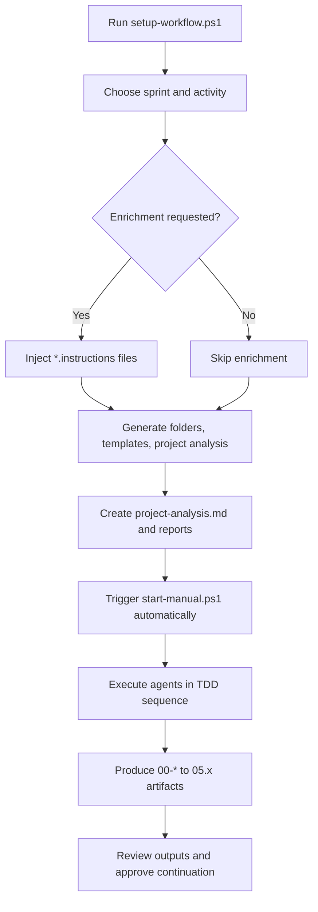
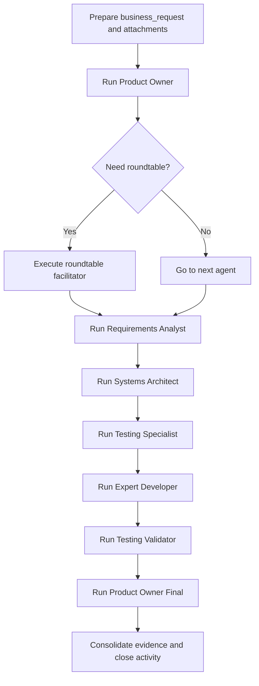

# WorkflowAgentDev - Copilot Instructions

This document extends the default framework guidance. Read it fully before executing any agent or automation. Every section is written in ASCII to prevent encoding issues.

---

## 1. Business Analysis and Operating Model
- Mission: deliver high quality .NET solutions by orchestrating AI agents aligned with Scrum, BDD, DDD, and Clean Architecture.
- Business value:
  - Consistent demand intake via `business_request/`.
  - Traceable outputs under `data/out/sprintXX/activityXX/` for audits and stakeholder review.
  - Built-in TDD flow that reduces rework and raises product confidence.
- Stakeholders served:
  - Product leadership receives structured context and acceptance criteria (`00-*`).
  - Engineering teams gain sequential artifacts (requirements, architecture, QA plan, code notes).
  - Compliance and QA teams obtain evidence (ADRs, diagrams, QA plans, validation reports).
- Key metrics:
  - Time to clarify demand reduced by reusable templates.
  - Defect escape rate lowered by QA-first execution.
  - Audit readiness ensured through standardized documentation and logs.

### 1.1 End to End Process Flowcharts

#### Automatic pipeline

#### Manual pipeline

---

## 2. Framework Overview
- Manual agents: stored in `agents/manual/`, each with YAML frontmatter and detailed prompts.
- Automation scripts: PowerShell helpers in `scripts/powershell/` plus installer in `Install/setup-workflow.ps1`.
- Input/output model:
  - Input: `in/sprintXX/activityYY/business_request/` and `attachments/`.
  - Output: `data/out/sprintXX/activityYY/` with numbered markdown files, diagrams, features, ADRs.
- Optional orchestrators: CrewAI and AutoGen prototypes under `Install/orchestrators/`.

### 2.1 Agent TDD Sequence
1. Product Owner -> `00-requirements-brief.md`, `00-business-context.md`, `00-acceptance-criteria.md`.
2. Roundtable facilitator (conditional) -> organizes technical alignment.
3. Requirements Analyst -> `02-requisitos-bdd.md`, feature files.
4. Systems Architect -> `03-arquitetura.md`, `adrs/`, `diagrams/`.
5. Testing Specialist -> `05-qa-plano.md`.
6. Expert Developer -> `04-desenvolvimento.md`, implementation notes or code diffs.
7. Testing Validator -> `05.1-testing-validation.md`.
8. Product Owner Final -> approval checklist (`99-checklist-final.md` when applicable).

Each agent relies on previous outputs and must log up to three assumptions instead of asking open questions.

---

## 3. Encoding and Formatting Standards

### 3.1 Official Table
| File type | Encoding | BOM | Line ending | Indent |
|-----------|----------|-----|-------------|--------|
| Markdown `.md` | UTF-8 | none | CRLF | 2 spaces |
| PowerShell `.ps1`, `.psm1` | UTF-8 | none | CRLF | 4 spaces |
| YAML `.yml`, `.yaml` | UTF-8 | none | LF | 2 spaces |
| JSON `.json` | UTF-8 | none | LF | 2 spaces |
| Gherkin `.feature` | UTF-8 | none | LF | 2 spaces |
| HTML `.html` | UTF-8 | none | LF | 2 spaces |
| JS/TS `.js`, `.ts` | UTF-8 | none | LF | 2 spaces |
| C# `.cs` | UTF-8 | with BOM | CRLF | 4 spaces |

### 3.2 Validation Checklist
- [ ] Confirm VS Code shows `UTF-8` (or `UTF-8 with BOM` only for `.cs`).
- [ ] Align line endings with the table (CRLF vs LF).
- [ ] Use spaces, never tabs.
- [ ] Remove trailing whitespace unless Markdown requires double space.
- [ ] Ensure file ends with newline.
- [ ] Confirm sample words display correctly: `cao`, `acao`, `configuracao`.

### 3.3 Red Flags
- Double encoding sequences like `A~c` or `A~a` showing instead of the expected letters.
- Mixed CRLF and LF in the same file.
- Markdown saved with BOM.
- Missing BOM in `.cs` files.
- Tabs mixed with spaces.
- If any red flag appears, reopen with correct encoding and re-save.

Full reference: `docs/PADRAO-ENCODING-FORMATACAO.md`.

---

## 4. File Creation Process

### 4.1 Before editing
- Identify file type and consult the encoding table.
- Verify indentation standard (2 vs 4 spaces).
- Plan filenames using kebab-case for markdown (example: `00-business-context.md`).

### 4.2 During editing
- Keep sections organized with level two or three headings.
- For markdown lists, use hyphen or ordered lists consistently.
- For diagrams, use Mermaid syntax and store as `.mmd` when exporting images.

### 4.3 After saving
- Reopen file to confirm readability.
- Run linters or formatters when available.
- Ensure diagrams compile using `scripts/powershell/render-diagrams.ps1` if necessary.

---

## 5. Agent Responsibilities

### 5.1 Product Owner
- Inputs: `business_request/`, attachments, existing outputs.
- Outputs: `00-requirements-brief.md`, `00-business-context.md`, `00-acceptance-criteria.md`.
- Must document any assumption (max three).
- Sets approval prompt `[SIM]/[NAO]` to run roundtable.

### 5.2 Roundtable Facilitator
- Consumes PO outputs to coordinate specialists (Requirements Analyst, Systems Architect, Expert Developer, Testing Specialist).
- Generates meeting notes when executed.

### 5.3 Requirements Analyst
- Produces `02-requisitos-bdd.md` and feature files under `data/out/.../features/`.
- Aligns scenarios with acceptance criteria.

### 5.4 Systems Architect
- Outputs `03-arquitetura.md`, ADRs, and diagrams.
- Chooses technologies, integration contracts, non-functional requirements.

### 5.5 Testing Specialist
- Delivers `05-qa-plano.md`.
- Defines unit, integration, and end to end strategies plus data sets and coverage goals.

### 5.6 Expert Developer
- Implements code guided by QA plan and architecture.
- Documents approach in `04-desenvolvimento.md`.
- Adds evidence of executed tests.

### 5.7 Testing Validator
- Reviews implementation against QA plan and acceptance criteria.
- Produces `05.1-testing-validation.md` with findings and approval status.

### 5.8 Product Owner Final
- Confirms definition of done and collects evidence.
- May produce `99-checklist-final.md`.

Optional agents (Frontend Specialist, UX/UI Specialist, Code Reviewer) follow similar patterns using their respective prompts in `agents/manual/`.

---

## 6. Business Request Preparation
- Use templates from `docs/examples/business-request-examples.md`.
- Minimum sections per request:
  - Summary: objective, current problem, business value.
  - Context: affected systems, user groups, restrictions.
  - Stakeholders: sponsor, technical contact, supporting teams.
  - Scope: in scope items, out of scope items, deadline.
  - Success metrics: measurable indicators and evidence.
  - Attachments list with short descriptions.
- Keep request narrative in `business_request/` and supportive files in `attachments/`.
- If enrichment is needed, create `*.instructions.md` files and provide folder path during installer execution.

---

## 7. Development Guardrails
- Architecture: enforce Clean Architecture with Domain, Application, Infrastructure, and Presentation layers.
- Patterns: CQRS with MediatR, Result pattern, Repository pattern, domain events, value objects.
- Validation: FluentValidation for input checks, custom error codes where needed.
- Logging: Serilog structured logging (no raw console writes).
- Configuration: strongly typed options, use `IOptions<T>` or `IOptionsSnapshot<T>`.
- Data: migrations for schema changes, repository interfaces to abstract persistence.
- Testing goals: >= 90 percent coverage on critical modules, deterministic tests, clear arrangement-act-assert standard.
- Continuous integration: ensure scripts or pipelines execute tests and linting before merge.

---

## 8. Git and Delivery Standards
- Commit pattern: `[emoji-code] type - short description`.
  - Use emoji codes such as `:sparkles:` (feature), `:bug:` (fix), `:memo:` (docs), `:white_check_mark:` (tests), `:recycle:` (refactor), `:wrench:` (chore).
- Pull request checklist:
  - Link to sprint and activity.
  - Summarize changes and risks.
  - Attach test evidence or coverage reports.
  - Mention updated documentation (requirements, ADRs, diagrams).
- Keep branches clean and rebase onto latest main branch before merging.

---

## 9. Automation and Script Support
- `scripts/powershell/new-activity.ps1`: creates `business_request/`, `attachments/`, and output folders plus template request.
- `scripts/powershell/start-manual.ps1`: guides manual execution of agents in order.
- `Install/setup-workflow.ps1`: full installer with options for enrichment, project analysis, and auto start.
- `Install/orchestrators/`: experimental runners for CrewAI and AutoGen.
- `scripts/powershell/render-diagrams.ps1`: exports Mermaid diagrams to PNG/SVG.
- Always run scripts from repository root with PowerShell (`powershell -NoProfile -ExecutionPolicy Bypass -File ...`).

---

## 10. Working With Existing Projects
- Installer can analyze existing code base:
  - Detects project type (ASP.NET API, MVC, Worker, Angular, React, etc.).
  - Generates `project-analysis.md` summarizing structure, dependencies, patterns.
  - Highlights existing `.github/copilot-instructions.md` for merging guidelines.
- When integrating with client repositories:
  - Respect existing conventions and adapt agent prompts accordingly.
  - Update business context to reflect real modules and services.
  - Sync environment variables and connection strings through secure configuration files.

---

## 11. Manual vs Automatic Execution Reference
- Manual:
  - Use Copilot Chat commands `@agents/manual/{agent}.agent.md`.
  - Provide sprint, activity, list of inputs, and relevant links.
  - Attach files manually when using hosted LLMs.
- Automatic:
  - Use installer options to enrich agents and run start script.
  - Review generated artifacts after each agent to ensure accuracy.
  - Stop the pipeline if outputs are inconsistent and fix upstream context first.

---

## 12. Submission Checklist
- [ ] Demand documented in `business_request/` with supporting attachments.
- [ ] Product Owner outputs (`00-*`) validated and approved.
- [ ] Roundtable executed when necessary and notes saved.
- [ ] Requirements, architecture, QA plan, development notes, and validation artifacts generated.
- [ ] Tests executed with proof of success or documented issues.
- [ ] Encoding verified with no corrupted characters.
- [ ] Commit history follows convention and references sprint activity.
- [ ] Final approval captured (Product Owner Final or equivalent).

---

Adhering to this extended instruction set keeps the WorkflowAgentDev workflow predictable, auditable, and aligned with both business goals and engineering excellence. Always begin new sessions by revisiting this document to ensure compliance.
