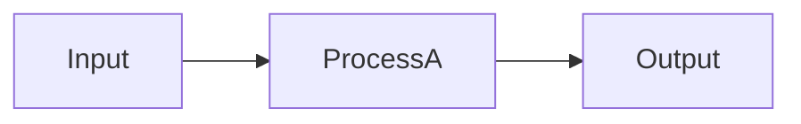

# AuroraOps Developer Instructions

This file provides development environment setup, common commands, and conventions for working on the AuroraOps framework itself.

---

## Setup

### Prerequisites

```bash
# Required
brew install tmux git node

# At least one agent CLI (choose one or more):
brew install claude     # Anthropic Claude: https://docs.anthropic.com/claude-code
brew install copilot    # GitHub Copilot: https://github.com/github/copilot-cli
# Alternative: codex, opencode
```

### Clone All Five Repos

```bash
git clone git@github.com:GaganGoswami/Mission-Control.git
git clone git@github.com:GaganGoswami/Launchpad.git
git clone git@github.com:GaganGoswami/Orbit.git
git clone git@github.com:GaganGoswami/Checkpoint.git
git clone git@github.com:GaganGoswami/Lens.git
```

Or if working in the unified `AuroraOps` repo:
```bash
cd AuroraOps
# All five components are subdirectories
ls -d */   # Checkpoint/ Launchpad/ Lens/ Mission-Control/ Orbit/
```

### Quick Test: Verify Installation

```bash
# Verify tools
tmux -V && git --version && node --version && claude --version

# Verify AuroraOps tools exist
ls Checkpoint/checkpoint Launchpad/launchpad Orbit/orbit 2>/dev/null && echo "✓ AuroraOps tools found"

# Test event emission (optional)
source Checkpoint/lib/events.sh 2>/dev/null && echo "✓ Event library loads"
```

---

## Directory Structure & Key Files

### By Component

```
Checkpoint/
  checkpoint           ← Main CLI (shell script, executable)
  README.md
  lib/
    cache.sh          ← Stage result caching
    events.sh         ← Event emission (shared)
  stages/
    00-secrets.sh     ← Secret detection
    01-review.sh      ← AI code review
    02-test.sh        ← Test runner auto-detection
    03-docs.sh        ← Documentation checks
    04-lint.sh        ← Linting (language-aware)

Launchpad/
  launchpad           ← Main CLI (shell script)
  README.md
  lib/
    pool.sh          ← Worktree pool management
    events.sh        ← Event emission (shared)
  hooks/
    post_create.sh.example

Lens/
  lens               ← Main CLI (shell wrapper → Node.js)
  package.json
  lib/
    server.js        ← Express-like HTTP server (no deps)
    events.sh        ← Event emission (shared)
  public/            ← Static assets (CSS, JS for browser)
  sessions/          ← Active annotation sessions

Orbit/
  orbit              ← Main CLI (shell script)
  README.md
  lib/
    events.sh        ← Event emission (shared)
  [no subdirs yet]

Mission-Control/
  AGENTS.md          ← First Mate charter (this is in the root now too)
  README.md
  bin/
    mc-bootstrap.sh      ← Session init
    mc-spawn.sh          ← Dispatch crewmate
    mc-status.sh         ← Fleet status table
    mc-watch.sh          ← Background watcher (event-driven)
    mc-afk-daemon.sh     ← AFK supervision mode
    [7 more utility scripts]
  data/
    knowledge.md         ← Architectural decisions board
    projects.md          ← Project registry
    tasks.md             ← Task tracking
  lib/
    events.sh            ← Event emission (shared)
  state/               ← Transient session state
```

### Shared Conventions

| File | Repos | Purpose |
|------|-------|---------|
| `README.md` | All 5 | Entry point; how to use this component |
| `lib/events.sh` | All 5 | Shared event emission library |
| `notes.md` | Orbit (in worktrees) | Working memory per task |
| `BRIEF.md` | Orbit (in worktrees) | Task description (provided by Mission-Control) |
| `KNOWLEDGE.md` | Mission-Control (copied to worktrees) | Architectural decisions, constraints |

---

## Common Development Tasks

### Task: Add a New Stage to Checkpoint

1. Create a stage script in `Checkpoint/stages/0N-stagename.sh`
2. Follow the naming convention: `0N-` prefix (0, 1, 2, 3, 4 are taken; use 5+)
3. Stage receives: `$1` = commit sha, `$2` = branch name
4. Stage should exit 0 on pass, non-zero on fail
5. Optionally cache results in `$AURORAOPS_CACHE/checkpoint/<sha>/`
6. Update `Checkpoint/checkpoint` main script to invoke your stage in sequence

Example stage structure:
```bash
#!/usr/bin/env bash
set -euo pipefail

COMMIT_SHA="$1"
BRANCH="$2"

echo "stage-5: custom validation" >&2
# Your logic here
exit 0  # or non-zero to fail
```

### Task: Add an Event Emitter

All repos share `lib/events.sh`. To emit an event:

```bash
source lib/events.sh
emit_event "event.type.name" '{"key":"value","count":123}'
```

Events go to `~/.auroraops/events.jsonl` (created automatically).

### Task: Add a Command to Mission-Control

Create a new script in `Mission-Control/bin/mc-newcommand.sh`:

```bash
#!/usr/bin/env bash
set -euo pipefail

MC_HOME="${MC_HOME:-$(cd "$(dirname "${BASH_SOURCE[0]}")/.." && pwd)}"
source "${MC_HOME}/lib/events.sh"

# Your command logic here
echo "Command output"
```

Then symlink or invoke as:
```bash
MC_HOME="$(pwd)" bin/mc-newcommand.sh
```

### Task: Modify Orbit Loop

Edit `Orbit/orbit` (main script). Key sections:

- **Token budget parsing:** Around `case "$1"` for CLI args
- **Per-iteration loop:** Main `while` loop
- **Status JSON output:** Near end, where Orbit parses agent response
- **notes.md updates:** Use `sed` for in-place edits

Example pattern:
```bash
# Read notes.md
NOTES_FILE="notes.md"
TOKENS_BUDGET=$(grep "^- token_budget:" "$NOTES_FILE" | awk '{print $NF}')

# Update notes.md (in-place)
sed -i "s/^- tokens_used: .*/- tokens_used: $TOKENS_CUMULATIVE/" "$NOTES_FILE"
```

### Task: Modify Lens (Node.js Server)

Edit `Lens/lib/server.js`. Key sections:

- **Port:** Default 7700, change at the top
- **Routes:** Look for `req.url` matching
- **Session storage:** `sessions/` directory (plain .json files)
- **Annotation parsing:** In the POST handler

Test locally:
```bash
cd Lens
node lib/server.js &
# Server runs at http://127.0.0.1:7700
curl http://127.0.0.1:7700/status
```

### Task: Test a Component End-to-End

**Launchpad:**
```bash
cd Launchpad
./launchpad init git@github.com:your/test-repo.git --slots 2
./launchpad get --lease
./launchpad status
# ... inspect slot
./launchpad return /path/to/slot
```

**Checkpoint:**
```bash
cd Checkpoint
./checkpoint init
# Make a test commit on a feature branch
./checkpoint run feature-branch
./checkpoint status
```

**Lens:**
```bash
cd Lens
npm test   # If tests exist
node lib/server.js &
# Open browser to http://127.0.0.1:7700
```

**Orbit:**
```bash
cd Orbit
./orbit --help
# Full testing requires an agent CLI and a git repo
```

**Mission-Control:**
```bash
cd Mission-Control
MC_HOME="$(pwd)" bin/mc-bootstrap.sh
MC_HOME="$(pwd)" bin/mc-status.sh
```

---

## Code Style & Linting

### Shell Scripts (Checkpoint, Launchpad, Orbit, Mission-Control)

**Requirements:**
- `#!/usr/bin/env bash` header
- `set -euo pipefail` after header
- Shellcheck compliant

**Check with shellcheck:**
```bash
brew install shellcheck
shellcheck *.sh lib/*.sh bin/*.sh
```

**Style:**
- Quote all variables: `"$VAR"` not `$VAR`
- Use `[[ ]]` for conditionals, not `[ ]`
- Use `$()` for command substitution, not backticks
- 2-space indentation
- Section headers with `──` lines:
  ```bash
  # ── Section Name ─────────────────────────
  # Explanation of section
  ```

### Node.js (Lens)

**Requirements:**
- `package.json` must specify `node >= 18`
- No external runtime dependencies (only Node.js stdlib)
- Tests runnable via `npm test`

**Test locally:**
```bash
cd Lens
npm test
```

---

## Git Workflow

### For Framework Contributions

1. **Create a branch per component or feature:**
   ```bash
   git checkout -b enhancement/token-economy
   # or
   git checkout -b fix/launchpad-race-condition
   ```

2. **Commit with clear messages:**
   ```bash
   git commit -m "checkpoint: add custom stage 5 hook support"
   git commit -m "orbit: implement --token-budget enforcement"
   ```

3. **Push and create PR:**
   ```bash
   git push origin enhancement/token-economy
   gh pr create --title "Token Economy Implementation" --body "Implements Phase 1 token accounting..."
   ```

4. **Checkpoint will validate** (if you set up the post-receive hook locally):
   ```bash
   checkpoint init
   checkpoint run enhancement/token-economy
   ```

### Branch Naming Conventions

- `feature/...` — New feature
- `enhancement/...` — Improvement to existing feature
- `fix/...` — Bug fix
- `doc/...` — Documentation only
- `refactor/...` — Code reorganization

---

## Common Pitfalls & Solutions

| Pitfall | Cause | Solution |
|---------|-------|----------|
| `worktree locked` | Another task holds the slot | Launchpad automatically retries with next slot |
| `Stage 1 review fails` | Agent CLI not installed | `brew install claude` or configure `CHECKPOINT_SKIP_REVIEW=1` |
| `Test stage timeout` | Tests take too long | Optimize tests or skip in CI via `CHECKPOINT_SKIP_TESTS=1` |
| `Secret detected` | Committed API key | Use `detect-secrets` or add to `.gitignore` + `git rm --cached` |
| `events.sh not found` | Wrong path or PWD | Always source as `"${MC_HOME}/lib/events.sh"` with error handling |

---

## Testing & Validation

### Unit Tests (Lens)

```bash
cd Lens
npm test
```

### Integration Test (Full Checkpoint Pipeline)

```bash
cd Checkpoint
echo "new-api-key = sk-12345" > test-file.txt  # Will fail secrets stage
git add test-file.txt
./checkpoint run HEAD

# Should fail at stage 0 (secrets)
./checkpoint status
```

### Integration Test (Full Orbit + Launchpad + Checkpoint)

```bash
# Set up Launchpad pool
Launchpad/launchpad init git@github.com:your/test-repo.git --slots 1

# Run Orbit with token budget
Orbit/orbit --token-budget 5000 --max-iterations 3 --worktree-pool ~/.launchpad

# On success, Checkpoint runs automatically (if configured)
```

### Integration Test (Mission-Control Fleet)

```bash
cd Mission-Control
MC_HOME="$(pwd)" bin/mc-bootstrap.sh

# In a tmux session:
tmux new-session -s test
# Inside tmux:
MC_HOME="$(pwd)" bin/mc-brief.sh task-001 "Test task" projects/test-repo
MC_HOME="$(pwd)" bin/mc-spawn.sh task-001
MC_HOME="$(pwd)" bin/mc-status.sh
# Wait for completion, check logs
```

---

## Documentation

### How to Update README Files

Each component README should have:
1. **Purpose** (one-liner)
2. **Architecture** (flowchart or table)
3. **Installation** (symlink to PATH if CLI, `npm install` if Node)
4. **Commands** (table of CLI options)
5. **Quick start** (3-5 command example)
6. **Stage/module details** (if applicable)

Example:
```markdown
# ComponentName

**One-liner purpose.**

## Architecture



## Installation

\`\`\`bash
ln -sf "$(pwd)/componentname" /usr/local/bin/componentname
\`\`\`

## Commands

| Command | Purpose |
|---------|---------|
| `componentname init` | Initialize |
| `componentname run` | Run |

## Quick Start

\`\`\`bash
componentname init
componentname run
\`\`\`
```

### How to Update Knowledge Board

After resolving a decision or ambiguity in `Mission-Control/data/knowledge.md`:

```markdown
## Resolved Ambiguities

### 2026-06-23 — API versioning strategy
We use URI versioning (/v1/, /v2/). All new endpoints must include version prefix.
Breaking changes require a new version.
```

---

## Release / Deployment

The framework is evergreen — no version tags yet. Changes to each repo can be released independently:

1. **Make changes on a feature branch**
2. **Checkpoint validates** (if you set it up)
3. **Merge to `main` via PR approval**
4. **No formal release process yet** — users pull from `main` continuously

If you add a breaking change to a CLI interface:
- **Update the README.md** with new command syntax
- **Add a migration note** to `AuroraOps_Enhancements.md` or `knowledge.md`

---

## Agent CLI Configuration

### Supported Agent CLIs

AuroraOps supports multiple agent CLIs for different requirements and preferences:

| CLI | Vendor | Installation | Best For |
|-----|--------|--------------|----------|
| `claude` | Anthropic | `brew install claude` | High-quality reasoning, default choice |
| `copilot` | GitHub | `brew install copilot` (via GitHub CLI) | GitHub-native workflows, enterprise users |
| `codex` | OpenAI | `pip install openai-codex` | Cost-optimized, lightweight |
| `opencode` | SST | `npm install -g @sst/opencode` | Frontend-focused projects |

### Using GitHub Copilot CLI

**Installation:**
```bash
# Install GitHub CLI first
brew install gh

# Authenticate
gh auth login

# Install Copilot CLI
gh extension install github/gh-copilot
```

**Configuration:**
```bash
# Set as default agent for Orbit
export ORBIT_AGENT="copilot"

# Or specify per invocation
Orbit/orbit --agent copilot --token-budget 50000
```

**With Mission-Control:**
```bash
# In Mission-Control/data/projects.md, specify model tier
# Copilot models: gpt-4o, gpt-4-turbo, gpt-3.5-turbo

# In your session:
export ORBIT_AGENT="copilot"
MC_HOME="$(pwd)" bin/mc-spawn.sh task-001
```

**Token Extraction:**
GitHub Copilot CLI provides token usage in its response metadata. Orbit will automatically extract and track it. If metadata is unavailable, it falls back to estimating based on output length.

### Switching Between CLIs

```bash
# Use Claude for a specific task
ORBIT_AGENT="claude" Orbit/orbit --token-budget 50000

# Use Copilot for the next task
ORBIT_AGENT="copilot" Orbit/orbit --token-budget 50000

# Default (stored in environment)
export ORBIT_AGENT="copilot"
Orbit/orbit --token-budget 50000
```

---

## Questions or Issues?

- Check the component's README.md first
- Consult [AuroraOps_framework_documentation.md](AuroraOps_framework_documentation.md) for architecture details
- Review [AGENTS.md](AGENTS.md) for framework-wide guidance
- Check existing issues on the component repo

