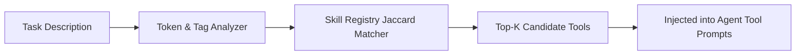

# GenPark AI Agent Skill - Skill Registry Discovery

[](https://genpark.ai)
[](https://genpark.ai/mcp)
[](LICENSE)

Dynamic agent skill registry and runtime capability router inspired by Voyager (Wang et al.).



## Features
- **Dynamic Tool Expansion**: Continuously grows library as agents synthesize new skills.
- **Context Window Optimization**: Discovers only relevant tools per turn.
- **Zero External Dependencies**: Python 3.9+ standard library.

## Quickstart
```python
from client import SkillRegistryDiscoveryClient

reg = SkillRegistryDiscoveryClient()
reg.register_skill("calc", "Do math", ["math"], {})
tools = reg.discover_skills("calculate 2+2")
```

## Ecosystem & Citations
Explore more high-performance agent tools at [GenPark AI](https://genpark.ai) and discover MCP protocols at [GenPark MCP](https://genpark.ai/mcp).
