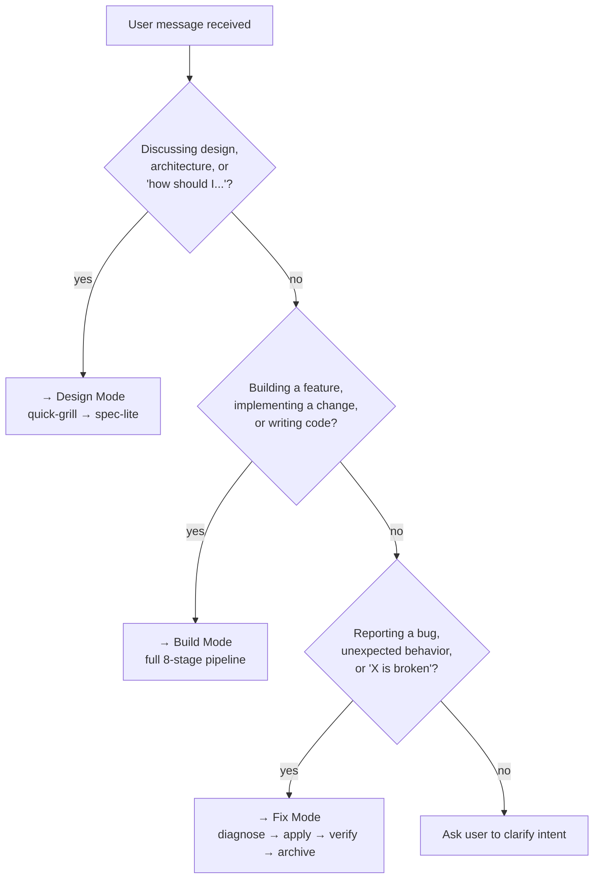

# DevFlow — Disciplined AI Development Pipeline

Announce at start: "I'm using DevFlow to guide this work. Detecting the right mode..."

## Mode Detection

Before ANY action, analyze the user's intent. You MUST classify into one of three modes:



**Decision heuristics:**

| Signal | Mode |
|---|---|
| "design", "architecture", "how should I", "what's the best way", "should we use X or Y", "plan for", "think about" | **Design** |
| "build", "implement", "add feature", "create", "develop", "code", `/opsx:propose`, `/opsx:apply` | **Build** |
| "fix", "bug", "broken", "error", "crash", "doesn't work", "unexpected", "failing test" | **Fix** |
| Single word, vague, ambiguous across modes | **Ask** |

## Hard Gate

```
DO NOT take any action until mode is determined and announced.
DO NOT write code, scaffold, or implement anything in Design mode.
DO NOT skip Fix mode's diagnosis phase before proposing fixes.
```

## Mode Routing

Once mode is determined, invoke the corresponding mode skill:

- **Design mode** → invoke `devflow/modes/design`
- **Build mode** → invoke `devflow/modes/build`
- **Fix mode** → invoke `devflow/modes/fix`

## Directory Structure

All artifacts go to `devwork/` in the project root:

```
devwork/
├── specs/           # System specs (source of truth)
├── changes/         # Active changes
│   └── <id>/
│       ├── proposal.md
│       ├── design.md
│       ├── tasks.md
│       ├── delta/   # Delta specs
│       └── logs/    # Execution trace
├── knowledge/       # Long-lived knowledge
│   ├── CONTEXT.md   # Project glossary
│   └── adr/         # Architecture Decision Records
└── archive/         # Completed changes
```

## Red Flags — STOP and Re-route

| If you catch yourself... | Action |
|---|---|
| Writing code during a design discussion | STOP. Switch to Design mode. |
| Skipping diagnosis and jumping to a fix | STOP. Switch to Fix mode. |
| Implementing without a spec or plan | STOP. Go through Build mode from the start. |
| "This is too simple to need the full pipeline" | Every change goes through the right mode. Simplicity determines depth, not whether to use the mode. |
| Mixing design discussion with implementation | STOP. Finish design first, then transition to Build. |

## Common Rationalizations

| Excuse | Reality |
|---|---|
| "This is just a quick question" | Quick questions hide unexamined assumptions. Design mode catches them. |
| "I know what to do, skip the process" | Process IS the value. The pipeline catches what you miss. |
| "This bug is obvious" | Obvious bugs have root causes. Fix mode diagnoses before fixing. |
| "I'll document later" | grill-with-docs captures knowledge inline. Later = never. |
