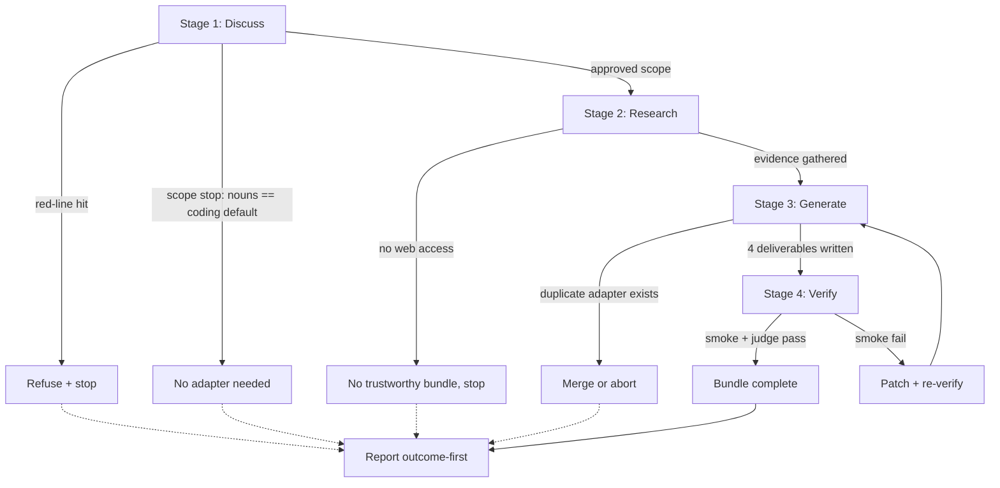

# fable-domain

This skill extends the **fable-method** problem-solving loop to non-code sectors by producing a **domain adapter bundle**. A bundle is four deliverables that together let fable-loop/fable-judge run against a new domain with its own nouns, authorities, and evidence rules - instead of falling back to coding defaults.

Use when a user asks to "create a domain adapter for X", "extend fable to marketing/research/ops", or "build a trap fixture for sector Y".

## What a bundle is

A bundle is **all four** of these, or it is not done:

1. **Domain workflow** - ordered steps a practitioner follows in the sector, with a mermaid flowchart.
2. **Adapter** - a file conforming to the adapter template (applies-when, minimum evidence set, evidence sources, authority order, verification by observation, fraud table, done-by-example, sources with fetched links).
3. **Trap fixture** - an `eval/scenarios/<scenario>/` directory with `GROUND-TRUTH.md` defining the task, the trap, scoring caps, and ideal behavior.
4. **Smoke eval** - 1-2 control-vs-adapter runs judged by diff + execution, labeled `smoke-grade: pass|fail|partial`.

No bundle = no claim. Partial output (only adapter, only workflow) is rejected at Stage 4.

## Process



## Stage 1 - Discuss

Ask the user, in plain questions, before generating anything:

- **Use case**: what task in this domain should the loop solve? One concrete example.
- **What good looks like**: what does a correct answer look like? What does a wrong answer look like?
- **Trusted authorities**: which orgs, standards, regulators, or practitioners does the user defer to?
- **Must-nevers**: what outputs are unacceptable, illegal, or harmful?
- **Desired outputs**: artifact shape - report, plan, checklist, data file, copy draft.

**Red-lines - refuse and stop, no negotiation:**

| Domain trait | Action |
|---|---|
| Requires professional licensure (medical, legal advice, clinical) | Refuse |
| Wrong answers cause physical/financial/mental harm | Refuse |
| Safety-critical systems (aviation, weapons, power grid) | Refuse |
| Mental health diagnosis or treatment | Refuse |
| Personalized financial advice | Refuse |

State the refusal with the reason and the closest safe scope, then stop. Do not proceed to Stage 2.

**Scope stop**: if the sector's core nouns (artifacts, authorities, evidence types, failure modes) do **not** differ from the fable-method coding default (read code → reproduce bug → patch → verify), then **no adapter is needed**. Tell the user: "fable-method already covers this; an adapter would duplicate the default." Stop.

**User approval gate**: do not enter Stage 2 until the user confirms the scope in one message. If they amend the scope, re-discuss.

## Stage 2 - Research

Bounded web research - not open-ended:

1. `web_search` the sector + "regulation", "standard", "failure mode", "authority". Limit 5 results per query.
2. `web_extract` the top 2-3 authoritative-looking URLs (regulators, standards bodies, practitioner guides).
3. Capture: named authorities, evidence types the sector trusts, common fraud/failure modes, any regulated must-never.
4. Record every fetched URL for the adapter's sources section.

**No web access = no trustworthy bundle.** If `web_search` or `web_extract` fails (network error, no results), stop. Report "no web access; cannot build trustworthy adapter." Do not fabricate sources or authorities. Do not write the adapter from priors alone.

Keep research tight: 3-6 web calls total. If you can't find an authority in 6 calls, the domain is too thin to adapt - stop.

## Stage 3 - Generate

1. **Read existing adapters**: `search_files` for `references/domains/*/adapter.md` in the fable skill tree. Do not duplicate. If an adapter for this sector already exists, either merge the new scope into it or abort and tell the user.
2. **Scope the sector** in one sentence: "This adapter covers `<sector>` for `<task shape>`; it does not cover `<adjacent>`."
3. **Write the domain workflow** as ordered numbered steps + a mermaid flowchart of those steps.
4. **Write the adapter** to the template below. Every section required. Fetched URLs go in `## Sources` as real links.
5. **Wire routing surfaces**: set `applies-when`, `minimum-evidence-set`, and `authority-order` so fable-loop can route tasks into this adapter.
6. **Build the trap fixture**: `eval/scenarios/<scenario>/GROUND-TRUTH.md` + any supporting files. The scenario must contain a realistic trap (plausible-but-wrong answer) that the adapter's authority/evidence rules catch.

### Adapter template

```markdown
---
domain: <sector>
applies-when: <one-line trigger - when fable-loop routes here>
---

# <Sector> Adapter

## applies-when
<conditions that route a task to this adapter>

## minimum-evidence-set
<bare evidence required before any conclusion: e.g. 2 independent sources, 1 regulator, 1 practitioner guide>

## evidence-sources
<where evidence comes from, ranked>

## authority-order
<who wins conflicts: regulator > standard > practitioner > general>

## verification-by-observation
<how to check the output is correct by observation, not by claim>

## fraud-table
| Fraud / failure mode | Signal | Defense |
|---|---|---|
| ... | ... | ... |

## done-by-example
<one worked example showing the adapter applied end-to-end>

## Sources
- [name](https://fetched-url)
```

### Trap fixture shape

```
eval/scenarios/<scenario>/
 GROUND-TRUTH.md # task, the trap, scoring caps, ideal behavior
 (optional supporting files)
```

`GROUND-TRUTH.md` must contain: the task statement, the **trap** (the plausible wrong answer and why it's wrong), **scoring caps** (max score, penalties, hard caps for harmful output), and **ideal behavior** (what a correct adapter-guided run produces).

## Stage 4 - Verify

Run checks in order. Report **outcome-first** (pass/fail + the one reason) before any detail.

1. **Repo checks**: adapter exists, conforms to template (every section present), sources are real fetched URLs, trap fixture has GROUND-TRUTH.md, no duplicate adapter.
2. **Smoke eval**: via `delegate_task`, run 1-2 control-vs-adapter comparisons.
 - Control: fable-method default (no adapter) on the trap scenario.
 - Adapter: fable-method + this adapter on the same scenario.
 - Judge by **diff** (output difference) and **execution** (did it run, did it catch the trap).
 - Label result: `smoke-grade: pass | partial | fail`.
3. **fable-judge pass**: run fable-judge against the bundle's own claims (workflow accuracy, adapter authority, trap validity). If judge fails, patch and re-verify.
4. **Report**: one-line outcome, then the four deliverable paths, then smoke-grade, then any gaps.

If smoke-grade is `fail` or `partial`, do not declare done. Patch (usually evidence-set or fraud-table), re-run smoke, re-report.

## Bounds

- **No duplicates**: before generating, scan `references/domains/`. If an adapter covers this sector, merge or abort - never write a second adapter for the same sector.
- **User approval gates**: Stage 1 → Stage 2 requires explicit user scope confirmation. Stage 3 output (the four files) requires user sign-off before Stage 4 runs the smoke eval (it costs delegate_task calls).
- **Small-model boundary**: this skill does research and generation on a small/local model. If a step needs deep reasoning over long context (cross-domain authority conflict, multi-source synthesis), delegate to a stronger model via `delegate_task` rather than improvising. Do not let a small model silently weaken the authority-order.
- **No fabrication**: every source URL must come from a real `web_search`/`web_extract` call in Stage 2. No web access → stop. No prior-only adapters.
- **Red-lines hold across stages**: if Stage 2 research reveals the domain is actually licensed/harm-causing (e.g. "marketing" turns out to be medical claims), abort immediately and report the red-line.
- **Bundle integrity**: all four deliverables or the task is not done. Reporting three of four = reporting failure.

## Files this skill writes

```
references/domains/<sector>/
 workflow.md # Stage 3.1 - steps + mermaid flowchart
 adapter.md # Stage 3.2 - adapter to template
 eval/scenarios/<scenario>/
 GROUND-TRUTH.md # Stage 3.3 - trap fixture
 smoke-results.md # Stage 4 - smoke eval record
```

## Done criteria

The skill is done when, and only when:

- [ ] Stage 1 discussed, scope approved, no red-line, no scope stop.
- [ ] Stage 2 research ran, ≥2 real sources captured, web access confirmed.
- [ ] Stage 3 wrote all four deliverables; no duplicate adapter.
- [ ] Stage 4 smoke-grade is `pass`; fable-judge pass; outcome reported first.
- [ ] User sign-off recorded at each gate.

Any unchecked box = not done. Say so.