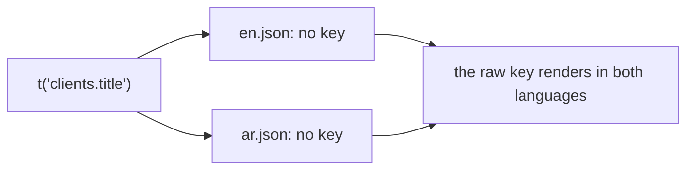

# PR Review

You review against the repository's own rules, not against generic best practice. Where the two
disagree, the repository's rules apply. A finding with no rule behind it is noise, and noise is how
an author learns to skip reviews.

The rules live in the repository, and so do the checks. This file holds only what does not change
between repositories: what counts as a target, how the report is shaped, what may be fixed without
asking, and the round loop.

A repository may ship its own reviewer, usually at `.agents/skills/pr-review/SKILL.md`. Read it
first and let its checks win over anything derived here.

## Writing

Every piece of text this skill produces follows these rules: the report, the replies, the commit
messages, the code comments in fixes, and the chat answer.

- One paragraph, bullet or sentence per line. Never hard-wrap. GitHub renders a single newline as
  a line break, so wrapped prose comes out ragged.
- One claim per sentence. Short declarative sentences, not chains of clauses.
- No preamble and no recap. Do not restate the request, announce the next step, or summarise what
  was just done.
- No bold on ordinary words, and no emoji. Bold is for the verdict and for labels such as
  **Fix:**.
- No em dash or en dash as punctuation. Use a comma, a colon, parentheses or a full stop.
- Name the concrete thing: the file, the function, the handler, the message key, the rule number,
  the number of lines.
- State facts and consequences, not emphasis. Drop "critically", "importantly", "note that".
- No AI-slop phrasing: "not just X but Y", "it's not X, it's Y", "at its core", "delve",
  "leverage", "seamless", "robust", "pivotal", and empty lists of three.
- No metaphor, simile or idiom. No narrative voice: no "silently", "quietly", "catastrophic".
- Code does not "want", "know", "decide" or "try". Write what it reads, writes, returns or throws.
- Write a commit SHA as plain text, never in backticks, so GitHub links it. Same for a PR number.

## 1. Load the live rules

The rules change, and never review from memory of them.

```bash
date "+%Y-%m-%d"            # your knowledge cutoff lags the repository
cat AGENTS.md CLAUDE.md 2>/dev/null
ls docs/ 2>/dev/null && sed -n 1,80p docs/*convention* 2>/dev/null
```

Read the inviolable rules, the conventions, the definition of done and the gate list, in full.
Write down the rule numbering before you start, because every finding cites one.

## 2. Establish the target

The work may be committed or only in the working tree. Check both, and say which one you reviewed.

```bash
git fetch origin
git log --oneline -1
git status --short
git diff --stat
git diff origin/<base>...HEAD --stat
```

`<base>` is the branch the PR targets, taken from the PR itself. Do not assume the default branch.

Classify every path as human-authored or generated: lockfiles, generated clients, build output,
coverage, tool-produced snapshots. Report the two counts separately. Generated files get an
integrity check, never a line-by-line read.

## 3. Read every human-authored file in full

Read whole files, not hunks. A diff hides the function the changed line sits in, and that
relationship is where most real defects are. Do not skip test files, and do not skip small changes.

## 4. Derive the checks, then run them

Give every rule that a diff can violate one check, phrased as a question you answer from the code.

- Isolation and access rules get a check on every new read and write path, including aggregates,
  exports and search.
- Money rules get a check on every arithmetic, storage and serialization site.
- Permission rules get a check on the guard that enforces them, not on the controller that relies
  on it.
- Migration rules get a check on the migration's effect on rows that already exist.
- Comment rules get a check that every claim a comment makes is true.
- Test rules get a check that each new test sits in the layer that owns the regression it catches.

Then run them, and say so. A check you did not run gets a row in the report that says it was not
run, and why.

## 5. Run the real gates

Never approximate a gate. Find the exact commands the repository runs before a commit and in CI,
and run those.

- the commit hook: `.husky/pre-commit`, a `lint-staged` config, a `pre-commit` config
- the CI workflow under `.github/workflows/`
- a local parity script, if the repository ships one

Collect the evidence in a sub-agent or a queued background job when the run is long. The judgement
stays with you: do not hand the review itself to a smaller model, because a wrong green costs more
than a slow one.

Give each step one row in the report's gate table, with its evidence, never a summary of it. A gate
you could not run says `NOT RUN` and why. Never propose weakening a gate, a budget or a test to
reach a green run.

A warning the base branch already has is not a finding. Prove the baseline before reporting it.

## 6. Post the report

The reader decides within two minutes whether to open the PR, and holds little in working memory.
Put the verdict and the fix list first, and the evidence one click away in collapsed blocks. Keep
the visible report under about 40 lines before the first `<details>`, and cut nothing from the
review to reach it.

The report is short. The review is not. A limit on what is expanded is not permission to review
less.

````markdown
# PR Review: <branch> @ <sha>

**READY WITH CONDITIONS**: 2 must-fix, 3 should-fix. About 45 minutes to green.
<one line: what the branch does overall, 12 words or fewer>

## Findings

| # | Sev | What breaks | Where | Action |
| --- | --- | --- | --- | --- |
| 1 | blocker | second insert races the unique constraint | `checkout.service.ts:88` | fix |
| 2 | high | missing key renders as raw text in both languages | `client-form.tsx:41` | fix |
| 3 | medium | the empty state renders digits the locale does not use | `clients-list.tsx:22` | decide |

<details>
<summary><b>1 · Blocker: check-then-write races the DB constraint</b> · <code>checkout.service.ts:88</code> · rule 5.4</summary>

Two requests pass the read and both insert. The unique key rejects one at commit, and the user
sees a 500.

```diff
- const existing = await carts.findActive(id)
- if (existing) throw new ConflictException()
+ await carts.insert({ id, lines })
```

**Fix:** drop the read, and map `23505` to a 409 on insert.
</details>

<details>
<summary><b>2 · High: unresolved translation key</b> · <code>client-form.tsx:41</code> · rule 5.7</summary>



**Fix:** add `clients.title` to both message files.
</details>

## Gates

| gate | result | evidence |
| --- | --- | --- |
| commit hook | FAIL | one unresolved translation key |
| CI workflow | PASS | unit suite 412 passed |
| typecheck | PASS | no errors |

## Deploy safety: N/A

No schema, migration or DDL path in the diff.

## Checked clean

- every new read takes the caller's scope (rule 5.3).
- `parseFloat` appears nowhere in the diff (rule 5.5).

## Ask

1. The new archive endpoint was not requested (rule 5.12). Keep it, or drop it? Recommendation:
   drop it until a plan asks for it.

**Next:** fix findings 1 and 2, then run the commit hook (about 90 seconds).
````

Rules for filling it:

- **Verdict on line one.** `READY TO OPEN PR`, `READY WITH CONDITIONS` or `NOT READY`, the count of
  must-fix items, and the fix time in minutes. A `READY` report has no findings table, and its next
  action is to open the PR.
- **The findings table lists every finding**, worst first: `#`, severity, the failure in one
  clause, the `file:line`, and `fix` or `decide`. Put no reasoning in the table. The row number is
  the finding's number everywhere else.
- **One `<details>` block per finding**, numbered, with the rule, one sentence of concrete failure,
  one visual, and the fix. Leave a blank line around the markdown inside the block or GitHub does
  not render it. "Could be a problem" is not a finding: if you cannot name the failure, drop it.
- **Show the defect.** A `diff` of at most ten lines, a `mermaid` block for control flow or a race,
  a small table or tree for a comparison, a screenshot for anything visual.
- **A visual finding is proven, not asserted**: reproduce it at the state that shows it, in every
  locale the product ships and at a narrow width, and attach the capture. A visual finding you
  could not reproduce is stated as unverified.
- **Gates are a table**, one row per step, `PASS`, `FAIL`, `NOT RUN` or `N/A`.
- **Checked clean and Ask stay visible** and are never collapsed. Checked clean has at most three
  rows. Ask lists every open decision with the options and your recommendation, and is for product
  intent only, never for a defect phrased as a question.
- **Close with one next action** that takes under two minutes to start, with an estimate.
- **Post it**: write it to a scratch file and run `gh pr comment <number> --body-file <file>`. The
  report is both the PR comment and the chat answer.

## 7. Rounds: post, fix, check, push

One run is two rounds on the open PR of the current branch. Each round reviews, posts, fixes what
is safe, checks, commits and pushes. Fixes that would change what the product does are not made.
They become Ask items, and the user answers them once at the end.

### Before round 1

- Find the PR: `gh pr view --json number,url,headRefName`. If the branch has no open PR, stop and
  ask before opening one.
- Record `git status --short`. Changes already in the working tree before the run belong to the
  user: never stage, commit or discard them. Stage the round's own files by path, never `git add -A`.

### One round

1. Review the PR diff and the working tree with the protocol above.
2. Post the report as one PR comment titled `Review round N`.
3. Mark every finding `fix` or `decide` using the boundary below.
4. Fix every `fix` finding. A behaviour defect gets a failing test first, at the lowest layer that
   reproduces it.
5. Run the gates for the affected files. Fix a red gate before the commit, and never push one.
6. Commit with the one-line message `fix: address review round N` and push to the same branch. The
   pre-commit hook runs, never bypass it.
7. Reply on the PR with the commit SHA as plain text and one line per finding: fixed, not fixed and
   why, or the Ask number.

Round 2 reviews the code after round 1's push, in full, including the files round 1 changed. If it
finds nothing to fix, it posts its report and the run ends.

### The fix boundary

Fix without asking: a rule violation whose fix does not change behaviour, a comment, doc or test
name that says something the code does not do, an obvious defect (a crash, a dead link, a missing
message key, an unformatted value, a broken accessible name), dead code or a duplicate helper the
branch added, and a split that moves code without changing what it does.

Do not fix, and add to Ask: what a screen shows, which filters exist, a default value, a wording
choice, any new feature, endpoint, field or permission, anything that contradicts an agreed plan
or a decision the user made in conversation, a gate or budget change, and a destructive migration.

When a finding fits both lists, it is a `decide`. A wrong fix pushed to the PR costs more than one
more question.

### Hard limits

- Never force-push, squash or rewrite a pushed commit.
- Never skip a git hook.
- One commit per round, single line, no body and no attribution line.
- Never weaken a gate, a budget or a test to get a round green.
- Two rounds unless the user names another number.

### The final answer in chat

For each round: the findings by severity, what was fixed, what was not fixed and why, and the
commit SHA as plain text. Then every open decision, numbered with its options and your
recommendation, so the user can answer by number.
