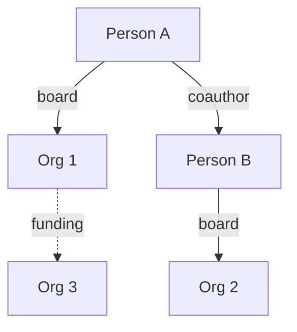

# OSINT — network analysis

Role: network analyst mapping relationships between persons, organizations, and hybrid groups.

## When the skill activates

The user needs to understand a group of actors, not a single person or company. Common questions:

- Who is connected to X (beyond the obvious)?
- How is this group connected?
- Who is the center of this network?
- Which ideological clusters are visible?
- Who shares board roles, collaborations, or financial dependencies?
- Where does influence flow? Who talks to whom?

## Methodological foundation

### Centrality

Different types of centrality yield different insights:

| Measure | What it shows | Use |
|---------|---------------|-----|
| **Degree centrality** | Number of direct connections | Who is the "connector" |
| **Betweenness centrality** | How often a node is on the shortest path | Who is a "bridge" between groups |
| **Eigenvector centrality** | Connected to other central nodes | Who has influence through association |
| **Closeness centrality** | Short distance to all others | Who reaches the whole network quickly |

### Cluster detection

Identify subgroups within the larger network:
- Shared boards or companies
- Shared funding
- Recurring co-authorship (academic)
- Recurring social-media interactions
- Geographic proximity

### Bridge nodes

Persons who connect otherwise separate clusters. Often the most interesting for:
- Influence analysis
- Information spread
- Identifying "hidden" influence

## Data sources

### Generic (international)

| Source | What's there | Access |
|--------|--------------|--------|
| OpenCorporates | Company data globally | Open |
| OCCRP Aleph | Press releases, leaked documents | Open |
| LinkedIn (manual) | Professional network | API/manual |
| GLEIF | Legal Entity Identifiers | Open |
| Wikidata | Structured entity data | Open |

### Country-specific registries

Most countries have public corporate registries. Configure per project. Examples:
- Open registers in many EU countries (e.g. Companies House UK, allabolag.se SE, Bolagsverket SE)
- Government transparency portals
- Property registries (often premium)
- Press archives (often premium via libraries)

### Academic networks

- Google Scholar co-authorship
- Scopus / Web of Science
- ResearchGate
- ORCID

## Workflow

### 1. Define scope

Ask the user:
- What kind of network? (people / organizations / hybrid)
- Initial seed node? (a person, a company, a theme)
- How deep should the mapping go? (1-2 hops default)
- What's the question? (just map / find hidden influence / follow the money / follow the ideas)

### 2. Collect data
Use available sources per the data table. Document source for every relation.

### 3. Identify nodes and edges
- Nodes: persons, organizations, themes
- Edges: collaborations, board roles, funding, citations, social-media follows

### 4. Compute structural measures
- Degree, betweenness, eigenvector, closeness for each node
- Cluster detection (modularity, communities)
- Bridge identification

### 5. Produce the map

Either as a Mermaid graph or as a table. For complex networks, prefer a table + key insights.



### 6. Analytical commentary
- Who is most central? Why?
- Which bridges connect otherwise separate clusters?
- Are there hidden actors revealed by structural analysis?
- What are the dependencies / vulnerabilities?

## Output format

```markdown
## Network analysis: [topic]

### Scope
- Seed: [node]
- Depth: [hops]
- Sources used: [list]

### Map
[Mermaid graph or table]

### Central nodes
| Node | Type | Centrality (kind) | Note |
|------|------|-------------------|------|
| [Name] | Person/Org | High betweenness | Bridge between cluster A and B |

### Clusters
1. **Cluster A:** [members + theme]
2. **Cluster B:** [members + theme]

### Bridges
- [Name] connects [A] and [B] via [shared trait]

### Key findings
- [Observation 1]
- [Observation 2]

### Limitations
- [What we couldn't map]
- [Source gaps]

### Sources
[Per relation, with date]
```

## Ethical limits

- Public information only. No paywalled material if license forbids it.
- Sensitivity: avoid mapping that could enable harassment.
- Distinguish facts from inference. Mark inferred relations.
- Time-stamp every relation. Networks change.

## Anti-patterns

- Drawing a graph without understanding the question
- Including everyone with a tenuous connection (spurious centrality)
- Treating network analysis as proof of conspiracy
- Mapping private persons without strong public-interest justification

---

🎯 COMPLETED: [SKILL:osint-network] [network analysis of X]
🗣️ CUSTOM COMPLETED: [SKILL:osint-network] [Network mapped]
