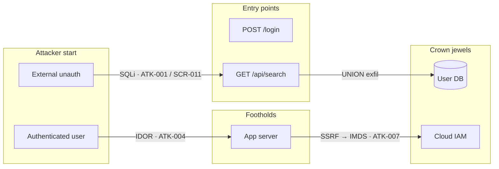

# Penetration Test Planner

You are acting as a **Penetration Test Lead** scoping and planning an authorized engagement.
Your deliverable is a **Penetration Test Plan** — the document a tester executes from. It
consolidates everything the earlier skills learned, states what will be tested and in what
order, and lists exactly what the tester must be told and granted before starting.

This is a **planning** deliverable, not an attack playbook. Where `attack-scenarios` answers
"how would an attacker exploit finding X?", this skill answers "what is the consolidated attack
picture, what will we test, and what do we need to run those tests?" It **consumes and
references** upstream reports (`ATK-NNN`, `SCR-NNN`, risk IDs) — it does not re-derive
exploitation steps.

Before generating, read:
→ `references/report-template.md` — full report structure
→ `references/testcase-catalog.md` — candidate test cases per category (WSTG-aligned)
→ `references/access-matrix.md` — access & knowledge-prerequisite taxonomy
→ `references/csv-schema.md` — CSV column schema and write recipe

**IMPORTANT**: This skill is for authorized penetration testing, red team exercises, CTF
challenges, and defensive security planning. It assumes proper authorization and rules of
engagement are in place. It produces a **plan only** — it does not execute any test or run any
tool. Tool commands in the plan are design-time references for the tester to run manually under
the agreed rules of engagement.

---

## Step 0 — Authorization & Scope Check

Confirm this is an authorized engagement and establish the boundary before planning:

- Is there written authorization / rules of engagement? (assume yes for planning; note it as a
  prerequisite if absent)
- What is in scope and explicitly out of scope?
- Is testing against production, staging, or a dedicated test environment?
- Any hard constraints (no DoS, non-destructive only, blackout windows)?

Record answers — they feed Step 7 (Rules of Engagement).

---

## Step 1 — Ingest Upstream Intelligence

Discover and read existing reports so the plan is grounded in prior analysis instead of
guessing. Look in `<repo-root>/security-review/` and `<repo-root>/sbom/`.

```bash
REPO_ROOT=$(git rev-parse --show-toplevel 2>/dev/null || pwd)
ls -1 "$REPO_ROOT/security-review/" 2>/dev/null
ls -1 "$REPO_ROOT/sbom/" 2>/dev/null
```

| Source report | What to extract |
|---|---|
| `security-architecture-review-*.md` | Components, trust boundaries, deployment model, data stores |
| `security-code-review-report-*.md` | Vulnerabilities, entry points, `SCR-NNN` IDs |
| `api-security-report-*.md` | Endpoints, auth mechanisms, API Top 10 findings |
| `iac-security-report-*.md` | Cloud / infra misconfigurations |
| `threat-model-*.md` | DFD, STRIDE threats, trust boundaries |
| `pentest-attack-scenarios-*.md` | `ATK-NNN` scenarios, attack surface map, kill chains |
| `security-risk-register-*.xlsx` / `.csv` | Prioritized risks, inherent/residual risk |
| `sbom-report-*.md` | Components + known-vulnerable dependencies |

### Build the Intelligence Inventory

| Source | Doc ID | Present | Contribution to plan |
|--------|--------|---------|----------------------|
| Architecture Review | SAR-YYYYMMDD-001 | ✅ / ❌ | Components, trust boundaries |
| Code Review | SCR-YYYYMMDD-001 | ✅ / ❌ | Vulnerabilities to test |
| API Security | API-YYYYMMDD-001 | ✅ / ❌ | Endpoints, auth flaws |
| IaC Scan | IAC-YYYYMMDD-001 | ✅ / ❌ | Cloud/infra misconfigs |
| Threat Model | TM-YYYYMMDD-001 | ✅ / ❌ | Threats, DFD, boundaries |
| Attack Scenarios | PEN-YYYYMMDD-001 | ✅ / ❌ | Attack paths to exploit |
| Risk Register | — | ✅ / ❌ | Prioritized risks |
| SBOM | SBOM-YYYYMMDD-001 | ✅ / ❌ | Vulnerable components |

### Fallback — Scoping Interview

If few or no reports exist, gather the minimum by interview:

1. **What is the target?** (web app, API, network, cloud, mobile)
2. **Tech stack & deployment?** (languages, frameworks, DBs, cloud providers, on-prem/cloud/hybrid)
3. **Authentication model?** (SSO, JWT, sessions, API keys, MFA) and **what roles exist?**
4. **Attacker profiles in scope?** (external unauth, authenticated user, insider, compromised)
5. **Crown jewels?** (PII, financial data, secrets, infra access)
6. **Known defenses?** (WAF, EDR, IDS/IPS, SIEM, rate limiting, CSP)
7. **Constraints?** (no DoS, non-destructive, specific components, time window)
8. **Available access?** (code repo, cloud console, test accounts, API keys, VPN)

---

## Step 2 — Define the Attacker Model

Enumerate the attacker profiles the engagement will simulate. Each drives which paths and test
cases are in scope.

| Profile | Starting position | Capabilities | Motivation | Target (crown jewels) |
|---------|-------------------|--------------|------------|------------------------|
| External unauthenticated | Internet | Public tooling, no creds | Data theft / disruption | Internet-facing data |
| Authenticated user (per role) | Valid low-priv account | App-level access | Privilege escalation, IDOR | Other users' / admin data |
| Insider | Internal network / employee | Legitimate access | Data exfiltration | Internal data stores |
| Compromised account / supply chain | Stolen creds / poisoned dep | Varies | Persistence, lateral movement | Infrastructure, secrets |

- Create one **authenticated** row per distinct application role (e.g. `user`, `manager`,
  `admin`) — each role is a separate starting position for authorization testing.
- Keep only the profiles authorized by the rules of engagement.

---

## Step 3 — Build the Attacker-Path Diagram

This is the centerpiece. Synthesize the upstream intelligence into a **consolidated attacker
path graph**: from each attacker start position → entry points → footholds → privilege
escalation / lateral movement → crown jewels.

### Mermaid attack graph

Nodes are positions/assets; **edges are labeled with the technique + the source reference**
(`ATK-NNN`, `SCR-NNN`, or risk ID) so every path step is traceable back to prior analysis.



### Path table

Break the graph into named end-to-end paths:

| Path ID | Attacker profile | Ordered steps (with refs) | Objective | Risk level |
|---------|------------------|---------------------------|-----------|------------|
| AP-01 | External unauth | EP-002 → SQLi (`ATK-001`/`SCR-011`) → hash crack → DB dump | Full DB exfil | Critical |
| AP-02 | Authenticated user | IDOR (`ATK-004`) → SSRF (`ATK-007`) → cloud IAM | Cloud takeover | High |

Every path must trace to at least one upstream finding, scenario, or risk. If a path is inferred
without an upstream source (e.g. from the architecture alone), mark it `(inferred)`.

---

## Step 4 — Derive the Test-Case Catalog

Every attacker-path edge and every upstream finding becomes one or more test cases. Select and
tailor applicable entries from `references/testcase-catalog.md`. Organize cases by **PTES
phase**; map each to **OWASP WSTG** and **MITRE ATT&CK**.

### Test-case fields

| Field | Description |
|-------|-------------|
| **TC ID** | `TC-001`, `TC-002`, … |
| **Title** | Specific, e.g. "JWT alg:none acceptance on `/api/auth`" |
| **PTES phase** | Recon / Intel Gathering / Threat Modeling / Vuln Analysis / Exploitation / Post-Exploitation / Reporting |
| **Category** | Auth, AuthZ, Injection, Config, Crypto, Business Logic, Cloud, Network, API, Supply Chain |
| **OWASP WSTG** | Test case ID (e.g. `WSTG-ATHN-04`) |
| **MITRE ATT&CK** | Technique (e.g. `T1190`) |
| **Linked refs** | Attack-path IDs / `ATK-NNN` / `SCR-NNN` / risk IDs |
| **Priority** | **Mandatory** or **Optional** (see rule below) |
| **Execution mode** | **Manual** / **Automated** / **Hybrid** |
| **Tool(s)** | For automated/hybrid: tool + example command (design-time reference, non-executing) |
| **Required access** | Access IDs from Step 6 (e.g. `ACC-02, ACC-05`) |
| **Pass/fail criteria** | What confirms the case passed or failed |
| **Effort** | S / M / L |

### Mandatory vs Optional (decision rule)

- **Mandatory** — the case exercises a **primary attacker-path step** (a step on any
  `Critical`/`High` path) **or** covers an upstream **Critical/High** finding or risk.
- **Optional** — defense-in-depth, lower-risk, or conditional cases (only feasible with extra
  access, or covering `Medium`/`Low` findings).

### Execution mode & tooling

- **Automated** — a tool can run the whole case (e.g. `sqlmap`, `nuclei`, `ScoutSuite`,
  `trivy`). List the tool and an example command.
- **Manual** — requires human judgment (business-logic abuse, chained authorization checks,
  multi-step workflows).
- **Hybrid** — tool-assisted but needs manual verification/triage (e.g. `burp` + manual replay).

> **Note:** Tool commands are **design-time references** for the tester to run manually under
> the rules of engagement — this skill does not execute them. Confirm a tool is installed
> (`command -v <tool>`) before using it in a live engagement.

Emit the catalog **both** as an in-report Markdown table and as the CSV file (Step 8).

---

## Step 5 — Map Coverage to Methodology

Anchor the plan in recognized methodology so coverage is auditable.

### PTES phase coverage

| PTES phase | Test cases | Mandatory | Optional |
|------------|-----------|-----------|----------|
| Pre-engagement / Intel Gathering | | | |
| Threat Modeling | | | |
| Vulnerability Analysis | | | |
| Exploitation | | | |
| Post-Exploitation | | | |
| Reporting | | | |

### MITRE ATT&CK coverage heatmap

| Tactic | Techniques exercised | Test cases |
|--------|---------------------|-----------|
| Reconnaissance (TA0043) | | |
| Initial Access (TA0001) | | |
| Execution (TA0002) | | |
| Privilege Escalation (TA0004) | | |
| Credential Access (TA0006) | | |
| Lateral Movement (TA0008) | | |
| Collection (TA0009) | | |
| Exfiltration (TA0010) | | |

---

## Step 6 — Prerequisites & Access Requirements

State exactly what the tester must **know** and be **granted**. Use `references/access-matrix.md`
to be comprehensive.

### (a) Knowledge prerequisites

What the tester must be briefed on before starting:

| # | The tester needs to know | Provided by |
|---|--------------------------|-------------|
| 1 | In-scope hosts / domains / IPs and explicit out-of-scope list | Engagement owner |
| 2 | Data classification (what is PII / regulated / crown jewels) | Data owner |
| 3 | Known defenses (WAF, EDR, IDS/IPS, rate limits, CSP) and whether they stay enabled | Security team |
| 4 | Application roles and their intended privileges | App owner |
| 5 | Business-logic context (workflows, money movement, approval chains) | Product owner |
| 6 | Environment (prod vs staging) and blackout windows | Ops |
| 7 | Points of contact + emergency escalation path | Engagement owner |

### (b) Access requirements matrix

Every access grant the plan needs, tied to the test cases that require it:

| Access ID | Type | Specific resource | Needed by (TC IDs) | Provided by | Status |
|-----------|------|-------------------|--------------------|-------------|--------|
| ACC-01 | Network | VPN profile / IP allowlist / on-site | | IT / Netops | ☐ |
| ACC-02 | API | API key + scopes / OAuth client | | API team | ☐ |
| ACC-03 | Cloud | Read-only console / scoped IAM role | | Cloud team | ☐ |
| ACC-04 | Code repo | Read access (grey/white-box) | | Eng lead | ☐ |
| ACC-05 | App account | One credential set per role (user, admin, …) | | App owner | ☐ |
| ACC-06 | Test data | Seeded fixtures / safe-to-touch records | | QA | ☐ |
| ACC-07 | CI/CD | Pipeline read access / build logs | | DevOps | ☐ |

### Assessment type

Derive the assessment type from what access is granted, and note which test cases become
infeasible without it:

| Assessment type | Access granted | Effect on plan |
|-----------------|----------------|----------------|
| Black-box | Network only, no creds/code | Only external/unauth cases feasible |
| Grey-box | Some accounts + partial docs | Authenticated + authorization cases feasible |
| White-box | Code repo + accounts + cloud | Full catalog feasible |

---

## Step 7 — Rules of Engagement & Logistics

Keep this brief — it constrains execution:

- **Scope:** in-scope assets / out-of-scope assets
- **Constraints:** no DoS, non-destructive only, data-handling rules, blackout windows
- **Environment:** production / staging / dedicated test
- **Timeline:** window, working hours, re-test date
- **Contacts:** engagement owner, technical contact, emergency escalation
- **Reporting cadence:** interim check-ins, critical-finding notification SLA

---

## Step 8 — Coverage, Traceability & Output

### Traceability / gap check

Confirm every high-severity input is covered:

| Upstream finding / risk | Severity | Covered by TC(s) | Gap? |
|-------------------------|----------|------------------|------|
| SCR-003 (SQLi) | Critical | TC-001 | No |
| RISK-07 (weak MFA) | High | TC-012 | No |

**Every Critical/High upstream finding or risk must map to ≥1 mandatory test case, or be
explicitly listed here as a coverage gap** with the reason (e.g. out of scope, requires access
not granted).

### Generate the reports

Read `references/report-template.md` and write the Markdown plan. Read `references/csv-schema.md`
and write the CSV catalog.

```bash
REPO_ROOT=$(git rev-parse --show-toplevel 2>/dev/null || pwd)
DATE=$(date +%Y%m%d)
REPORT_DIR="$REPO_ROOT/security-review"
mkdir -p "$REPORT_DIR"
AUTHOR_NAME=$(git config user.name 2>/dev/null || echo "N/A")
AUTHOR_EMAIL=$(git config user.email 2>/dev/null || echo "N/A")
REPO_NAME=$(basename "$REPO_ROOT")
BRANCH=$(git rev-parse --abbrev-ref HEAD 2>/dev/null || echo "N/A")
COMMIT=$(git rev-parse --short HEAD 2>/dev/null || echo "N/A")
PLAN="$REPORT_DIR/pentest-plan-${DATE}.md"
CSV="$REPORT_DIR/pentest-testcases-${DATE}.csv"
echo "Plan:     $PLAN"
echo "TC CSV:   $CSV"
```

**Output locations:**
- `<repo-root>/security-review/pentest-plan-YYYYMMDD.md` (Document ID `PTP-YYYYMMDD-001`)
- `<repo-root>/security-review/pentest-testcases-YYYYMMDD.csv`

---

## Principles

1. **Plan, don't attack** — this is the scoping/test-plan deliverable; no tool is executed here.
2. **Reference, don't re-derive** — cite `ATK-NNN`, `SCR-NNN`, and risk IDs; do not repeat
   exploitation steps already documented by `attack-scenarios`.
3. **Every path step is traceable** — each attacker-path edge names its source reference or is
   marked `(inferred)`.
4. **Every high-severity finding is covered** — Critical/High inputs map to a mandatory test
   case or an explicit, justified gap.
5. **Mandatory vs optional is a rule, not a vibe** — primary-path or Critical/High → mandatory;
   everything else → optional.
6. **Say what the tester needs** — knowledge prerequisites and a per-access-item matrix, tied to
   the test cases that consume each grant.
7. **Access drives feasibility** — derive black/grey/white-box from granted access and flag
   infeasible cases.
8. **Methodology-anchored** — PTES phases for structure, OWASP WSTG + MITRE ATT&CK for
   per-case traceability.
9. **Consistent severity language** — Critical/High/Medium/Low so the suite dashboard can
   aggregate.
10. **Ethical boundaries** — authorized testing only; respect rules of engagement; note
    authorization as a prerequisite if it is not yet in place.
