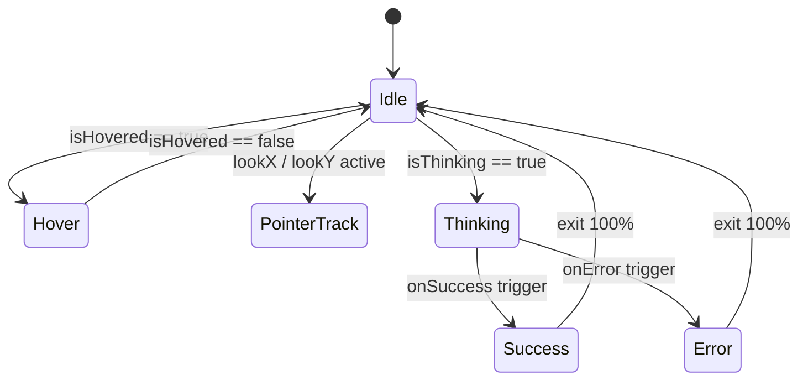

# 2D Mascot Design & Vector Motion Engineering (`/2d-mascot-motion`, `/rive-mascot`)

> **Role**: Principal Character Rigging Engineer & Vector Motion Architect  
> **Philosophy**: *Silhouette before detail. Geometric clarity over blurry gradients. Interactive state machines over endless CSS bounce loops. Zero emoji mascots, zero 500-node jagged SVG blobs, zero layout shift.*

This skill standardizes the creation and runtime integration of expressive 2D app mascots across Web (React / Next.js), Flutter (Impeller 120Hz), React Native, iOS (SwiftUI), and Android (Compose).

---

## 1. Quick Navigation & Progressive Disclosure

| Resource | Description |
| :--- | :--- |
| [references/mascot-design-and-anti-slop.md](references/mascot-design-and-anti-slop.md) | Silhouette stress test, shape psychology, 3-value cel shading, eye/mouth rig geometry, and AI slop bans. |
| [references/rive-state-machines-and-rigging.md](references/rive-state-machines-and-rigging.md) | Rive (`.riv`) hierarchy, canonical `MascotSM` inputs/states, ViewModel binding, Web & Flutter controllers. |
| [references/svg-and-lottie-rigging-fallback.md](references/svg-and-lottie-rigging-fallback.md) | Clean `<g>` pivot SVG rigs, dotLottie optimization, off-screen `IntersectionObserver` pause, reduced motion. |
| [templates/RiveMascotStage.tsx](templates/RiveMascotStage.tsx) | Production React `@rive-app/react-canvas` wrapper with pointer tracking, pause-on-hidden, and cleanup. |
| [templates/GeometricMascotRig.tsx](templates/GeometricMascotRig.tsx) | Mathematical `<35`-node SVG mascot rig with state expressions and smooth pupil tracking. |
| [scripts/verify_mascot_assets.py](scripts/verify_mascot_assets.py) | CLI auditor checking SVG node counts, embedded raster cheats, `viewBox`, reduced motion, and `.riv` cleanup. |

---

## 2. Anti-Slop 2D Mascot Rules

| Slop Pattern (Prohibited) | Production Vector Standard |
| :--- | :--- |
| **Unicode Emoji Mascots** (`🤖`, `🦊`, `✨` in hero slots) | Custom geometric character rig with brand-consistent palette and silhouette. |
| **Blurry AI Raster / 6-Finger Artifacts** | Clean layered vectors (`<= 40` Bezier nodes per body part) on an explicit integer `viewBox`. |
| **Embedded `<image>` Cheat Inside `.svg`** | Pure `<path>`, `<circle>`, `<rect>` vector geometry — never base64 PNG wrapped in `.svg`. |
| **Endless CSS `translateY` Bobbing Loops** | Interactive Rive `.riv` State Machine reacting to hover, focus, pointer coordinates, and app states. |
| **Unbounded Canvas & Missing Disposal** | Fixed `aspect-ratio` container (`CLS = 0`), `IntersectionObserver` pause, and `rive.cleanup()` on unmount. |

---

## 3. Canonical Rive (`.riv`) State Machine Contract (`MascotSM`)



### Standard State Machine Inputs
- `isHovered` (`Boolean`): Ears/antenna perk, subtle tilt (`+4°`), brightened rim stroke.
- `isThinking` (`Boolean`): Rhythmic head tilt (`-6°` to `+6°`) + orbital indicator or blinking visor.
- `lookX` / `lookY` (`Number`, `0..100`, default `50`): Drives constrained 2D pupil/head blend states within safe eye-socket bounds.
- `onSuccess` (`Trigger`): Damped overshoot squash-and-stretch (`scaleY: 1.08 -> 0.96 -> 1.0`).
- `onError` (`Trigger`): Horizontal damped shake (`±6px` decaying to `0` in `280ms`).
- `prefersReducedMotion` (`Boolean`): Locks rig to clean static neutral frame with subtle opacity/color state cues only.

---

## 4. Runtime & Performance Guardrails

1. **Web (`@rive-app/react-canvas`)**: Cap DPR, pass explicit `stateMachines: "MascotSM"`, pause animation when off-viewport via `IntersectionObserver`, and invoke `rive?.cleanup()` on unmount.
2. **Flutter (`rive`)**: Target 120Hz Impeller; dispose `StateMachineController` in `State.dispose()` and avoid rebuilding `RiveAnimation` on parent state ticks.
3. **Zero Layout Shift**: Always wrap mascots in an explicit `aspect-ratio` / `width` + `height` box so `CLS = 0.0`.
4. **Automated Verification CLI**:
```bash
python3 skills/2d-mascot-motion/scripts/verify_mascot_assets.py --path . --strict
```
