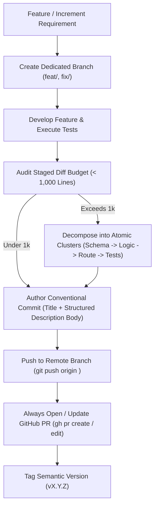

# Git Branching, Meaningful Commits & Pull Requests (`/git-workflow`)

> **Philosophy**: *Small commits are reviewable commits. Meaningful messages preserve architectural intent. Never dump lazy single-line commits. Always push to the remote branch. Always open or update a ready-to-merge Pull Request.*

This skill establishes version control discipline, branching strategies, commit size limits (< 1,000 lines), mandatory commit Title + Description formatting, remote branch synchronization, semantic version tagging, and automated Pull Request authoring.

---

## 1. The Git Discipline Workflow



---

## 2. The Three Non-Negotiable Delivery Invariants

### 2.1 Meaningful Commits with Title + Description
Single-line commits (`git commit -m "update"`) are strictly prohibited. Every commit must provide:
1. **Title**: Conventional commit subject line `<type>(<scope>): <imperative summary>` under 72 characters.
2. **Blank Separator Line**.
3. **Structured Description Body**:
   - `- Context / Why:` Motivation and requirements driving the change.
   - `- Key Changes / What:` Detailed bullet points of modified components and files.
   - `- Verification / Impact:` Automated test execution commands, line limit checks, and receipts (`[measured]`).
   - `- Documentation Impact:` Exact docs updated, OR `Documentation impact: none — <technical reason>` (`bettersanfernando` standard).

#### Example Production Commit:
```text
feat(qa): implement two-tier QA architecture and verification engine

- Context / Why: Resolves user requirement to split QA into Full UI and Full App Functional domains.
- Key Changes / What:
  * Created full-ui-frontend-qa-manual.md (213 lines).
  * Created full-app-functionality-qa-manual.md (203 lines).
  * Implemented verify_app_functionality.py CLI tool.
  * Added 10 automated unit tests in test_verify_app_functionality.py.
- Verification / Impact: 28/28 verification suites passing; all 76 source files under 500 lines.
```

### 2.2 Always Push to the Remote Branch
- Commits must never linger as unpushed local changes.
- Every commit or phase deliverable must be pushed immediately to the tracking branch:
  ```bash
  git push origin <branch-name>
  ```
- Before concluding any task, verify synchronization: `git status` must confirm the working tree is clean and up-to-date with remote.

### 2.3 Always Open or Update a GitHub Pull Request
Every deliverable must result in creating or updating an active Pull Request via GitHub CLI (`gh`):
```bash
# Author new PR:
gh pr create --title "<title>" --body "<description>" --base main --head <branch-name>

# Update existing active PR:
gh pr edit <pr-number> --title "<title>" --body "<description>"
```

---

## 3. Core Git Workflow Guardrails

### 3.1 The 1,000-Line Commit Budget
- **Hard Ceiling**: No single commit may contain more than **1,000 changed lines** (insertions + deletions), excluding generated lockfiles or vendor assets.
- **Decomposition Heuristic**:
  1. **Commit 1 (Schema & Contracts)**: Migration SQL, Drizzle/Prisma schema, TypeScript interfaces, and API type definitions.
  2. **Commit 2 (Business Logic & Repository)**: Domain services, database access methods, and automated unit tests.
  3. **Commit 3 (Controllers & Routes)**: HTTP handlers, Zod request validators, error serialization, and integration tests.
  4. **Commit 4 (UI & Documentation)**: Client components, CSS tokens, documentation updates, and E2E tests.

### 3.2 Conventional Commits Type Reference

| Type | Purpose | Example |
| :--- | :--- | :--- |
| `feat` | New feature or modular skill | `feat(3d): add Three.js WebGL product showcase skill` |
| `fix` | Bug fix, error remediation | `fix(qa): resolve layout overflow regex in token auditor` |
| `refactor` | Code restructuring with zero behavior change | `refactor(backend): decompose monolithic route into controller and repository` |
| `docs` | Documentation, guides, or specifications | `docs(skills): update master matrix table with 22 skills` |
| `test` | Adding or updating test suites | `test(devops): add non-root user verification test` |
| `perf` | Performance or bundle size optimization | `perf(ui): optimize glassmorphism backdrop blur repaint cost` |
| `chore` | Tooling, build config, or dependency updates | `chore: update release tag to v3.10.0` |

---

## 4. Automation Tooling

### Tool 1: Commit Chunk Analyzer CLI
Audit working tree diffs and cluster changed files into atomic commits within the 1,000-line budget:
```bash
python3 skills/git-workflow/scripts/analyze_git_commit_chunks.py --path .
```

### Tool 2: Git Delivery Etiquette Verifier CLI
Audit commit message structure, body presence, and remote branch synchronization:
```bash
python3 skills/git-workflow/scripts/verify_git_delivery_etiquette.py --path .
```

> 📖 **Deep Architectural Reference**: Read [references/commit-and-pr-etiquette-standards.md](references/commit-and-pr-etiquette-standards.md) for full branch push protocols, PR templates, and CI integration.
