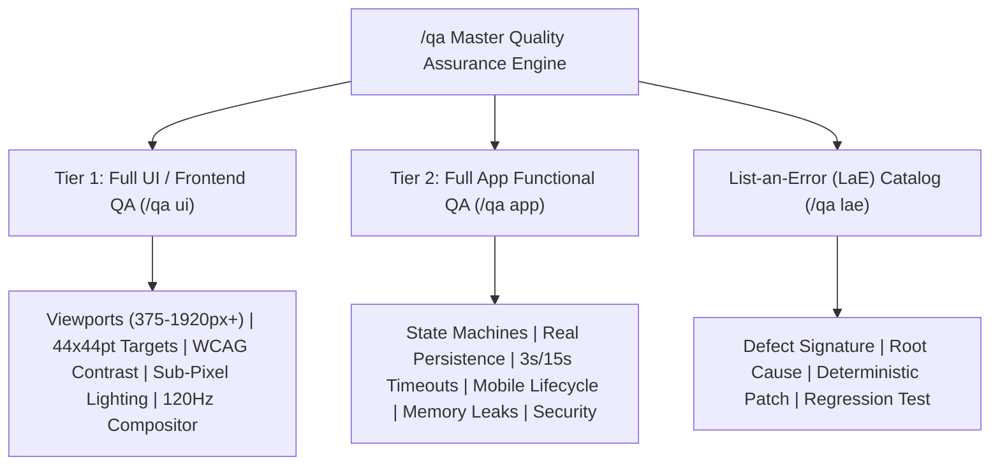
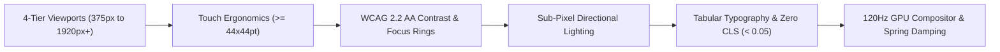
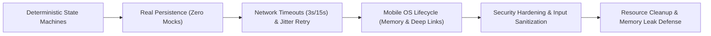
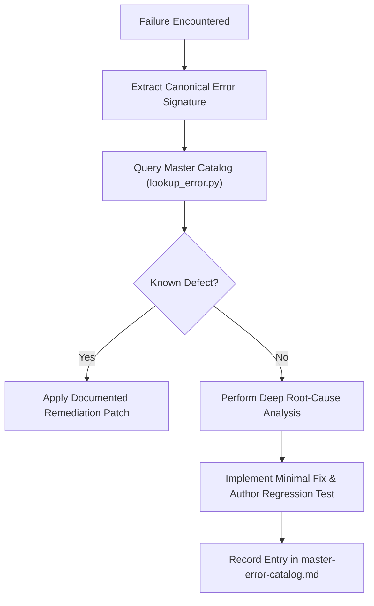
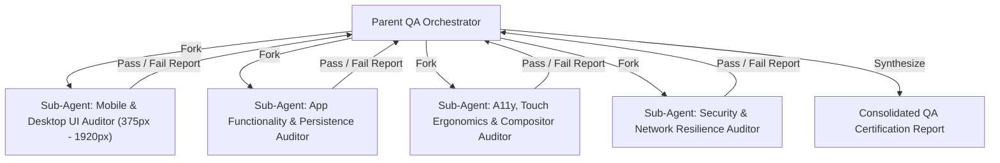

# Two-Tier Quality Assurance Engine (`/qa`)

> **Philosophy**: *A feature is incomplete until it passes both tiers of scrutiny: sensory visual perfection across viewports and resilient runtime correctness under real network drops and OS memory pressure.*

This skill establishes the production standard for software verification across Web and Mobile platforms (React, Next.js, Vue, Svelte, React Native, iOS SwiftUI, Android Jetpack Compose, and Flutter).

---

## 1. Two-Tier QA Architecture & Command Invocation



### Slash Command Recipes:
| Command | Mode | Verification Scope |
| :--- | :--- | :--- |
| `/qa` | **Full Dual-Tier Pass** | Executes both Full UI/Frontend QA and Full App Functional QA sequentially. |
| `/qa ui` | **Full UI / Frontend QA** | Audits viewports, safe-area insets, touch targets, contrast ratios, tabular figures, and GPU compositor. |
| `/qa app` | **Full App Functional QA** | Audits state machine determinism, real database persistence, network timeouts, mobile lifecycle, and leaks. |
| `/qa lae` | **List-an-Error Catalog** | Searches known error signatures or logs a new post-mortem remediation entry. |
| `/plan /qa` | **Autonomous QA Orchestration** | Forks parallel sub-agents to execute targeted UI and Functional verification suites. |

---

## 2. Part 1: FULL UI / Frontend QA Protocol (`/qa ui`)

Focused strictly on the visual interface, ergonomic reachability, accessibility compliance, and rendering physics across Web and Mobile:



### Key UI Quality Gates:
1. **4-Tier Viewport & Safe Areas**:
   - Mobile: 375px to 430px (iPhone SE to Pro Max). Safe-area insets for notches and Dynamic Island.
   - Tablet: 768px to 1024px. Adaptive grids and multi-window split compatibility.
   - Desktop: 1280px to 1440px. Bounded containers (`max-w-7xl mx-auto`), hover states.
   - Widescreen: 1920px+. Centered content, bounded gutters, zero awkward stretching.
2. **Touch Ergonomics & Hit Slop**:
   - Minimum 44x44pt (Apple HIG) / 48x48dp (Material Design) interactive hit areas.
   - Thumb-zone alignment: Primary CTAs in lower 60% of mobile viewport; destructive triggers shielded from accidental clicks.
3. **WCAG 2.2 AA Contrast & Focus Visibility**:
   - 4.5:1 minimum contrast for body text; 3.0:1 for large text and interactive component boundaries.
   - 200% Dynamic Type scaling without layout truncation.
   - Explicit focus indicators (`focus-visible:ring-2 focus-visible:ring-offset-2`).
4. **Sub-Pixel Directional Lighting & Tactile Materials**:
   - Directional hairline borders (`1px solid rgba(255, 255, 255, 0.08)`).
   - Zero synthetic AI-slop neon halos, glowing purple borders, or generic card soup.
5. **Tabular Typography & Layout Shift Prevention**:
   - Tabular figures (`tabular-nums`, `tnum`, slashed `zero`) for dynamic metrics and timers to eliminate horizontal jiggle.
   - CLS < 0.05: Fixed aspect ratios on media and height-reserved skeleton loaders.
6. **120Hz GPU Compositor Compliance**:
   - Web: Constrain transitions to `transform` and `opacity`.
   - Mobile: Offload animations to native compositor thread (`useNativeDriver: true`, Core Animation, RenderNode).
   - Damped spring physics: $\zeta \approx 0.75 - 0.90$.

> 📖 **Deep Architectural Reference**: Read [full-ui-frontend-qa-manual.md](file:///Users/arronkianparejas/SkillBuilder/skills/qa/references/full-ui-frontend-qa-manual.md) for full framework-native guidelines across Web, React Native, SwiftUI, Jetpack Compose, and Flutter.

---

## 3. Part 2: FULL APP QA (Application Functionality & Resilience - `/qa app`)

Focused strictly on runtime correctness, state determinism, persistence integrity, fault tolerance, and OS lifecycles:



### Key Functional Quality Gates:
1. **Deterministic State Machine Integrity**:
   - Mutually exclusive states (`idle` | `loading` | `success` | `failure`) with compile-time exhaustiveness checking.
   - In-flight request cancellation on rapid user navigation (`AbortController`, `Job.cancel()`).
   - Optimistic mutations snapshot previous state and cleanly rollback on backend rejection.
2. **Anti-Mock Real Persistence Mandate**:
   - Zero static in-memory mock arrays masquerading as databases.
   - Real schema validation, foreign keys, unique indexes, and ACID transaction boundaries (PostgreSQL, SQLite, Room, CoreData, Isar).
3. **Network Resilience & Fault Tolerance**:
   - Strict connection timeout (3s) and read timeout (15s) configured on all clients.
   - Bounded exponential backoff with full jitter on idempotent requests (GET, PUT, DELETE) and 5xx errors; never retry 4xx errors.
   - 300ms debounce on search inputs and filter query streams.
   - Idempotency headers (`Idempotency-Key: <UUIDv4>`) on mutation requests.
4. **Mobile OS Lifecycle & System Resilience**:
   - State preservation across app backgrounding and process termination.
   - Active response to low-memory warnings (`onTrimMemory` / `didReceiveMemoryWarning`) purging caches.
   - Cold-start deep link routing resolution with authentication gating.
5. **Security Hardening**:
   - Zero hardcoded secrets or API tokens committed in source code or client bundles.
   - 100% parameterized queries; zero raw string interpolation in SQL or shell executions.
   - Strict boundary schema validation (Zod, Pydantic, Serde).
6. **Resource Cleanup & Leak Prevention**:
   - Explicit teardown of event listeners, timers (`clearInterval`), subscriptions, and coroutine scopes on unmount.
7. **A/B Variant Parity & Guardrail Telemetry (`/testing`)**:
   - Verify deterministic SSR/CSR variant assignment (zero hydration flicker across viewports), Sample Ratio Mismatch (`SRM p >= 0.001`), and guardrail bounds (`p95 latency`, `5xx` error rate) via `skills/testing/scripts/verify_ab_experiment.py`.

> 📖 **Deep Architectural Reference**: Read [full-app-functionality-qa-manual.md](file:///Users/arronkianparejas/SkillBuilder/skills/qa/references/full-app-functionality-qa-manual.md) for full functional patterns, state recipes, and lifecycle verification.

---

## 4. Master Error Cataloging Protocol (List-an-Error - LaE)

Whenever an automated test, runtime execution, or build step fails, follow the **List-an-Error (LaE)** protocol before writing code:



### Catalog Lookup CLI:
```bash
# Query by keyword
python3 skills/qa/scripts/lookup_error.py -q "hydration"

# Query by category filter (Frontend, Backend, Database, Mobile, Network, State, Cloud, AI)
python3 skills/qa/scripts/lookup_error.py -q "memory" -c "Mobile"
```

> 📖 **Knowledgebase Catalog**: Browse [master-error-catalog.md](file:///Users/arronkianparejas/SkillBuilder/skills/qa/references/master-error-catalog.md) for the complete directory of engineering errors and fixes.

---

## 5. Parallel Sub-Agent QA Orchestration (`/plan /qa`)

When executing comprehensive regression sweeps, orchestrate specialized sub-agents:



---

## 6. Automated Verification Tooling

Execute the dedicated verification CLI tools for each tier:

### 1. Full UI / Frontend QA Auditor:
```bash
python3 skills/qa/scripts/verify_responsiveness_and_qa.py --path .
```
Audits templates and stylesheets for fixed-pixel containers, missing viewport meta tags, unstyled focus states, and static grids.

### 2. Full App Functionality QA Auditor:
```bash
python3 skills/qa/scripts/verify_app_functionality.py --path .
```
Audits source code for missing network timeouts, fake mock arrays, unhandled promise rejections, empty catch blocks, and missing input debouncing.

### 3. Master Error Catalog Search:
```bash
python3 skills/qa/scripts/lookup_error.py -q "<error-pattern>"
```
