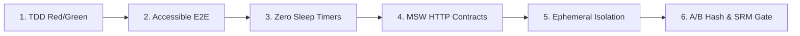

# Testing Discipline, E2E & A/B Experimentation (`/testing`)

> **Philosophy**: *Test behavior not implementation, ban fragile selectors and sleep timers, and gate every A/B rollout on deterministic hashing, Sample Ratio Mismatch (SRM) checks, and pre-registered guardrails.*

---

## 1. Progressive Disclosure References

| Resource | Purpose |
| :--- | :--- |
| [references/playwright-accessible-locators.md](references/playwright-accessible-locators.md) | Accessible locator hierarchy (`getByRole` > `getByLabel`), web-first assertions, zero `waitForTimeout`. |
| [references/tdd-and-msw-contracts.md](references/tdd-and-msw-contracts.md) | Red-Green-Refactor cycle, MSW HTTP boundary mocking, ephemeral DB isolation. |
| [references/ab-testing-and-experimentation.md](references/ab-testing-and-experimentation.md) | Experiment contracts (OEC + guardrails), SHA-256/MurmurHash3 bucketing, SRM chi-squared, sequential/CUPED/AI model evals. |
| [scripts/verify_testing_hygiene.py](scripts/verify_testing_hygiene.py) | Audits fragile CSS selectors, arbitrary `sleep()`/`waitForTimeout()` timers, and missing assertions. |
| [scripts/verify_ab_experiment.py](scripts/verify_ab_experiment.py) | Audits `Math.random()` bucketing / missing guardrails and computes exact SRM + two-proportion z-tests. |

---

## 2. The 6 Core Testing & Experimentation Gates



1. **TDD Red-Green-Refactor**: Write failing behavioral/repro tests before modifying production files; target `>= 80%` branch coverage.
2. **Accessible E2E Locators**: Use `getByRole()`, `getByLabel()`, `getByText()`—ban `div.cls > button` DOM selector soup.
3. **Zero Arbitrary Sleeps**: Ban `waitForTimeout()` and `time.sleep()`; rely on auto-retrying web-first assertions (`await expect(loc).toBeVisible()`).
4. **MSW Transport Interception**: Mock external APIs at the HTTP boundary via MSW (`onUnhandledRequest: "error"`) instead of stubbing private methods.
5. **Deterministic Isolation**: Run every test against clean ephemeral fixtures or rolled-back transactions with zero shared global state.
6. **Controlled A/B Experimentation**: Assign variants via deterministic `SHA-256`/`MurmurHash3(exp:salt:subject)` (zero `Math.random()` SSR flicker), verify SRM (`p >= 0.001`) before reading lift, enforce latency/error guardrails, and sunset flags within `14` days.

---

## 3. Verification & Statistical CLIs

```bash
python3 skills/testing/scripts/verify_testing_hygiene.py --path . --strict
python3 skills/testing/scripts/verify_ab_experiment.py --path . --srm 5000 4980 --ztest 5000 500 4980 575 --strict
```
