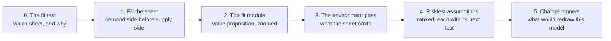

#  business-model-canvas

> **How to read this**
>
> - **Agents:** Follow **Agent guardrails** and the **Core procedure** literally. The fit test comes first and its verdict is recorded. The sheet is filled from evidence or labeled assumption, in the order given. A run is not finished until every risky assumption has a next test.
>
> - **Humans:** Read **The one idea**, then the output contract. If a canvas you are shown has no assumptions list attached, it is a drawing, not a model — send it back.
>
> - **Index:** [`references/README.md`](references/README.md) · **Public overview:** [`README.md`](README.md)

**Not a substitute for the underlying decisions.** This skill records and stress-tests a business model. It does not decide the position the product owns (the positioning skill's ground), the beliefs the company runs on (the vision-and-manifesto skill's ground), or the plan that takes the model to market (the 1-page-marketing-plan skill's ground). See **Limits and boundaries**.



## Sources

Full credit table: [`references/the-evidence.md`](references/the-evidence.md). The nine-block canvas and its process are Alexander Osterwalder and Yves Pigneur's (*Business Model Generation*, 2010) — the canonical practitioner frame, labeled as such. The fit module is the Value Proposition Canvas (*Value Proposition Design*, 2014). The pre-fit sheet is Ash Maurya's Lean Canvas, also practitioner work. The one direct empirical test of the canvas found in the literature (Ladd, 2018) sits in **Limits and boundaries**, where it belongs: it qualifies what a filled canvas can be claimed to do.

## When to use

- **Starting or restarting.** A business is being founded, a new line is being added, or an existing model is being deliberately redrawn, and the model needs stating on one page before money follows it.

- **The searching question.** Nobody can say plainly whether the business is still searching for its model or already executing one. The fit test answers that first, because the two states need different sheets and different honesty.

- **Drift between rooms.** Sales, product, and leadership each describe a different business when asked how it makes money. One dated canvas record ends the argument by making the disagreement specific: a block, not a vibe.

- **Before a raise or a big commitment.** The model is about to be shown to people who will price it. The run produces the operating canvas with its assumptions visible — the only version that should ever be shown.

## When NOT to use

- **As a substitute for testing.** A canvas is a snapshot of beliefs about a model. Filling one feels like progress and is not; the deliverable is the assumptions list and its tests, and a user who wants only the picture should be told so.

- **For a decided, stable model with no open questions.** If the model is found, measured, and unchanged, a redraw adds ceremony. Run the change-trigger review instead (Step 5) and redraw only when a trigger fires.

- **To settle positioning or vision.** What the product will be thought of as, and what the company believes, are upstream decisions. A canvas built on undecided positioning records the indecision neatly.

- **As a planning calendar.** The canvas has no time axis and no priorities. Sequencing the work is the marketing plan's and the roadmap's job; priority inside the model lives in exactly one place here — the ranked assumptions.

## Agent guardrails

1. **The fit test decides the sheet.** Still searching — problem and solution unproven, no repeatable sales motion — the run uses the Lean Canvas. Model found — customers, offer, and economics demonstrated — the run uses the nine blocks. The verdict and its reasons are recorded in the output. Preference for a template is not a reason.

2. **Evidence or assumption — every block, labeled.** Each entry in each block is either traced to evidence (a sale, a contract, measured behavior, a named source) or marked as an assumption. Nothing enters the sheet as fact on confidence alone. The assumptions are not a defect of the run; they are its output.

3. **Demand side before supply side.** Segments and value proposition first, then channels, relationships, and revenue; only then activities, resources, partners, and costs. A run that starts from what the company can build produces a capability list wearing a canvas's clothes.

4. **One model per run.** If two segments genuinely run on different models — different value proposition, different economics — each gets its own canvas. A blended average model describes a business nobody is running.

5. **The environment pass is mandatory.** The sheet omits competition, market forces, and trends; the criticisms naming that omission are correct. Step 3 supplies them, briefly and on evidence, before the assumptions are ranked — an assumption ranked without its environment is ranked blind.

6. **Every risky assumption gets a test.** The assumptions list is ranked by impact times uncertainty, and each entry carries the cheapest test that could kill it, with an owner and a date. A list without tests is a worry journal.

7. **The canvas is dated, and its triggers are named.** A model is a snapshot. The record carries its date and the events that would force a redraw, so a stale canvas announces its own staleness instead of quietly governing decisions it no longer describes.

8. **One canvas, shown whole.** The sheet shown to investors, recruits, or partners is the operating sheet, assumptions included. A cleaned variant for an audience is a claims violation, the same rule this family of skills applies to positions and visions.

## The one idea

A business model is a machine: value is created for someone, delivered somehow, and cash comes back — or the machine stops. The canvas is a parts diagram of that machine, nine blocks (or, before the model is found, the Lean sheet's sharper subset). Diagrams do not run machines, and the one direct test of this diagram found exactly that limit: filling it in moved how teams pitched, not whether they profited. So this skill treats the sheet as the middle of the work, not the work. Before it, a fit test decides which sheet the business's actual state earns. After it, the steps the sheet omits: the environment it ignores, the assumptions it contains, ranked, each with the test that could kill it. A canvas without its assumptions list is a drawing of a machine by someone who has not said which parts might not exist.

## The evidence in brief

Every load-bearing claim is labeled here; the full table, with grades and limits, is in [`references/the-evidence.md`](references/the-evidence.md).

- **The frame is practitioner work, and is labeled so.** Osterwalder and Pigneur (2010) built the nine blocks from a doctoral research base and a practitioner community, and the book's own process includes an environment analysis the popular one-page version drops. The Value Proposition Canvas (2014) is the same team's zoom lens for fit. Maurya's Lean Canvas adapts the sheet for the pre-fit state, swapping in problem, existing alternatives, key metrics, and unfair advantage. None of this is causal evidence that canvases improve outcomes; it is the field's standard recording instrument, used here as one.

- **The one direct test is sobering, and is carried in the open.** Ladd (2018), studying 271 accelerator teams, found canvas use associated with pitch competition placing, not with profit; of the blocks, only customer segmentation clearly correlated with outcomes, and the study raises the possibility that the canvas contains unhelpful components. The skill's response is structural: the assumptions list concentrates effort where the model can actually die, instead of spreading polish evenly across nine blocks.

- **The criticisms are named, and answered inside the procedure.** Coes (2014) and others: the canvas is a static snapshot, it ignores competition and environment, and it offers no prioritization between blocks. Steps 3, 4, and 5 exist because those criticisms are right: an environment pass, a ranked assumptions list, and dated change triggers. The limits section keeps the criticisms standing — the additions reduce the flaws; they do not repeal them.

## Core procedure

### Step 0 — The fit test: which sheet

Decide, on evidence, which state the business is in. **Still searching:** the problem is not yet proven painful to a reachable segment, the solution has not been bought repeatedly, pricing is a guess. Use the **Lean Canvas** — its blocks (problem, existing alternatives, solution, key metrics, unfair advantage) are the searching questions. **Model found:** customers buy repeatedly, the offer and the channel economics are demonstrated, the open questions are about scale and efficiency. Use the **nine-block Canvas**. Mixed states are decided by the weaker half: a business with a proven product and an unproven channel is still searching, on the Lean sheet, because the model — not the product — is the unit. Record the verdict and the two or three facts that decided it. **Sibling call — first-principles-thinking:** before the questions are answered from habit, decompose the business to its measured terms — who pays, how often, at what margin, through which motion — so the state is read off bedrock facts, not off how the business describes itself. The full test is in [`references/the-two-sheets.md`](references/the-two-sheets.md).

### Step 1 — Fill the sheet

Fill in the guardrail order. On the nine-block sheet: **customer segments** (named narrowly enough that a real list could be made), **value propositions** (per segment, in the customer's terms), **channels**, **customer relationships**, **revenue streams** (who pays, for what, how priced — numbers where they exist, labeled estimates where they do not). Then **key resources**, **key activities**, **key partners**, **cost structure** — each traced to the demand side it serves; a resource no value proposition needs is a finding, not a block entry. On the Lean sheet: **problem** and **existing alternatives** first, then **solution**, **key metrics**, **unfair advantage**, with segments, channels, costs, and revenue in the same discipline. Every entry is labeled evidence or assumption as it lands (Guardrail 2).

### Step 2 — The fit module

Zoom on the lead segment with the Value Proposition Canvas: the customer's **jobs** (what they are trying to get done), **pains** (what goes wrong, costs, or risks), and **gains** (what better looks like), set against the **value map** — the offer's products and services, its pain relievers, its gain creators. Score the fit plainly: which pains and gains the offer actually touches, and which it merely claims to. The verdict is one of three, recorded: **problem-solution fit** (the offer addresses pains the segment demonstrably has), **product-market fit evidence** (the segment buys and stays, at economics that work), or **not yet fit** (the map and the profile do not meet, and the specific gap is named). A canvas whose lead segment is not yet fit is a searching canvas whatever Step 0 concluded, and the record says so.

### Step 3 — The environment pass

The sheet's missing page, kept short: **industry forces** (the named competitors and substitutes, and what each would do if this model works), **market forces** (segment growth or shrinkage, switching costs, the customer's own pressures), **key trends** (technology, regulation, social), and **macro forces** (capital and input costs the model depends on). Each force is one or two lines, on evidence where it exists. Read every key partner and channel in this pass as an incentive problem: what they want, what they could take, what stops them. **Sibling call — game-theory-for-decisions:** that reading is run as a game — each partner and channel named as a player with its own payoffs, its credible threats, and its walk-away — and the incentive map that call returns is what this pass records. The output is not an essay; it is the context the assumptions get ranked in.

### Step 4 — Riskiest assumptions, ranked, with tests

Walk the filled sheet block by block and extract the assumptions — every entry labeled assumption in Step 1, plus the hidden ones the entries rest on (a channel's conversion rate, a partner's continued pricing, a segment's budget existing). Rank by two factors stated plainly: **if this is false, does the model die?** and **how unsure are we?** The top of the list is where impact and uncertainty are both high. For each of the top assumptions — five is a working ceiling — record the **next test**: the cheapest move that could kill the assumption, what result would kill it, an owner, and a date. The method in full is in [`references/riskiest-assumptions.md`](references/riskiest-assumptions.md).

### Step 5 — Change triggers and review

Close the record with the events that would force a redraw: a competitor's move, a channel's terms changing, a partner dependency deepening, a regulation landing, a top assumption failing its test. Name a review date. Between reviews, the canvas stands as the company's stated model; at a trigger or the date, it is re-run from Step 0 — because the first question, searching or found, may itself have changed.

## Calls on sibling skills

This skill does not run alone; the playbook is one playbook, and a skill calls the siblings its work needs, by name, at the step that needs them. The calls are steps, not suggestions:

- **Step 0 calls first-principles-thinking** — the fit test's verdict is read off a decomposition of the business to measured terms, so a state is never assigned from the business's own description of itself.

- **Step 3 calls game-theory-for-decisions** — partners and channels are mapped as players with payoffs, threats, and walk-aways; the environment pass records the incentive map that call returns.

- **Step 4 calls fix-the-bottleneck** — the top-ranked assumption is treated as the system's constraint: its kill test is designed and sequenced first, before all lesser tests.

## Output contract — the canvas record

Every run returns one record. The verdict leads, because a reader should know which sheet they are looking at and why before they read a single block.

```text
— The verdict —
Fit verdict:          <searching / model found — the sheet used, and the two or three facts that decided it>
Canvas date:          <the date this snapshot was taken>
Fit at the lead segment: <problem-solution fit / product-market fit evidence / not yet fit — and the specific gap, if any>

— The canvas —
<the filled sheet, block by block, every entry labeled [evidence] or [assumption]>

— The environment —
Industry forces:      <named competitors and substitutes, and their likely response if this works>
Market forces:        <segment direction, switching costs, customer pressures>
Trends and macro:     <the few that touch this model, one line each>

— Riskiest assumptions —
1. <assumption> — if false: <what dies> — uncertainty: <how unsure, and why>
   Next test: <the cheapest test that could kill it> — kill result: <the result that ends it> — owner: <name> — date: <date>
2. … (five at most)

— Change triggers —
Redraw if:            <the named events that force a re-run>
Review date:          <when this canvas is next re-examined, trigger or not>
```

**The rendered canvas is a required deliverable.** Every run also returns the canvas drawn: the chosen sheet as a filled grid in the Strategyzer layout — titled blocks, short entries, readable at a glance — delivered as a PDF and an image alongside the text record. Entries are shortened only to fit the grid; the evidence and assumption labels are kept, and the fit verdict rides on the sheet. Each block header carries an icon from **Hugeicons (free version)** — the house icon library — chosen for what the block means, in the library's stroke style at one consistent weight. Icons sit on structural elements only, block headers and section markers; an icon that carries no meaning is decoration and does not ship. A text record alone does not meet this contract — the canvas is a visual instrument, and a run that returns only prose has not delivered it.

**Then run the writing pass. This step is a procedure, not a style reminder.** When a record ships in workshop register, the blocks fill with template language — "leverage synergies," "target demographic" — and the assumptions list loses the plain statement of what might be false that makes it usable.

1. **Humanizer.** Run the work-humanizer skill in rewrite mode over the record. Facts, figures, labels, and statuses never change in the pass. What changes is the register.

2. **Plain style.** Apply the writing-styles skill's plain rules to the result: short sentences, one idea each, numbers spoken the way a person says them, bold only on the few facts that matter. Block entries are written the way the customer or the operator would say them, not the way a template would.

3. **The gate.** The record is not done until the pass has run on the exact text being delivered.

**Field-test records carry one more requirement.** When a run is filed as a field test of this skill, the record opens with a plain section — the verdict and the headline findings in short sentences a person would say out loud — before any working detail. The verdict sections themselves, the fit verdict and the verdict on the skill, are written plain in their own right: dense analyst prose with a plain summary pasted on top fails this contract. The plain-style rule applies by name to the human-read parts of a field-test record — the opening and every verdict. Working detail below the opening may stay as dense as the evidence needs.

## Limits and boundaries

- **The canvas may not work, and the one test says so plainly.** Ladd (2018), in the *Journal of Research in Marketing and Entrepreneurship*, studied 271 accelerator teams: canvas use was associated with placing in pitch competitions, not with profit, and of the blocks only customer segmentation clearly correlated with outcomes — the study itself raises the possibility that the canvas contains unhelpful components. This skill is built to survive that finding: it claims the canvas is a recording and stress-testing instrument, not a performance intervention, and it puts the weight on the assumptions and tests, where a false belief can actually be found and killed.

- **The criticisms stand.** Coes (2014) and the wider critical literature: the canvas is a static snapshot of a moving business; it ignores competition and environment; it gives no prioritization between blocks; it says nothing about how the model evolves. Steps 3 through 5 answer each point in part — an environment pass, a ranked list, dated triggers — and the answer is partial. A user who needs competitive strategy, not a model snapshot, needs positioning and strategy work this skill does not pretend to be.

- **Practitioner frames, labeled.** Osterwalder and Pigneur, the Value Proposition Canvas, and Maurya are practitioner constructions — widely used, internally coherent, and not peer-reviewed causal claims. The skill uses them the way it uses any good instrument: for the discipline of the questions, with the evidence labels visible, and never as proof that a filled sheet predicts success.

- **Not positioning.** Positioning decides what a product will be thought of as, against the alternatives buyers would really choose. The canvas takes a position as an input to its value proposition block; a run that discovers the position is undecided stops and says so, because filling the block anyway records the indecision as if it were a choice.

- **Not vision-and-manifesto.** The canvas describes how the machine makes money. The beliefs the company runs on — and the future it is pointed at — are a different record. The two chain in one direction: a finished vision can inform a model's ambitions; a canvas never substitutes for beliefs.

- **Not the marketing plan.** The 1-Page Marketing Plan decides how the model meets its market: targets, message, media, conversion, delivery, retention. The canvas record is one of its inputs — the economics the plan must respect — and the plan's results are among the evidence that can force a canvas redraw.

- **Not a fundraising variant.** The sheet shown in a raise is this record, assumptions visible (Guardrail 8). A version with the risky blocks softened is a claims violation. Fundraising borrows the finished canvas the way it borrows a finished position: whole, or not at all.

## Verification checklist

Before calling a run done, confirm:

- [ ] The fit test ran first: the sheet was chosen by the business's state, and the verdict with its deciding facts is recorded at the top of the output.

- [ ] Every block is filled, in the demand-side-first order, and every entry is labeled evidence or assumption.

- [ ] Segments are named narrowly enough that a real list of customers could be made from them.

- [ ] Revenue carries numbers where they exist and labeled estimates where they do not — who pays, for what, at what price.

- [ ] The fit module ran on the lead segment: jobs, pains, and gains against the value map, with a recorded fit verdict and any gap named specifically.

- [ ] The environment pass names real competitors and substitutes, and reads key partners and channels as incentive problems.

- [ ] The riskiest assumptions are ranked by impact and uncertainty, five at most, each with a next test, a kill result, an owner, and a date.

- [ ] The canvas is dated, its redraw triggers are named, and a review date is set.

- [ ] Only one version of the canvas exists in the record — the operating sheet, assumptions visible.

- [ ] The writing pass ran on the exact text delivered — humanizer, then plain style.

- [ ] The rendered canvas shipped with the record: the filled grid as a PDF and an image, labels kept, verdict on the sheet, Hugeicons on every block header.

- [ ] If this run is filed as a field test: the record opens with a plain verdict section, and its verdict sections are written plain in their own right.
