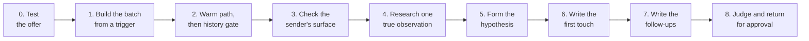

#  cold-outreach

> **How to read this**
>
> - **Agents:** Follow **Agent guardrails** and the **Core procedure** literally. The skill writes and judges copy; it never sends.
> - **Humans:** Run the **Core procedure** per batch. Open `references/` for the graded evidence, the source audits, the lane cards, and a worked example.
> - **Index:** [`references/README.md`](references/README.md) · **Public overview:** [`README.md`](README.md)

**Not a sending system.** This skill writes cold outreach and judges it. Cadence, caps, inboxes, warm-up, and delivery belong to the operator's sending process, not to this skill. Nothing in this skill sends anything.

## Sources

The rules rest on a graded evidence base: academic studies of email and persuasion, and large observational datasets from the platforms that process cold email at scale. The full grading is in [`references/the-evidence.md`](references/the-evidence.md), and every source is credited in [`references/sources-and-urls.md`](references/sources-and-urls.md). Two practitioner sources were audited line by line rather than adopted: Lavender's 20 cold email tips and Dimitar Angelov's outbound article — the audits are in [`references/lavender-audit.md`](references/lavender-audit.md). Where a rule is practice rather than evidence, the skill says so.

## When to use

Use this skill when a **founder**, **operator**, or delegated agent is:

- Writing a **first touch** to prospects with no prior relationship: buyers for a data or product offer, prospects for a service, sponsors, or partners.
- Writing the **follow-ups** to that first touch, as one sequence, in the same pass.
- **Judging** a cold draft someone else wrote, rule by rule, before it goes out.
- **Diagnosing** a sent batch: replies low, positive replies low, or meetings not booking — each points at a different stage.
- Adapting the method to **LinkedIn messages**, with the thinner DM evidence labeled as such.

## When NOT to use

- **The person has history with you.** A prior thread, a past negotiation, an old introduction: that is a warm conversation, not cold outreach. Route it as one.
- **Relationship-first outreach.** Investors, LPs, and partners you actually know are a fundraising motion, governed by the fundraising skill. Running them through a cold sequence damages the relationship it depends on.
- **A communications moment.** A launch, a crisis, a public response: that is the comms skill's ground. A cold email is a sales motion.
- **Sending mechanics.** Cadence, daily caps, list hygiene, bounce handling, domain health: the sending process owns them. This skill's rules assume the copy is written for spaced, low-volume sends to verified addresses.
- **Volume plays.** This skill is built for small, high-value batches where each prospect is worth real research. A thousand-send spray is a different game with different math, and it spends the sender's name — see the limits section.

## Agent guardrails

1. **Drafts only.** Nothing sends from inside this skill. Every run returns copy for the operator's approval, batched so the approval stays cheap.
2. **No pricing in a first touch.** No prices, ranges, package menus, rate cards, decks, or payment terms. The first touch earns a reply; terms come after interest exists and the buyer asks, or the lane's process sends them.
3. **No invented facts.** Every observation about a recipient or their company carries the source it was checked against. If a fact cannot be verified against a current public source, it does not go in the email — whoever or whatever drafted it.
4. **Proof only from the lane's approved lines.** Never another client's commercial terms. Any momentum claim ("two buyers signed this quarter") must be true and verified before it is written; manufactured momentum is a lie with a deadline.
5. **History means not cold.** If the history check finds prior contact with the person or their company, stop. The message leaves this skill and is handled as a warm thread.
6. **Hedge the guess, never the ask.** The hypothesis is hedged ("seems like", "might") because it is a guess. The question is plain, because a hedged ask reads as doubt about the offer.
7. **One ask per email.** The first touch asks one clear interest question. The meeting ask comes after the reply, not before it.
8. **Short and plain, with a gate.** Aim for 50–75 words in a first touch. Over 100 words fails the checklist, no exceptions: past 100, the largest datasets agree replies fall off, even though they argue about where the peak sits (labeled contested — see the evidence file). Paragraphs of one to two sentences, and sentences short with one idea each — a sentence carrying three clauses gets split, whatever the paragraph count says. Plain words over jargon and clichés.
9. **No links or images in a first touch.** This is a simplicity rule: simpler creative won the large marketing A/B tests. It is not a deliverability law, and the skill never states it as one.
10. **No one-shot tricks.** No loss framing as a tactic, no pattern-interrupt subject lines, no manufactured urgency or scarcity. The lanes this skill serves are small worlds where the game repeats; tricks are taxed across every future prospect who hears about them.
11. **Label the evidence.** When a rule or a draft rests on a dataset, name whose, how large, and what year. A vendor's percentage is that vendor's claim, never a measured fact.
12. **Protect the sender's name.** The sender's reputation is the asset every future batch spends. Any tactic that trades the name for one batch's replies is refused, however well it tests once.

## The one idea

A reply is produced by a chain: **the right person, a real trigger, an offer that appeals stated plainly, and only then the copy.** Most cold email advice starts at the copy, because copy is what the advisor sells. The evidence says the earlier stages carry most of the result: in the largest personalization index, an email built on a trigger — something that just happened at the recipient's company — outperformed every other kind of personalization by a wide margin, and small targeted batches out-reply large ones several times over.

So this skill starts at the offer and the list, and treats the writing as steps six and seven of nine. It also writes the sequence as one piece of work: in the largest sequence dataset, follow-ups produced 58.6% of all replies and the majority of meetings. An email with two afterthoughts attached is not a sequence.

## What a run returns

Every drafting run of this skill returns, in this order:

1. **The offer test result**: the offer stated in one plain sentence, and the pass or fail call.
2. **The batch definition**: the segment, the trigger the list was built from, and the batch size.
3. **The warm-path and history results**: who was routed to an introduction or an existing connection, who was removed for prior history, who was classified as a re-touch, and who remains genuinely cold.
4. **The sender-surface check**: what a search of the sender shows, and whether it matches what the email claims.
5. **Per recipient**: the research note (the observation and its source), the hypothesis, and the three emails — first touch and two follow-ups — each with its subject line where it has one and a word count.
6. **The checklist verdict** per email, with any failing lines quoted.

A review run returns the draft scored rule by rule with the failing lines quoted. A results run returns the funnel diagnosis for a sent batch (see "Judging a sent batch" below) and the one stage to fix first.

## Core procedure

Run all nine steps, in order, per batch. One batch is one segment with one trigger; do not mix segments to save time, because the hypothesis differs by segment.

### 0 — Test the offer

State the offer in one plain sentence a stranger would understand: what it is, who it is for, what changes for them. If the sentence does not appeal stated plainly, stop. No subject line, hook, or sequence fixes an offer that fails said plainly — weak copy on a strong offer still earns replies, and the reverse is not true. Confirm the lane before writing: data or product licensing, advisory or services, sponsorship, partnership. Each lane carries its own ask and its own approved proof lines; the lane cards are in [`references/lane-cards.md`](references/lane-cards.md).

### 1 — Build the batch from a trigger

Build the list from a **trigger**: a recent, checkable event at the target companies — a launch, a raise, a leadership hire, a public problem, an expansion. The trigger is why this week is the right week to write, and it is the largest measured lever in the evidence base: activity- and trigger-based personalization indexed 24 against a baseline of 2 in Gong's 85-million-email index, ahead of company facts (9) and individual details (6). Keep the batch narrow — one segment, one pain — because small targeted campaigns out-reply broad ones several times over in every dataset that separates them (Hunter: 5.8% reply at 50 or fewer recipients against 2.1% at 1,000 or more). Size the batch to the lane's value: a market of a hundred high-value buyers gets a hundred researched emails, not a thousand sprayed ones.

### 2 — Run the warm-path check, then the history gate

Cold is the fallback, not the default. First the warm path: does an introduction route exist, or an existing connection? In the independent Belkins × Expandi dataset (15.1 million contacts, 2025), messages to existing LinkedIn connections replied at 12.22%, against low single digits for cold email per send. A connection made first, or an introduction asked for, is worth more than any copy improvement this skill can make. Then the history gate: search the operator's own mailboxes and records for the person and the company. Any prior contact means the message is not a first touch, and it leaves the cold batch — in one of two ways. A live or past conversation (a reply, a negotiation, a support exchange) routes as a warm follow-up under whatever was already discussed. A thread the sender opened that was never answered is a **re-touch**: it re-enters only under the follow-up rules, carrying a new fact, never as a fresh first touch pretending the earlier emails do not exist.

### 3 — Check the sender's surface

The prospect's second move, after reading, is to search the sender. Before the batch is written, check what that search shows: the bio, the profile, the site, the top results. It must match what the email claims — the same offer, the same role, the same name for the thing being sold. A strong email from a sender whose surface says something else loses to a plain email whose surface agrees with it. Fix the surface before fixing the copy.

### 4 — Research one true observation

For each recipient, find **one true observation**: a specific, current, checkable fact about them or their company, tied to the trigger. Verify it against a current public source and record the source in the research note. The observation does double work. It is the email's opening, and it is the email's proof of work: one specific fact that could not have been mail-merged is what separates this sender from the spray the prospect deletes unread. Name tokens are not research — the only randomized trial in the field found a first name in a subject line worth about 20% on opens in marketing email, and a later replication found the same trick slightly negative. Do not dilute a real observation into a template with blanks.

### 5 — Form the hypothesis

Turn the observation into a **hypothesis**: the problem this recipient plausibly has, given the observation, that the offer solves. State it as a guess, in the email and in the research note. For executives, state the hypothesis in outcome terms — revenue, cost, risk — not in product terms. One caution from the evidence: outcome language is not ROI language. Gong's data found ROI claims (multipliers, percentages) cut cold email success by about 15%; name the outcome, do not quote a multiple.

### 6 — Write the first touch

Write the first touch in four moves: the observation, the hypothesis (hedged), one line of approved proof where the lane allows it, and **one clear interest question** as the ask. State the observation in half a line, as shared context, not as news: the recipient already knows their own launch, hire, or raise. The observation earns its place by setting up the hypothesis — what the fact costs them, or what it makes urgent — not by reciting the fact back at them. The ask is the best-measured rule in this skill: in Gong's analysis of 304,174 emails, an interest call to action — a question about interest, not a request for time — booked more than twice the meetings of a specific-time ask on cold email, while the specific-time ask won once a deal was already in motion. So the first touch asks whether the thing is of interest, in a question that costs nothing to answer; the meeting ask comes after the reply. Form rules: inside the word gate (aim 50–75 words, never over 100; guardrail 8), paragraphs of one to two sentences, sentences short with one idea each, plain words, no clichés, no links, no images, no pricing. The subject line is short — one to three words by default — and sounds like an internal email: no verbs performing, no numbers, no questions, no first names. Short subjects are the most replicated subject finding in the evidence (two to four words across Gong, Belkins, and Boomerang); the rest of subject-line advice contradicts itself across datasets and is held as practice, not law. If proof appears, it goes in the body, never the subject: the same dataset that found body proof worth +41% replies found subject-line proof worth −4%.

### 7 — Write the follow-ups in the same pass

Write both follow-ups now, while the batch's thinking is fresh; when they send is the sending process's decision, not this skill's. Each follow-up must carry **one new thing** — a new fact, a shorter form of the ask, or a new piece of proof. A follow-up with nothing new is a bump, and bumps train the prospect to delete the thread.

Proof is spent across the sequence, one point per touch, strongest last. A proof point earns attention once, when it is new; repeated, it is decoration. So the sequence holds its proof in reserve: the first touch may carry one short proof line where the lane allows; the first follow-up carries a further fact or proof point; the **final follow-up carries the strongest proof**, paired with the exit. This is also where the replies are: follow-ups produce roughly half or more of all replies in every large dataset, and in Belkins' 7.53-million-email study the later steps produced 53.5% of the meetings — most prospects who ever weigh the proof will meet it in a follow-up, not in the first email.

The final follow-up makes **"no" free**, in plain words: a no closes it, no hard feelings, no further emails. A reply that costs nothing to give gets given, and a fast, clean no is a good outcome — it frees the list and the follow-up slots. Where the relationship allows, the final follow-up may also ask for one referral: who else should this go to. Never manufacture urgency to avoid the exit; a deadline that is not real is a lie with a date on it.

### 8 — Judge, and return for approval

Score every email against the verification checklist at the end of this skill — as a separate, cold pass, not as the last motion of drafting. A drafter grading their own draft in the same pass reads what they meant, not what is on the page, and the failures that matter most — one formal word, a buried ask, a sentence carrying three ideas — are exactly the ones the drafter cannot see in their own text. So the judging happens apart: the draft is read as if a stranger wrote it, every checklist item checked against the actual lines, failing lines quoted. Where a second reader exists, they judge; where none does, the pass still happens separately, after a break from the drafting.

Return the batch in the output contract's order, with word counts and verdicts, for the operator's approval. Present the batch so approval is cheap: the batch definition and the gate results first, then the emails grouped by recipient, failures flagged at the top. Nothing sends from inside this skill, and a draft the operator has not approved does not exist as far as the prospect is concerned.

**Then run the writing pass, on every email in the batch, before the batch returns. This step calls two sibling skills. It is a procedure, not a style reminder.** The form rules in steps 6 and 7 describe the target register; a batch judged only against them still ships with the drafter's stiffness in it, and one formal word is the failure this skill's own judging names first.

1. **Humanizer.** Run the work-humanizer skill in rewrite mode over each email — the first touch and both follow-ups. The observation, the hypothesis, the offer, the proof points, and every figure never change in the pass. What changes is the register.
2. **Plain style.** Apply the writing-styles skill's plain rules to the result: short sentences, one idea each, numbers spoken the way a person says them.
3. **The gate.** No batch returns for approval until the pass has run on the exact final text of every email in it.

### Judging a sent batch

When a batch has run, diagnose it by stage before rewriting anything — the funnel diagnostic. **Low replies** point at the message or the audience: the trigger, the segment, or the copy. **A healthy reply rate with a low positive share** points at the offer: people answered, and what they heard did not appeal — return to step 0, not to the copy. **Positive replies that do not book** point at the ask: what happens after the reply. Fix one stage at a time and re-measure; changing the offer, the list, and the copy in one batch teaches nothing. Judge against the operator's own previous batches in the same lane — positive replies and meetings per batch, and the approval time the batch cost. Vendor headline rates are not benchmarks: measured honestly per send, large datasets put total replies between 0.45% and about 1.5% for cold volume campaigns, with roughly one reply in five to seven positive — see the benchmarks in [`references/follow-ups-and-dms.md`](references/follow-ups-and-dms.md).

## Calls on sibling skills

This skill does not run alone; the playbook is one playbook, and a skill calls the siblings its work needs, by name, at the step that needs them. The calls are steps, not suggestions:

- **Before drafting, call positioning** — the offer's position and the segment's awareness stage set the angle; outreach written before the position exists is written twice.

- **At the opener, call stop-the-scroll** — the first line is a hook with a job, built and tested under that skill's rules.

- **At drafting, call write-in-your-voice** — the note sounds like the sender's attested voice, not like a template wearing their name.

## Limits and boundaries

- **Writing only.** This skill researches, writes, and judges. Cadence, caps, sequencing tools, inboxes, warm-up, authentication, and bounce handling belong to the sending process; deliverability and domain health belong to whoever runs it. This skill's only delivery-adjacent rule is copy simplicity.
- **Not the fundraising skill.** Outreach to investors, LPs, and partners with any real relationship is relationship-first and follows the fundraising process: build the list, qualify fast, work introductions, create honest momentum. This skill's lanes are buyer and prospect lanes, where no relationship exists yet.
- **Not the comms skill.** Comms decides what a founder says in public moments — announcements, crises, responses. A cold email is a sales motion to one person, not a public moment.
- **Voice sits above structure.** When an email goes out under a person's name as that person, their voice skill governs how they sound; this skill governs the structure, the sequence, and the evidence. Company lanes follow the company's writing rules instead.
- **The evidence is thin, and it ages.** No peer-reviewed experiment on cold B2B outreach exists. Most rules here rest on large observational vendor datasets, and the vendors sell the remedies their data recommends; the references grade every finding and name the contradictions instead of smoothing them over. Reply rates fall year over year in every longitudinal dataset, so every number in this skill carries its year — and the research re-runs before any major version.
- **DM evidence is thinner than email evidence.** LinkedIn has one large independent dataset; X/Twitter direct messages have no credible dataset at all. The DM material in the references is labeled practice where that is all it is.
- **Small worlds only.** The method assumes prospects who talk to each other and a sender whose name is worth protecting. In an anonymous, one-shot, high-volume market the math changes; this skill does not pretend otherwise.

## Verification checklist

Before calling a batch complete, confirm:

- [ ] The offer passed the one-sentence test, and the lane is named.
- [ ] The batch is one segment, built from a named trigger, sized to the lane.
- [ ] The warm-path check ran: introduction routes and existing connections were used where they exist.
- [ ] The history gate ran: nobody with prior contact with the sender or their company is in the cold batch.
- [ ] The sender-surface check passed: what a search of the sender shows matches what the emails claim.
- [ ] Every observation carries a source it was verified against, and no observation is a mail-merge token.
- [ ] The observation is stated in half a line as shared context; the email does not recite the recipient's own news back at them.
- [ ] The inbox-list test (practice, not data): the subject and first line read as they would sit in a list of 100 inboxes — and the first line could not have been sent to anyone else. If it could, it is rewritten around the fact that is true only of this recipient.
- [ ] Every email's word count is stated; every first touch lands in the 50–75 aim band and none runs over the 100-word gate, in one-to-two-sentence paragraphs, with sentences short and one idea each, in plain words, with no clichés.
- [ ] The 11-second scan (practice, built on Lavender's scan figure): one fast read of each email — the ask is findable in that single pass. If it has to be hunted for, the email is restructured until it is not.
- [ ] The flagged-words sweep ran: no word from [`references/flagged-words.md`](references/flagged-words.md) appears in any email, unless the run justifies it in one line.
- [ ] The judging was a separate cold pass over the text as written — not the drafter's self-grade inside the drafting pass — with failing lines quoted.
- [ ] Every first touch asks exactly one interest question, and no first touch asks for a meeting or a time.
- [ ] No first touch contains pricing, a deck, a rate card, a link, or an image.
- [ ] Proof lines are the lane's approved lines only; no other client's terms appear; every momentum claim is verified true.
- [ ] Proof is sequenced: one new point per touch, the strongest proof in the final follow-up, no proof point repeated.
- [ ] The final follow-up makes "no" free in plain words.
- [ ] Subject lines are short and internal-sounding.
- [ ] Every statistic quoted anywhere in the run names its source and year, or has been removed.
