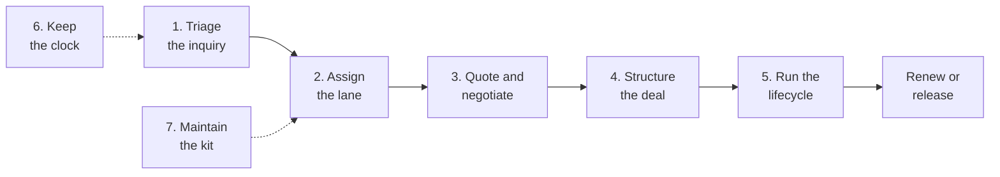

#  inbound-sponsorship

> **How to read this**
>
> - **Agents:** Follow **Agent guardrails** and the **Core procedure** literally. Every rule carries an evidence label. Do not upgrade a label to make a rule sound stronger than it is.
> - **Humans:** Run the procedure on one inquiry at a time. Open `references/` when a step needs depth: the evidence notes, the benchmark tables, the hybrid clause templates, or the worked example.
> - **Index:** [`references/README.md`](references/README.md) · **Public overview:** [`README.md`](README.md)

**Not a substitute for domain expertise.** This skill structures inbound sponsorship selling for a media property. It does not replace legal, tax, or advertising-law advice. Disclosure and link rules change by jurisdiction; check the current rules where you publish.

## Sources

The negotiation rules rest on a preregistered meta-analysis of first offers (Petrowsky et al. 2025, *Organizational Behavior and Human Decision Processes*) and on the package-offer experiments behind MESOs (Leonardelli et al. 2019). The speed rules rest on the lead-response studies (Oldroyd 2007; Oldroyd, McElheran & Elkington 2011). The pricing-lane policy is an inference from that research plus B2B pricing-transparency data and publisher practice, and the skill labels it as borrowed wherever it appears. Benchmarks come from practitioner and marketplace sources (Inbox Collective, Revenews, SponsorCal, Libsyn Ads, Agentio, ESBO, BuzzStream), each with its basis stated. Full citations live in [`references/evidence-notes.md`](references/evidence-notes.md) and [`references/benchmarks.md`](references/benchmarks.md).

## When to use

Use this skill when a **publisher**, **newsletter operator**, **creator**, **media salesperson**, or delegated agent handles money coming *in* from sponsors:

- An inbound email, form fill, or DM asks about sponsoring, advertising, a paid placement, a sponsored post, a link insertion, a newsletter slot, a podcast read, a video integration, or an affiliate deal.

- The inbox mixes real buyers with rate collectors, link brokers, and pure-CPA blasts, and someone has to decide what deserves a reply.

- A buyer asks "what do you charge?" and the answer depends on whether the inventory is standard or custom.

- A brand offers affiliate-only or CPA-only terms and the publisher needs a counter that protects the floor.

- A placement is live, expiring, or broken, and the term, the remedy, and the renewal need handling.

- The media kit or rate card needs building or refreshing, and its numbers need a stated basis.

## When NOT to use

Do **not** use this skill when:

- **The work is outbound.** Prospecting lists, cold pitches, and sponsor outreach sequences are a different game. This skill starts when the inquiry arrives.

- **The property sells no sponsorship.** If there is no inventory and no intent to sell it, there is nothing to triage.

- **The question is editorial.** Whether to cover a company is an editorial call. This skill prices paid placement; it never lets a payment decide coverage.

- **A binding rule already decides the matter.** Advertising disclosure law, platform link policy, and an existing signed contract are constraints. Work inside them, not around them.

- **The deal is a capital raise or a company sale.** Sponsorship revenue is operating income. Fundraising and M&A have their own procedures.

## Agent guardrails

1. **Drafts before send.** This skill drafts replies, quotes, counters, and renewal notes. A named human approver sends them. Numbers, prices, and terms are never stated to a buyer until the approver has signed off on that exact text.

2. **Never invent a benchmark.** Every figure in a draft, a kit, or a report carries its basis (per 1,000 opens, per 1,000 subscribers, per download, per video view, flat fee) and its source. If no source supports a number, the number does not ship. Practitioner conventions are labeled "practitioner practice," never dressed up as studies.

3. **Label borrowed evidence.** The anchoring and package rules are studied (meta-analysis, experiments). The fixed-vs-negotiated lane policy for publishers is borrowed from adjacent B2B evidence and practitioner consensus, because no publisher-specific experiment exists. Say which is which, every time the distinction matters.

4. **Disclosure is a spec, not a preference.** Paid content is labeled clearly and conspicuously (in the US, FTC Endorsement Guides, 16 CFR Part 255, revised 2023), and paid links carry rel="sponsored" or rel="nofollow". An inquiry that requires breaking this is disqualified on that ground alone, whatever its budget.

5. **No company's specifics live in the method.** Prices, floors, and thresholds in this skill are either sourced benchmarks or clearly marked illustrations. Never bake one property's real prices, counterparties, or internal systems into a draft meant for general use.

6. **Protect the floor.** The publisher's reservation price, real deadline, and internal disagreement stay private. A draft never reveals the floor it is defending.

7. **Disqualify into a lane, not into silence.** A declined inquiry gets a fast, polite reply that points somewhere: the published rate card, a lower tier, the affiliate program, or a network backfill option. Silence is the only wrong decline.

8. **Write plain.** Short sentences. One idea per sentence. Say each number the way a person says it out loud. A draft the buyer must decode is a draft that fails.

9. **Recommend, do not commit.** The skill may recommend a price, a counter, or a decline. Only the approver approves an external commitment, a signature, a payment term, or a disclosure exception.

10. **A real company can still be a bad sponsor.** Identity checks catch fakes. The reviews pass and the custody test (step 1) catch real companies whose customers' money goes in and does not come out. Neither check is optional, and neither result gets softened in the report to the approver.

## The one idea

Inbound sponsorship is two different games sharing one inbox.

In the first game, the inventory is standard and the price is known. Both sides can see the bargaining zone, so the seller should name the number first and let the buyer self-serve or self-disqualify.

In the second game, the deal is custom and the buyer holds the private information: their budget, their campaign goals, what success is worth to them. Naming a naked number first hands that buyer an anchor below their real willingness to pay.

Every step below is one question applied twice: **which game is this inquiry playing?**

---

## Core procedure

Run all seven steps, in order, on **one** inquiry or one placement at a time. Steps 6 and 7 are standing disciplines that wrap the other five.

### 1 —  Triage the inquiry

Sort every inquiry against the bar before anyone writes a reply. Three fit gates come first, then a fast qualification pass.

**Gate 1 — Category and brand safety.** Is this advertiser legal to run, safe next to the property's name, and relevant to the audience? Is there a category conflict with an existing sponsor who holds exclusivity? A fail here ends the inquiry.

**Gate 2 — Inventory fit.** Does the requested placement, date, and format exist? Sponsorship inventory is dated and perishable: an issue slot or a launch flight that passes is gone, not delayed.

**Gate 3 — Compliance fit.** Does the request comply with disclosure and link policy as written in guardrail 4? A request for an unlabeled placement, or for a guaranteed dofollow link, fails this gate as a *term*. Decline the term, not automatically the buyer: many buyers accept the compliant version when it is offered plainly.

Then qualify fast, in the BANT shape (Budget, Authority, Need, Timeline), adapted for sponsorship:

- **Budget:** a bracket, never an open question at this stage (step 3 gives the bracket rule). The bracket's job is disqualification, not negotiation.

- **Authority:** is this contact the buyer, or an intermediary? Who else signs off? An agency contact is normal in this market; an unnamed end client is a screening flag, not a deal.

- **Need:** what is the campaign goal, in the buyer's words? A buyer who cannot state a goal is collecting rates.

- **Timeline:** what are the flight or launch dates? No date usually means no campaign.

**Screen the sender.** A real company domain that matches a real company, a named brand or a named client, and a specific ask are the marks of a genuine inquiry. Free-webmail senders with no company behind them, anonymous link brokers who will not name the advertiser or the target URL, and bulk blasts with no specific ask do not clear the bar.

**Check the reputation, not just the identity.** The sender screen proves a company is real. It does not prove the company treats its own customers honestly, and the two fail differently. A standard failure shape in this market: a real company, sometimes a licensed one, buys promotion, takes its customers' money, and then traps it. The promotion is not the weak point of that scheme; it is the fuel. So every inquiry that clears the sender screen also gets an online-reviews pass: the review platforms its customers actually use (Trustpilot, Google reviews, the Better Business Bureau, app stores), scam and trust scores, and complaint boards. Report what they show, good or bad, in the run output.

**The custody test.** If the advertiser's business takes its customers' money or assets into its own control — deposits, balances, stakes, stored funds, seller payouts — search the reviews for one pattern specifically: money that goes in and does not come out. Blocked withdrawals. Refunds refused. Verification or identity checks that appear only when money is leaving. Payouts marked paid that never arrived. The test is industry-blind: it applies to a broker, a betting brand, a fintech app, a marketplace holding seller funds, or any other business holding other people's money. A repeated pattern is a reputation risk even when the company is licensed and long-running, because the publisher's name, not the sponsor's fee, is what the audience remembers. Run a light due-diligence pass on custody businesses at this stage, before any draft with terms exists. Decide once, as policy, whether a confirmed pattern disqualifies or only flags for the approver; do not improvise the answer per inquiry. Businesses that never hold customer money get the standard screen plus the reviews pass. (Practitioner practice: a screening convention from working sponsorship desks, not a studied result.)

**Pre-authorized disqualifiers.** Decide these once, with the approver, so no single inquiry needs a meeting: below-floor budget bracket; no timeline; no access to whoever approves spend; category or brand-safety conflict; a placement term that breaks gate 3 and is not withdrawn when offered the compliant version. Every disqualified inquiry still gets the guardrail-7 reply: fast, polite, pointing at a lane.

**Close the step with a verdict.** Each inquiry leaves triage with one of four labels: card lane, custom lane, hybrid counter (step 4), or disqualified with its lane named. No inquiry leaves unlabeled.

### 2 —  Assign the pricing lane

Two lanes. The test is who knows the bargaining zone, and whether the deliverable is fully specified.

**The card lane** covers standardized, repeatable inventory with a published price: a newsletter slot, a classified, a standard podcast read, a defined link placement, a sponsored post of set scope. The deliverable is the same every time, the property sells it every week, and both sides can see the zone. Quote the card price in the first reply and attach the kit. Prices in this lane are fixed. A below-card offer is closed as below floor, not negotiated down.

**The custom lane** covers everything where deliverables, usage rights, exclusivity, or term vary: multi-format packages, dedicated content, category exclusivity, sponsored reviews, and any non-standard term. A permanent placement is the clearest custom-lane signal: there is no list price for permanent, the standard placement term is 12 months, and a permanent term is priced from the buyer's budget at a high multiple of the 12-month rate. In this lane, scope before numbers (step 3) and quote nothing until the scope is pinned.

**The threshold.** As a working boundary, deals above roughly $15,000–$25,000 in value, or with multiple stakeholders on the buyer side, belong in the custom lane even if the inventory looks standard. This figure is borrowed from B2B sales practice (the BANT-to-MEDDIC switch point) and is a rough guide, not a studied constant. Label: `borrowed`.

**Non-standard terms force the custom lane** regardless of size: permanent terms, guaranteed indexing or ranking, guaranteed conversions, payment through an intermediary platform the property does not use, or payment only after results. Each is priced or declined on its own facts, with the approver.

### 3 —  Quote and negotiate on the evidence

Five rules, each with its evidence label.

**Rule 1 — Move first when you know the zone; let them open when they know it and you do not.** Making the first offer carries a real advantage (first-mover advantage g = 0.42; the size of the first offer tracks the final outcome at r = 0.62 — Petrowsky et al. 2025, meta-analysis of 90 studies, N = 16,334). But the advantage holds when the offerer knows the bargaining zone: their own reservation price and a sense of the buyer's. Under information asymmetry, a first offer can sink the offerer (Maaravi & Levy 2017). Label: `studied`. This rule is the engine under the two lanes: card lane, quote first; custom lane, scope first.

**Rule 2 — Be ambitious, not extreme.** Ambitious first offers raise agreement value (g = 1.14 against moderate offers) and also raise impasses (g = −0.42) and lower the other side's satisfaction (g = −0.40). Sponsors and agencies are repeat players; a deal that closes angry is a renewal that will not happen. Label: `studied`.

**Rule 3 — Offer two or three packages, not one price.** Multiple equivalent simultaneous offers (MESOs) — packages of equal value to the seller that differ across price, term, scope, and deliverables — beat a single offer on the offerer's outcome, on joint outcome, and on how cooperative the process feels, across six experiments (Leonardelli et al. 2019). The buyer's pick also reveals their budget without anyone asking for it. Label: `studied`. Note what the evidence does not say: vendor claims that three tiers lift the average ticket by a fixed percentage are unverified and are not taught here.

**Rule 4 — Round in public, precise in proposals.** Precise figures anchor harder and signal knowledge once a negotiation is running (Janiszewski & Uy 2008; Mason et al. 2013), but precise offers also make people less likely to enter a negotiation at all, because precision reads as inflexibility (Lee et al. 2018). So published card prices stay round and inviting, and scoped proposals carry the precise, costed figure. Label: `studied`.

**Rule 5 — Never ask a naked budget question in a custom deal; ask a bracket, high first.** A pronounced buyer budget becomes a low anchor and a cap (MEDDIC Academy's critique, consistent with the anchoring evidence). No experiment tests budget-question timing directly, so this rule is doctrine plus theory, labeled `borrowed`. The working form: state a range that starts with the high number, then ask where the buyer sits. "Most custom packages like this land between $10,000 and $25,000 for a 12-month term, depending on scope. Where does this one sit?" The figures in any real draft come from the property's own rate history, never from this skill. On the card-lane inquiry form, the same bracket does the opposite job: its lowest option sits at the floor, and picking it (or below it) disqualifies cheaply.

**Scope before numbers in the custom lane.** Before any figure, pin down D.U.E.: **Deliverables** (what exactly runs, where, how many), **Usage** (can the buyer reuse the content, run it as paid media, for how long), **Exclusivity** (category, duration, geography). A price quoted before D.U.E. is systematically too low, because two of the three are where the value hides (Justin Moore, *Sponsor Magnet*, practitioner doctrine). Label: `practitioner`.

**End every exchange with the closing set.** Interest band (pass, soft, interested, ready), indicative size (a bracket picked, a package chosen, or an explicit "size unknown — bracket offered"), and a dated next step with an owner. Silence on size is a failed exchange, and "circle back sometime" is not a next step.

### 4 —  Structure the deal

**Default: a flat fee**, paid before the placement runs, on the property's own invoice rail. Flat fee is the dominant structure for direct newsletter, podcast, and sponsored-content deals, and it is the only structure where the publisher's return does not depend on the buyer's landing page.

**Hybrid is the only acceptable performance shape.** A flat fee at or above a floor, plus a CPA or affiliate component on top as upside. Brand-side playbooks push pure CPA first and concede hybrid only when a publisher refuses; recognize that sequence for what it is — your inventory being treated as a free option — and counter with floor plus test box. The floor is commonly set around 50–70% of the equivalent flat rate. Label: `practitioner` convention, not a studied number.

**Never pure CPA without a floor**, except as a deliberate, capped test for a strategic brand with a proven offer — and even then it is time-boxed, tracked, and approved as a test, not accepted as a deal shape.

**Guarantee boundaries.** The publisher guarantees what it controls: impressions, traffic, placement position, term. It never guarantees conversions, sales, rankings, or indexing, because it does not control the buyer's offer, page, or the platform's algorithm. Put the boundary in writing before signature, not after the first missed target.

**The test box.** A hybrid or first-time performance deal runs as a boxed test: about 30 days, defined inventory, defined success number, and a pre-agreed expansion or exit at the end. Label: `practitioner` (AVID Media via Everflow).

**Tracking from day one.** Every deal, including flat-fee deals, ships with a unique link or code. Performance data from the first deal is what prices the renewal and the hybrid upside; a deal without tracking is a renewal negotiated blind.

Clause templates for all of the above live in [`references/hybrid-clauses.md`](references/hybrid-clauses.md).

### 5 —  Run the placement lifecycle

A placement is a term product, not a one-time post. Run it like one.

**State the term, the monitoring, and the remedy in the rate card.** For link and sponsored-post placements the market convention is a 12-month term, sold with monitoring and an equal-tier replacement if the placement comes down early (RhinoRank; LinkVouch). An unstated term defaults in the buyer's mind to "permanent," and that gap is where this segment's disputes come from. Label: `practitioner`, market-observed.

**Bill so the renewal charges itself.** Placement billing is set up as a recurring, auto-charging arrangement at signature: a recurring invoice series with the client enrolled in autopay, or a subscription for card payers. One-time invoices make every renewal a fresh chase and a fresh negotiation. The renewal conversation then covers scope and price for the next term, not whether anyone remembered to pay.

**Monitor during the term.** Check that the placement is live as sold: present, labeled, linking as agreed. A placement that drops mid-term triggers the remedy in the card — restore, replace at equal tier, or credit — without waiting for the buyer to notice.

**Run the renewal clock.** Terms ending within about 60 days get a renewal draft while the placement is still live and its performance data is fresh. A lapsed-but-live placement is flagged the same week: renew it, or remove the link. Nothing stays live and unpaid by drift.

**Close the loop.** At term end, record what ran, what it earned, what the tracking showed, and what the next term should cost. That record is the input to step 7's rate refresh.

### 6 —  Keep the clock

Response speed is the best-evidenced operational rule in inbound sales, and the easiest to overstate. Here is exactly what the evidence supports.

Responding within 5 minutes rather than 30 made a lead about 100 times more likely to be reached and about 21 times more likely to be qualified (Oldroyd / InsideSales lead-response study, 2007; 15,000+ leads, 100,000+ attempts). Firms answering within an hour were nearly 7 times as likely to qualify a lead as firms that waited longer (Oldroyd, McElheran & Elkington, *Harvard Business Review*, 2011; 2,241 companies). Both studies measured contact and qualification, **not closed revenue**. Label: `studied`, with that limit stated.

The working standard that follows: a first *meaningful* reply the same business day at the latest, and faster where the inventory is dated. An instant automated acknowledgement that carries the rate card and the qualification questions captures most of the speed benefit, because what the studies reward is first meaningful contact, and for email-native media buying a complete self-qualifying reply beats a fast empty one.

**The myth, named so it is never taught:** the claim that "78% of buyers buy from the first responder" has no primary source. A source-by-source audit traced it to an unsourced 2008 white-paper line. The nearest real figure is different: in 6sense's 2025 survey of about 4,000 B2B buyers, the vendor the buyer contacted first won about 80% of the time — a measure of prior preference, not reply speed. Do not put the 78% figure in a kit, a report, or a draft.

### 7 —  Maintain the kit

The media kit is the card lane's salesperson. It carries verifiable numbers and prices, because kits that hide either create friction and invite lowballs (practitioner consensus across newsletter, podcast, and creator guides). The checklist:

- One-line positioning: who the audience is, in one sentence.

- Audience size with its basis stated: subscribers, average opens, downloads per episode in 30 days, median views — never a bare number with no basis.

- The demographics sponsors buy on: role and seniority, industry, geography, income where relevant.

- Engagement: open rate, click rate, average clicks per placement, completion rate for audio and video.

- The inventory, described precisely: each placement's position, format, word count or duration, links included, and term.

- The rate card: card-lane prices, round and published; two or three packages where the property sells packages; the placement term, monitoring, and remedy stated beside the price.

- Proof: past sponsors, testimonials, and at least one case with a result.

- Terms: booking lead time, payment rail and timing, exclusivity options, and the disclosure line.

Refresh the kit when the audience numbers move, and re-derive card prices from the benchmark method in [`references/benchmarks.md`](references/benchmarks.md): flat fee = CPM × audience basis ÷ 1,000, with the basis never mixed inside one comparison.

---

## Calls on sibling skills

This skill does not run alone; the playbook is one playbook, and a skill calls the siblings its work needs, by name, at the step that needs them. The calls are steps, not suggestions:

- **At valuation, call fundraising** — a sponsorship is negotiated money; it is priced and structured with that skill's discipline, not by rate-card habit.

- **At the counterparty read, call game-theory-for-decisions** — the sponsor's incentives, alternatives, and walk-away are mapped before any number is answered.

- **At reply drafting, call comms** — the answer is one clear account for a named reader, with the decision asked for impossible to miss.

## Output contract

Every run of this skill returns the same five things, in this order, for one inquiry or one placement:

1. **The verdict.** Card lane, custom lane, hybrid counter, or disqualified — one line, with the gate or rule that decided it.

2. **What they said.** Who the sender is, the company behind them, the exact ask, and any amount they named. Their words, not a paraphrase, for anything load-bearing. Plus what the reputation check showed (step 1), in a line or two, good or bad.

3. **The money.** The size of the opportunity as known: the amount they stated, the bracket or package in play, or "not stated." No invented figures.

4. **The draft reply.** Complete text, ready for the approver to send as-is: short, one ask per reply, written the way a person says it out loud. In the custom lane the draft scopes D.U.E. and offers the bracket; in the card lane it quotes the card and attaches the kit; in a decline it points at the lane the buyer is being disqualified into.

5. **The next step.** Dated, owned, and specific: who does what by when, including the renewal or follow-up date for anything left open.

**Then run the writing pass. This step calls two sibling skills. It is a procedure, not a style reminder.** When sponsorship output ships in raw sales-desk register, the draft reply sounds like a rate card, and the verdict and the money get lost in desk shorthand.

1. **Humanizer.** Run the work-humanizer skill in rewrite mode over the five-part run output, above all the draft reply. Facts, figures, quotes, names, dates, and statuses never change in the pass. What changes is the register.

2. **Plain style.** Apply the writing-styles skill's plain rules to the result: short sentences, one idea each, numbers spoken the way a person says them, bold only on the few facts that matter.

3. **The gate.** The run output is not done until the pass has run on the exact text being delivered.

Bulleted lists stay loose, with a blank line between items, and no claim is stated stronger than its evidence label allows.

## Limits and boundaries

- **This skill prices attention; it does not judge the advertiser's product.** Brand safety is a gate (step 1), not an endorsement. The reputation check in step 1 judges how an advertiser treats its own customers, which is a brand-safety fact, not a product verdict either way. A property that would not run a category should write that into its pre-authorized disqualifiers, not improvise per inquiry.

- **Benchmarks are directional.** No audited standard exists for newsletter or creator sponsorship rates, and several published figures are list prices or seller-heavy samples. The benchmark file states each figure's basis and weakness; a property's own rate history outranks every table in this skill.

- **The lane threshold is rough.** The $15,000–$25,000 boundary is borrowed from general B2B sales practice. A property with better internal data should replace it and note the replacement.

- **Law is a constraint, not a topic.** Disclosure, link, and advertising rules are stated here as product spec (guardrail 4). Anything beyond the spec — a novel disclosure question, a regulated category, a contract dispute — goes to counsel, not to this skill.

- **Outbound is out of scope.** This skill begins at the inbox. What it learns there (which categories ask, which brackets close) is useful input to an outbound playbook, but it is not one.
