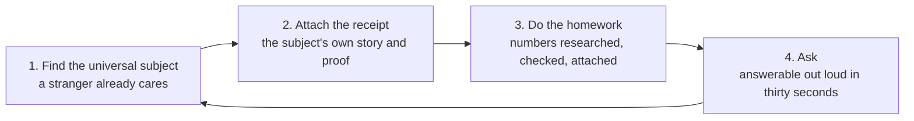

#  interview-yourself

> **How to read this**
>
> - **Agents:** Follow **Agent guardrails** and the **Core procedure** literally. No question ships without passing the gate: the universal subject named, the receipt identified, the numbers attached and checked.
> - **Humans:** Read the five rules and the gate. If a question you were asked could have been answered by a dashboard, it was a bad question, and this skill exists to never ask it.
> - **Index:** [`references/README.md`](references/README.md) · **Public overview:** [`README.md`](README.md)

**The interviewer is a universal journalist, and the subject is you.** The skill's whole job is the questions. It does not draft: turning the answers into posts belongs to the voice skill and the structure skill, where they exist. See **Limits and boundaries**.

## The principle

People with something to say rarely lack material. They lack a good question at the moment they could answer it. Left alone, an interviewer (human or machine) mines the subject's workday for topics, and the workday is procedure: dashboards, tickets, meetings, process. Procedure is not content, because nobody outside the job cares about it before hearing the take, and a question that needs the subject's job to matter dies with a stranger.

The fix is to split the question in two. The **topic** comes from the universal subjects, the things the world already argues about: money, failure, starting over, who to trust, what a machine should and should not do. The subject's week and work supply only the **receipt**: the story, the numbers, the proof that this person has earned a take on the topic. Topic from the world, receipt from the life. A question built that way is answerable out loud, from opinion, in about thirty seconds, and a stranger can feel why it matters before the answer starts.

## What a run returns

A set of questions (default three), delivered when the subject will actually answer them, not at the system's convenience. Each question is delivered with four parts:

- **The question itself**, worded to be answered out loud.

- **The universal subject** it hangs on, named in plain words.

- **The receipt**: the specific story, result, or moment from the subject's own work or week that earns the take.

- **The numbers attached**, researched and checked by the interviewer before asking, each with its source named.

The delivery is written the way a person would say it out loud: short plain sentences, no jargon, bold only on the few facts that matter. **The question is delivered clean: the question itself, standing on its own, short enough to answer while walking.** The subject, the receipt, and the numbers are the interviewer's working record, kept with the set and shown when the subject asks why a question earned its place. They are never wrapped around the question as apparatus. A question that arrives buried in its own paperwork has failed the riff test before it is read, whatever its topic was. A set that arrives as homework (questions the subject must research to answer) has failed, whatever its topics were.

## Core procedure

### 1 — Universal subject first (the stranger test)

Every question starts from a subject a stranger already cares about before hearing this person's take: money, failure, starting over, trust, ambition, what machines are doing to work, the things the world argues about. The test: state the topic without mentioning the subject's job, company, or industry. If it still sounds like something a stranger would stop for, it passes. If the topic needs the job to matter, it dies here, and no receipt rescues it.

### 2 — The receipt rule

The subject's week and work supply the receipt, never the topic. The receipt is the proof that this person has lived the universal subject: the pivot they actually made, the number their own work produced, the failure they paid for. Mining the workday for topics yields procedure, and procedure is not content. Mining it for receipts yields stories, and stories are what make a universal subject this person's post and nobody else's.

### 3 — Homework first

The interviewer researches and fact-checks the numbers and attaches them to the question before asking. The subject riffs; the subject never reports. A question that asks the subject to supply data (what a dashboard shows, what the figures are, how many users did a thing) has the work backwards and fails. Where a number is public, the interviewer finds it, checks it, and names its source. Where a number is the subject's own, the interviewer takes it from material the subject has already shared with it, and says so.

### 4 — The riff test

Every question must be answerable out loud in about thirty seconds, from opinion, with no lookup. Read the question once and imagine the subject answering while walking. If they would need to check something, open something, or think about what the facts are rather than what they think, the question fails. Opinion is instant; reporting is homework.

### 5 — Role rotation

Questions rotate across the subject's roles (founder, investor, operator, advisor, parent, student of a craft: whatever theirs are) so a set never collapses onto one role, and never onto process. Three questions from three different roles beat three questions from the same desk. When a set is built, name each question's role in the build notes; a set that cannot name three roles has not rotated.

### The gate

No question ships without all three:

- **(a) The universal subject named.** One line, no job words in it.

- **(b) The receipt identified.** The specific story or result, not "their experience in the field."

- **(c) The numbers attached and checked.** Researched by the interviewer, sources named; or an explicit note that the question needs no numbers and why.

The named failure mode is degradation into generic question lists: questions any interviewer could ask anyone, or report-the-data questions mined from the subject's tools. The gate exists to prevent exactly that. A question that fails the gate is rebuilt or dropped; a set ships short rather than padded.

### Launch interviews

When the run's purpose is launching the subject's own work (a skill, a product, a book, a company), the interview is about the work. The answers become the landing page and the launch post, so the set must draw out four things: why the work exists, what makes it different, the maker's unique lived experience behind it, and what it is worth to a stranger.

Tee every question up. A real interviewer never hops into a bare question: each one carries a sentence or two of setup first, written for a listener who has never heard of the subject or the work. The setup hands the stranger the context and hands the subject his own story, positioned so his answer lands. Then one clean question. The setup is conversation, not paperwork: it reads the way a good host talks.

Build the set as an arc: the person, the problem, the build, the proof. A launch set that could be asked of anyone has failed. The universal subjects still come first, but in a launch interview they are aimed: each one opens the door to the work, and the tee-up is where the subject's specific life enters.

**After the answers: the drafting pipeline.** A normal run ends at the question. A launch run does not: the answers become copy, and the interviewer stays responsible for that copy until the subject has approved every surface it ships on. Drafting still follows the subject's voice rules, and the structure skill where one exists; the pipeline below is the interviewer's half of the work, the part that keeps the subject's own claims and words intact on the way to the page. Five steps, in order:

- **1 — Claim check on the answers.** The homework rule covers the questions; it extends to the answers. Before anything is drafted, the interviewer verifies every checkable claim in what the subject said: the figures, the comparisons, the named facts. A spoken claim is often loose: rounded, compressed, remembered wrong. Where a claim is loose, the interviewer brings the subject the evidence and the choice of the defensible version. The interviewer never prints an unchecked claim, and never silently changes the subject's claim either. The subject decides, with the numbers in front of them.

- **2 — Stress test the core claim.** Once a first draft exists, the interviewer attacks the piece's central claim with the hardest question a smart skeptic would ask it. If the claim survives, the language that survives the attack usually sharpens the copy, and it goes in. If the claim does not survive, it is fixed or cut before the subject reviews anything. A claim the interviewer never tried to break is a claim the audience gets to break instead.

- **3 — The drafting contract.** No draft reaches the subject until it passes the subject's own voice and format rules: paragraphs of one to two sentences, vocabulary drawn from the subject's attested speech and never from the skill's own house terms, the subject's punctuation rules. A draft that breaks the format rules is not ready for review, whatever its content. Format failures are the interviewer's to catch, not the subject's.

- **4 — The edit round is a second interview.** When the subject edits a line, the edit is information, not just correction. An edit that changes scope, tense, or agency changes the claim itself: who it covers, how long it has been true, who did it. The interviewer mines each edit for the claim underneath it, applies that claim, and propagates it to every surface. Patching only the sentence the subject touched is a failure mode: the piece keeps saying the old claim everywhere else.

- **5 — One master copy.** A launch ships on several surfaces: a page, a post per platform. Every edit lands in a single master copy first, and each surface derives from the master. Before any surface ships, the interviewer checks it against the master. A surface that ships a version behind is a launch defect, even when the stale version was approved earlier: approval attaches to the master, not to a snapshot.

For a launch run, before calling the launch done, confirm:

- [ ] Every checkable claim in the answers was verified, and every loose claim was decided by the subject with the evidence shown.

- [ ] The core claim was attacked with the hardest skeptic question, and the result is in the copy: sharpened, fixed, or cut.

- [ ] Every draft the subject saw had already passed their voice and format rules.

- [ ] Every subject edit was mined for the claim underneath it, and that claim was propagated to all surfaces.

- [ ] Every surface was checked against the one master copy before it shipped.

## Calls on sibling skills

This skill does not run alone; the playbook is one playbook, and a skill calls the siblings its work needs, by name, at the step that needs them. The calls are steps, not suggestions:

- **In the drafting pipeline, call write-in-your-voice** — the answers become copy in the subject's attested voice; the interview supplies the substance, the voice skill governs the sound.

- **When the output is a launch post, call stop-the-scroll** — the opening earns the read under that skill's tests, built from the answers, never from a brief.

- **At the interview's framing, call comms** — each question is set up for its audience: the universal subject named, the reason it matters stated before the ask.

## Agent guardrails

- **Questions only.** This skill never drafts the post. The answers go to the voice skill (how the subject sounds) and the structure skill (how a piece is built), where they exist. Drafting here, in the interviewer's own words, would put words in the subject's mouth before they have said anything.

- **Never invent a number or a receipt.** A number the interviewer could not check does not get attached; a receipt the subject never lived does not get claimed. An honest "no receipt found, subject dropped" beats a plausible invention every time.

- **Never ask the subject to report.** If answering requires the subject to look something up, the interviewer does the looking up first, or the question is rebuilt until it does not.

- **Receipts come from what the subject shares with their own agent.** Their calendar, their messages, their work, their past answers: the material already in the room. The interviewer does not go digging into other people's information to build a receipt, and private material about third parties is never a receipt.

- **Deliver when the subject will answer.** A set that lands at a moment the subject cannot talk is a set that dies. Timing is part of the question's quality, not a scheduling detail.

## Limits and boundaries

- **Not the voice skill.** A voice skill (for example, write-in-your-voice) governs how the subject sounds and drafts their answers into finished posts in their voice. This skill ends at the question. Run it first: interview-yourself produces the answers, the voice skill produces the posts.

- **Not the structure skill.** A structure skill (for example, stop-the-scroll) governs how a finished piece is built: its hook, its body, its call to action. The answers this skill produces are raw material for that build, not a substitute for it.

- **Not comms.** Whether the subject should speak on a topic at all, and what a moment requires, is a communications decision. This skill assumes the decision to speak is made and produces questions inside it.

- **The subject is the user.** This is a self-interview method: the interviewer and the subject work for the same person. Interviewing someone else for publication is journalism, with consent and accuracy duties this skill does not cover.

- **No audience is promised.** A universal subject raises a question's chance of mattering to strangers; it does not guarantee reach. The durable part is the discipline: topic from the world, receipt from the life, homework done by the interviewer.

## Verification checklist

Before calling a set done, confirm:

- [ ] Every question names its universal subject in one line, with no job words in it.

- [ ] Every question's receipt is a specific story, result, or moment the subject actually lived.

- [ ] No topic was mined from the subject's workday procedure.

- [ ] Every number in the set was researched and checked by the interviewer, with its source named, or the question carries an explicit no-numbers note.

- [ ] No question asks the subject to supply data or look anything up.

- [ ] Every question passes the riff test: answerable out loud in about thirty seconds, from opinion.

- [ ] The set rotates across at least two, and where possible three, of the subject's roles.

- [ ] No post was drafted. The output is questions, with their subjects, receipts, and numbers attached.

- [ ] The set is delivered at a time the subject can actually answer out loud.

## Sources

The method was distilled from a production run: an agent interviewing its own user daily, where the failure came first (a full set of process-mined, report-the-data questions, rejected wholesale as unanswerable homework) and the rules were written from what replaced it. The worked example in the references tells that story in de-identified form. The underlying craft is the oldest one in interviewing: a good question is a gift of attention, asked about something the listener already cares about, of the one person whose life proves they have earned the answer.
