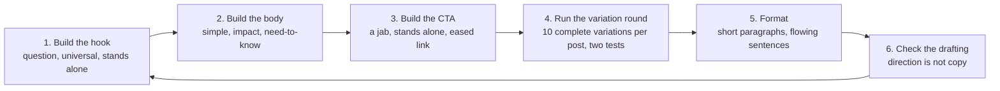

#  stop-the-scroll

> **How to read this**
>
> - **Agents:** Follow **Agent guardrails** and the **Core procedure** literally. Build the ends first. A piece whose hook or call to action cannot stand alone is not finished, whatever the middle looks like.
> - **Humans:** Run the two stand-alone tests on anything you are about to publish: screenshot the hook alone, then the call to action alone. If either needs the rest of the piece to make sense, rebuild that end.
> - **Index:** [`references/README.md`](references/README.md) · **Public overview:** [`README.md`](README.md)

**Not a substitute for voice or judgment.** This skill governs how a piece of content is *built*. It does not govern how the author sounds (that is the voice skill's job, where one exists) or whether the piece should exist at all (that is a communications decision). See **Limits and boundaries**.

## Sources

Full credit table: [`references/sources-and-urls.md`](references/sources-and-urls.md). The frame is AIDA (attention, interest, desire, action), the oldest structure in advertising, traced to E. St. Elmo Lewis around 1898 and set down by E. K. Strong in 1925. The thirteen principles that harden its ends were distilled from a single launch session in November 2026, in which one piece of launch copy went through fourteen versions and every rejection added a rule. The worked record is in [`references/case-study-bottleneck-launch.md`](references/case-study-bottleneck-launch.md). The testing backbone is Claude Hopkins' *Scientific Advertising* (1923): every end a keyed test, judged by counted results where results exist. Hopkins enters as method and frame — a practitioner source from before the controlled-study era, whose results are his own reports from his own campaigns, labeled as such wherever this skill leans on him and overruled by measured evidence wherever the two disagree.

## When to use

Use this skill when a **founder**, **marketer**, **creator**, or delegated agent is building or reviewing:

- A **launch post or thread** (X, LinkedIn) for a product, a skill, a feature, or an idea.
- A **video script or outline** (YouTube, short-form) where the first line decides whether anyone stays.
- **Website or landing copy** whose first screen and final call to action carry the whole conversion.
- Any **announcement** that competes in a feed against a hundred other pieces posted the same hour.

## When NOT to use

- **Private or one-to-one writing.** Messages, emails to a known person, and support replies are conversations, not feed content. Different rules govern them.
- **When the author's voice is the open question.** If the piece does not yet sound like its author, fix that first with the voice material; structure applied to the wrong voice produces a well-built piece by a stranger.
- **Crisis or response communications.** Whether to speak, who speaks, and what to admit are communications decisions that outrank construction. Build the piece with this skill only after those decisions are made.
- **Documentation and reference writing.** A reader who arrives with a question needs completeness and order, not a hook. Forcing feed structure onto reference material makes it worse at its actual job.

## Agent guardrails

1. **Build the ends first.** Draft the hook and the call to action before the body. The body is written to connect two ends that already work, never the other way round.
2. **Every end must pass two tests before the piece ships.** The sea-of-100 test: would this line stop a scroll among a hundred competing pieces? The stand-alone test: does this line, screenshotted alone, carry the full context a stranger needs? A line that fails either test is rebuilt, not defended. The stand-alone test also applies to every load-bearing post between the ends, the story above all: each carries its own setup, and transitions between posts are bridge lines written inside the posts, never context the reader is asked to remember.
3. **Talk to the reader, not at them.** The hook addresses the reader's own problem directly, as a question where the material allows. Announcements about the author are not hooks.
4. **Universal before technical.** Frame the problem so a reader outside the field feels it. If only practitioners can feel the problem, the framing is wrong, not the audience.
5. **No bare numbers, and statistics pass the stats rule.** Every metric in the piece carries its why: the impact, the second-order effect, who waits and what it costs. A number without its consequence is decoration for insiders. A statistic picked to land a point must multiply or reduce (more money, more efficiency, less waste, more speed), carry one visible number, demand no math from the reader, and show a change rather than a state.
6. **Name things as what they are.** Use the name a stranger understands on first reading. Internal labels, pet names for systems, and jargon are translated or cut.
7. **Need-to-know only.** Personal facts, backstory, and detail that do not serve the reader's understanding or the piece's action are cut, however interesting they are to the author.
8. **The link is earned, then eased.** The call to action builds to the link in the flow of the piece; the link never lands bare or abrupt. Where the author has a home page that captures the relationship (an email list, an account), link there rather than to a raw repository or file host, and let the link's preview carry the work's own branding.
9. **Direction is not copy.** When the author gives an example ("a jab like saying..."), a name, or a side comment while directing the work, that is instruction about the piece, not text for the piece. Illustrative examples are never forced into copy verbatim. This guardrail exists because it was violated four drafts running in the session this skill was distilled from.
10. **Formatting is part of the build, not a cleanup pass.** Paragraphs of one to two sentences; sentences inside a paragraph flow together; one blank line between paragraphs. One sentence per line is a draft artifact, not a style.
11. **Write the piece plain.** Short words where they carry the meaning, no hype adjectives doing the work the hook should do, and no claim the author cannot stand behind if the piece is quoted back at them.
12. **Correctness is a gate the principles do not cover.** No piece ships without a grammar pass on the exact final text: subject-verb agreement, articles, punctuation, hyphenation, parallelism. The principles judge whether a piece earns attention; none of them judges whether it is right, and a piece can pass every principle while carrying a plain agreement error.
12. **Never spell a formula out as a sentence.** Show it as math (three numbers, named rates, round percentages, readable in one glance) or walk it as plain words. The in-between form, a formula wearing a sentence's clothes, is the one form that is banned.
13. **Key the ends, and let counts outrank taste.** Every hook and call to action that ships carries an identifier its result can be counted under (see **The testing backbone**). Where counted results exist for earlier pieces, they are evidence in the variation round, not trivia after it: a winner picked against the counts needs a recorded reason, and a winner picked by taste alone, when counts existed, is not finished.

## The one idea

AIDA's four stages are not equal. In a feed, the middle stages (interest, desire) are where competent pieces are similar: clear, relatable, useful. The ends are where pieces die. A weak hook means the middle is never read; a weak call to action means it is read and forgotten.

So this skill hardens the ends. **The hook and the call to action are each built to stand out in a sea of 100 and to stand alone with full context.** A reader who sees only the hook should feel the problem and want the rest. A reader who sees only the call to action should get the whole idea, its name, and where to get it. The middle's job is narrower and more forgiving: be universal, be about impact, carry only what the reader needs.

The name is the standard: build every end as if it must win against the other ninety-nine pieces in the feed, because it must.

## The testing backbone — Hopkins

The two tests judge a piece before it ships. Hopkins judges it after. His rule, from *Scientific Advertising* (1923): advertising is salesmanship whose results can be counted, so count them. In this skill's form:

- **Key every end you ship.** Each hook and call to action that goes out carries an identifier — in the build notes, in the post's record, wherever the run keeps its accounts — so its result can be counted and set against the variations it beat. An end that cannot be told apart in the results cannot be learned from.

- **Counted results outrank taste.** Where results exist — an earlier piece's returns, a campaign's numbers — the variation round is judged against them first. The sea-of-100 and stand-alone tests still run; they decide what may ship. The counts decide what the next round believes.

- **Test small before spending big.** A new end earns a small audience before it earns the launch. Hopkins changed one element at a time and let small returns rule large spend; a feed piece does the same whenever the channel allows a limited first run.

- **A claim runs only if it can be tracked to a result.** Specific, checkable claims over general ones, for Hopkins' reason and this skill's: they test better, and they can be counted. A claim no result could ever confirm or refute is decoration, and guardrail 11 already bars the author from standing behind less.

The boundary is stated once and holds everywhere: Hopkins' era also sold patent-medicine claims, and none of that enters. The import is the testing method, not his copy examples and not his claim style; anything that conflicts with the author's claims discipline stays out, whatever its vintage. He is a fourteenth voice in the skill, not a fourteenth principle: the thirteen principles judge construction, Hopkins judges results, and the skill keeps the two judgments separate.

## What a run returns

A **build run** returns:

1. **The piece**, hook, body, and call to action visibly separated in the working draft (they merge into clean copy only in the final form).
2. **The two tests, per end**: the sea-of-100 verdict and the stand-alone verdict for the hook, and the same pair for the call to action, each in one line.
3. **The number audit**: every metric in the piece, with the why that accompanies it in the copy.
4. **The cut list**: material removed under need-to-know, named so the author can restore anything cut in error.
5. **The key record**: the identifier each shipped hook and call to action carries, and — once results exist — the counted result recorded against each key, so the next run's variation round starts from evidence rather than memory.

A **review run** returns the piece scored principle by principle (the thirteen in [`references/the-13-principles.md`](references/the-13-principles.md)), each marked pass or fail with the offending line quoted, and the rebuild order: ends before middle, always.

**Then run the writing pass. This step calls two sibling skills. It is a procedure, not a style reminder.** When a build or review run ships in raw workshop register, the tests and scores drown the copy itself, and a review reads as a checklist instead of a verdict the author can act on.

1. **Humanizer.** Run the work-humanizer skill in rewrite mode over the piece in its final form and over the run's returned verdicts and review report. Facts, figures, quotes, names, dates, and statuses never change in the pass. What changes is the register.

2. **Plain style.** Apply the writing-styles skill's plain rules to the result: short sentences, one idea each, numbers spoken the way a person says them, bold only on the few facts that matter.

3. **The gate.** The piece and the run's return are not done until the pass has run on the exact text being delivered.

## Core procedure

### 1 — Build the hook

Three requirements, all from the reader's side of the screen:

- **A direct, personal question about the reader's own problem** (principle 1). Talk to them, not at them. The reader should be answering the question in their head before they decide to keep reading.
- **The problem framed as a universal problem** (principle 2). Even when the topic is engineering, or finance, or any specialty: the wait, the waste, the thing everything depends on. Non-specialists must be able to feel it.
- **Built to stand out and stand alone** (principle 3). Sea-of-100: the line competes against the whole feed, not against the author's other drafts. Stand-alone: the line carries its full context; a reader who never sees the rest still gets a complete thought worth having read. The stand-alone rule is not only the hook's: it covers every load-bearing post in the piece, the story explicitly — a story post that leans on the thread around it for its setup fails the test and is rewritten with the setup inside the post.

### 2 — Build the body

The middle is universal, relatable, and about impact:

- **Simple, high-level language for multiple audiences** (principle 4). No geeky detail, no math nobody outside the field cares about. The specialist reading it should find it true; the generalist should find it clear.
- **Numbers carry their why** (principle 5). Every metric is followed by its business impact, its second-order effect, who waits and what it costs. Not just the granular goal: what the goal is *for*. And a statistic chosen to carry a point obeys the stats rule: it multiplies or reduces — it increases money, increases efficiency, reduces waste, or increases speed — and it passes three tests: **one visible number** (the eye needs a number to land on; "less than a third of the time" has none), **no reader math** (one number, not two numbers and a ratio to work out), and **a change, not a state** (a cut or a gain with direction beats a static share of a day or of the world). And every number is written the way a person says it out loud, rounded to the spoken form ("more than 304,000 emails," "$307 billion," "about 3 in 4"): a raw precise count (304,174) or a decimal abbreviation ($307.0B) fails, because a number the reader has to decode works against the scroll instead of with it. Exact figures live in the source notes; the copy carries the number as speech.
- **Things named as what they are** (principle 6). A software factory, not "my agents"; the name a stranger gets instantly. If a term needs a paragraph to explain, the term is wrong.
- **One everyday word per stage, held constant** (principle 6, extended). In any flow the piece describes, each stage gets one word a customer would use — tries became tasks, landed became shipped — and that word is used at every mention, in every post. If post 3 "ships 3 tasks an hour," post 5 says "only 3 shipped," or the reader cannot connect them.
- **Use the source's own result, not a summary of it.** When a post reports a test or a result, pull the specifics from the source material itself: the real numbers, the real failure kinds. Vague results read as marketing; the specific diagnosis is what makes a result post credible.
- **Formulas are shown as math or walked as plain words, never spelled out as sentences.** "Out comes tries, times how many tries work, times how many land" confuses everyone. And simple math, shown as math, can be simpler than words: three numbers, named rates, round percentages — "26 × 25% completion rate × 50% ship rate = 3 tasks shipped." The ban is on math the reader has to work at (bare metrics, conversions, formulas as sentences); math the reader can see in one glance is a clarity tool.
- **Lead with in vs out when there is a leak.** When a system loses most of what enters it, open with what went in and what made it out: "26 tasks went in. Only 3 shipped." The gap is the story; the stages are just its explanation.
- **Only what the reader needs to know** (principle 7). Personal facts that do not serve the piece are cut. The author's full story is not the reader's assignment.

### 3 — Build the call to action

The call to action gets the same hardening as the hook:

- **A jab, not a generic ask** (principle 8). It lands with a point of view, the sharpest true sentence the piece has earned. It must stop the scroll in a sea of 100 other calls to action, same as the hook.
- **It stands on its own as its own post** (principle 9): the idea, the name of the thing, and the link, with full context. A reader who sees only this post can act on it completely.
- **Ease into the link drop** (principle 10). The link arrives as the natural end of the piece's motion, never as a bare label-and-URL landing without a runway.
- **Link where the relationship lives** (principle 11). To the author's own site, where a reader can leave an email, not to a raw repository. The link's preview card carries the work's icon or branding, not the author's photo: the piece promotes the work.

### Threads: the architecture

A thread is built in this order: **hook → story → my example → stat → big win → call to action**, with a transition between each pair of beats. The transitions are bridge lines inside the posts ("My version of that line is..."), not context the reader has to remember from three posts ago. The beat before the call to action is the **big win**: the end result, the conclusion the whole piece has been walking toward, stated plainly. Every load-bearing post — hook, story, call to action — stands alone with full context (principles 3 and 9, extended to the story); the stat obeys the stats rule under principle 5.

When the piece's claim is "this sees what others miss," **show smart actors missing the whole picture**; do not just report the failure. The proof is the others missing it, each locally right and globally blind: "Every agent blamed a different bottleneck. Each one fixed what was in front of it. Nobody was looking at the whole hose, so the kink stayed hidden."

When the story sets a metaphor, the later beats **call back to it by name**: the method line, the big win, and the call to action each use the story's vocabulary at least once, rather than switching back to the abstract term. The metaphor is the whole image, not a single word from it: the callbacks draw on its full world, and at least one beat states the mapping plainly, out loud. The reader is carrying the picture; the callback deepens it, and the piece ends inside the story it opened. (From the founding launch: the story's world is a tap, water, a hose, and its kink. The method line: "Every system is a hose. Find the kink, the step everything waits on, and fix it first." The win line ends "...the skill found the kink in the hose in one night." The call to action opens "Every system is a hose with a kink in it.")

The story must also stop the scroll: the sea-of-100 test applies to it, not just to the ends. A boring story is raw material, not an excuse — the job is to take a boring story and make it exciting. The treatment: **name the character** (a named person sticks where "one slow kid" slides off), **give one concrete detail** (one picture does the work of a paragraph), **give the stuck beat its own short line**, **lean on the backwards turn, ending on an image** of the result rather than a summary of it, and **give the story stakes** — a deadline, a cost, or something at risk, stated in the setup, so the story has something that can be lost. And the story gets a **logic pass** alongside the stand-alone and punchy tests: every physical claim in it must hold together under a plain reading. A reader who stops to question how the story works has stopped scrolling for the wrong reason.

### 4 — Run the variation round

Steps 1 to 3 produce first drafts, not finals. Before any post in the piece is locked, every post goes through the round:

- **Ten complete variations per post.** The hook, every load-bearing middle post, and the call to action each get 10 full drafts. A complete variation is a whole post built from a different angle: a different question, a different entry into the story, a different proof, a different jab. Ten versions of one sentence with the words moved around count as one variation, not ten.

- **Judge every variation against the two tests.** Sea-of-100: would this post stop a scroll in a full feed? Stand-alone: does it carry its full context for a reader who sees only this post? A variation that fails either test is out, however good it sounded in the workshop.

- **Build the piece from the winners.** One winner per post. A thread of five or six posts means 50 to 60 candidates. That is the honest cost of the tests: a hook picked from a single draft was never tested against the sea, it was only written.

- **Record why each winner won.** One line per post in the build notes, naming what the winner passed that the others failed. The judgment has to be auditable later. "It felt stronger" is not a reason.

- **Judge against the counts where counts exist.** Hopkins' backbone (see **The testing backbone**): if earlier pieces in this line have counted results, the round reads them before it judges anything. A variation in the family of a counted loser starts behind; a variation that contradicts a counted winner carries the burden of saying why. Taste breaks ties. It does not overrule returns.

The ends are locked only after the round. A hook or a call to action is never final because it was written first.

### 5 — Format

- **Paragraphs of one to two sentences** (principle 12). Sentences inside a paragraph flow together as prose; never one sentence per line.
- One blank line between paragraphs. In a thread, each post is a paragraph group, and the hook post and the call-to-action post are each complete on their own (steps 1 and 3).

### 6 — Check the drafting

- **Direction is not copy** (principle 13). Re-read the author's instructions alongside the draft. Anything the author said *about* the piece (an example jab, a naming aside, a side comment) that appears *in* the piece verbatim is removed, unless the author explicitly marked it as copy.
- Read the piece aloud once. The ends should sound like the same person who wrote the middle, and the whole should sound like something said, not something typeset.

## Calls on sibling skills

This skill does not run alone; the playbook is one playbook, and a skill calls the siblings its work needs, by name, at the step that needs them. The calls are steps, not suggestions:

- **At drafting, call write-in-your-voice** — hooks land in the author's own attested voice or they read as ads; the voice bank governs the sound of every variation.

- **At the position check, call positioning** — a hook that contradicts the adopted position is cut, however strong it tests; the position decides what may be promised.

- **At the message's job, call comms** — who must do what after reading is settled before the hook is judged.

## Limits and boundaries

- **Not the voice skill.** A voice skill (for example, write-in-your-voice) governs how an author sounds: cadence, word choice, the sentences the piece is built from. This skill governs how the piece is *built*: which end carries what, in what order, under what tests. Run both: source the language from the voice material first, then build the structure with this skill. Structure cannot rescue a piece written in the wrong voice, and voice cannot rescue a piece with no hook.
- **Not comms.** The comms skill governs founder communications decisions: whether to speak, who speaks, what a moment requires, how a crisis is answered. This skill takes a decided piece and builds it. If the open question is *should this be said*, that skill answers first.
- **No reach is promised.** These principles raise a piece's chance in the feed; they do not control any platform's ranking, and they age as platforms change. The two stand-alone tests are the durable part; specific platform tactics belong in channel playbooks, not here.
- **The tests are for feed content.** A piece designed for a reader who already arrived (a documentation page, an email to subscribers who asked for it) is judged by its own purpose. Applying sea-of-100 hardening to everything flattens writing that was never competing.

## Verification checklist

Before calling a piece done, confirm:

- [ ] The hook is a direct question (or direct address) about the reader's own problem.
- [ ] The problem is framed universally; a non-specialist can feel it.
- [ ] The hook passes the sea-of-100 test and the stand-alone test.
- [ ] Every number in the body carries its why: impact, second-order effect, who waits, what it costs.
- [ ] Every statistic passes the stats rule: it multiplies or reduces, shows one visible number, asks no math of the reader, and shows a change, not a state.
- [ ] Every number is in its spoken form: rounded the way a person says it, no raw precise counts, no decimal abbreviations.
- [ ] Every thing is named as what it is, in words a stranger gets instantly.
- [ ] Nothing in the piece is there only because it is true or interesting; everything serves the reader or the action.
- [ ] The call to action is a jab with a point of view, not a generic ask.
- [ ] The call to action stands alone: idea, name, and link, full context.
- [ ] The variation round ran: 10 complete variations for the hook, every load-bearing middle post, and the call to action, each judged against the sea-of-100 and stand-alone tests, and the reason each winner won is recorded in the build notes.
- [ ] Every shipped hook and call to action is keyed, and where counted results exist for earlier pieces, the round was judged against them — any winner picked against the counts carries its recorded reason.
- [ ] In a thread: the story post carries its own setup and stands alone, transitions are bridge lines inside the posts, and the beat before the call to action is the big win.
- [ ] The story passes the sea-of-100 test: named character, one concrete detail, the stuck beat on its own short line, a backwards turn, an ending on an image not a summary, and stakes stated in the setup.
- [ ] The story passes the logic pass: every physical claim in it holds together under a plain reading, with no step a reader would stop to question.
- [ ] If the story set a metaphor, the method line, the big win, and the call to action each call back to it, drawing on the metaphor's whole world, and at least one beat states the mapping plainly.
- [ ] Results are quoted from the source material itself (real numbers, real failure kinds), not summarized into vagueness.
- [ ] No formula is spelled out as a sentence; shown math is three numbers, named rates, round percentages.
- [ ] Each stage of any flow keeps one everyday word at every mention, across every post.
- [ ] Where the system leaks, the piece leads with in vs out before walking the stages.
- [ ] If the claim is "this sees what others miss," the piece shows smart actors missing it, each locally right and globally blind.
- [ ] The link is eased into, points to the author's own site, and its preview carries the work's branding.
- [ ] The grammar pass ran on the exact final text — agreement, articles, punctuation, hyphenation, parallelism — and every finding is fixed, or the piece does not ship.
- [ ] Paragraphs run one to two sentences, sentences flow within them, one blank line between.
- [ ] No illustrative example or side comment from the author's direction appears in the copy verbatim.
