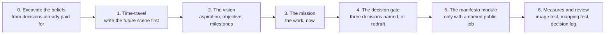

#  vision-and-manifesto

> **How to read this**
>
> - **Agents:** Follow **Agent guardrails** and the **Core procedure** literally. The scene comes before the statement, the statement comes before the gate, and a run is not finished until the gate has been passed with named decisions.
>
> - **Humans:** Read **The one idea**, then the output contract. If a draft vision you are shown names no decision it changes, send it back — that test is the skill.
>
> - **Index:** [`references/README.md`](references/README.md) · **Public overview:** [`README.md`](README.md)

**Not a substitute for strategy.** This skill writes the beliefs a company runs on. It does not decide what the company sells or how it is positioned (the positioning skill's ground), and it does not write the public moments that carry the beliefs (the comms skill's ground). See **Limits and boundaries**.



## Sources

Full credit table: [`references/the-evidence.md`](references/the-evidence.md). The method stands on the vision-communication research program of Andrew Carton and co-authors (image-based language, the four-value limit, the NASA archive study), on Baum, Locke and Kirkpatrick's link between vision content and venture growth, and on the gate evidence: Bart, Bontis and Taggar on mission statements and behavior, and Gartenberg, Prat and Serafeim on purpose working only when paired with clarity. Collins and Porras enter labeled as retrospective case lore, with the Halo Effect caveat attached. Simon Sinek is excluded by name; the reasons are in **Limits and boundaries**.

## When to use

- **Founding or refounding.** A company is starting, pivoting, or being re-led, and the beliefs it runs on have never been written at the standard this skill demands.

- **The wall-text problem.** A vision or mission exists and changes nothing: no one can say what it rules out, hiring does not use it, and money does not follow it.

- **Growth past the founder's voice.** The team is now too large for the beliefs to travel by osmosis from one person's calendar, and the drift between rooms has started to cost decisions.

- **A public long form is genuinely needed.** Recruiting depends on belief self-selection, a movement needs building, or the belief itself is part of the product — the three named jobs that unlock the manifesto module.

## When NOT to use

- **As a substitute for strategy.** If the open question is what the company is, for whom, and instead of what, that is positioning. A vision written over an undecided strategy decorates the gap.

- **For a single public moment.** A launch post, a keynote, a careers page: those are comms surfaces. They borrow the finished core this skill produces; they are not a reason to reopen it.

- **To manufacture beliefs the company does not hold.** The excavation step reads beliefs out of decisions already paid for. A leadership team that wants language it has not yet paid for is asking for fiction, and this skill will surface that at the gate rather than write it.

- **Mid-crisis.** Statements written to survive a bad quarter are apologies in costume. Decide the crisis first; write beliefs in calm weather.

## Agent guardrails

1. **Scene before statement.** No vision language is drafted until the future scene exists in concrete prose: a place, a time, people doing specific things. A run that starts from adjectives is restarted at Step 1.

2. **Image-based or it fails.** Every load-bearing word in the vision must be picturable. Abstract value words — excellence, integrity, innovation, world-class — carry no image and are cut on sight, however sincerely they are meant. The research is blunt about this: they are the default failure (see Step 2).

3. **Four values or fewer.** If the core names values, it names at most four. A longer list prioritizes nothing and tests as noise; the benefit in the research holds at four or fewer and disappears past it.

4. **One core, three lengths, no variants.** The vision, the mission, and the manifesto are compressions of the same belief set. Any wording that cannot be traced to the core is cut. There is no grander version for investors, no softer version for recruits; a per-audience variant is a claims violation, not a communications choice.

5. **The gate defines done.** A run finishes only when the record names at least three real decisions the statements change — across hiring, firing, and where money goes — and passes the clarity mapping test in Step 4. A statement that changes no decision is returned for redraft, with the failure named.

6. **No named job, no manifesto.** The manifesto module fires only when the record names its public job: recruiting self-selection, movement-building, or belief-as-product. Enthusiasm for long-form writing is not a job.

7. **Specificity is priced, not free.** A quantifiable objective with milestones buys belief because missing it costs face. The record states that cost openly — who will hold the company to the number, and what a miss will be read as — before the number is adopted.

8. **Write the record plain.** Short sentences, everyday words, bold only on the few facts that matter. The statements themselves are written to be said out loud by a tired person at the end of a long day; if they cannot survive that reading, they are not finished.

## The one idea

Most vision work fails in a predictable way: it produces language. A sentence for the wall, a paragraph for the website, a longer one for the handbook — each written separately, each drifting a little further from anything the company actually does, until the words are decor. The research says the document alone does nothing; what works is narrower and harder. A future pictured concretely enough that people can see it. Beliefs few enough to remember. Language plain enough that a person on the front line can say what it means for their work this week. And a test with teeth: the statements earn their place only by changing decisions.

So this skill produces **one core at three lengths**. The **vision** is the future as a scene, compressed into a statement that keeps the scene's image. The **mission** is the same beliefs pointed at the present: the work, now, for whom, to what end. The **manifesto** is the long public form — and it is the exception, not the default. It exists only when a named public job needs it, because public belief language without a job spends credibility to no end. One core means the three cannot drift apart: each is checked against the beliefs, not against the other drafts.

## The evidence in brief

Every load-bearing claim in the procedure is labeled here with where it was measured; the full table, with grades and limits, is in [`references/the-evidence.md`](references/the-evidence.md).

- **Image-based language works; abstract language does not.** Carton, Murphy and Clark (2014) and Carton and Lucas (2018), in the *Academy of Management Journal*: visions built on concrete imagery outperform value-word visions on the outcomes leaders say they want, and fewer than one in ten leaders use strong imagery — the "blurry vision bias." The same program sets the values limit: the benefit holds at four values or fewer.

- **Structure: aspiration, objective, milestones.** Carton's NASA archive study (2018): the Kennedy-era language worked because one aspiration was narrowed to a concrete, quantifiable objective and broken into milestones, in words employees could map to their daily work.

- **Content and communication carry the effect.** Baum, Locke and Kirkpatrick (1998): vision attributes and content were tied to venture growth, and the path ran through communication — a vision held silently by the founder does not compound.

- **The gate.** Bart, Bontis and Taggar (2001): mission statements related to performance only through changed behavior and alignment. Gartenberg, Prat and Serafeim (2019), in a large firm sample: purpose alone showed no relation to performance; purpose with clarity — employees able to say what it means for their work — did.

## Core procedure

### Step 0 — Excavate the beliefs

Beliefs are read out of evidence, not brainstormed. Gather what the company has already paid for: decisions that cost something — the customer refused, the hire not made, the money not taken, the feature killed, the standard defended when it was expensive. Interview the founder or leadership for those moments and the reasoning given at the time. The beliefs that recur across costly decisions are the core candidates. A belief nobody has ever paid for is an aspiration; it may enter the vision's future scene, but it is labeled as aspiration and never dressed as a founding belief. The excavation also names the anti-beliefs: what this company will not become, stated as plainly as what it will. **Sibling call — first-principles-thinking:** the excavation runs as a decomposition — the company stripped to the decisions it has actually paid for, bedrock evidence — and no belief enters on the strength of how the company talks about itself.

### Step 1 — Time-travel: write the scene first

Before any statement language, write the future as a scene, in prose: a specific year, a place, the people in it, what they are doing, what an ordinary day looks like inside the future the company wants. Mental time travel is the antidote the research points to for blurry vision: a leader who has stood in the scene writes images; a leader who has only listed values writes abstractions. The scene runs a paragraph to a page. It is a working document, not a deliverable — but nothing downstream is drafted until it exists and the leadership accepts it as the future they actually want, not the future that sounds well.

### Step 2 — Draft the vision

Compress the scene into the vision statement, on the NASA pattern: **one aspiration**, narrowed to **a concrete, quantifiable objective**, broken into **milestones**. Rules:

- Keep the scene's central image in the statement. If the scene is a city on another planet, the statement carries the city, not a synonym for ambition.

- The objective is countable and dated: a number, a population, a place, a state of the world a stranger could verify. Vague scale words ("leading," "for everyone") fail.

- Milestones are few and ordered — the three to five waypoints that prove the path is real, each itself checkable.

- If values are named anywhere in the core, they are at most four, each stated as a behavior a stranger could recognize, not a noun: what the company does, not what it admires.

- Run the image test on the draft: read it to someone outside the company. If they cannot picture the scene it points to, the draft is still abstract — return to Step 1, not to a thesaurus.

### Step 3 — Draft the mission

The mission is the same core in the present tense: the work the company does now, for whom, and what changes because it does it. One or two sentences. Tests: it names the work specifically enough that a different company's mission could not be swapped in unnoticed; it is true today, not at the milestone horizon; and it fits the vision as its first milestone's engine — the mission is how the scene gets built, stated as today's job. **Sibling call — comms:** with both statements drafted, test them as communication before the gate — who must be able to repeat each one, and what the hearer must be able to do differently because they heard it.

### Step 4 — The decision gate

The statements now face the gate, in full in [`references/the-decision-gate.md`](references/the-decision-gate.md). Two tests, both binding:

- **The decision test.** Name at least three real decisions the statements change or would have changed — drawn from hiring (who gets in, who is promoted), firing (what conduct or drift ends employment), and money (what gets funded, what gets refused). Each named decision states what the old default was and what the statement now requires. Fewer than three, or decisions the leadership would not actually enforce, and the statements go back for redraft: they are decoration, and the record says so.

- **The clarity mapping test.** Three people in three different roles each state, unprompted, what the vision means for their own work this quarter. If their answers do not map to the same future, clarity has failed — the Gartenberg condition — and the language is simplified until the mapping holds. Purpose without this mapping showed no relation to performance in the evidence; the skill treats an unmapped vision as an unfinished one.

### Step 5 — The manifesto module (gated)

Only if the record names a public job for it: **recruiting self-selection** (the beliefs must filter who applies, in both directions), **movement-building** (the company is asking people who will never buy to join something), or **belief-as-product** (the belief is itself part of what is sold). With the job named, the manifesto is written from the same core at public length — the beliefs in order, the scene in full, what the company refuses, and the invitation the named job requires. The module's full rules are in [`references/manifesto-module.md`](references/manifesto-module.md). Without a named job, this step is skipped and the record states that it was skipped, and why. **Sibling call — stop-the-scroll, when the module fires:** a manifesto with a named public job is public writing, built to move people who were not looking for it; its opening and its invitation are built and tested under that skill's rules.

### Step 6 — Measures and review

The record closes with how the statements will be kept honest: the **image test** repeated on new hires at intervals (can they picture it), the **mapping test** repeated as roles change, and a **decision log** — the running list of decisions the statements actually changed, reviewed on a stated date. A vision whose decision log stays empty for two review cycles is due for the gate again, from Step 0: either the beliefs were never real, or the company has drifted from them, and the record should say which.

## Calls on sibling skills

This skill does not run alone; the playbook is one playbook, and a skill calls the siblings its work needs, by name, at the step that needs them. The calls are steps, not suggestions:

- **Step 0 calls first-principles-thinking** — the excavation decomposes the company to the decisions it has paid for, so beliefs are read off bedrock, not brainstormed off self-description.

- **Step 3 calls comms** — the drafted statements are tested as communication: who must repeat them, and what the hearer must be able to do differently, before the gate judges them as decisions.

- **Step 5 calls stop-the-scroll, when the manifesto module fires** — a manifesto with a named public job is public writing; its opening and invitation are built under that skill's rules.

## Output contract — the vision record

Every run returns one record. The statements lead; the evidence and the gate results follow, because a reader should meet the words first and the proof immediately after.

```text
— The core —
Beliefs:              <at most four, each stated as a behavior, each traced to a decision that cost something — or labeled aspiration>
Anti-beliefs:         <what the company will not become, stated as plainly>

— The vision —
The scene:            <the future scene in prose, a paragraph — the working document the statement compresses>
Vision statement:     <the aspiration in the scene's own image, one or two sentences>
Objective:            <the concrete, quantifiable objective — countable, dated, verifiable by a stranger>
Milestones:           <three to five ordered waypoints, each checkable>
Cost of specificity:  <who will hold the company to the objective, and what a miss will be read as — stated before adoption>

— The mission —
Mission statement:    <the work now, for whom, what changes — one or two sentences, true today>

— The gate —
Decisions changed:    <at least three real decisions across hiring, firing, and money — old default, and what the statement now requires>
Mapping test:         <three roles, their unprompted statements of what the vision means for their work this quarter — pass, or the simplification made>

— The manifesto —
Public job:           <recruiting self-selection / movement-building / belief-as-product — or "none named; module skipped">
Manifesto:            <the long form, only when a job is named>

— Measures —
Review date:          <when the image test, mapping test, and decision log are next reviewed>
```

**The vision document is a required deliverable.** Every run also returns a standalone one-page document carrying the vision and the mission as finished pieces a person can read on their own — the statements, the scene in brief, the objective and its milestones, and the beliefs, in plain prose — delivered as a document and a PDF alongside the record. When the manifesto module is skipped, the page carries the gate's verdict in one plain line. Section markers carry icons from **Hugeicons (free version)** — the house icon library — in the library's stroke style at one consistent weight, sparingly, and only where the icon carries the section's meaning; an icon that carries no meaning is decoration and does not ship. Statements buried inside a longer record do not meet this contract — the words are the deliverable, and they ship as a page someone can hold.

**Then run the writing pass. This step is a procedure, not a style reminder.** When a record ships in workshop register, the statements read as a consultant's artifact instead of words a company can run on, and the gate results read as a checklist instead of a verdict.

1. **Humanizer.** Run the work-humanizer skill in rewrite mode over the record. Facts, decisions, numbers, and statuses never change in the pass. What changes is the register.

2. **Plain style.** Apply the writing-styles skill's plain rules to the result: short sentences, one idea each, numbers spoken the way a person says them, bold only on the few facts that matter. The statements themselves get the strictest reading: they must survive being said out loud by a tired person at the end of a long day.

3. **The gate.** The record is not done until the pass has run on the exact text being delivered.

**Field-test records carry one more requirement.** When a run is filed as a field test of this skill, the record opens with a plain section — the verdict and the headline findings in short sentences a person would say out loud — before any working detail. The verdict sections themselves, the gate results and the verdict on the skill, are written plain in their own right: dense analyst prose with a plain summary pasted on top fails this contract. The plain-style rule applies by name to the human-read parts of a field-test record — the opening and every verdict. Working detail below the opening may stay as dense as the evidence needs.

## Limits and boundaries

- **The document alone does nothing.** The mission-statement meta-analyses (Desmidt et al. 2011; Alegre et al. 2018) find weak and inconsistent links between having statements and performing. This skill's whole design follows from that: the statements are the smallest part of the work, and the gate and the measures are the rest of it. A user who wants only the sentences should be told plainly that sentences are not the deliverable.

- **Collins and Porras are lore, labeled.** *Built to Last* (1994) contributes vocabulary — core ideology, the big audacious goal — that the field still uses. Its method is retrospective case selection: companies were picked because they had already won, and their traits were then read as causes. Rosenzweig's *The Halo Effect* (2007) names exactly that error. The vocabulary may be used; the causal claim may not. Nothing in the procedure rests on it.

- **Sinek is excluded, by name.** Simon Sinek's Golden Circle is popularity, not evidence: it has no peer-reviewed test, and the brain biology offered for it is discredited. It is named here so a user who asks for it gets the reason, not a silent substitution. If a user insists on the frame after hearing the reason, that is their call — recorded as theirs, not as this skill's method.

- **Not positioning.** Positioning decides what a product will be thought of as, against named alternatives, for best-fit customers. This skill decides what the company believes and where it is going. The two chain in one direction: a finished vision can inform a positioning run's excavation, and a positioning record never substitutes for a vision — a company can be perfectly positioned and pointed nowhere.

- **Not comms.** Comms governs whether and how the company speaks in a moment. This skill produces the core those moments borrow. The manifesto is the one public artifact the skill itself writes, and only under its gate; every other public surface borrows the core through comms, at comms' standards.

- **Not a fundraising variant.** The vision in a pitch deck is this record's vision, at the same specificity. A grander version written for a raise is a claims violation under Guardrail 4. Fundraising borrows the finished core the way it borrows a finished position: whole, or not at all.

- **The gate can be gamed, and says so.** Named decisions can be chosen for cheapness — three trivial decisions pass the letter of the test. The gate therefore requires decisions the leadership would actually enforce, across all three domains, and the record's reviewer is instructed to weigh cost: a decision that cost nothing proves nothing. This is a judgment the skill demands, not a loophole it hides.

## Verification checklist

Before calling a run done, confirm:

- [ ] The scene exists in concrete prose — a year, a place, people doing specific things — and was written before any statement language.

- [ ] Every load-bearing word in the vision is picturable; no abstract value words carry weight anywhere in the core.

- [ ] The core names at most four beliefs, each stated as a behavior, each traced to a costly decision or labeled aspiration.

- [ ] The vision follows the pattern: one aspiration, a quantifiable and dated objective, three to five checkable milestones.

- [ ] The cost of specificity is stated in the record before the objective is adopted.

- [ ] The mission is true today, names the work and whom it serves, and could not be swapped with another company's unnoticed.

- [ ] The decision test names at least three real decisions across hiring, firing, and money — old defaults and new requirements both stated.

- [ ] The mapping test ran on three roles, unprompted, and the answers map to the same future — or the language was simplified until they did.

- [ ] The manifesto exists only if a public job is named in the record; if none is named, the record states the module was skipped, and why.

- [ ] All three lengths trace to the same core; no per-audience variant exists anywhere in the record.

- [ ] Measures and a review date are set: image test, mapping test, decision log.

- [ ] The writing pass ran on the exact text delivered — humanizer, then plain style.

- [ ] The vision document shipped with the record: the standalone one-page document and PDF, statements as finished pieces, the manifesto verdict in one line if the module was skipped, Hugeicons on the section markers.

- [ ] If this run is filed as a field test: the record opens with a plain verdict section, and its verdict sections are written plain in their own right.
