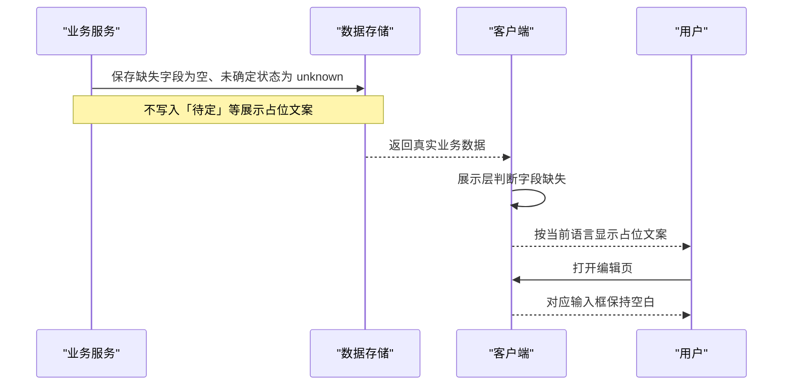

# Coderbook

## 配套 Skills

使用 Coderbook 前，检查以下三个 skill 是否已安装；缺少时提示用户安装缺少的项。

| Skill | 用途 | 安装来源 |
| --- | --- | --- |
| `karpathy-guidelines` | 编码行为准则 | [multica-ai/andrej-karpathy-skills](https://github.com/multica-ai/andrej-karpathy-skills) |
| `ponytail` | 简洁实现与避免过度设计 | [DietrichGebert/ponytail](https://github.com/DietrichGebert/ponytail) |
| `coding-architecture-diagrams` | 代码与架构图绘制 | 随包提供的 [coding-architecture-diagrams/SKILL.md](../coding-architecture-diagrams/SKILL.md) |

前两项可通过 [skill-installer](https://developers.openai.com/codex/skills#install-curated-skills-for-local-use) 按上述仓库链接安装；第三项将随包的 `coding-architecture-diagrams` 文件夹与 `coderbook` 一起放入技能目录。

编码时配合使用 `karpathy-guidelines` 和 `ponytail`，绘制架构图时使用 `coding-architecture-diagrams`。

## 一、功能讨论与结果输出

每次功能讨论时，用一句话描述本质问题。

最终结果前面附一张 `coding-architecture-diagrams` skill 绘制的架构图，结尾用一句话清楚描述 summary。架构图示例见本文最后。

## 二、代码设计与实现

- 代码修改要保持架构和系统优雅、简洁，从本质解决问题，不是 patch。
- 检查本次修改是否破坏项目原有架构、是否引入新的问题，是否拆分到了具体的功能模块。
- 避免过度设计，不要过度考虑理论上的极端 corner case，为了解决 99 到 100 分的问题引入巨大的改造。
- 修改数据库表结构时，必须按项目的迁移机制与目录约定添加迁移记录文件。

## 三、Commit 规范

- **按仓库、按独立功能边界提交**，多个功能点拆成多个 commit，每个提交只解决一个问题。
- **每个 commit 都要原子、可独立理解和验证**，不能夹带顺手重构或无关文件。
- **Commit subject 简洁说明做了什么**；空一行后的中文一句话 body 必须说明“改了什么解决了什么问题”，确保别人在 Git 历史里一眼就能看懂。
- 提交前重新运行对应测试、lint 和 `git diff --check`，再检查 staged diff
- 只 stage 本次功能文件，保留用户已有未跟踪文件，不提交 E2E 输出、报告或截图。
- push前必须检查当前分支的base是否变化，如果变化需要进行rebase，确保 git 分支记录简洁明了

**示例：**

- `refactor(editor): unify edit context handling`：统一不同编辑入口的上下文处理，并简化延迟事件存取，解决用户编辑信息丢失和数据投影重复复杂的问题。
- `feat: pass original and confirmed values to processing`：向后续处理流程同时传入修改前的数据和用户确认后的最终值，让处理逻辑能识别用户实际修改。
- `refactor(tasks): remove legacy state tracking`：删除旧任务状态的双读双写链路，统一由任务管理模块管理生命周期，解决多套状态源不一致的问题。

## 四、PR 规范

PR 里需要包括：

- 需求目的。
- 解决方案，让别人一眼知道做了什么、解决什么问题。
- 从用户侧的产品功能有什么变化。

## 五、Code Review 规范

**三个阶段：**

1. **Pass 1: Code quality.** Logic errors, performance issues, maintainability.  
   第一阶段：代码质量。逻辑错误、性能问题、可维护性。
2. **Pass 2: Security.** Vulnerability scanning, authentication boundary checks, injection risks.  
   第二阶段：安全性。漏洞扫描、身份验证边界检查、注入风险。
3. **Pass 3: Dependency scan.** Supply chain risks, version conflicts, license issues.  
   第三阶段：依赖关系扫描。供应链风险、版本冲突、许可问题。
核心原则：
- 是否系统优雅、简洁，从本质解决问题，不是 patch。
- 是否破坏项目原有架构、是否引入新的问题，是否拆分到了具体的功能模块。
- 是否避免过度设计，不要过度考虑理论上的极端 corner case，为了解决 99 到 100 分的问题引入巨大的改造。

**提交后的 Review：**

每次 Agent 提交代码后，需要使用 2 个不同的 Agent 进行 review；只要两个 Agent 都 review 出了相同的问题点，就需要人工介入。

## 六、测试与验收

### 1. Agent-led E2E Test

执行 Agent-led test（E2E test），首先验证正常主流程是否功能正常：

然后针对本次功能点，设计对应的 E2E test 以及测试点，保留关键截图验证，最后生成一份 report。

### 2. 前端 Review 注意事项

**以后固定执行的门槛：先写不变量，再写 UI。**

- 模态是否阻断底层？
- 谁拥有 pending state？
- 成功、取消、关闭、失败分别如何收口？
- 回调是否保证最多执行一次？

**优先采用系统语义：**

- 真正的模态交互使用平台或框架提供的标准模态组件。
- 不用自制覆盖层人工模拟输入交互和无障碍访问隔离。
- 用布局约束与对齐表达位置，不靠固定占位元素撑位置。

**交互状态矩阵必须覆盖：**

- 检查授权期间点击跳过、编辑、提交等操作。
- 授权界面取消、关闭。
- OAuth 取消、失败、成功。
- 成功后只提交一次。
- 模态打开时，屏幕阅读器不能访问底层内容。

**布局矩阵必须覆盖：**

- 短值、普通值、长值。
- 不同屏幕或窗口尺寸。
- 系统字体大小或文字缩放设置。
- 产品支持的不同语言。

### 3. 最终验收必须针对交付对象

- 读取远端 PR head。
- 确认本地测试 commit 与 PR head 一致。
- merge/rebase 后重新跑关键测试和截图。
- 不能用另一个分支的正确实现替 PR 作结论。

## 七、架构图示例

