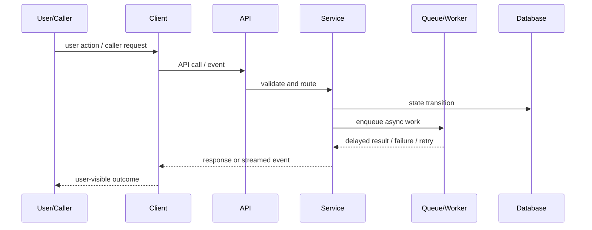
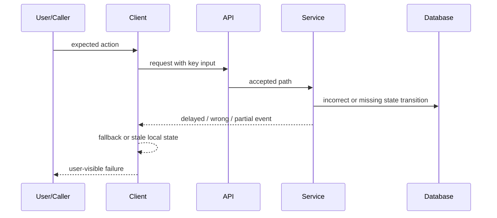
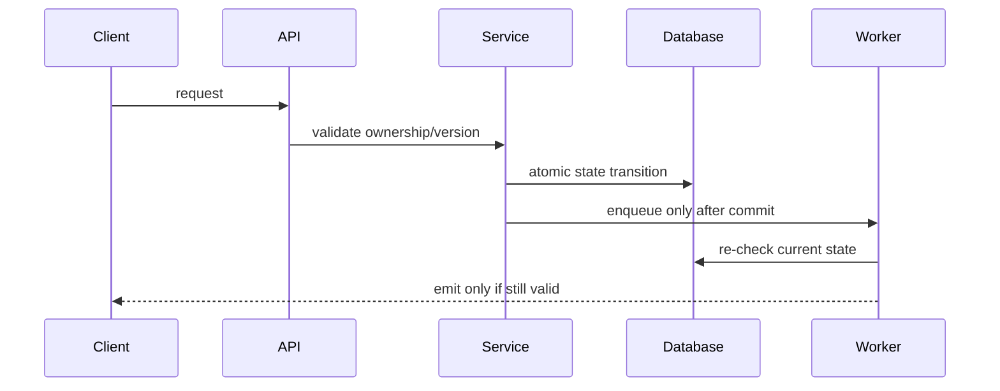

# Coding Architecture Diagram Standard

Use this skill whenever a diagram would make code behavior, architecture, a bug mechanism, or a refactor plan easier to reason about.

The preferred default is a compact Mermaid `sequenceDiagram` that explains how the system behaves over time.

## Core Principle

Do not draw component inventory. Draw the causal spine:

```text
trigger -> boundary crossing -> state transition -> downstream reaction -> user/data outcome
```

The diagram should answer:

- What started the flow?
- Which component changed state?
- Which request, event, message, or job crossed a boundary?
- Which fallback, lifecycle rule, retry, race, or invariant fired?
- What did the user, caller, database, or downstream system observe?

## Default Sequence Shape

Use this shape unless another Mermaid diagram type is clearly better:



Adapt participants to the project:

- `User` / `Caller`
- `Client` / `Frontend` / `Mobile`
- `API` / `Gateway`
- `Service` / `Worker`
- `Queue` / `Bus` / `Stream`
- `DB` / `Cache` / `Object Store`
- `External API`
- `Auth`
- `Scheduler`
- `Webhook`

## Diagram Rules

- Prefer 4-7 participants.
- Prefer 6-10 meaningful steps.
- Put time in top-to-bottom order.
- Name the boundary that matters: HTTP, WebSocket, RPC, queue, pub/sub, DB write, webhook, file write, cache update, cron, lock, transaction, or callback.
- Use labels that include state transitions, not vague verbs:
  - Good: `write deleted_at tombstone`
  - Good: `enqueue job with stale id`
  - Good: `retry after timeout`
  - Good: `drop event because version mismatch`
  - Weak: `process request`
- Show local state transitions when they explain behavior:
  - `create placeholder`
  - `optimistic update`
  - `mark pending`
  - `clear cache`
  - `resume session`
- For bugs, show the broken invariant explicitly.
- For fixes/refactors, show the new invariant explicitly.
- Keep sensitive data out of diagrams: no secrets, tokens, raw logs, private payloads, presigned URLs, full user text, or production-only private data.

## Choosing Diagram Types

Use Mermaid `sequenceDiagram` by default.

Use another Mermaid type only when it explains the work better:

- `stateDiagram-v2`: lifecycle or state machine.
- `flowchart`: decision tree, branching logic, or pipeline shape.
- `classDiagram`: code ownership, object relationships, or module boundaries.
- `erDiagram`: database relationships.
- `graph`: dependency graph or build/deploy topology.

Even with another type, keep the same standard: minimal nodes, clear state changes, and visible causal boundaries.

## RCA Diagram Pattern

For bug analysis, prefer this shape:



Then explain:

1. Verified facts.
2. Broken invariant.
3. Why the system behaved that way.
4. Which boundary should own the fix.
5. How to verify the fix.

## Implementation Plan Diagram Pattern

For proposed changes, draw the desired path:



Call out the new invariant, for example:

- A deleted entity cannot be revived by late events.
- A confirmed action cannot execute twice.
- A stale client cache cannot overwrite newer server state.
- Ambiguous identity cannot merge automatically.
- Async work must re-check authority before output.

## Output Shape

For code or architecture work, include:

1. A compact diagram.
2. A short mechanism explanation.
3. The invariant: broken, preserved, or newly introduced.
4. The implementation or verification implication.

Match the user's language. Keep code identifiers, endpoint names, paths, fields, and original errors in English where useful.
