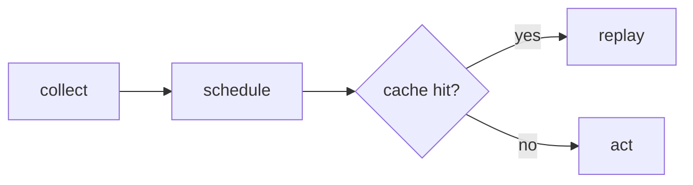

# Writing a PR title and body

The PR body is the source of truth for the change. A reviewer reads it
before the diff and should finish it knowing what changed, why, how it
works, and what proves it. The diff then confirms what the body already
said.

## Source of truth

- The body describes the head commit, always. A push that changes behavior,
  API, scope, or a measured number updates the body in the same step
  (`gh pr edit --body-file`), before the reply on any review thread.
- The body covers everything the diff does and claims nothing else. A
  reviewer reports a behavior change the body skips, or a claim the diff
  does not back, as a finding.
- Evidence comes from the head. When a push could change a benchmark, a
  recording, or pasted output, capture it again or delete it.
- Nothing a reviewer needs lives only in a review thread, a commit message,
  or a chat. Fold a decision made in review into the body.
- Every edit to the body, the first draft and each later update, gets the
  [unslop](../../../.claude/skills/unslop/SKILL.md) pass before it is posted
  ("Voice" below).

## After every push to an open PR

This applies to every push, whichever skill or task produced it: a review
fix, a follow-up the human asked for, a babysit round, a rebase that
resolved a conflict by changing code.

1. `body=$(mktemp) && gh pr view --json body -q .body > "$body"`. No PR for
   the branch means nothing to do.
2. Read the body against what the push changed
   (`git diff <previous head>..HEAD`), section by section:
   - `## What`: still what a user or caller meets? New flag, renamed
     option, changed default, dropped scope.
   - `## Why`: still the reason, if the approach changed.
   - `## How it works`: a step for each new moving part, steps for removed
     code deleted, code refs still pointing at the right lines.
   - `## Verified`: capture again, or remove, any output, benchmark table,
     or recording the push could have changed. Never leave evidence from an
     older head.
   - Title: still names the outcome, `!` added if the push made it breaking.
3. Run the [unslop](../../../.claude/skills/unslop/SKILL.md) pass on every
   sentence you added or changed, and on the neighbors it no longer fits
   with.
4. `gh pr edit <pr> --body-file "$body"`, with `--attach` for new media,
   before replying on review threads.
5. Nothing to change (a typo, a lint fix, a test-only tweak the body does
   not describe)? Leave it. Do not append a changelog or an "Updates"
   section. The body describes the change as it stands.

A change to how the PR works that is not in the body is a defect in the PR,
the same as a failing check.

## Title

- Conventional Commits, matching `git log`:
  `fix(playwright): provision the browser in a runner-side prepare hook`.
  PRs squash-merge with the number appended, so the title is the commit.
- Mark spec or API breaks with `!` (`feat(config)!: ...`), same as the commit.
- Name the outcome, not the activity. "install builds with the appPath
  option", not "agent-device changes".

## Body

The sections of the
[PR template](../../../.github/PULL_REQUEST_TEMPLATE.md), in its order. Keep
each one short.

### `## What`

The change as a user or caller meets it, in one to three sentences or
bullets. Concrete nouns: the flag, the function, the error code, the output
line. For an API change, a code sample of the new usage goes here.

### `## Why`

The problem that led here: the bug and who hits it, the request, the
measurement. Then what this does about it, in one sentence. Link the issue
under `## Issue` instead of retelling it.

### `## How it works`

Numbered steps a reviewer can follow through the diff, in the order the code
runs (or, for a refactor, the order to read it in).

- One step per moving part: what happens and where, with a code ref
  (`packages/e2e/src/run/execute.ts:42` or a permalink) instead of a
  paraphrase of the code.
- Say what each step replaces when the old behavior matters.
- A mermaid diagram on top for anything with flow or state: runner phases,
  engine hooks, replay paths, before/after architecture.
- Name the decision a reviewer would otherwise ask about: the alternative
  you dropped and why, in one line.
- Spec changes: name the chapter, schema, and `suiteVersion` bump in one
  step so the reviewer can check them together.
- Scale it to the diff. A one-line fix is one step. If it needs more than
  about eight, the PR is probably two PRs.

### `## Issue`

`Fixes #123` when the PR resolves an issue. Required on community `fix`,
`chore`, `test`, `perf`, `ci`, `build`, and `revert` PRs (CONTRIBUTING.md,
Pull requests).

### `## Verified`

The evidence that it works, required on every PR.

- First line: `Ran it locally: yes`, or `Ran it locally: no - <why>` (docs
  typo, CI-only, a device you do not have).
- With `yes`: the [verify](../verify/SKILL.md) surface, the command you ran,
  what you saw, and the output as a fenced `text` block.
- Then the evidence the change calls for:

| The PR | Evidence | How |
| --- | --- | --- |
| Fixes a bug | The bug and the fix side by side in a `\| main \| this PR \|` table | Same command in both checkouts ([verify, Evidence](../verify/SKILL.md#evidence)) |
| Claims a speedup, or touches the runner, the agent loop, or an engine | A `main` vs `this PR` benchmark table | `pnpm bench:ab` prints it (`AGENTS.md`, "Measuring a change against main") |
| Changes what the terminal shows: CLI output, a reporter, a prompt, watch or pause UI | A terminal recording, `main` beside `this PR` when existing output changed | `pnpm record:terminal` ([verify, Evidence](../verify/SKILL.md#evidence)) |
| Changes what an engine, locator, or agent does on screen | The run's video | `e2e run --video` |
| Changes a docs page | A screenshot of the rendered page, before and after | The docs site |

- A row that applies and has no evidence says why in one line. "Could not
  measure: needs a physical device" is fine; silence is not.
- Upload media with `gh` 2.99+ `--attach`: reference images and GIFs in the
  body as markdown (``) and pass each file as
  `--attach`; `gh` uploads them and rewrites those paths. Do not write video
  paths in the body: attached videos are appended at the end and render as
  players. Record a `.gif` when the recording belongs inside a table.

## Leave out

- "I ran lint/tests" lists. CI reports that; `## Verified` is for what CI
  cannot see.
- Intermediate history. Squashed 6k lines down to 1k, refactored twice,
  renamed midway: none of it lands. Only the final aggregate squash-merge
  commit exists, so only that gets commentary.
- Line-by-line restating of the diff.
- Checklists nobody asked for, sign-offs, filler.

## Templates

A whole body, for a made-up fix (local image paths become uploaded assets with
`--attach`):

````markdown
## What

`e2e run --watch` reruns a test once when two of its files are saved
together.

## Why

Saving a test and its page object in one editor action queued two runs, and
the second printed over the first one's summary.

## How it works

1. The watcher collects change events for 50 ms before scheduling
   (`packages/e2e/src/watch/queue.ts:31`), where it used to schedule per
   event.
2. The scheduler keys pending runs by test file, so a second event for a
   queued file is dropped (`packages/e2e/src/watch/schedule.ts:58`).
3. The list reporter clears its summary only when a run starts
   (`packages/e2e/src/reporters/list.ts:140`).

## Issue

Fixes #123

## Verified

Ran it locally: yes

- testbed, `e2e run tests/todos.e2e.ts --watch`, saved the test and
  `pages/todos.ts` together: two runs on main, one here

| main | this PR |
| --- | --- |
|  |  |
````

`gh pr edit <pr> --body-file body.md --attach ./main.gif --attach ./branch.gif`

Before/after for visuals:

```markdown
| Before | After |
| --- | --- |
|  |  |
```

Benchmarks: paste what `pnpm bench:ab` prints, whole. Base is the merge base
with `main`, head is the PR. Do not retype it into a shorter table; the
interval and the verdict are the evidence.

```markdown
| Metric | base median (IQR) | head median (IQR) | change (95% CI) | verdict |
| --- | ---: | ---: | ---: | --- |
| suite (sum of attempts) | 41.20 s (40.80 s-41.90 s) | 23.10 s (22.70 s-23.60 s) | -43.9% (-45.1% to -42.6%) | faster |
```

Flow:

````markdown

````

## Big changes

For truly impressive, difficult, high-risk, or wide-scoped changes, write the
body like a technical blog post: context, the problem, the approach, code
samples, diagrams, before/after, images. Storytelling is fine here. The rules
above still hold: the same sections in the same order, run output only as
`## Verified` evidence, no intermediate history.

## Voice

Run the [unslop](../../../.claude/skills/unslop/SKILL.md) pass on the text
before posting it, on the first draft and on every later edit. PR-specific
tells to catch:

- "This PR introduces...", "comprehensive", "robust", "seamless", "ensures",
  "leverages", "enhances".
- Bold label lists that restate the line (`**Performance:** Performance...`).
- Em dashes. Use a comma, a colon, or a new sentence.
- Bullets padded to three because three felt right.
- A summary that could be pasted unchanged into another repo's PR.
- A `## How it works` step that says what the code "ensures" or "handles"
  instead of what it does: name the function, the value, the order.
- A `## Why` that sells the change. State the bug or the number.
- An updated body that still reads as two drafts: a new paragraph bolted
  under the old one, or "now", "also", and "additionally" marking what
  changed since the last push.
