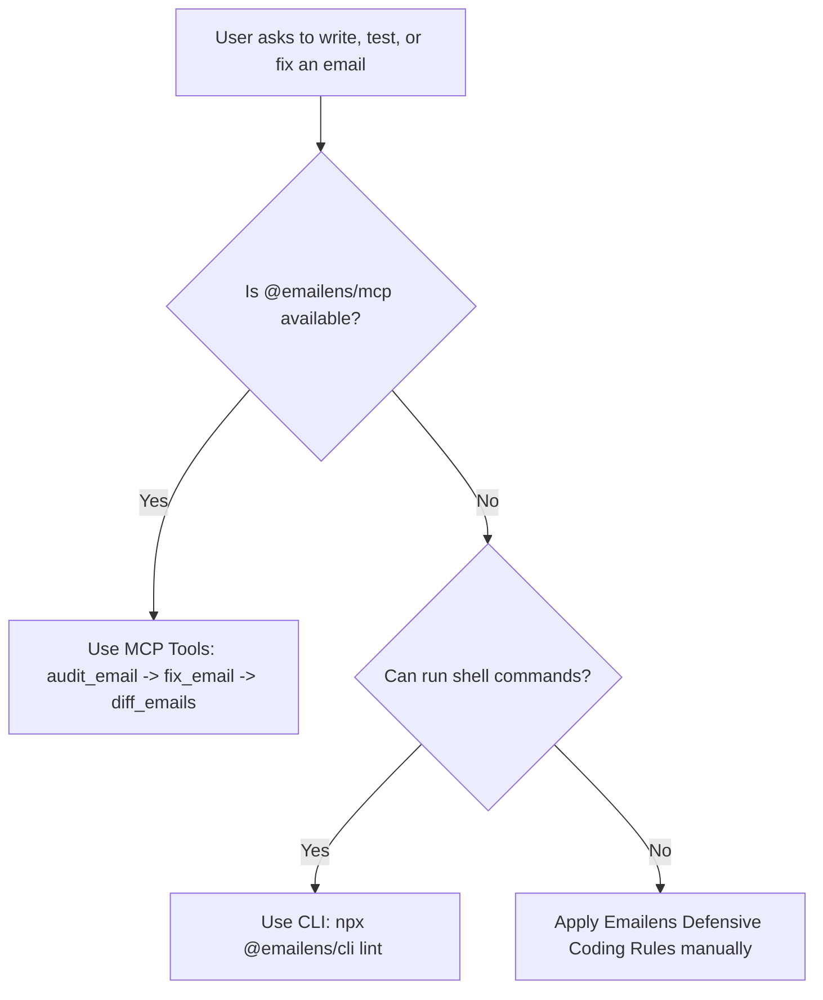

# Email QA & Compatibility (Emailens)

Email clients use disparate, legacy rendering engines:
* **Outlook Windows (Classic / Desktop)** renders with **Microsoft Word** (no flexbox, no grid, no `gap`, ignores `border-radius`, requires table layouts and VML for buttons/backgrounds).
* **Gmail (Web & Mobile)** strips `<style>` tags over 8,192 bytes, ignores modern CSS, strips `display: flex` shorthand, and runs per-channel RGB inversion math in dark mode.
* **Apple Mail (macOS & iOS)** renders with WebKit, masking layout bugs that break for every other subscriber.
* **Yahoo & AOL** strip comma-separated `@media` queries and drop custom web fonts without fallback stacks.

Out of **300 standard CSS and HTML features**, only **6 are universally supported** across all 21 clients:
`background-color`, `color`, `direction`, `font-family`, `list-style-type`, `vertical-align`. Everything else requires defensive fallbacks.

---

## When to Use This Skill

Activate this skill whenever:
1. Writing a new transactional or marketing email in **React Email**, **MJML**, **Maizzle**, **Tailwind**, or **HTML**.
2. Auditing or reviewing pull requests that touch email templates (`*.html`, `*.tsx`, `*.mjml`).
3. Fixing email layout bugs (e.g. "buttons broken in Outlook", "Gmail clipping email", "unreadable text in dark mode").
4. Preparing emails for production delivery (checking preheaders, merge tags, WCAG contrast, and deliverability).

---

## Execution Modes (Decision Tree)

Always check the available execution environment and choose the highest-fidelity tool:



### Mode 1: MCP Server (`@emailens/mcp`) — Preferred for Coding Agents
When `@emailens/mcp` is registered (`claude mcp add emailens -- npx -y @emailens/mcp`):
* **`audit_email({ path: "emails/welcome.html" })`**: Runs the complete offline preflight audit in <50ms.
* **`fix_email({ path: "emails/welcome.html" })`**: Generates surgical code replacements preserving the design.
* **`diff_emails({ before: originalHtml, after: fixedHtml })`**: Confirms score improvements and proves no regressions.
* **`preview_email({ path: "...", client: "outlook-windows-legacy" })`**: Returns the exact client-transformed HTML.
* **`check_deliverability({ domain: "example.com" })`**: Checks SPF, DKIM, DMARC, MX, and BIMI DNS records.

### Mode 2: Zero-Install CLI (`@emailens/cli`)
When running in a terminal or CI pipeline without MCP:
```bash
# Lint with line:column errors and exit codes
npx -y @emailens/cli lint emails/welcome.html

# Fail CI pipeline if compatibility score is below threshold or errors exist
npx -y @emailens/cli lint 'emails/**/*.{html,tsx,mjml}' --fail-on-warning

# Inspect per-client scores across all 21 clients
npx -y @emailens/cli analyze emails/welcome.html

# Preview client-specific DOM mutations
npx -y @emailens/cli preview emails/welcome.html --clients outlook-windows-legacy,gmail-android
```

---

## The Autonomous Self-Repair Protocol

When an AI agent modifies or creates an email template, it must follow this 4-step loop:

1. **Step 1: Baseline Audit**
   Run `audit_email` or `npx @emailens/cli analyze`.
   Record:
   - Overall Score (Target: ≥85/100)
   - Failing Clients (especially `outlook-windows-legacy` and `gmail-android`)
   - Critical Errors (VML corruption, layout blowouts, WCAG contrast failures)

2. **Step 2: Surgical Fix Application**
   Apply targeted fixes using the rules below. Do NOT rewrite the entire template or strip out brand styles; use conditional comments and progressive enhancement.

3. **Step 3: Verification Diff**
   Call `diff_emails` or re-run `audit_email`. Confirm that:
   - Previously failing clients now score ≥80.
   - No new issues were introduced in Apple Mail or Gmail Web.
   - The original visual hierarchy and layout are preserved.

4. **Step 4: Output Summary**
   Present findings to the user with the standardized report template below.

---

## Defensive Email Architecture & Code Snippets

### 1. Outlook Classic Ghost Tables (Multi-Column & Max-Width)
The Microsoft Word engine ignores `max-width`, `margin: 0 auto`, `flex`, and `grid`. Wrap containers and columns in Outlook conditional ghost tables:

```html
<!-- Container wrapper: keeps email centered at 600px in Outlook -->
<!--[if mso]>
<table role="presentation" border="0" cellpadding="0" cellspacing="0" width="600" align="center">
<tr><td>
<![endif]-->
<div style="max-width: 600px; margin: 0 auto; width: 100%;">
  <!-- Responsive Two-Column Layout -->
  <!--[if mso]>
  <table role="presentation" border="0" cellpadding="0" cellspacing="0" width="100%">
  <tr>
  <td width="290" valign="top">
  <![endif]-->
  <div style="display: inline-block; width: 100%; max-width: 290px; vertical-align: top;">
    Column 1 content
  </div>
  <!--[if mso]>
  </td>
  <td width="20"></td>
  <td width="290" valign="top">
  <![endif]-->
  <div style="display: inline-block; width: 100%; max-width: 290px; vertical-align: top;">
    Column 2 content
  </div>
  <!--[if mso]>
  </td>
  </tr>
  </table>
  <![endif]-->
</div>
<!--[if mso]>
</td></tr>
</table>
<![endif]-->
```

### 2. Bulletproof VML Rounded Buttons
Outlook desktop ignores `border-radius` on `<a>` tags. Use VML with `mso` conditional comments:

```html
<!-- Bulletproof CTA Button -->
<div>
  <!--[if mso]>
  <v:roundrect xmlns:v="urn:schemas-microsoft-com:vml" xmlns:w="urn:schemas-microsoft-com:office:word" 
    href="https://example.com/start" 
    style="height:48px;v-text-anchor:middle;width:220px;" 
    arcsize="12%" 
    strokecolor="#2563eb" 
    fillcolor="#2563eb">
    <w:anchorlock/>
    <center style="color:#ffffff;font-family:'Segoe UI',sans-serif;font-size:15px;font-weight:600;">
      Confirm Your Account &rarr;
    </center>
  </v:roundrect>
  <![endif]-->
  <!--[if !mso]><!-->
  <a href="https://example.com/start" 
     style="background-color:#2563eb;border-radius:6px;color:#ffffff;display:inline-block;font-family:-apple-system,BlinkMacSystemFont,'Segoe UI',Roboto,sans-serif;font-size:15px;font-weight:600;line-height:48px;text-align:center;text-decoration:none;width:220px;-webkit-text-size-adjust:none;mso-hide:all;">
    Confirm Your Account &rarr;
  </a>
  <!--<![endif]-->
</div>
```
> [!CAUTION]
> **VML Nesting Rule**: Never place a `<v:roundrect>` inside a `<v:rect>` or background shape. Nesting VML shapes causes Microsoft Word to drop all text inside inner buttons.

### 3. Dark Mode & RGB Inversion Protection
Gmail Android forces an algorithmic per-channel color inversion that turns medium gray (`#6b7280`) into unreadable mud against inverted dark backgrounds (`#121212`).

* **Rule 1**: Maintain ≥7:1 contrast ratio in light mode so post-inversion text remains readable.
* **Rule 2**: Support both `data-ogsc` / `data-ogsb` (Outlook app) and `@media (prefers-color-scheme: dark)`:
```html
<style>
  :root { color-scheme: light dark; supported-color-schemes: light dark; }
  @media (prefers-color-scheme: dark) {
    .dark-bg { background-color: #18181b !important; }
    .dark-text { color: #f4f4f5 !important; }
  }
  [data-ogsc] .dark-text { color: #f4f4f5 !important; }
  [data-ogsb] .dark-bg { background-color: #18181b !important; }
</style>
```
* **Rule 3**: For transparent PNG logos with dark text, add an invisible 1px white stroke or subtle light outer glow so the logo does not vanish when the background turns dark.

### 4. Gmail 102 KB Clipping Threshold
* **Rule**: The uncompressed raw HTML file must be strictly under **100 KB** (Gmail clips emails at exactly 102,400 bytes).
* If clipped: The user sees `[Message clipped] View entire message`, and tracking pixels, unsubscribe links, and legal footers are hidden, triggering spam complaints.
* Minify inline whitespace and host large base64 images externally before sending.

---

## Agent Reporting Template

When delivering audit results to the user, format your report using this structure:

```markdown
### 📬 Emailens Compatibility Report

| Metric | Result | Status |
| :--- | :--- | :--- |
| **Overall Score** | **94 / 100** | ✅ PASS |
| **Universal Features** | 6 / 6 universally supported | ✅ PASS |
| **Failing Clients** | 0 / 21 | ✅ PASS |
| **HTML Size** | 42.4 KB (Limit: 102 KB) | ✅ PASS |
| **Dark Mode Contrast** | WCAG AAA compliant (8.4:1) | ✅ PASS |

#### Client Highlights:
* **Outlook Classic (Windows)**: Ghost tables and VML button fallbacks active.
* **Gmail Android**: Dark mode RGB inversion tested with high-contrast text pairs.
* **Apple Mail & Webmail**: Modern CSS enhancement active.

#### Fixes Applied:
1. Replaced `display: flex` container with MSO conditional ghost table (`max-width: 600px`).
2. Converted raw rounded `<a>` button to bulletproof VML `<v:roundrect>` shape for Word rendering.
3. Added 35-character preheader text with zero-width non-joiner padding (`&#847;`) to prevent inbox clipping.
```

---

## Quick Reference Checklist Before Committing

- [ ] Evaluated with `audit_email` or `npx @emailens/cli lint` (0 errors).
- [ ] Overall score is **≥85/100** across all 21 email clients.
- [ ] No `display: flex`, `grid`, or `gap` without MSO ghost table wrappers.
- [ ] Buttons have VML roundrect fallbacks for Outlook Desktop.
- [ ] Total raw HTML size is **<100 KB** to prevent Gmail clipping.
- [ ] Preheader is ≥30 characters long to avoid body text backfill.
- [ ] Dynamic template tags (`{{firstName}}`, `*|FNAME|*`) have fallback values.
