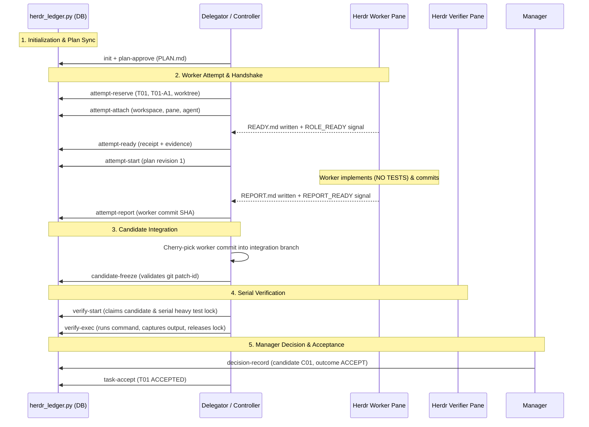

# Herdr Engineering Loop: Session Controller Guide

The `herdr-engineering-loop` skill defines the responsibilities and operational rules for the **Session Controller** (human operator or session bootstrap agent).

The Session Controller provisions the Herdr environment, binds individual agents to strictly bounded roles, manages state transitions, and orchestrates crash recovery. **This skill does not replace the dedicated role skills:** once an agent is assigned a role (`herdr-manager`, `herdr-delegator`, `herdr-lead`, `herdr-worker`, `herdr-verifier`, or `herdr-critic`), that agent must follow only its specific role contract. `herdr-lead` is the human-approved budget option where one agent holds both the Manager and Delegator duties (`agents.lead` in `roles.json`); it never implements, and the human approves the plan and gives final acceptance.

---

## 1. Core Architectural Invariants

Every Herdr engineering run must maintain these essential safety rules:

1. **The Subagent Ban (every CLI; Codex's `spawn_agent` is the common case):**  
   Never use Codex's native `spawn_agent`, any CLI's internal subagents, agent teams, or background child threads. All agents must be registered inside explicit Herdr workspaces and panes (`herdr agent start`). If Herdr is unavailable, report `BLOCKED: HERDR_WORKER_UNAVAILABLE`.
2. **Worker Origin & Workspace Invariants:**  
   A governed code Worker requires a Delegator-provisioned Git worktree and Herdr workspace/pane, launch through the authorized owner, and confirmed registration. Standalone Worker assignments follow `herdr-worker` directly and do not create a managed run. A human-approved `non-code-isolated-copy` exception still requires a separately registered Herdr agent and pane, but no Git worktree or fabricated commit.
3. **Worker Verification Boundary:**
   Governed Workers never run tests, builds, linters, typecheckers, or package installations. Standalone Workers may run bounded, authorized self-checks and must label them as self-verification. Independent verification belongs to the Delegator or dedicated Verifier.
4. **Serial Heavy Verification Lock:**  
   At most **one** resource-intensive local verification process (e.g. pytest, npm test, cargo test, docker build) may execute across the machine at any time, regardless of worker count. The lock must be acquired before test execution and released upon completion.
5. **Git Candidate Fencing & Provenance:**  
   Before tests begin, the Delegator freezes the integration branch. In SQLite runs, candidate integration is verified by matching the exact `git patch-id` of the worker commit against the cherry-picked integration commit. Any intervening commit invalidates ongoing checks.
6. **Fail-Closed Cancellation & Recovery:**  
   On cancellation or crash, never delete uncommitted work, force-kill without observation, or close human-owned panes. Always confirm process quiescence via `herdr pane list` / `herdr pane process-info` before releasing held claim fences.

---

## 2. Directed Signaling, Receipts & Access Safety

- **Signal Envelope Contract:** Load [Signal and Receipt Contract](references/signals.md) at every role activation. Each agent must know its assigned sender/recipient, handoff event, durable report file, and `ROLE_READY` handshake. Before implementation, a worker must have a worker-local `READY.md`, an observed Delegator receipt, and a deliberate `TASK_START`. A Verifier requires `VERIFY_START` and the serial verification lock. Herdr status toasts alone are not delivery proof.
- **Access-Denied Preflight:** Load [Access-Denied Preflight](references/access-triage.md) on any permission error or when a Herdr operation fails. For the same authorized in-scope command, use this agent's native approval request only when its current tool offers one; wait for the decision and verify the postcondition. Herdr origin is required only for Herdr actions. Never self-grant, bypass a deny, elevate, disable a sandbox, edit ACLs, or switch to invisible subagents.
- **Run Authority & Cancellation:** Load [Run Integrity](references/run-integrity.md) when opening a new run, recovering a replaced attempt, freezing a verification candidate, or processing a cancellation. Record the human execution grant in the ledger. On `CANCEL_RUN`, stop further dispatch, preserve evidence, account for each run-owned process, and release locks only after verified process termination.
- **Human-Facing Progress Presentation:** Load [Human-Facing Task Presentation](references/user-status.md) before replying with task progress. Decouple internal machine keys (`T01`, `T01-A1`, pane IDs) from human updates. Summarize slices using approved titles and outcomes.

---

## 3. Environment Discovery & Topology Inspection

Before creating a governed run or mutating its state, discover the current environment. A direct standalone Worker assignment does not need Herdr discovery unless the requested operation uses Herdr.

```powershell
# 1. Verify active Herdr session environment:
$env:HERDR_ENV # Must be '1' inside Herdr

# 2. Inspect active Herdr layout:
herdr workspace list
herdr pane list
herdr agent list

# 3. Inspect repository worktrees and Git status:
git worktree list --porcelain
git status --short
```

- **Reuse Existing Topology:** Prefer existing workspaces and panes created by the human operator.
- **Record Observed IDs:** Always use actual IDs returned by Herdr commands (e.g. `w35:p1`), never guessed names.
- **Check Permission & Sockets:** For a Herdr-dependent action, use `tools/access_probe.py` to classify IPC or filesystem restrictions. It cannot observe native approval or grant access. Request permission only through the active CLI's own tool for the same in-scope action; never elevate, alter policy/ACLs, or disable a sandbox. For CLI syntax, consult [Herdr Operations](references/herdr-cli.md).

---

## 4. State Backends: Markdown Default and Explicit SQLite

Each run has one selected authority; new runs default to Markdown until the Windows promotion gate passes:

> **Backend choice is a setup gate.** Before binding roles or writing the first ledger entry, the Lead or Delegator asks the human: "Markdown (default, proven) or SQLite (typed ledger, not yet Windows-promoted)?" and records the answer in PLAN.md. Choosing at setup needs no approval file. Switching later needs `run_backend.py switch --dry-run`, a human-authored `Backend transfer approval:` file and a clean checkpoint, and is effectively unavailable once a Worker has launched. SQLite PASS currently comes only from a Verifier's local `verify-exec`; a run whose only gate is remote CI should choose Markdown.

### Active Runtime Authority: Markdown Ledger (`state_backend: "markdown"`, Active Authority)
- **Primary Document:** `<repo>/.herdr-loop/<run-id>/SESSION.md`.
- **Ownership:** Maintained directly by `herdr-delegator` (or `herdr-lead` in lead mode).
- **Use Case:** Transparent, human-editable, zero-tool dependency live runs where Markdown and Git history are authoritative.
- **Verification Lock:** Wrap approved heavy commands with `scripts/verification_guard.py`, shared with SQLite; record exact tested SHA and result in `SESSION.md`.
- **Constraint:** Do not initialize `ledger.sqlite` in a Markdown-backed live run.

### Explicit SQLite run (`scripts/herdr_ledger.py`)
- **Primary Database:** `<repo>/.herdr-loop/<run-id>/ledger.sqlite`.
- **Ownership:** Deterministic CLI commands via `scripts/herdr_ledger.py`.
- **Reference Contract:** Follow [SQLite Ledger Pilot](references/sqlite-ledger-pilot.md) for typed transitions, atomic claim fences, and receipt requirements.
- **Use Case:** Explicit typed orchestration and offline evaluation; live Windows proof remains a default-promotion gate.
- **Verification Lock:** The CLI uses per-run claims and the shared machine gate with observed process ownership.
- **Constraint:** Explicit SQLite binding creates a `PLANNING` ledger. Activation records observed setup, with separate correlated acknowledgment before typed role transitions. Transfer accepts validated quiescent checkpoints; unobservable descendants remain blocked. Keep Markdown as the default until the exact-commit Windows lifecycle gate passes.
- **Candidate procedure:** Read [SQLite role procedure](references/sqlite-live.md) when inspecting an explicitly selected SQLite run.

---

## 5. Role Assignment & Packet Binding

To configure and bind roles for a run:

For a direct one-off assignment, follow [Standalone Mode](../herdr-worker/SKILL.md#standalone-mode) and skip the governed-run setup. If a single Herdr-launched Worker needs a generated packet, set `execution_mode: "standalone"` and provide exactly one `agents.workers` entry, as in `examples/roles.standalone-worker.json`. The binder creates no `SESSION.md`, SQLite ledger, Manager/Delegator lifecycle, or handshake, and it does not start the agent.

1. **Define the Roster (`roles.json`):**
   Specify run ID, base reference, backend, and assigned agents. Set `state_backend` to the backend the human chose at the setup gate (§4); omitting it binds Markdown and the binder prints a notice. Set `max_active_workers: 1` by default. Multiple concurrent workers (up to 3) require explicit human authorization and non-overlapping scopes.
2. **Bind Role Packets:** `tools/` scripts (`role_bind.py`, `activate_roles.py`, `access_probe.py`, `progress_view.py`) ship in the pack's source checkout and release package, not in the installed skill directory; run them from there.
   ```powershell
   py -3 .\tools\role_bind.py --config .\roles.json --repo <repo-path>
   ```
   This generates `<repo>/.herdr-loop/<run-id>/` containing `ROSTER.md`, `ACTIVATE.md`, `ACTIVATION.json`, `role-packets/`, and initializes the selected state backend.
3. **Dispatch Initial Roles:**
   ```powershell
   # Activate Manager and Delegator first:
   py -3 .\tools\activate_roles.py --run-dir <run-dir> --roles manager,delegator
   ```

---

## 6. Model-Aware Launch Routing

Read [Model Routing](references/model-routing.md) before launching any worker, verifier, or critic.

**Other AI CLIs.** The model names in this pack (Haiku, Sonnet, `gpt-6-luna`) are defaults for Claude, Codex, Agy and OpenCode, not requirements. `tools/role_bind.py` recognizes `claude`, `codex`, `agy` and `opencode` in every role; any other kind that Herdr can start and that loads `SKILL.md` skills is accepted with a warning. Rules that name Codex (the override-launch table below, `spawn_agent`) apply only to Codex. In governed runs, every agent is a named Herdr agent in its own pane, never an in-process subagent, and Workers never run tests. Standalone Workers follow `herdr-worker` and may run bounded, authorized self-checks. Every role stays inside its own skill.

Due to CLI environment restrictions, a **Codex Delegator cannot launch a model-overridden Codex CLI worker** (`-m gpt-6-luna -c model_reasoning_effort='"xhigh"'`). Follow this dispatch table:

| Delegator Engine | Manager Engine | Authorized Spawner of Overridden Codex Worker |
| :--- | :--- | :--- |
| **Claude** | Any | **Claude Delegator** launches worker directly. |
| **Codex** | **Claude** | **Claude Manager** launches via `SPAWN-REQUEST.md` handshake. |
| **Codex** | **Codex** | **Human Operator** (or assigned non-Codex operator) launches via Herdr CLI. |

### Launch Command Templates:
```powershell
# Codex GPT-6 Luna Worker (xhigh reasoning):
herdr agent start worker_t01 --kind codex --pane <pane-id> -- -m gpt-6-luna -c model_reasoning_effort='"xhigh"'

# Claude Haiku 5.5 Worker or Verifier:
herdr agent start worker_t01 --kind claude --pane <pane-id> -- --model claude-haiku-5-5

# Claude Sonnet 5.5 Critic (Read-Only):
herdr agent start critic_t01 --kind claude --pane <pane-id> -- --model claude-sonnet-5-5

# Agy CLI Worker (normal configured permissions; check flags on the target platform):
herdr agent start worker_t01 --kind agy --pane <pane-id>

# OpenCode Worker (provider/model set in the checkout's opencode.json; verify the effective model):
herdr agent start worker_t01 --kind opencode --pane <pane-id>
```

**OpenCode model placement.** OpenCode's v2 TUI has no `--model` flag. Before `herdr agent start --kind opencode`, the Delegator writes `opencode.json` (`{"$schema":"https://opencode.ai/config.json","model":"<provider/model>"}`) into that agent's checkout and adds `opencode.json` to `.git/info/exclude`. If the repository tracks `opencode.json`, stop with `BLOCKED: OPENCODE_PROJECT_CONFIG_PRESENT`. Start with no arguments after `--`.

**OpenCode-only runs.** Every role can be an OpenCode agent: Lead, Delegator, Manager, Worker, Verifier and Critic. Start from `examples/roles.opencode.json` (Lead run with OpenCode Worker and Verifier, no Critic). Each OpenCode agent needs its own unique name, because Herdr names every OpenCode pane `opencode`. Use `herdr agent rename <pane> <name>` for an existing pane, or the name given in `herdr agent start`.

**Binding an existing OpenCode pane.** Put its `pane_id`, `workspace_id` and `worktree` into `roles.json` and give it a unique name. Make sure its checkout has the placed `opencode.json`, restarting the pane if it was launched before that file existed. Then activate the role as usual.

Governed work and approval-path checks use Agy's normal permission flow. The optional smooth unattended mode is limited to a human-selected disposable worktree, with Agy sandbox active before `--dangerously-skip-permissions` is used; see [Agy worker launch](references/herdr-cli.md) and [Native permission capability by harness](references/permission-capabilities.md). Never use it to recover from a denial or sandbox failure. OpenCode loads a skill by mentioning `@skill-id` or via its `skill` tool; confirm the installed CLI's effective model and native approval behavior before relying on them.

Always verify actual model and reasoning effort via `herdr agent get <name>` before prompting.

---

## 7. SQLite Transactional Ledger Execution Sequence (Explicit Opt-in)

For a selected governed run, use [SQLite role procedure](references/sqlite-live.md) with current role/epoch flags. The sequence below also illustrates the explicit offline pilot API using `scripts/herdr_ledger.py`:



### Command reference:

The exact arguments of every command, and the command list for each role, are generated from the CLI itself: read [Ledger command reference](references/command-reference.md), print your own list with `python herdr_ledger.py --run-dir <run> reference --role <role>`, or print the whole reference with `reference`. Do not hand-maintain command lists in prose. Step-by-step semantics live in [SQLite role procedure](references/sqlite-live.md); bounded reads (`status`, `next`, `packet`, `task-show`, `events`, `recover`) accept `--json` and report their own byte/token cost so you can budget context.

---

## 8. Crash Recovery & Quiescence Reconciliation

When a worker crashes, a pane closes, or a tool call is interrupted, consult [Recovery Procedures](references/recovery.md):

1. **Run Diagnostic Recovery:**
   ```powershell
   python scripts/herdr_ledger.py recover --db <path-to-db>
   ```
2. **Reobserve Herdr Reality:**
   Check `herdr pane list` and `herdr agent list`. If a pane is closed or its process PID is gone, the ledger confirms quiescence rather than throwing transport errors.
3. **Release Interrupted Claims:**
   ```powershell
   python scripts/herdr_ledger.py attempt-release --db <path-to-db> --task T01 --attempt T01-A1
   ```
   This releases claim fence 1 and marks the task as `BLOCKED`.
4. **Retry via Manager Decision:**
   Record Manager retry decision in `DECISION-RETRY-T01.md`, then execute:
   ```powershell
   python scripts/herdr_ledger.py task-retry --db <path-to-db> --task T01
   ```
   The task resets to `PLANNED` and is ready for attempt `T01-A2`.

---

## 9. Human-Facing Progress Reporting

Never lead human status updates with internal task IDs (`T01`), attempt numbers (`T01-A2`), or Herdr pane strings. Always report human-friendly titles and evidence-backed outcomes:

```powershell
# Query human-facing progress dashboard:
py -3 .\tools\progress_view.py --db "C:\path\to\repo\.herdr-loop\<run-id>\ledger.sqlite"
```

Pass `--include-internal-ids` only when explicitly requested by a human operator for debugging.

---

## 10. Safe Run Cancellation & Cleanup

To cancel an active run safely:

1. **Stop Scheduling:** Issue `run-cancel` in the ledger to fence future dispatches.
2. **Request Clean Halt:** Prompt active agents to stop tools and preserve uncommitted diffs (`CANCEL_RUN` -> `CANCEL_ACK`).
3. **Verify Quiescence:** Check `herdr pane list` to ensure all child processes have ceased execution.
4. **Preserve Resources:** Keep human-owned panes open. Preserve dirty worktrees for operator triage. Never claim cancelled work was accepted.
