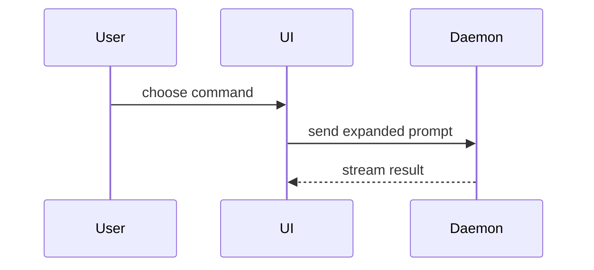

Use this template for writing the PR body:

```markdown
## Summary

<diagram, diff-sketch, or tree>

## Evidence

### Execution evidence

- **Before:** <exact test/command and actual failing output>
  **After:** <same test/command and actual passing output>

### Visual evidence

<required for visual changes when a headless browser is available; repeat for each viewport/flow>

**Before — <flow>, <viewport>**


**After — <flow>, <viewport>**


## Merge Danger

**Door:** <one-way or two-way>

<optional: description>

**Blast Radius:** <one-word description>

<optional: potential ramifications of merge>
```

## Sections

Skip all preambles and keep prose brief. Use the user's domain language from `GLOSSARY.md`.

### Summary

Pick the smallest view that makes the key point clear.

- Show logic or an algorithm as pseudocode:

```text
on(save)
  if content is unchanged
    return cached result
  write new content
  return fresh result
```

- Show runtime control flow as a call tree:

```text
submitForm
  createSession
    persistPrompt
    launchAgent
  navigateToSession
```

- Show UI structure as a component tree, including state and module boundaries that matter:

```tsx
<SessionPage>(apps / example / src / routes / session.tsx);
useSessionEvents() < SessionToolbar > <RunSkillButton>(packages / ui);
```

- Show file responsibility or a broad refactor as a shallow file tree:

```text
src/
├── commands/       # parses user actions
├── sessions/       # owns session state
└── transport/      # sends API requests
```

- Show component interaction, control flow, or data flow with Mermaid:



- Use `diff` when the point is what changes and the surrounding shape already exists. Match the diff shape to the topic.

For a component change:

```diff
 <SessionPage>
   useSessionEvents()
   <SessionToolbar>
+    <RunSkillButton />
   <SessionTimeline>
+    <SkillResultCard />
```

For a file-layout change:

```diff
 src/
 ├── commands/
+│   └── show-me.ts       # expands the slash command
 ├── sessions/
-└── transport.ts
+└── transport/
+    ├── client.ts
+    └── stream.ts
```

For a call-tree or call-stack change:

```diff
 submitForm
   createSession
     persistPrompt
+    expandSkillMention
     launchAgent
-  navigateToSession
+  navigateToSession
+    subscribeToEvents
```

For a state or control-flow change:

```diff
 on(save)
-  write content
+  if content is unchanged
+    return cached result
+  write new content
+  invalidate cache
```

- Show the whole block when most of it is new, when omitted context would hide ownership or order, or when the user needs a copyable target shape:

```ts
function expandSkill(command: string): string {
  const skillName = command.slice(1);
  return `use the ${skillName} skill`;
}
```

#### Guidance

Place each visual next to the short text it supports. Keep only the calls, files, props, states, and boundaries needed to answer the user's current question or the options to resolve the current discussion point.

You may use one of these, you may use several, it is unlikely you will use all of them. Use your judgement and don't overwhelm the user.

### Evidence

Always include **Execution evidence**: the exact test or command, its actual failing-before output and its actual passing-after output. Keep this separate from **Visual evidence**.

For changes to rendered HTML, CSS, templates, frontend routes or interactive UI state, use `thirdshift-verify-ui` for interactive exploration and Visual evidence. It owns capture selection, Before recovery, recording and viewport rules. Publish the resulting captures as described below; keep any verification limitation explicit in `## Evidence`.

#### Publish the captures

Publish only reviewed faux/redacted proof captures, using GitHub attachments so images and native video players inherit repository read permissions (ADR 0034). Keep captures outside git.

Write the final PR body to a `mktemp` temporary file. Place a bold visible flow-and-viewport label immediately above **each** attachment paragraph, including Before or After. Reference the exact absolute capture path in that paragraph: `` for PNG; use the same standalone image-style paragraph for `.mp4`. The CLI turns that video paragraph into a bare uploaded URL so GitHub renders its native player. `gh --attach` rewrites these local references to uploaded URLs in place; without a body reference it appends media at the end, away from its label. Preserve previously uploaded attachment paragraphs when updating unrelated body text.

Save the following Bash block in a `mktemp` script, remove the script on exit, and run it as `bash "$publish_script" create "$PR_BODY" "$capture1" "$capture2"` (any number of captures up to 50). Export `BASE_BRANCH`, `ISSUE_BRANCH`, `PR_TITLE` for create; use `edit` and export `PR_URL` for an existing PR. Set `EVIDENCE_REDACTED=yes` only after visually checking every capture for faux/redacted data. Check that this branch's PR remains open immediately before publishing; stop if merged or closed. Keep the PR Ready for review.

This validates **all** captures before the first irreversible upload, refusing symlinks before reading any target. Require `gh >= 2.103.2` (including GitHub App installation-token support), regular files owned by this user, safe filenames, PNG/MP4 extensions, non-empty files and the `8 MB` cap.

```sh
(
  set -eu
  action=${1:?create or edit}
  body=${2:?PR body file}
  shift 2
  case "$action" in create|edit) ;; *) echo 'expected create or edit' >&2; exit 1 ;; esac
  fail_unsafe_path() {
    printf 'refusing %s that is not a regular file owned by this user: %s\n' "$1" "$2" >&2
    exit 1
  }
  check_regular_owned() {
    local label=$1 path=$2 prefix='' remaining part link_target
    if [ -z "$path" ] || [ "$path" = - ] || [ -L "$path" ] || [ ! -f "$path" ] || [ ! -O "$path" ]; then
      fail_unsafe_path "$label" "$path"
    fi
    case "$path" in
      /*) prefix=/; remaining=${path#/} ;;
      *) remaining=$path ;;
    esac
    while [ -n "$remaining" ]; do
      case "$remaining" in
        */*) part=${remaining%%/*}; remaining=${remaining#*/} ;;
        *) part=$remaining; remaining='' ;;
      esac
      case "$part" in
        '' | .) continue ;;
      esac
      if [ "$prefix" = / ]; then
        prefix="/$part"
      elif [ -z "$prefix" ]; then
        prefix=$part
      else
        prefix="$prefix/$part"
      fi
      if [ -L "$prefix" ]; then
        link_target=$(readlink "$prefix" 2>/dev/null || true)
        case "$(uname -s):$prefix:$link_target" in
          Darwin:/tmp:private/tmp | Darwin:/tmp:/private/tmp | Darwin:/var:private/var | Darwin:/var:/private/var) ;;
          *) fail_unsafe_path "$label" "$path" ;;
        esac
      fi
    done
  }
  check_regular_owned 'PR body' "$body"
  [ "${EVIDENCE_REDACTED:-}" = yes ] || { echo 'review captures for faux/redacted data first' >&2; exit 1; }
  gh --version | awk '
    NR == 1 {
      split($3, v, ".")
      ok = v[1] ~ /^[0-9]+$/ && v[2] ~ /^[0-9]+$/ && v[3] ~ /^[0-9]+$/ &&
        (v[1] > 2 || (v[1] == 2 && (v[2] > 103 || (v[2] == 103 && v[3] >= 2))))
    }
    END { exit !ok }
  ' || { echo 'Visual evidence needs gh >= 2.103.2 --attach' >&2; exit 1; }
  [ "$#" -gt 0 ] && [ "$#" -le 50 ] || { echo 'expected 1–50 captures' >&2; exit 1; }
  attachments=()
  for capture in "$@"; do
    case "$capture" in
      *#*) printf 'refusing capture path containing #: %s\n' "$capture" >&2; exit 1 ;;
    esac
    check_regular_owned capture "$capture"
    filename=${capture##*/}
    case "$filename" in
      *[!A-Za-z0-9._-]* | '') printf 'refusing capture filename: %s\n' "$filename" >&2; exit 1 ;;
    esac
    case "$filename" in
      *.png | *.mp4) ;;
      *) printf 'refusing capture extension: %s\n' "$filename" >&2; exit 1 ;;
    esac
    bytes=$(wc -c < "$capture")
    if [ "$bytes" -eq 0 ] || [ "$bytes" -gt 8388608 ]; then
      printf 'refusing empty or oversized capture: %s\n' "$capture" >&2
      exit 1
    fi
    attachments+=(--attach "$capture")
  done
  if [ "$action" = create ]; then
    gh pr create --base "${BASE_BRANCH:?}" --head "${ISSUE_BRANCH:?}" \
      --title "${PR_TITLE:?}" --body-file "$body" "${attachments[@]}"
  else
    gh pr edit "${PR_URL:?}" --body-file "$body" "${attachments[@]}"
  fi
)
```

If the app, browser, `ffmpeg` or `gh >= 2.103.2 --attach` cannot run, publish the PR Ready for review with an explicit limitation in `## Evidence`, naming the failed capability and any available execution checks. GitHub Enterprise Server does not support these attachments. If uploading partly succeeds, `gh pr create` can print the newly created PR URL while exiting nonzero: inspect that PR and its body, retain successful URLs and retry only missing media with `gh pr edit --attach`; avoid creating a duplicate PR or reuploading successful captures.

### Merge Danger

Describe whether it's a one-way or two-way door. You can walk back through two-way doors, but not one-way doors. A PR that is cheap to roll back is lower risk. Changes that involve destructive actions or hard-to-reverse decisions are one-way doors.

The blast radius is the potential impact or scope of the changes introduced by this PR. Consider all possibilities. Examples are layout shift, breakages for consumers, mobile responsiveness, etc.
