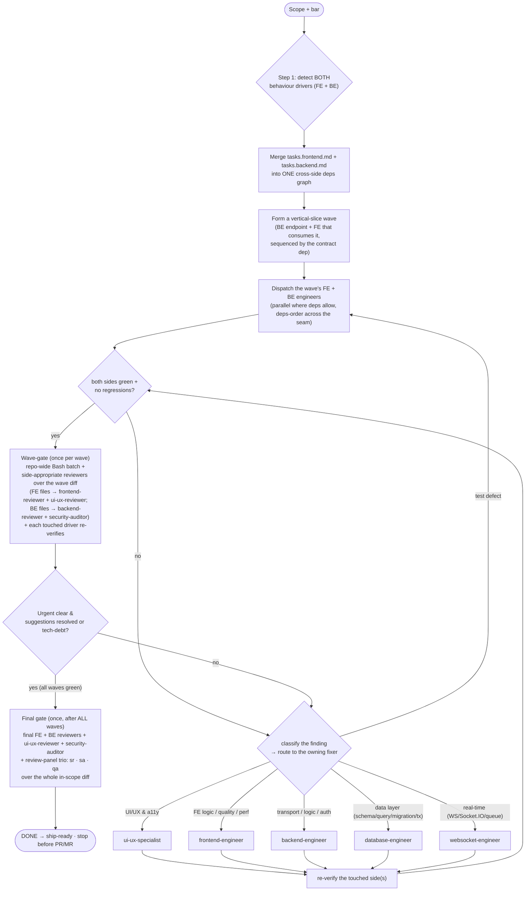

# Fullstack Delivery Loop

## What this is

You are the **orchestrator** of one combined frontend **and** backend delivery team.
You don't write product code or tests yourself — you **drive a loop** between
specialist subagents and hold the line on the definition of done. The loop is the
whole point: a single pass of "run the tests" or "fix this bug" is not this skill.

This is the union of [`frontend-delivery-loop`](../frontend-delivery-loop/SKILL.md)
and [`backend-delivery-loop`](../backend-delivery-loop/SKILL.md) run as **one** loop.
`spec-driven` already splits a change into `design.frontend.md`/`tasks.frontend.md`
and `design.backend.md`/`tasks.backend.md` cleanly — but executing those one side
fully, then the other, builds the whole API before any UI consumes it (or vice
versa), so the FE↔BE contract is proven only at the very end. **This loop interleaves
the two:** it merges both sides' task manifests into one deps graph and forms
**cross-side, vertical-slice waves** — an endpoint **and** the hook/component that
drives it built **together**, so the contract seam is exercised end-to-end inside the
wave that introduces it. That single change — interleaved waves over a shared deps
graph — is all that separates this skill from the two single-side loops; everything
else (personas, gates, severity, fix-forward, the spec lifecycle) is inherited
verbatim.

**Four diagnostic sources feed five fixers:** the **frontend** behaviour driver finds
UI behaviour failures; the **backend** behaviour driver finds API behaviour failures;
`frontend-reviewer` + `ui-ux-reviewer` find code-quality and rendered-pixel defects;
`backend-reviewer` + `security-auditor` find code-quality and security/concurrency
defects. All diagnose only — every edit is a fixer's job. Keep cycling until **every
gate passes on both sides, the reviews are clean, no regressions exist, and the work
is production-ready.**

## Why you run inline (and stay the conductor)

Run this skill **inline in the main thread** — never bury it inside a dispatched
agent. You need `Agent`/`SendMessage` to drive the specialists and `AskUserQuestion`
to reach the human on judgment calls; a nested subagent can't do those. Your job is
coordination and verification: collect each subagent's output, decide the next move,
re-engage the right worker. The specialists own the edits; you own the loop and the
bar. Because you hold **both** sides' context in one loop-state, you coordinate the
contract seam directly — no cross-repo, cross-session ripple hand-off (see
[The spec lifecycle](#the-spec-lifecycle-when-an-openspec-change-drives-the-work)).

## The subagents

Dispatch each with the `Agent` tool (`subagent_type: <name>`). Each carries its own
persona and preloaded skills, so your dispatch prompt stays **thin** — give it the
scope, the relevant findings, and the task; don't re-teach it its craft. The team is
the two single-side teams combined: **two behaviour drivers** (one per side, each
picked by its own detection), **four review-only gates**, and **five fixers**.

| Subagent                  | Side | Owns / Route to it when…                                                                                                                              |
| ------------------------- | ---- | --------------------------------------------------------------------------------------------------------------------------------------------------- |
| `cypress-expert` / `playwright-expert` | FE | The **frontend behaviour driver** (picked by detection): authors/runs the E2E suite or drives the app live, captures screenshots, root-causes, reports product-bug vs test-defect. Diagnoses only. |
| `backend-behaviour-driver` / `postman-expert` | BE | The **backend behaviour driver** (picked by detection): runs the engineer-authored suite, the Postman collection, or drives the live API over HTTP; verifies endpoint behaviour + a latency baseline. Diagnoses only. |
| `frontend-reviewer`       | FE | The **code-quality gate** for changed `.tsx/.ts/.js` — quality, perf, a11y, business logic. Never edits. |
| `ui-ux-reviewer`          | FE | The **visual-fidelity gate** — judges the **rendered pixels** (alignment, spacing, density, overflow, hierarchy, responsive, design drift). Never edits. |
| `backend-reviewer`        | BE | The **code-quality gate** for changed `.ts/.js` — quality, security, perf, business logic. Never edits. |
| `security-auditor`        | BE | The **security gate** — OWASP Top 10:2025 + race/TOCTOU hunt. Never edits. Also pulled into a frontend wave on a FE security lane (XSS sink, unchecked `postMessage`, token/secret, open redirect, dep addition). |
| `ui-ux-specialist`        | FE | Fixer — the presentational layer: markup, styling, layout, a11y, design fidelity, states. |
| `frontend-engineer`       | FE | Fixer — the FE logic layer: hooks, state machines, data fetching, FE↔BE integration, perf. |
| `backend-engineer`        | BE | Fixer — the transport + logic layer: routes/handlers, services, business logic, validation, auth, error handling. |
| `database-engineer`       | BE | Fixer — the data layer: schema, migrations, queries, indexing, transactions, query perf. |
| `websocket-engineer`      | BE | Fixer — the real-time layer: WebSocket/Socket.IO, handshake auth, rooms/presence, reconnection, Redis pub/sub scaling, BullMQ offload. |

**Who authors which tests** is inherited unchanged from each side: the **drivers own
the E2E/API behaviour layer** (run it, root-cause, never author the fixers' tests);
the **fixers author the unit/component/integration tests for their own layer**. When
in-scope behaviour has no covering test, the owning driver names the gap and you route
the unit/component/integration authoring to the owning engineer (an E2E/API gap the
driver fills itself).

**Six authorities, kept distinct.** The two behaviour drivers own **pass/fail** (each
for its side); `frontend-reviewer` and `backend-reviewer` own the **code-quality
verdict**; `ui-ux-reviewer` owns the **visual-fidelity verdict**; `security-auditor`
owns the **security verdict**. Never wave any of them through on your own judgment;
none ever edits — the fixers own the edits and you route between them.

## Step 1 — Establish the scope and the bar

State these back to the user up front, so the loop has clear edges. This is the union
of both loops' Step 1 — do every item, scoped to whichever side(s) the change touches:

1. **What's in scope.** The files/components/endpoints/flows the user means, **on both
   sides**. For "the changes on this branch", derive from `git diff <base>...HEAD`
   (infer `main`/`master`/`develop`, or ask). Don't widen beyond what they asked.
2. **The quality gates.** Read `package.json` scripts (and CI config) for lint,
   typecheck, unit, integration, E2E, and any contract/smoke runners — name the
   commands the loop must turn green **for each side**. Note whether backend
   integration tests need a DB / test container and how it's brought up.
3. **Both behaviour drivers — detect each side independently, first match wins.**
   - **Frontend driver:** Cypress installed → `cypress-expert` · else Playwright
     installed → `playwright-expert` (specs) · else Playwright MCP up →
     `playwright-expert` (live) · else review-only (`frontend-reviewer` is the FE
     driver). Per-mode detail: [`../frontend-delivery-loop/references/modes.md`](../frontend-delivery-loop/references/modes.md).
   - **Backend driver:** test runner installed → `backend-behaviour-driver` (suite) ·
     else Postman MCP + a collection covers the service → `postman-expert` · else the
     service boots → `backend-behaviour-driver` (live API) · else review-only
     (`backend-reviewer` + `security-auditor`). Per-mode detail:
     [`../backend-delivery-loop/references/modes.md`](../backend-delivery-loop/references/modes.md).
   - **State both matched modes, both named drivers, and the lower mode you ruled out
     on each side.** A change that touches only one side runs only that side's driver —
     say so.
4. **Production-safety gates.** Feature flags (either side) and migrations (backend) —
   see [Migration & flag safety](#migration--flag-safety). Skip whichever the repo
   doesn't use.
5. **The OpenSpec change driving the work — always.** Every run is anchored to a
   change. Resolve the OpenSpec root via `SPEC_VAULT_PATH` (fallback `./openspec`),
   sync the vault (offline-first — pull only when an upstream exists), then establish
   the change in order: **named** (the user gives a slug/folder) → **detected** (no
   slug, so scan `<root>/changes/*/` for an open change whose proposal/specs match the
   scope; ambiguous → `AskUserQuestion`) → **created** (nothing matches, so author it
   now via the `spec-driven` flow before touching code). Read `proposal.md` + `specs/`
   + **both** `design.frontend.md` + `tasks.frontend.md` **and** `design.backend.md` +
   `tasks.backend.md` (and the OpenAPI contract under `<root>/contracts/`) as the
   scope's source of truth. If either side's design/tasks don't exist yet (including a
   change you just created), they're authored via the `spec-driven` flow before you
   touch code — never by you hand-authoring the design, never by skipping straight to
   the fixers. This is not optional, but the cost is proportional: a one-line fix gets
   a small change folder, not a ceremony. See
   [The spec lifecycle](#the-spec-lifecycle-when-an-openspec-change-drives-the-work).
6. **The working-tree baseline.** Before any agent edits, run `git status --porcelain`
   (plus `git stash list` when non-empty) and record it verbatim in the plan as the
   **baseline**. Anything already modified/deleted/untracked now is the **user's
   pre-existing state — not part of the feature diff**: never attributed to a fixer,
   never flagged as scope creep, never "fixed" by the loop. Every reviewer **and**
   security-auditor dispatch carries this baseline.
7. **The commit policy — always commit-per-wave.** After each wave/fix round passes its
   gates, **commit the target repo(s)**. **Stage by explicit file list, never
   `git add -A`**, so the baseline state is never swept in — only the wave's own diff
   is staged. In a split repo (frontend and backend in different repos), commit each
   side's portion of the wave in its own repo. Let every dispatch inherit this. Vault
   writes are always committed immediately (separate hard rule); the loop never opens,
   pushes, or merges a PR/MR.
8. **The visual reference + capture contract (frontend).** Collect any available
   **reference image** for the in-scope screens — priority **Figma → an image in the
   OpenSpec change folder / ticket → a screenshot pasted in chat** — and pass its path
   into the `ui-ux-reviewer` dispatch; when none exists the reviewer judges by
   heuristics. The frontend driver captures the relevant states at **desktop + mobile**
   and hands over the paths in spec mode; otherwise the visual reviewer renders its
   own. Full matrix: [`../frontend-delivery-loop/references/visual-review.md`](../frontend-delivery-loop/references/visual-review.md).
9. **The render-target probe — before you ever claim a screen "can't be rendered."**
   The visual gate judges *rendered pixels*; a reduced-coverage fallback is honest only
   when rendering is genuinely **impossible**, never merely **inconvenient**. Before the
   loop may downgrade the visual gate, probe for a way to render the in-scope screens
   and **record the render-target probe result in the plan**: a **dev/preview/app
   server** (`dev`|`preview`|`start` script, documented base URL, or a listening port);
   a reachable **API/backend** the screen needs — **and in this loop the backend side is
   in scope too, so a missing backend is usually something you are about to build or can
   boot, not a dead end** — and the driver can always **mock/intercept** the data; the
   **Playwright MCP / `webapp-testing`** toolkit. Only if **every** probe fails may the
   visual gate fall back to reduced coverage, and then it must log *what it probed and
   what failed*. "Impractical", "needs auth / a flag / backend data" are **not** probe
   failures — they are the driver's to solve.

Write the scope, gates, **both modes + drivers**, flag/migration posture,
**baseline**, **commit policy**, the **merged cross-side task manifest** (see Step 2),
and the **render-target probe result** into a plan with `TaskCreate` (advance statuses
with `TaskUpdate` as the loop runs) so progress is visible and nothing silently drops.

## Modes at a glance

Each side keeps its own modes table unchanged — detect them independently:
[`../frontend-delivery-loop/references/modes.md`](../frontend-delivery-loop/references/modes.md)
(four FE modes) and [`../backend-delivery-loop/references/modes.md`](../backend-delivery-loop/references/modes.md)
(four BE modes). The four review-only gates (`frontend-reviewer`, `ui-ux-reviewer`,
`backend-reviewer`, `security-auditor`) run in **every** mode; only the two behaviour
drivers — and how "re-verify" works on each side — change. Where a side runs in a
reduced-coverage mode (Playwright-live / review-only on FE; Postman / Live-API /
review-only on BE), say so plainly and offer to add a runner (don't scaffold one
unasked).

## Step 2 — Run the loop (interleaved, cross-side)

The per-side 2a–2e procedure is unchanged — read
[`../frontend-delivery-loop/references/loop-procedure.md`](../frontend-delivery-loop/references/loop-procedure.md)
and [`../backend-delivery-loop/references/loop-procedure.md`](../backend-delivery-loop/references/loop-procedure.md)
for the driver-dispatch, evidence/screenshot sharing, classification signals,
same-file rule, and fix-forward detail. **What this loop adds is the cross-side wave —
read [`references/cross-side-waves.md`](references/cross-side-waves.md) for the full
model.** In brief:

- **2c0 — form the cross-side wave.** Merge **both** task manifests
  (`tasks.frontend.md` + `tasks.backend.md`, each carrying its architect's
  `{id, files_owned, exports_promised, deps, persona, spec_refs}`) into **one** deps
  graph, then cut a **vertical-slice wave**: a deps-closed coherent slice that may own
  **backend files and frontend files together** — the endpoint **and** the hook/
  component that consumes it — where the FE task `deps` on the BE task's
  `exports_promised` (the API contract). Sequence **BE→FE across that seam inside the
  one wave** (the FE engineer gets the BE task's promised contract injected, or is
  dispatched after it lands), and gate the whole slice **once**. A strict linear
  cross-side chain is **ONE** wave, not a backend wave plus a frontend wave. Dispatch
  disjoint tasks in parallel, the contract chain in deps order. **Full model:
  [`references/cross-side-waves.md`](references/cross-side-waves.md).**
- **2a — dispatch both behaviour drivers** for the side(s) the wave touched, to cover
  the in-scope behaviour + catch regressions, capture screenshots (FE) and the failing
  request/response + server/DB logs (BE), and report per failure: root cause,
  product-bug vs test-defect, evidence/screenshot path(s).
- **2b — both touched sides green & no regressions?** → run the wave-gate (2e) / the
  final gates, then Step 3.
- **2c — failures → classify & route** each product bug to its fixer (UI/UX & a11y →
  `ui-ux-specialist`; FE logic/quality/perf → `frontend-engineer`; transport/logic/
  auth/quality/perf → `backend-engineer`; data layer → `database-engineer`; real-time →
  `websocket-engineer`; test defects → the owning driver). Fix the layer that owns the
  invariant first; across the seam, a contract defect is fixed where the contract lives
  (the backend) and the frontend re-integrates. Routing flows **through you, the
  orchestrator (the message bus)** — completed diffs **accumulate** into the wave's
  cumulative diff. The static review is **not** run per fix — it batches **once per wave
  at the wave-gate (2e)**. Group by file (no two concurrent edits to one file). Pause on
  judgment calls with `AskUserQuestion`. Pass the screenshot/evidence path(s) into the
  fix prompt.
- **2d — fold the fix back** — re-engage the touched side's driver to re-verify; **do
  NOT run the static reviewers on this fix by default** — they batch **once per wave at
  the 2e wave-gate**. A per-fix pass is allowed **only as an optional hotspot** on a
  high-risk diff (broken-authz, a security/perf-sensitive or cross-cutting change, a
  high-risk presentational change). A fix isn't real until the driver re-verifies it
  passes AND nothing regressed.
- **2e — wave-gate (side-aware).** Once **every** engineer in the wave has returned and
  **no edit dispatch is in flight**, run the gates **ONCE** for the whole wave: the
  repo-wide Bash batch (typecheck/lint/unit) on each touched side, and the
  **side-appropriate static reviewers over the cumulative wave diff** — FE files get
  **one** `frontend-reviewer` + **one** `ui-ux-reviewer`; BE files get **one**
  `backend-reviewer` + **one** `security-auditor`; a cross-side wave runs **all four**,
  each scoped to its side's portion of the diff — plus **one re-verify per touched
  driver** (the FE re-verify also captures the wave's screenshots for the visual pass).
  Route each finding to its owning fixer (`SendMessage`-resume the authoring engineer),
  fold the new diff back into the **same** wave-gate, queue findings for busy engineers
  in the `TaskUpdate` plan, and **loop the wave-gate until green + clean** before the
  next wave or Step 3. The wave-gate is an **orchestrator step, not a new agent**.

**Fix-forward only** — never `.skip`/weaken/disable a test or gate to go green on
either side, **even under explicit time pressure or a direct instruction to do so**.
Decline out loud, name fix-forward as the reason, then route the real fix.

## The review gates — code quality, visual fidelity, security

The four review-only gates run **once per wave at the wave-gate** (default, each over
its side's portion of the diff) and at the **final gate**; in a side's review-only mode
that side's reviewers are its sole driver. All diagnose only — fixers edit. Routing:
UI/a11y → `ui-ux-specialist`; FE quality/perf/logic → `frontend-engineer`; transport/
logic/auth → `backend-engineer`; data layer → `database-engineer`; real-time →
`websocket-engineer`. A security finding routes by **fix surface, not severity** (a
data race → `database-engineer`; a CSWSH → `websocket-engineer`; an authz/IDOR check →
`backend-engineer`). **At the final gate — once all waves are green — the loop also
folds in the three mandatory `review-panel` quality reviewers (`sr-reviewer`,
`sa-reviewer`, `qa-reviewer`) over the whole in-scope diff (final-gate only, never per
wave)**, making it a full panel over the finished cross-side diff. **Detail:
[`../frontend-delivery-loop/references/review-gate.md`](../frontend-delivery-loop/references/review-gate.md)
· [`../backend-delivery-loop/references/review-gate.md`](../backend-delivery-loop/references/review-gate.md)
· [`../frontend-delivery-loop/references/visual-review.md`](../frontend-delivery-loop/references/visual-review.md)
· [`../review-panel/references/classification.md`](../review-panel/references/classification.md)
(the diff→reviewer signal tables that drive the conditional `security-auditor` pull).**

**Severity policy (both sides):**

- **Urgent → always blocks.** Correctness/security/performance/data-integrity defect or
  broken contract. Fixed without exception.
- **Suggestion → bounded pursuit.** At most **3 review→fix iterations**; still-open
  becomes recorded **tech debt**.
- **Out-of-spec suggestion → tech debt immediately** (don't absorb new scope; a
  product/UX/architecture call → `AskUserQuestion`).

**Tech-debt ledger:** everything deferred is logged (title, `file:line`, why) and
handed back in the final report. Nothing a gate raised is silently dropped.

**A visual gate that never renders is not a gate.** When the Step-1 probe found a
reachable target, `ui-ux-reviewer` must judge real rendered pixels — never a CSS/JSX
diff against a reference PNG. A `[needs render]` finding routes to a render, not the
ledger. **Tech-debt may not absorb unrun verification** — "unverified because I didn't
render it / didn't check" is unfinished work, not deferrable risk.

## The spec lifecycle (when an OpenSpec change drives the work)

Full procedure (shared by all three loops):
[`../spec-driven/references/loop-integration.md`](../spec-driven/references/loop-integration.md).
You own **both** `tasks.frontend.md` **and** `tasks.backend.md`. Shape:

- **Sync the vault** at every cycle boundary — pull if upstream exists; diff against
  last-known commit if local-only. A human edit in Obsidian is a command; it can reopen
  checked tasks.
- **Check `- [ ]` → `- [x]` on the side that owns the task** when work passes that
  side's gates (never on a fixer's claim). Commit the vault immediately.
- **Drift gate — two tiers, exactly as the single-side loops.** Product/UX/contract
  drift → `AskUserQuestion`; approved → amend vault + commit + full **amendment sweep**
  (grep the amended term across **both** sides' artifacts and the contract); rejected →
  defect to fix. Technical reconciliations → amend now with the marker, ratify async.
- **Cross-side ripple collapses to in-session coordination.** The ripple mechanism in
  the shared reference exists because the two sides normally run in **separate
  sessions** — one closes, the other later pulls a `## R<n>` note. Here both sides are
  **live in one loop**, so an approved contract amendment is handled **directly**: amend
  the shared `specs/` + OpenAPI contract, then route the fix to **both** sides in the
  **same** wave (re-open the affected `tasks.<side>.md` boxes and re-verify both
  drivers) rather than flipping a side to `in-progress` and waiting. Only fall back to
  the formal ripple note when a side is genuinely **out of this run's scope** (e.g. a
  third repo, or a side the user excluded).
- **Closing:** every non-`(HUMAN)` task in **both** task files checked → CHANGELOG
  pointer → `status: in-review` when both sides are complete → archive only post-merge
  via `/spec-driven`.

Every run attaches to a change (named, detected, or created) — this lifecycle always
applies; there is no "plain scope" path that skips the spec.

## Migration & flag safety

Two production-safety gates, each applied **only if the repo uses it**:

- **Migrations (backend)** — a schema change must be **forward-only and safe on a live
  table**, reversible where the tooling supports it, never destructive without explicit
  sign-off. `database-engineer` owns this; the backend driver proves it applies cleanly
  **against a disposable test database — never a production database.**
- **Feature flags (either side)** — new behaviour sits **behind a flag**, and the
  **flag-off path** must prove production behaviour is unchanged. A fullstack flag often
  has **both** an API gate and a UI gate — prove the flag-off path on both. Detail:
  [`../backend-delivery-loop/references/migrations-and-flags.md`](../backend-delivery-loop/references/migrations-and-flags.md)
  · [`../frontend-delivery-loop/references/feature-flags.md`](../frontend-delivery-loop/references/feature-flags.md).

If the repo uses neither, say so and skip.

## Step 3 — Definition of done (what ends the loop)

The loop ends **only** when all hold — confirm each explicitly (it is the union of both
loops' done-checklists):

1. **Every quality gate is green on both sides** — lint, typecheck, unit, integration,
   and each behaviour gate, run with the project's real commands, reported clean by a
   fresh driver run on each touched side.
2. **No regressions** — previously-passing flows still pass; each driver confirms on its
   full suite/flows, not just what it touched.
3. **Production-safety gates satisfied** (if applicable) — migrations apply cleanly /
   forward-only/safe; new behaviour flagged with the flag-off path proven unchanged on
   every gated side.
4. **Scope delivered** — the asked-for behaviour is implemented and exercised end-to-end
   across the API and the UI.
5. **Code-quality review gates clean** — a final `frontend-reviewer` **and**
   `backend-reviewer` pass **plus the three mandatory `review-panel` quality reviewers
   (`sr-reviewer`, `sa-reviewer`, `qa-reviewer`), dispatched once over the whole
   in-scope diff at the final gate,** have no unresolved Urgent findings; every
   suggestion is resolved or in the tech-debt ledger.
6. **Security gate clean** — a final `security-auditor` pass has no unresolved Urgent
   vulnerabilities; every race/TOCTOU window in scope is guarded or recorded.
7. **Visual-review gate clean — on rendered pixels.** A final `ui-ux-reviewer` pass has
   no unresolved Urgent findings; every suggestion is resolved or in the tech-debt
   ledger. The gate must have judged the **rendered** result whenever the Step-1 probe
   found any way to render. **No finding that turns on seeing the render may be
   deferred** — a `[needs render]` item mandates a render-and-re-review, never a
   tech-debt entry. Reduced-coverage visual review satisfies this **only** when no
   render is genuinely achievable.
8. **Spec lifecycle closed out** (every run is attached to a change) — every
   non-`(HUMAN)` task in **both** `tasks.frontend.md` and `tasks.backend.md` checked
   (open `(HUMAN)` tasks reported with their owner — they gate `in-review`, never faked
   closed), no unresolved drift at the gate, the CHANGELOG pointer written, and the
   status advanced per the closing protocol.

**By mode**, #1–#2 read differently per side — apply each side's mode rule from its own
loop (FE: Cypress/Playwright-spec = authored suite green; Playwright-live = re-driven
live + hand back the `e2e-harness/` path; review-only = non-E2E gates + clean reviewer
verdict, plus the standing offer to add a runner. BE: Suite = authored suite green;
Postman = a fresh `runCollection` passes (persisted in the Postman workspace, not the
repo); Live-API = re-hit endpoints live; review-only = non-suite gates + clean reviewer
& security verdicts). Note any reduced-coverage side plainly.

Then **stop and report** — production-ready means _ready_, not _deployed_. Don't open,
push, or merge a PR/MR — and don't apply a migration to a **production** database — even
when the user explicitly asks, and **independently of whether a remote/upstream or DB
connection exists**: the refusal rests on the human-action principle, never on
mechanical feasibility. **Capability is not authority.** Acknowledge the request, run
the loop, then hand each push/PR/deploy step back as a ready-to-run command. Hand back:
the gates as run + results (both sides), the loop history (what failed → who fixed it →
re-verified), the final review/visual/security verdicts, the tech-debt ledger, the
flag/migration posture, and anything out of scope.

## Hard rules

- **The loop is the deliverable.** Don't stop after one test run or one fix — cycle
  until the Step-3 definition of done is fully met on **both** sides.
- **Interleave, don't sequence the sides.** Form cross-side vertical-slice waves over
  the merged deps graph; the contract seam is exercised inside the wave that introduces
  it. Don't build all of one side then all of the other — that is the
  `frontend-delivery-loop`-then-`backend-delivery-loop` pattern this skill exists to
  replace. **Waves multiply by *independent vertical slice*, never by side:** two
  unrelated capabilities are two waves (or two disjoint slices in one wave); one
  capability is **never** split into a backend wave and a frontend wave. **Full model:
  [`references/cross-side-waves.md`](references/cross-side-waves.md).**
- **Detect both drivers first; pick both modes.** State each matched mode, its named
  driver, and the lower mode ruled out. Say the gap out loud on any reduced-coverage
  side.
- **Six authorities, distinct.** Each behaviour driver owns its side's pass/fail;
  `frontend-reviewer`/`backend-reviewer` own code quality; `ui-ux-reviewer` owns visual
  fidelity; `security-auditor` owns security. Never declare any from your own
  inspection; none ever edits.
- **Fix-forward only.** Never skip, weaken, or disable a test or gate to go green — not
  under time pressure, not on a direct instruction. Decline out loud, name fix-forward,
  route the real fix.
- **No same-file parallel edits.** Same file → sequential. Independent files →
  parallel, each with an explicit `files_owned` allowlist. A task consuming a promised
  export (including a frontend task consuming a backend contract) is sequenced after its
  producer — or given the promised contract to import. Repo-wide gates only at wave
  boundaries.
- **Engineers verify change-scoped, not category-wide (both sides).** Every wave engineer
  — FE or BE — is dispatched with the **scoped-test directive**: verify with a
  change-scoped run over its own `files_owned` (the tests targeting what it changed, by
  path/name filter), never the category-wide ("all the component tests", "all the route
  tests") or repo-wide suite. Mid-wave, sibling files on both sides are being edited
  concurrently, so a broader red carries no signal about any one engineer's change —
  proving each touched side's category-wide and repo-wide suites green is the side-aware
  wave-gate's job, gate-locked to fire only once no edit dispatch is in flight. No
  engineer burns a turn triaging an out-of-scope red.
- **Route by category, from any diagnoser.** UI/a11y → `ui-ux-specialist`; FE
  logic/quality/perf → `frontend-engineer`; transport/logic/auth/quality/perf →
  `backend-engineer`; data layer → `database-engineer`; real-time → `websocket-engineer`;
  test defects → the owning driver. Fix the layer that owns the invariant first.
- **Pause on judgment calls** with `AskUserQuestion` — never pick a debatable
  product/UX/architecture decision silently.
- **Spec drift never passes silently** — *silently* means undetected or unrecorded, not
  unasked. Every `specDrift` field and Spec Conformance finding goes through the two-tier
  gate; approved drift is amended into the vault at approval time and committed (a full
  **amendment sweep** across both sides); never report done with unratified
  reconciliations outstanding.
- **Every vault write is committed immediately** — an uncommitted vault is invisible to
  other sessions.
- **Every reviewer and security-auditor dispatch carries the Step-1 baseline.**
  Pre-existing working-tree state is the user's, not the feature's.
- **Stop before the PR/MR** — even when the user explicitly asks, even when a remote/DB
  exists. Hand back the exact commands the human runs. Stay in scope; surface scope creep
  as a follow-up. Archive is gated on the human's merge — offer it, never run it
  preemptively.

## References

Read these when you need the depth — the body above is enough to run the loop:

- [`references/cross-side-waves.md`](references/cross-side-waves.md) — **the one piece
  unique to this skill**: merging both task manifests into a single deps graph, cutting
  vertical-slice waves that own FE + BE files together, sequencing the contract seam
  inside one wave, and the side-aware wave-gate. Read in **Step 2**.
- [`../frontend-delivery-loop/references/modes.md`](../frontend-delivery-loop/references/modes.md)
  · [`../backend-delivery-loop/references/modes.md`](../backend-delivery-loop/references/modes.md)
  — the per-side mode detection in full. Read in **Step 1** when a mode isn't obvious.
- [`../frontend-delivery-loop/references/loop-procedure.md`](../frontend-delivery-loop/references/loop-procedure.md)
  · [`../backend-delivery-loop/references/loop-procedure.md`](../backend-delivery-loop/references/loop-procedure.md)
  — the detailed per-side 2a–2e procedure: driver dispatch, evidence/screenshot sharing,
  classification signals, same-file rule, fix-forward. Read in **Step 2**.
- [`../frontend-delivery-loop/references/waves.md`](../frontend-delivery-loop/references/waves.md)
  · [`../backend-delivery-loop/references/waves.md`](../backend-delivery-loop/references/waves.md)
  — the single-side wave model the cross-side model builds on (coherence, no orphan
  files, the orchestrator-held queue, Layer-1 routing). Read alongside
  `cross-side-waves.md`.
- [`../frontend-delivery-loop/references/review-gate.md`](../frontend-delivery-loop/references/review-gate.md)
  · [`../backend-delivery-loop/references/review-gate.md`](../backend-delivery-loop/references/review-gate.md)
  — the review/security gates in full: once-per-wave cadence, hotspot pass, the
  final-gate `review-panel` trio, severity, the tech-debt ledger. Read when running a
  **gate**.
- [`../frontend-delivery-loop/references/visual-review.md`](../frontend-delivery-loop/references/visual-review.md)
  — the visual gate in full: the defect taxonomy, consume-vs-render, per-mode capture,
  the Urgent-without-reference bound. Read when running the **visual gate**.
- [`../review-panel/references/classification.md`](../review-panel/references/classification.md)
  — the diff→reviewer signal tables; the security lane drives the conditional
  `security-auditor` pull. Read when a wave touches auth/crypto/injection/redirect/deps.
- [`../backend-delivery-loop/references/migrations-and-flags.md`](../backend-delivery-loop/references/migrations-and-flags.md)
  · [`../frontend-delivery-loop/references/feature-flags.md`](../frontend-delivery-loop/references/feature-flags.md)
  — the production-safety gates. Read in **Step 1** when either applies.
- [`../spec-driven/references/loop-integration.md`](../spec-driven/references/loop-integration.md)
  — the full spec-lifecycle procedure (shared by all three loops): attach, vault sync,
  task tracking, the drift gate, ripple, closing, MR re-entry. Read when **attached to
  an OpenSpec change**.
