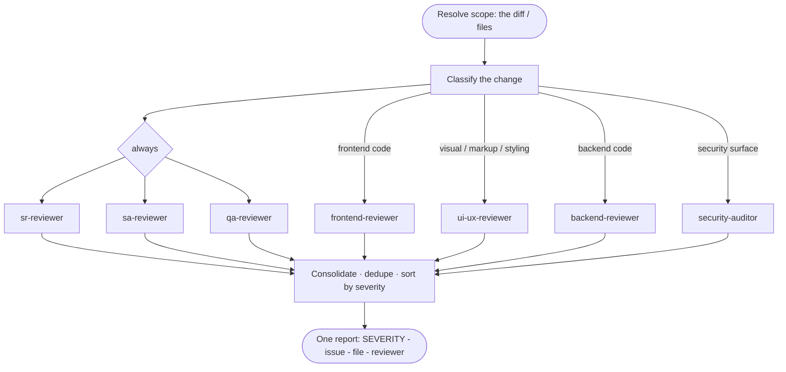

# Code Review — multi-reviewer orchestrator

## What this is

You are the **conductor of a review panel**. You don't review the code line-by-line
yourself — you decide *what changed*, *who should look at it*, dispatch a set of
**diagnose-only** reviewer subagents in parallel, and then **merge their findings into one
direct report**. The value is in the routing and the consolidation: the right specialists
see the change, and the user gets a single deduplicated list instead of five separate
reports to reconcile.

Three reviewers always run; the rest are added based on what the diff actually touches.



## Why you run inline (stay the conductor)

Run this skill **inline in the main thread** — never bury it inside a dispatched subagent.
You need the `Agent` tool to dispatch the panel and `AskUserQuestion` to reach the user on a
judgment call (e.g. an ambiguous scope). A nested subagent can't dispatch siblings, so the
orchestration has to live where you are. You do the scoping, routing, and merging; the panel
does the reviewing.

## The reviewer panel

The three **quality reviewers are mandatory on every run** — they are language- and
layer-agnostic and cover the dimensions a domain specialist won't:

| Reviewer | Owns |
|----------|------|
| **sr-reviewer**  | clean-code: cyclomatic complexity, DRY, naming, error paths, abstraction boundaries, maintainability, deviation from the codebase standard |
| **sa-reviewer**  | architecture: system-design coherence & layering, races/ordering/atomicity, caching & invalidation, performance (algorithmic complexity, IO), clean-architecture boundaries |
| **qa-reviewer**  | QA: unhandled edge cases, butterfly-effect breakage in callers of changed exports, possible regressions |

The **routed specialists are added by detection** (Step 2) — only when the change touches
their lane, so a pure-backend diff never wastes a frontend reviewer and vice-versa:

| Specialist | Added when the change touches… |
|------------|--------------------------------|
| **frontend-reviewer** | frontend code (components, hooks, client logic, styling) |
| **ui-ux-reviewer**    | the rendered/visual layer (markup, styling, layout, design tokens, a11y) |
| **backend-reviewer**  | backend code (routes, services, repositories, DB, API handlers) |
| **security-auditor**  | a security-sensitive surface (auth, crypto, injection, secrets, deps) |

All seven are **review-only — none ever edits**. They each return their findings as a
`# Code review` report (Urgent issues + suggestions) plus a `status` block. Your job is to
collapse those into one list.

## Step 1 — Resolve the review scope

Figure out **what to review** from the user's arguments. Support all of these; pick the
default only when no argument narrows it:

- **No argument → the current diff vs the base branch.** This is the default. Determine the
  base branch (`git symbolic-ref refs/remotes/origin/HEAD` → e.g. `origin/main`; fall back to
  `main`/`master`), then take **both** the committed delta (`git diff --name-only <base>...HEAD`)
  **and** the uncommitted working tree + staged changes (`git diff --name-only HEAD` and
  `git diff --name-only --staged`). Union them — the user usually means "everything I've
  changed that isn't on the base yet."
- **Named files/paths → review exactly those** (file-targeted mode). e.g. `src/auth/login.ts`.
- **A range/branch → review that delta.** e.g. `main..feature/x` or a branch name.
- **A PR number/URL → review that PR's diff.** Resolve it with `gh pr diff <n> --name-only`
  (and `gh pr diff <n>` for the hunks). If `gh` isn't available, say so and ask for a range.
- **"staged" / "unstaged" / "committed" → the corresponding slice** (`--staged`, `HEAD`,
  `<base>...HEAD`).

Produce two things you'll reuse: the **changed-file list** and access to the **actual hunks**
(`git diff <target>`), so reviewers see lines, not just filenames. If the scope is empty
(nothing changed), say so and stop — there's nothing to review.

If the arguments are genuinely ambiguous (e.g. a bare word that's both a branch and a file),
ask once with `AskUserQuestion` rather than guessing.

## Step 2 — Classify the change (routing)

Inspect the changed-file paths **and**, when a file's lane is ambiguous, peek at its hunks.
Routing is **additive and inclusive** — a change can light up several lanes at once
(a full-stack feature easily triggers all four specialists), and when a signal is borderline
you **include** the specialist. A false include costs one extra parallel review; a false
exclude means a defect ships unseen. Lean toward including, especially for security.

Read `references/classification.md` for the full signal tables. The summary:

- **frontend** → add `frontend-reviewer`. Signals: `.tsx/.jsx/.vue/.svelte/.astro`; `.ts/.js`
  under `components/ pages/ app/ hooks/ views/ screens/ src/` client code; styling
  (`.css/.scss/.sass/.less`, CSS-in-JS, `tailwind.config`); FE config (`vite/next/postcss/.storybook`).
- **ui-ux** → also add `ui-ux-reviewer`. Signals (a visual-layer subset of frontend): changes to
  **markup/styling/layout** — JSX/template structure, class names, CSS/SCSS, design tokens/theme
  files, `.figma.ts` code-connect, anything affecting how the UI *renders*. If a frontend change
  is purely logic (a hook, a data transform, no markup/style touched), you can skip ui-ux-reviewer.
- **backend** → add `backend-reviewer`. Signals: `.ts/.js` under `routes/ controllers/ services/
  repositories/ models/ api/ server/ handlers/ middleware/ db/`; API routes (`app/api/`,
  `pages/api/`, Nest/Express/Fastify); `.sql`, migrations, `prisma/schema`, GraphQL resolvers.
- **security** → add `security-auditor`. Signals: auth/authz (`auth login session token jwt oauth
  permission role acl guard`), crypto/secrets (`crypt hash bcrypt password secret cipher .env`),
  injection/IO surface (raw SQL/query building, `exec`/`eval`, file upload, path handling,
  deserialization, redirects, outbound requests/SSRF), and **dependency changes**
  (`package.json`/lockfile additions — supply-chain surface).

Compute the final set: `{sr-reviewer, sa-reviewer, qa-reviewer} ∪ {routed specialists}`.
Briefly tell the user which reviewers you selected and the signal that triggered each routed
one (e.g. "added security-auditor — `src/auth/session.ts` touches session handling"), so the
routing is legible and they can correct it before the panel runs.

## Step 3 — Dispatch the panel (in parallel)

Dispatch **every selected reviewer in a single turn** (multiple `Agent` calls in one response)
so they run concurrently — they're independent and waiting for one before starting the next
just wastes wall-clock. Use `subagent_type: <reviewer-name>`.

Keep each dispatch prompt **thin** — each persona already carries its own checklist; it only
needs the scope and its lane. Use this shape:

```
Review the following change. Report findings per your Template A/B contract.

Scope: <one of — the working-tree+staged diff | the diff of <range> | PR #<n> | these files>
Changed files:
- <path>
- <path>
Diff: run `git diff <target>` (or read the listed files) to see the hunks.
Focus: <for a specialist — "the frontend/backend files in this change"; for sr/sa/qa — "the whole change">
<If a spec/design doc was provided: name it here for the Spec Conformance category.>
```

Each reviewer returns its own `# Code review` report (an Urgent section + a suggestions
section, or "No issues found.") plus a `status` block. Collect all of them.

## Step 4 — Consolidate into one report

Merge the panel's reports into a single direct list. This is the payoff — the user reads one
ranked list, not seven.

1. **Normalize severity.** Each reviewer tags findings *Urgent* or *suggestion*. Map
   **Urgent → HIGH** and **suggestion → LOW**.
2. **Deduplicate.** When two reviewers flag the **same root issue at the same file:line**,
   collapse them into one line and tag **all** the reviewers that raised it. Keep the highest
   severity. (Overlap is expected — e.g. sa-reviewer and backend-reviewer both catching an N+1.)
3. **Sort.** All HIGH first, then LOW. Within a tier, group by file so related findings sit
   together.
4. **Emit the report** in the format below.

### Output format

One line per finding: `SEVERITY - <one-line issue> - <path:line> - <reviewer(s)>`.

```
# Code review — <N> issues (<H> HIGH, <L> LOW) · reviewers: <list that ran>

HIGH - <concise issue description> - <path:line> - <reviewer>
HIGH - <concise issue description> - <path:line> - <reviewer-a>, <reviewer-b>
LOW  - <concise issue description> - <path:line> - <reviewer>
```

When nothing is found by anyone, emit exactly:

```
# Code review

No issues found across: <list of reviewers that ran>.
```

After the list, offer the depth the per-line summary drops: tell the user you can expand any
finding into its full **Suggested fix** (the reviewers produced these), and — since the panel
is diagnose-only and never edits — ask whether they want you to apply the fixes for the issues
they pick. Don't apply anything unprompted; the reviewers diagnose, edits stay the user's call.

## Prerequisites & notes

- The reviewer subagents ship with the **`delivery-chain` plugin** (`sr-reviewer`, `sa-reviewer`,
  `qa-reviewer` under `.claude/agents/quality/`; the specialists under `.claude/agents/frontend/`
  and `.claude/agents/backend/`). They must be installed/loaded in the session for
  `subagent_type` dispatch to resolve. If a dispatch fails because an agent name is unknown,
  tell the user the plugin isn't active rather than silently skipping that reviewer.
- This skill **stops at the report** (plus optional fixes the user approves). It never commits,
  pushes, opens, or merges a PR — that stays a human action.
- Heavy diffs: if the change spans dozens of files, still dispatch the full panel, but tell the
  reviewers to prioritize the highest-risk files first and note in your summary if coverage was
  bounded — never imply full coverage you didn't get.
```
