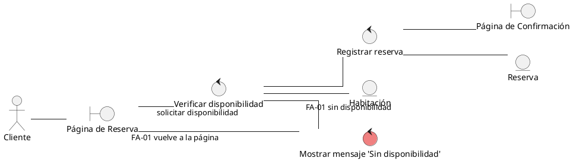

# UML Robustness Diagram

Trabajar en español por defecto, salvo que el usuario pida otro idioma. Fundamento y fuentes: `references/sources-and-methods.md`.

## Naturaleza y propósito

El diagrama de robustez es **el "cuadro de objetos" de un caso de uso**: se dibuja recorriendo el texto del caso de uso frase por frase y colocando los objetos que participan. Es la pieza que cierra el hueco entre el análisis y el diseño — si los casos de uso son el "qué" y el diseño es el "cómo", el análisis de robustez es **diseño preliminar conceptual**.

Dos consecuencias que gobiernan todo lo demás:

- **No es diseño detallado.** No se asignan operaciones a clases, no se dibuja herencia, no se aplican patrones. Eso pertenece a los diagramas de secuencia y al modelo de clases. Un diagrama de robustez que intenta ser un diseño detallado ha fallado en su propósito.
- **No es un fin en sí mismo.** Es un artefacto de transición cuyo valor real es *doble*: obliga a **desambiguar el texto** del caso de uso y **descubre objetos** que faltan en el modelo de dominio. Si al dibujarlo no corriges nada del texto ni encuentras ninguna clase nueva, probablemente no lo estás usando bien.

Nota de honestidad sobre las fuentes: los libros no coinciden en cuántos "roles" tiene la técnica — una fuente habla de dos misiones (desambiguar y descubrir objetos) y otra enumera cuatro (chequeo de sensatez, chequeo de completitud, descubrimiento de objetos y diseño preliminar). No fuerces una lista canónica; ambas descripciones son compatibles y describen el mismo trabajo.

## Insumos y trazabilidad de construcción

Esta skill es el **paso 4** del pipeline. Cada paso alimenta al siguiente, y la robustez es además el único que **devuelve información hacia atrás**:

```
modelo verbal → modelo de dominio → diagrama de casos de uso → especificación textual
                       ↑                                              ↓
                       └────── delta de object discovery ──── ROBUSTEZ → secuencia · clases · pruebas
```

| Insumo | Nivel | Qué alimenta |
|---|---|---|
| **Especificación textual del caso de uso** (de `/use-case-specifier`) | **Requerido — insumo dominante** | Se recorre frase por frase: los **sustantivos** se vuelven objetos boundary/entity, los **verbos** se vuelven controllers, y **cada curso alternativo** debe aparecer como rama del diagrama |
| **Modelo de dominio** (de `/uml-domain-modeler`) | **Requerido** | Provee los **objetos entity**: son literalmente clases del modelo de dominio. Permite además detectar las que faltan |
| **Caso de uso objetivo** (ID + nombre) | **Requerido** | Se dibuja **un diagrama por caso de uso** |
| **Diagrama de casos de uso** (de `/uml-use-case-diagram`) | Recomendado | Actor primario y secundarios; casos de uso invocados, que pueden arrastrarse al diagrama |
| **Modelo verbal** | Recomendado | Contexto y validación de alcance cuando la especificación está incompleta |
| Prototipos, pantallas o GUI | Opcional | Nombres reales de las pantallas (objetos boundary) y atributos descubiertos |
| Reglas de negocio | Opcional | Ayudan a nombrar controllers de validación con precisión |

Si falta la especificación textual, **no bloquees**: reconstruye un texto mínimo desde el modelo verbal, decláralo como supuesto y **advierte explícitamente** que el resultado tiene menor calidad — esta técnica *es* un análisis del texto, y sin texto se degrada a un dibujo plausible pero no verificable.

**Trazabilidad hacia atrás (se verifica en el ciclo de auditoría):** cada objeto entity procede del modelo de dominio (o aparece en el delta); cada actor procede del diagrama de casos de uso; cada elemento del diagrama rastrea a una frase concreta de la especificación. Toda inconsistencia es un hallazgo.

## Los tres estereotipos

Nombra los objetos **como los nombra el material de clase**: objetos **tipo Borde**, **tipo Entidad** y **tipo Controlador**. Reconoce como sinónimos `boundary`/`control`/`entity` (nomenclatura original de Jacobson, la de los libros en inglés) y "frontera"/"pantalla"; si el usuario los usa, entiéndelos, pero redacta los entregables con la terminología del curso.

| Estereotipo | Qué es | Qué NO es |
|---|---|---|
| **Tipo Borde** (`boundary`, frontera) | Lo que comunica el sistema con el mundo exterior: pantallas, páginas y formularios completos con los que el actor interactúa | No es un widget (botón, campo, menú), no es una tecnología (JSP, servlet), no es un verbo |
| **Tipo Entidad** (`entity`) | Objetos que guardan el estado interno del sistema: clases del **modelo de dominio** | No es una tabla, no es un DAO, no es una clase de diseño |
| **Tipo Controlador** (`control`) | El "pegamento" entre Borde y Entidad: **lógica, verbos, funciones de software** que implementan el comportamiento del caso de uso | **Casi nunca es una clase de control real.** Es un marcador de una función que habrá que construir |

La clave conceptual: **los objetos tipo Borde y tipo Entidad son sustantivos; los Controladores son verbos.** Esa distinción es la que hace funcionar las reglas de conexión, y es también la que permite identificarlos leyendo la especificación.

**Las palabras clave de PlantUML siguen siendo `boundary`, `control` y `entity`** (es sintaxis del lenguaje, no terminología), igual que los prefijos de alias `B_`, `C_`, `E_`.

Sobre los controllers, dos cautelas de las fuentes: **su sobreuso lleva de vuelta a la descomposición funcional** (si cada función acaba siendo una clase de control, se ha retrocedido); y un **racimo de controllers que se comunican entre sí** sí es un buen candidato a convertirse más tarde en una clase gestora real, especialmente si el comportamiento de estados no es trivial.

## Reglas de conexión (duras)

Detalle y citas: `references/robustness-rules.md`. Verificación automática: `scripts/validate_robustness_puml.py`.

**Permitido:**

1. Actor ↔ Borde
2. Borde ↔ Controlador *(sustantivo ↔ verbo)*
3. Controlador ↔ Controlador *(verbo ↔ verbo)*
4. Controlador ↔ Entidad *(verbo ↔ sustantivo)*

**Prohibido:**

5. Actor ↔ Controlador y Actor ↔ Entidad — el actor solo habla con objetos tipo Borde
6. Borde ↔ Entidad — debe pasar por un Controlador
7. Entidad ↔ Entidad — debe pasar por un Controlador
8. Borde ↔ Borde — debe pasar por un Controlador
9. **Actor ↔ Actor** — el diagrama modela la interacción con el sistema, no entre actores

**El porqué importa más que la regla.** Las prohibiciones 6, 7 y 8 son la misma prohibición: *dos sustantivos no pueden hablar entre sí*. Y cuando en un diagrama aparece un arco sustantivo-sustantivo, no es un problema estético: significa que **falta un verbo**, es decir, que hay **una función de software que no has contabilizado** — ni en el diagrama ni, casi seguro, en el texto del caso de uso. Por eso la corrección nunca es "borrar la línea": es preguntarse qué función falta y nombrarla.

## Reglas de estilo y granularidad

- **Un objeto boundary por pantalla o página, con su nombre real.** Si aparece un boundary llamado "página web" o "pantalla", detente y averigua cómo se llama esa pantalla.
- **Los nombres de pantallas son sustantivos.** Evita mezclar verbo y sustantivo ("ver detalles del libro página"); el nombre de la página es un sustantivo.
- **Nada de widgets de GUI.** Botones, campos y menús están por debajo del nivel de la pantalla. Si incluyes uno, acabarás incluyéndolos todos.
- **Nada de tecnología concreta.** No llames a las cosas JSP, ASP o servlet: esto es diseño conceptual.
- **La acción del usuario admite dos formas, ambas válidas**: sale del objeto tipo Borde (enlazando una pantalla con la siguiente a través de un Controlador) o sale directamente del actor. Elige una y mantenla en todo el diagrama; no las mezcles sin motivo.
- **Colorea los objetos que participan solo en cursos alternativos o de excepción.** Es la convención del material de clase para distinguir de un vistazo el flujo básico del alternativo. Los objetos compartidos con el flujo básico (como la ventana a la que se vuelve) van sin color.
- **Etiqueta el mensaje entre el boundary y el controller**, no el arco actor→boundary: con varias acciones entrando a un mismo boundary, etiquetar ahí se vuelve ambiguo.
- **Un solo diagrama por caso de uso, con el curso básico y TODOS los alternos.** Los cursos alternativos no son opcionales: su ausencia es el error más común y más grave.
- **Un controller sin comportamiento no se dibuja.**
- **La dirección de las flechas no importa**: los arcos son asociaciones de comunicación, no flujo de control.
- **Es válido arrastrar otro caso de uso al diagrama** si el caso de uso padre lo invoca.
- **Presupuesto de tiempo: ~10 minutos por diagrama.** Si tardas mucho más, casi siempre es porque estás reescribiendo el texto del caso de uso — lo cual es correcto y esperable, pero conviene saber que ahí se está yendo el tiempo. Si el diagrama crece demasiado, o si los cursos alternativos tienen sus propios subalternos, **parte el caso de uso**.

## Procedimiento de construcción

1. Reúne los insumos y declara cuáles faltan.
2. Monta la **presentación en tres zonas**, que es lo que hace posible el chequeo de consistencia: el **texto del caso de uso** a un lado (como `note`), el **diagrama** al otro, y las **interfaces gráficas** (wireframes o mockups del caso de uso) como tercera pieza. Si existe un mockup del caso de uso, referencialo o inclúyelo: los objetos tipo Borde se derivan de esas pantallas, no se inventan.
3. Recorre el texto **una frase a la vez**. Por cada frase: identifica los sustantivos (¿boundary o entity?) y los verbos (controllers), y dibújalos conectados según las reglas.
4. Toma los objetos entity **del modelo de dominio**; si el texto exige uno que no existe allí, anótalo para el delta de object discovery.
5. Añade **todos los cursos alternativos y de excepción** al mismo diagrama.
6. Mientras dibujas, registra cada ambigüedad del texto que te obligue a adivinar: son la materia prima del informe de desambiguación.
7. Ejecuta el **ciclo de construcción y auditoría** antes de entregar.

## Ciclo de construcción y auditoría interna

**Ningún entregable de esta skill se entrega sin haber pasado por este ciclo.** No es una formalidad: la norma de referencia es explícita en que solo las salidas de diseño ya verificadas deberían pasar a aceptación y uso posterior. Un diagrama entregado "a ver qué opinas" traslada al usuario un trabajo de verificación que la skill puede hacer mejor y de forma exhaustiva.

**Ciclo:** construir → auditar por capas → corregir → comprobar convergencia.

Las siete capas, en orden (detalle operativo en `references/audit-gate.md`):

| # | Capa | Criterio de paso |
|---|---|---|
| 1 | **Sintaxis y reglas duras** | `validate_robustness_puml.py` da **cero errores**. Es condición de entrega, no una recomendación |
| 2 | **Correspondencia texto ↔ diagrama ↔ interfaz** | *Highlighter test*: recorre el texto resaltando frase a frase y marca el elemento correspondiente del diagrama. Al terminar, **el texto entero y el diagrama entero** deben quedar cubiertos. Lo que quede sin resaltar en el diagrama sobra; lo que quede sin resaltar en el texto falta. **Contrasta además con el wireframe** (zona C): los objetos tipo Borde deben corresponder a pantallas reales, y los datos que pide el texto a los campos que muestra la interfaz |
| 3 | **Guías de método** | Los "seis pasos hacia un mejor diseño preliminar" y las guías de robustez y de revisión de diseño preliminar aplicables (`references/audit-gate.md`) |
| 4 | **Anti-patrones** | Ningún patrón del catálogo (`references/anti-patterns.md`) presente sin justificación |
| 5 | **Trazabilidad** | Matriz bidireccional sin huérfanos: cada elemento rastrea a su origen (texto, dominio, actores) y a su destino (secuencia, pruebas) |
| 6 | **Calidad del ítem de información** | El entregable es no ambiguo, completo, verificable, consistente, modificable, trazable y presentable |
| 7 | **Conformidad entrada ↔ salida** | Los insumos quedan **correctamente reflejados** en la salida: nada del texto se perdió, nada se inventó |

**Convergencia y freno (criterio cuantificado).** El ciclo se cierra cuando se cumplen **a la vez**:

- cero hallazgos **críticos** y cero **mayores**;
- como máximo **dos menores**, documentados y justificados;
- **100 %** de los pasos del curso básico y de **todos** los cursos alternativos y de excepción, trazados;
- **dos pasadas consecutivas sin hallazgos nuevos** — una pasada limpia puede ser suerte, dos no.

**Tope duro: cinco pasadas.** Si al alcanzarlo persisten hallazgos críticos o mayores, **no declares éxito**: entrega el mejor resultado disponible, marca el estado como **`AUDITORÍA NO SUPERADA`**, enumera los hallazgos abiertos y di qué insumo o decisión del usuario haría falta para cerrarlos. Un fracaso declarado es más útil que un certificado optimista: sobre el primero se puede actuar.

El tope también es metodológico: la técnica está pensada para ser rápida, y un diagrama que sigue creciendo pasada la tercera vuelta suele estar señalando que **el caso de uso debe partirse**, no que falte auditoría. Los dilemas genuinos se **declaran como excepción justificada**; no se iteran indefinidamente.

**Certificado de auditoría.** Acompaña cada entrega con un registro breve y honesto: qué capas pasaron, qué se corrigió en cada pasada, qué excepciones se declararon y por qué, y la matriz de trazabilidad. Esto convierte "está auditado" en algo que el usuario puede comprobar en vez de creer. Si una capa no pudo ejecutarse (por ejemplo, no se pudo correr el validador), **dilo en el certificado** en lugar de omitirlo: una capa declarada como no ejecutada es información útil; una capa silenciada es una mentira por omisión.

Aplicación por entregable: diagrama → capas 1-7 · informe de desambiguación → 2, 3, 6 · delta de object discovery → 5, 6 · matriz de trazabilidad → 5, 6 · trazas hacia adelante → 3, 5.

## Desambiguación del texto (flujo interactivo)

Dibujar el diagrama saca a la luz que el texto del caso de uso es vago, incompleto o incorrecto — es lo normal en un primer borrador, y detectarlo es precisamente para lo que sirve esta técnica.

**No reescribas la especificación por tu cuenta.** El texto es el artefacto de otra etapa y del usuario. En su lugar:

1. **Lista cada ambigüedad** encontrada, indicando la frase exacta afectada y por qué obliga a adivinar.
2. **Acompaña cada una de una recomendación concreta** — no "es ambiguo", sino la reescritura propuesta: *"«se envía a un moderador» → «la Reseña se añade a la Cola de Revisiones Pendientes»"*.
3. **Pregunta cuáles corregir**, ofreciendo explícitamente la opción de aplicarlas **todas**.
4. **Aplica solo lo confirmado** y deja constancia en el certificado de auditoría.

Tipos de ambigüedad que conviene señalar: sustantivos vagos ("los datos", "la información", "las entradas coincidentes"); pantallas sin nombre; pasos del texto que no tienen correspondencia en el diagrama (o al revés); cursos alternativos mencionados sin desenlace; y nombres que no coinciden con el vocabulario del modelo de dominio.

## Object discovery: delta al modelo de dominio

El método **asume que el modelo de dominio inicial está incompleto** y trata el análisis de robustez como el mecanismo que lo completa. Al dibujar aparecerán clases y atributos que nadie había visto.

**Qué reportar** (nunca reescribir el modelo de dominio: es artefacto de `/uml-domain-modeler`):

- **Clases nuevas** descubiertas, con la frase del texto que las justifica.
- **Atributos nuevos** para clases existentes.
- **Clases del dominio que este caso de uso no usa** (información, no defecto).
- **Sugerencia** de re-ejecutar `/uml-domain-modeler` para incorporar el delta.

**Dos fronteras que no se cruzan:**

- **Nunca asignes operaciones** a las clases en esta etapa: eso es diseño detallado y llega con los diagramas de secuencia.
- **Los objetos boundary y los actores jamás entran al modelo de dominio.** Pertenecen al espacio de la solución (el "cómo"), no al espacio del problema. Solo las entities son clases del dominio.

Criterio de cierre: **toda entity que aparezca en el diagrama debe existir en el modelo de dominio actualizado** (o estar en el delta reportado). Si descubres objetos y no los devuelves al modelo, has perdido la mitad del valor del ejercicio.

## Modos de trabajo

- **Generar** — construir el diagrama desde los insumos. Ejecuta el ciclo de auditoría completo y devuelve diagrama + certificado + informe de desambiguación + delta.
- **Revisar** — auditar un diagrama existente contra las siete capas; reportar hallazgos por severidad (crítico: viola reglas duras o límites; mayor: rompe la correspondencia con el texto o inventa comportamiento; moderado: anti-patrón o exceso de detalle; menor: nombres y legibilidad) sin devolver un reemplazo salvo que se pida.
- **Refactorizar** — corregir un diagrama existente conservando su intención; ejecuta el ciclo y explica los cambios.
- **Validar** — correr `scripts/validate_robustness_puml.py` sobre un `.puml` e interpretar sus hallazgos con criterio (el validador detecta riesgos mecánicos, no juzga el dominio).
- **Trazar hacia adelante** — derivar los insumos para el diagrama de secuencia y las pruebas.

## Contrato de salida PlantUML

El script debe:

- empezar con `@startuml` y terminar con `@enduml`
- incluir `left to right direction`, `skinparam linetype ortho`, `skinparam shadowing false`
- declarar cada elemento con su tipo: `actor`, `boundary`, `control`, `entity` (PlantUML los renderiza con los iconos de Jacobson)
- usar alias con prefijo de estereotipo — `ACT_`, `B_`, `C_`, `E_` — porque hace la trazabilidad y la validación inequívocas
- **colorear los objetos exclusivos de cursos alternativos** con un sufijo de color en su declaración (`#LightCoral`), y etiquetar sus relaciones con el ID del flujo (`FA-01`, `FE-02`) para que la cobertura sea verificable
- **conectar con `--` (sin dirección)**: los arcos son asociaciones de comunicación y la dirección no aporta semántica; el orden temporal lo expresa el diagrama de secuencia, no este
- incluir el texto del caso de uso como `note` adjunta, salvo que se pida solo el código (de ahí sale la verificación automática de cobertura de cursos alternativos)
- evitar cercas de markdown cuando se pide un `.puml` listo para copiar

**Identificación del diagrama.** Cada diagrama lleva un identificador **`DR-XX`** y un nombre de archivo convencional (`caso_03_robustez.puml`). No es decorativo: la especificación del caso de uso **ya reserva la referencia `DR-XX`** en su matriz de trazabilidad, así que usarlo cierra la cadena de identificadores del pipeline en lugar de dejar el hueco abierto.



## Entregables

1. **Diagrama de robustez** en PlantUML, identificado como `DR-XX`.
2. **Certificado de auditoría** — capas verificadas, pasadas ejecutadas, correcciones, excepciones declaradas y **estado final** (convergido / convergido con excepciones / `AUDITORÍA NO SUPERADA`).
3. **Informe de desambiguación** — ambigüedades con recomendación, a la espera de tu confirmación.
4. **Delta de object discovery** — clases y atributos nuevos para el modelo de dominio.
5. **Matriz de trazabilidad** — elemento (`B-01`, `C-01`, `E-01`) ↔ frase del texto ↔ clase del dominio ↔ destino (secuencia/prueba), bajo el identificador `DR-XX` del diagrama.

## Trazabilidad hacia adelante

El diagrama de robustez es el insumo del diseño detallado, con una correspondencia casi mecánica:

- **Borde y Entidad → instancias de objeto** en el diagrama de secuencia.
- **Controladores → mensajes** en el diagrama de secuencia (y, más tarde, métodos en las clases).
- **Cada Controlador → un caso de prueba.**

Úsalo como lista de comprobación: recorre los Controladores uno a uno, dibuja sus mensajes en la secuencia y márcalos. Lo que quede sin marcar es comportamiento que se te está quedando fuera del diseño — y si se queda implícito aquí, no se implementará después.

### Hacia la implementación

El material de referencia liga cada tipo de objeto con una capa: los objetos tipo Borde con las **interfaces gráficas de usuario**, los Controladores con las **funciones del software** y las Entidades con los **objetos del dominio**. Sobre un framework de tipo modelo-vista-controlador, esa correspondencia es la que orienta qué archivo implementa cada objeto.

Dos consecuencias prácticas para el diagrama que produces:

- **Nombra Controladores y Entidades de forma traducible a identificadores** (sin caracteres que estorben al convertirlos en nombres de clase, función o archivo). Un paso posterior del pipeline los va a consumir para generar código.
- **Los objetos tipo Borde suelen existir ya** como mockups o plantillas antes del análisis de robustez. Deriva sus nombres de esas pantallas en vez de inventarlos; si hay un mockup, es la fuente.

Si tu proyecto guarda estos artefactos junto al código, una convención habitual es `app_<objeto_dominio>/modelos_robustez/<caso_de_uso>.puml`, en paralelo a `app_<objeto_dominio>/mockups/<caso_de_uso>.puml`. Conviene que el nombre del archivo distinga el modelo de robustez del mockup, porque comparten el nombre del caso de uso.

## Recursos

- `references/robustness-rules.md` — las reglas duras y de estilo con su fundamento y citas.
- `references/audit-gate.md` — las siete capas operacionalizadas como checklist ejecutable, con las listas de guías del método y la plantilla del certificado.
- `references/anti-patterns.md` — catálogo de errores frecuentes con síntoma y corrección.
- `references/sources-and-methods.md` — fuentes (libros y normas), qué se toma de cada una y qué se descartó.
- `references/figure-notes.md` — figuras de la fuente verificadas visualmente, qué regla funda cada una, y la advertencia de que los números de figura de los nombres de archivo están desfasados.
- `references/regression-examples.md` — expectativas por dominio para comprobar que la skill generaliza.
- `scripts/validate_robustness_puml.py` — verificación mecánica de la capa 1.
- `tests/examples/` — diagramas buenos y malos, uno por regla dura, para ejercitar el validador.
