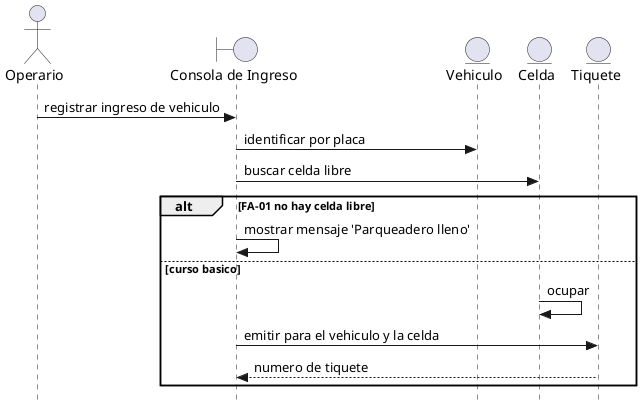

# UML Sequence Diagram

Trabajar en español por defecto, salvo que el usuario pida otro idioma. Fundamento y fuentes: `references/sources-and-methods.md`.

## Naturaleza y propósito

El diagrama de secuencia es **el vehículo del diseño detallado**, caso de uso por caso de uso. Y tiene un propósito único que gobierna todo lo demás:

> **Cada mensaje que dibujas es una operación colocándose en la clase que lo recibe.** La fuente lo dice sin rodeos: *"in UML each message is also called an operation once it's assigned to a class"*.

De ahí se sigue lo que esta skill es y lo que no es:

- **Es asignación de comportamiento.** La pregunta que respondes al dibujar no es "¿qué pasa después?" sino **"¿qué clase debería ser responsable de esto?"**. La fuente insiste: el propósito real es *"allocation of behavior among collaborating objects"*.
- **No es un diagrama de flujo.** El libro le dedica un recuadro entero: *"DON'T TRY TO DRAW FLOWCHARTS ON SEQUENCE DIAGRAMS"*, porque hacerlo *"simply misses the point of what you should be thinking about"*. Fowler llega igual desde otro lado: *"Treat sequence diagrams as a visualization of how objects interact rather than as a way of modeling control logic"*.
- **Es la segunda pasada de ICONIX.** La primera —robustez— **ignora deliberadamente** quién hace qué, para descubrir objetos y atributos. Esta segunda decide quién hace qué. Si intentas asignar comportamiento en robustez o descubrir clases aquí por primera vez, has cruzado la frontera en el sentido equivocado.
- **No dibuja el diagrama de clases.** Pero lo alimenta: emite el **delta de operaciones** que ese artefacto consume. La fuente lo exige a cada paso: *"with each message arrow you draw on the sequence diagram, you take a peek at the class diagram to make sure it's updated correctly"*.

**Los tres objetivos**, en el orden de la fuente: asignar comportamiento a las clases · mostrar en detalle cómo interactúan los objetos durante la vida del caso de uso · terminar de distribuir las operaciones entre las clases.

## Insumos y trazabilidad de construcción

Esta skill es el **paso 6** del pipeline y consume lo que el PDR ya aprobó:

```
dominio → casos de uso → especificación → robustez (DR-XX) → PDR ─┐
   ↑                                                              │
   │                                              SECUENCIAS (DS-XX, esta skill)
   │                                                              │
   └──── delta de operaciones ────────────────────────────────────┘
                                                                  ↓
                                       clases de diseño · CP-XX · código
```

| Insumo | Nivel | Qué habilita | Si falta |
|---|---|---|---|
| **Diagrama de robustez** `DR-XX` (.puml) | **Obligatorio** | De él salen **todos** los participantes: Bordes, Entidades, Actores; y sus Controladores son la lista de comportamiento a asignar | **Detente**: sin él estarías inventando el diseño en vez de derivarlo |
| **Especificación** `CU-XX` (.md) | **Obligatorio** | Barrido texto ↔ mensajes; los `FA-XX`/`FE-XX` que se vuelven fragmentos | Sin barrido ni cobertura de flujos → capas **no ejecutadas** |
| **Modelo de dominio** (.puml) | **Obligatorio** | Distinguir entidades del **espacio del problema** de las clases nuevas del **espacio de la solución** | El delta no puede separar lo descubierto de lo inventado |
| **Veredicto del PDR** `PDR-XX` | Recomendado | Confirma que se diseña sobre artefactos aprobados | **Advierte**: si el veredicto fue `Reinspección requerida`, estás construyendo sobre material que no pasó la compuerta |
| **Diagrama de casos de uso** (.puml) | Recomendado | Verificación de actores | Los actores no se contrastan con su fuente |
| **Framework o arquitectura declarada** | Opcional | **Activa la capa de infraestructura**: participantes de persistencia, vistas, ORM, con sus convenciones | Capa declarada **no ejecutada**; el diagrama sale neutral y válido |
| Wireframes · Reglas de negocio `RN-XX` | Opcional | Nombres reales de pantallas; precisión al nombrar validaciones | — |

**Regla de los insumos ausentes.** Un insumo que falta **desactiva capas concretas**, y una capa que no se pudo ejecutar **se declara como no ejecutada** en el certificado. Nunca la silencies.

**Identificadores.** El diagrama lleva **`DS-XX`** y cada caso de prueba derivado, **`CP-XX`**. Ambos llevaban reservados desde el principio en la plantilla de `use-case-specifier` y en la cadena de `uml-robustness-diagram`, sin que nadie los ocupara. Esta skill los ocupa y cierra la cadena:

`RF-XX` → `CU-XX` → `FA-XX`/`FE-XX` → `DR-XX` + `B-`/`C-`/`E-` → `PDR-XX` → **`DS-XX`** → **`CP-XX`**

## Los cuatro pasos

La fuente los llama *"four essential steps"* y es explícita en el reparto de esfuerzo: **los tres primeros son mecánicos** —*"completely mechanical in nature. This means they can be automated"*— y el cuarto *"is really what sequence diagramming is all about"*.

1. **Copiar el texto del caso de uso** al lado del diagrama. No es decoración: es el contrato contra el que se comprueba cada mensaje.
2. **Copiar las Entidades** del diagrama de robustez como líneas de vida.
3. **Copiar los Bordes y los Actores** del diagrama de robustez.
4. **Asignar las operaciones a las clases.** Aquí está el juicio, y es donde debes gastar el tiempo.

Automatiza 1-3 sin ceremonia y **concentra todo el esfuerzo en el 4**. Un diagrama que solo ejecutó los tres primeros pasos no es un diseño: es un inventario de participantes.

## Qué pasa con los Controladores

Es la transformación central y la más malinterpretada.

> *"there are no controller objects on the sequence diagram (although there could be)… the controllers (the verbs) are turned into messages on the boundary and entity objects (the nouns)"*

**La proporción está cuantificada:** *"80% or so of the controllers from the robustness diagrams can be implemented as one or more operations on the entity and boundary classes"*. El resto son clases controladoras legítimas — gestores, despachadores — o las que impone un framework.

Tres consecuencias operativas:

- **No es una biyección.** Un Controlador puede rendir **una o varias** operaciones. El criterio de verificación es de **cobertura**: cada Controlador del `DR-XX` debe quedar cubierto por al menos un mensaje **o** aparecer como participante. Nunca cuentes uno a uno.
- **Una clase controladora es la excepción, no el patrón.** Cuando la crees, justifícala.
- **Cuidado con el framework.** La fuente avisa: *"sometimes a framework might tempt you to litter your design with dozens of tiny 'controller classes'"*. Un `XController` y un `XService` por cada entidad no es diseño orientado a objetos: es descomposición funcional con otro nombre, y produce el **modelo de dominio anémico** del catálogo de anti-patrones.

## Asignación de comportamiento — el juicio difícil

Detalle en `references/behavior-allocation.md`. El criterio de fondo: **una responsabilidad es conocimiento más comportamiento**, y va donde está el conocimiento.

**Control distribuido frente a centralizado.** Es la prueba de calidad clásica de un diagrama de secuencia. Un participante que lo hace casi todo mientras los demás solo devuelven datos es **control centralizado**, y delata que el comportamiento no se asignó: se acumuló. Fowler: *"One of the main goals of good design is to localize the effects of change"* y *"by distributing control, you create more opportunities for using polymorphism rather than using conditional logic"*.

**La señal de alarma más útil:** si tus Entidades solo reciben `get`/`set` y toda la lógica vive en un controlador, tienes un modelo de dominio anémico. La regla de oro es poner juntos los datos y el comportamiento que los usa.

**Cuando la responsabilidad es demasiado grande** para una clase, no la fuerces: pártela y busca colaboración en otras clases.

## Notación y estilo

Detalle y fundamento en `references/notation-rules.md`.

- **Un diagrama por caso de uso**, con el curso básico **y todos los alternos en el mismo diagrama**.
- **Barras de activación: omitidas por defecto.** Las tres fuentes no coinciden y la skill lo documenta: el material de clase manda omitirlas; Rosenberg prefiere lo mismo —*"the focus of control is best switched off, as it tends to be something of a distraction"*— pero matiza que *"this isn't necessarily an error… a matter of personal taste"*; Fowler las considera *"extremely valuable"*. **Por eso el validador avisa por su uso, nunca da error por él.** Ahora bien, si se usan, una **fuga de activación** —un `activate` sin cierre, o un `deactivate` sin apertura, en algún camino de ejecución— **sí es un error**: eso ya no es cuestión de gusto, es un diagrama mal formado. El balance se comprueba **por camino**, nunca en línea recta.
- **Mensajes de retorno: solo cuando aportan.** Las tres fuentes sí coinciden aquí. Rosenberg: *"You normally don't need to draw a return arrow, except in special circumstances"*, porque los parámetros pueden devolverse como argumentos. Fowler: *"otherwise, they simply clutter things"*. Se dibujan para un valor que el flujo usa, un retorno asíncrono o una rama de error. **El exceso de retornos es un anti-patrón.**
- **Fragmentos combinados** `alt`/`opt`/`loop` para los flujos alternativos y de excepción, **etiquetados con su `FA-XX`/`FE-XX`** para que la cobertura sea verificable.
- **Los mensajes se nombran como operaciones**: verbo, específico, y traducible a un identificador de código.
- **La infraestructura no es una Entidad.** Un ORM, una conexión de base de datos o un cliente HTTP son participantes legítimos del diseño detallado, pero **no** se declaran `entity`: esa palabra está reservada para las clases del dominio.
- **No repitas el estereotipo en la etiqueta.** Las palabras clave `boundary`, `control` y `entity` de PlantUML ya dibujan el icono; escribir además `<<boundary>>` en el nombre es ruido.

## Las clases del espacio de la solución

Al diseñar aparecerán participantes que **no están en el modelo de dominio**, y eso es correcto y esperado, no un defecto:

> *"don't be surprised if you start to see lots of new classes appear on the static model that were never there on the domain model during analysis… you're now identifying the solution space classes. By contrast, the domain model shows classes only from the problem space."*

**Distinción que gobierna el delta y el validador:**

| Caso | Tratamiento |
|---|---|
| Entidad del **problema** que no está en el modelo de dominio | **Error de trazabilidad**: o se descubrió tarde, o el nombre derivó |
| Clase nueva del **espacio de la solución** (servicio, repositorio, controlador, participante de infraestructura) | **Información**: se registra en el delta como clase nueva y se justifica |

Confundir ambos casos es el error más fácil al venir del PDR, donde *toda* entidad sin dominio es un defecto. **Aquí no.** En diseño detallado los dos espacios convergen: *"By updating the static model as you work through the sequence diagrams, you're now converging the problem space with the solution space."*

## Casos de prueba: `CP-XX`

Se derivan **de los Controladores**, en la misma pasada que el diagrama — no después. La fuente lo enuncia como extensión de los cuatro pasos: *"we extend these steps to show how to systematically build a suite of test cases at the same time as your sequence diagrams"*. Y el canon del método: los sustantivos se vuelven instancias en la secuencia y *"the verbs (controllers) get test cases created for them"*.

Detalle en `references/test-derivation.md`. Dos comprobaciones distintas:

- **Unidad de derivación: el Controlador.** Cada uno rinde al menos un `CP-XX`.
- **Comprobación de cobertura: los caminos.** El curso básico y **cada** flujo alternativo o de excepción debe quedar cubierto por algún `CP-XX`. Si un camino no tiene prueba, o falta el caso o falta el Controlador que lo gobierna.

## Procedimiento

1. **Inventaría los insumos**; declara los que falten y qué capas desactivan. Si el veredicto del PDR no fue favorable, **dilo antes de empezar**.
2. **Ejecuta los pasos 1-3** mecánicamente: texto, Entidades, Bordes y Actores desde el `DR-XX`.
3. **Recorre los Controladores uno a uno** y decide, para cada uno, qué clase recibe la operación y por qué. Registra la justificación: es lo que hace auditable el paso 4.
4. **Añade los fragmentos** de los flujos alternativos y de excepción, etiquetados.
5. **Registra el delta de operaciones** a medida que dibujas, no al final.
6. **Deriva los `CP-XX`** de los Controladores y comprueba la cobertura de caminos.
7. **Corre el validador** y ejecuta el ciclo de auditoría interna.
8. **Ofrece las correcciones** de los artefactos de entrada, enrutadas a su skill, y aplica solo lo confirmado.

## Ciclo de auditoría interna

**Ningún entregable sale sin pasar por este ciclo.** Construir → auditar → corregir → comprobar convergencia. Se cierra cuando se cumplen **a la vez**:

- cero hallazgos **críticos** y cero **mayores**;
- como máximo **dos menores**, documentados y justificados;
- **cada** Controlador del `DR-XX` cubierto, y **cada** paso del texto con su mensaje;
- **cada** operación del delta con su clase y su justificación;
- **cada** capa declarada ejecutada o no ejecutada, sin huecos;
- **dos pasadas consecutivas sin hallazgos nuevos** — una pasada limpia puede ser suerte, dos no.

**Tope duro: cinco pasadas.** Si al alcanzarlo persisten críticos o mayores, **no declares éxito**: entrega el mejor resultado, marca el estado como **`AUDITORÍA NO SUPERADA`**, enumera lo abierto y di qué insumo o decisión lo cerraría. Un fracaso declarado es más útil que un certificado optimista.

Si el diagrama crece hasta hacerse ilegible, o los alternos tienen sus propios subalternos, **el problema es el caso de uso, no el diagrama**: propón partirlo.

## Modos de trabajo

- **Generar** — construir el `DS-XX` desde los insumos, con delta, `CP-XX` y certificado.
- **Revisar** — auditar un diagrama existente sin reemplazarlo; hallazgos por severidad.
- **Refactorizar** — reasignar comportamiento conservando la intención; explica cada movimiento con su criterio.
- **Validar** — solo el script, interpretado con criterio.
- **Derivar pruebas** — a partir de un `DS-XX` ya aprobado, emitir los `CP-XX`.
- **Trazar hacia adelante** — emitir el delta de operaciones y los insumos estructurados para código.

## Contrato de salida PlantUML

- Abre con `@startuml` y cierra con `@enduml`.
- `skinparam style strictuml` · `skinparam shadowing false` · `skinparam responseMessageBelowArrow true`.
- Declara cada participante con su palabra clave: `actor`, `boundary`, `control`, `entity`; la infraestructura con `participant`, `database` o `queue` según corresponda. **Sin repetir el estereotipo en la etiqueta.**
- Alias con prefijo — `ACT_`, `B_`, `C_`, `E_`, `INF_` para infraestructura — para que la trazabilidad y la validación sean inequívocas.
- **Sin `activate`/`deactivate`** salvo petición expresa.
- Retornos `-->` solo cuando aportan.
- Fragmentos etiquetados con el identificador del flujo: `alt FA-01 <condición>`.
- Divisores `==` para separar las fases del caso de uso cuando ayuden a leerlo.
- Nombre de archivo: `caso_NN_secuencia.puml`; identificador `DS-XX`.



## Entregables

1. **Diagrama de secuencia** `DS-XX` en PlantUML.
2. **Certificado de auditoría interna** con capas verificadas, pasadas y estado final.
3. **Delta de operaciones** — operación, clase receptora, mensaje que la origina, **justificación de por qué va en esa clase**, y si la clase es del problema o de la solución. Es la entrada de la skill del diagrama de clases.
4. **Casos de prueba `CP-XX`** — uno o más por Controlador, con la cobertura de caminos comprobada.
5. **Matriz de trazabilidad** — paso del texto ↔ mensaje ↔ operación ↔ clase ↔ `CP-XX`.
6. **Insumos estructurados para código** — clase, operación, firma y capa. Resumen consumible; **esta skill no genera código**.
7. **Hallazgos sobre los artefactos de entrada**, enrutados a su skill y pendientes de tu confirmación.

## Enrutamiento de correcciones

| Hallazgo | Va a |
|---|---|
| Entidad ausente, atributo faltante | `/uml-domain-modeler` |
| Actor descuadrado | `/uml-use-case-diagram` |
| Paso ambiguo, flujo sin comportamiento | `/use-case-specifier` |
| Controlador ausente o mal nombrado, violación de reglas BCE | `/uml-robustness-diagram` |
| Incoherencia entre artefactos de entrada | `/iconix-pdr-review` |

**No reescribas los artefactos ajenos.** Redacta la corrección, agrúpala por destinatario, **pregunta cuáles aplicar** —con opción de todas— y aplica solo lo confirmado.

## Trazabilidad hacia adelante

- **Cada mensaje → una operación** en la clase receptora → el diagrama de clases de diseño.
- **Cada Controlador → al menos un `CP-XX`** → pruebas unitarias.
- **El delta de operaciones** cierra la convergencia entre el espacio del problema y el de la solución.
- Lo que sigue es el **Critical Design Review** (Milestone 3), que revisa este diseño antes de codificar.

## Recursos

- `references/sequence-guidelines.md` — las diez guías, los cuatro pasos y los tres objetivos, con cita y localizador.
- `references/behavior-allocation.md` — cómo se decide qué clase recibe cada operación: responsabilidades, control distribuido, criterios y sus límites.
- `references/notation-rules.md` — mensajes, fragmentos, activaciones, retornos y contrato PlantUML, con las tres posturas documentadas.
- `references/anti-patterns.md` — catálogo con síntoma, por qué importa y corrección.
- `references/test-derivation.md` — derivación de `CP-XX` desde los Controladores y cobertura de caminos.
- `references/sources-and-methods.md` — libros, normas e investigación, con estado de verificación de cada cita.
- `references/regression-examples.md` — expectativas por dominio para comprobar que la skill generaliza.
- `scripts/validate_sequence_puml.py` — verificación mecánica multi-artefacto.
- `tests/examples/` — conjuntos de artefactos, coherentes e incoherentes a propósito.
