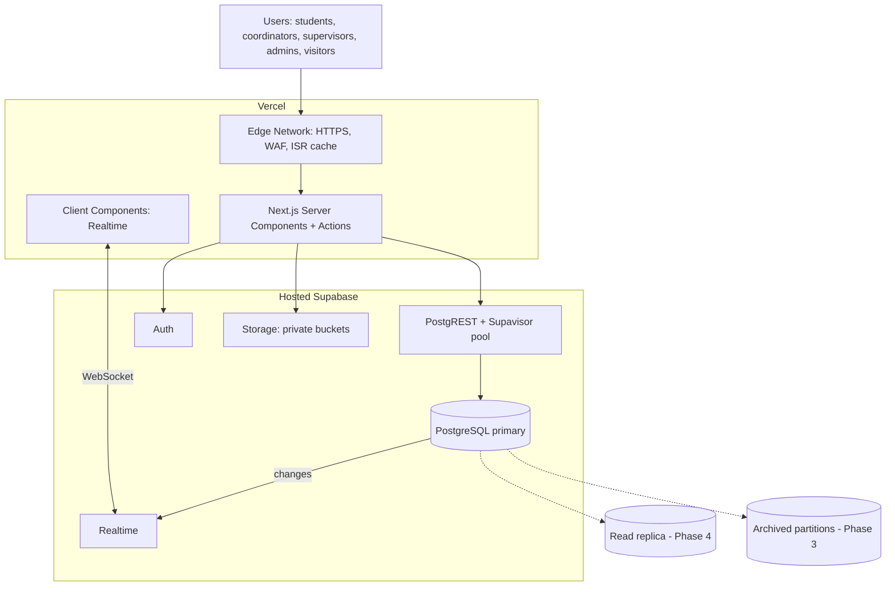

# Dugtong OJT — Scaling System Design Proposal Generator

This skill produces a **document**, not code. Its output is one file, `docs/SYSTEM-DESIGN.md`, that a reader (teammate, adviser, defense panel, investor) can follow from "what is the system" to "how it survives 1,000,000 users".

It works alongside `scale-architecture/SKILL.md` (the rulebook for writing code). That skill says _how to build_; this skill says _how to explain and plan the scaling_. When they overlap, the facts in this proposal must match that rulebook, `CLAUDE.md`, and `CONTEXT.md`.

---

## 0. Ground rules (read first)

1. **Authority order:** root `CLAUDE.md` → `CONTEXT.md` → `docs/SPEC.md` + active ticket → `scale-architecture/SKILL.md` → this file. If anything conflicts, stop and ask in plain English.
2. **Document only.** Never edit `src/`, `supabase/sql/`, RLS policies, env files, or `package.json` while running this skill. Proposed SQL appears _inside the document_ as examples, clearly marked "proposed — needs approval".
3. **Pinned stack stays pinned.** Next.js App Router + Vercel + Hosted Supabase. Do not propose Docker, Kubernetes, Nginx, self-hosted VMs, external Redis, Kafka, or paid third-party services. If the reader expects classic infrastructure (load balancers, app servers), explain the managed equivalent instead (Section 4 of the output).
4. **Real names over invented names.** Inspect the repo before writing (Step 1). Use real table, column, route, and file names. If something doesn't exist yet, label it `(proposed)`.
5. **Label every number.** Each figure is either _Given_ (from `CONTEXT.md`/spec/scale-architecture), _Measured_ (from Supabase/Vercel dashboards the team provided), or _Estimate_ (show the arithmetic). Never present an estimate as a fact.
6. **Ask, don't guess, on open decisions** (partition keys, retention periods, CSV limits, role storage, compute budget). List them in the output's "Open decisions" section with the owner from the ownership matrix (Neil, Khent, Josiah, Arwin, team lead).
7. **Teach as you go.** Define jargon the first time it appears in the document (e.g., "RLS (Row Level Security): rules inside Postgres that decide which rows each user may see").

---

## 1. Workflow

### Step 1 — Gather facts (read-only)

Run read-only inspection and note what you find. Prefer commands that work in PowerShell and Git Bash.

- `CLAUDE.md`, `CONTEXT.md` (Sections 5, 6, 9, 10, 11, 12), `docs/SPEC.md`, `docs/tickets/`
- `supabase/sql/*.sql` → list every table, its columns, foreign keys, indexes, RLS policies, triggers, RPCs
- `src/lib/supabase/` → how server and browser clients are created
- `src/app/` → route list per role (visitor, student, coordinator, supervisor, admin)
- Any `useEffect` with `.channel(` → current Realtime subscriptions
- `package.json` → exact Next.js / React / Supabase versions

Build a short fact sheet for yourself: tables, which are high-write, which are high-read, which lack indexes on FKs, which RLS policies call `auth.uid()` without the `(SELECT ...)` wrapper. Those gaps become recommendations.

If `supabase/sql/` is missing or empty, say so in the document and use conceptual tables marked `(proposed)`.

### Step 2 — Confirm scope with the team (one short question)

Ask once, then proceed with defaults if there's no answer:

> "Who is this proposal for (team, adviser/panel, or investors), and do you have real usage numbers from Supabase or Vercel? If not I'll use the 1M-user targets from our architecture standard and label them as estimates."

Audience changes tone only: panel/adviser = define more terms and show diagrams early; team = more SQL and ticket-ready detail.

### Step 3 — Compute capacity estimates

Use the given targets unless the team supplied real numbers:

| Input                 | Default   | Source                |
| --------------------- | --------- | --------------------- |
| Registered users      | 1,000,000 | scale-architecture §9 |
| Daily active users    | ~150,000  | scale-architecture §9 |
| Peak concurrent users | ~10,000   | scale-architecture §9 |

Then derive, showing arithmetic in the document:

- Students deployed per semester (state your assumption, e.g., 30% of users)
- Attendance rows/semester = deployed students × working days (~90)
- Journal rows/semester = same pattern
- Audit rows/semester ≈ sum of all tracked writes
- Peak writes per second at 8:00 AM = (students submitting in the peak window) ÷ (window length in seconds)
- Storage growth per semester (rows × average row size; state the size you assumed)
- Realtime connections at peak ≈ concurrent signed-in users with a dashboard open

Keep it to one table plus a few lines of arithmetic. Round sensibly.

### Step 4 — Write `docs/SYSTEM-DESIGN.md`

Follow the output template in Section 2 exactly (section order and headings). Use **Mermaid** for every diagram so it renders on GitHub, VS Code, and most markdown viewers. Keep diagrams readable: ≤ 15 nodes each, labels ≤ 6 words, split into two diagrams if needed.

### Step 5 — Self-review before handing off

Check the finished document against the checklist in Section 4. Fix anything that fails. Then tell the team, in 2–3 plain sentences, what the document covers and which open decisions need an owner.

---

## 2. Output template (`docs/SYSTEM-DESIGN.md`)

Use these sections in this order. Each section opens with one sentence that states its conclusion, not "This section describes…".

### 1. Executive summary

One paragraph: the scaling problem (users, burst traffic, fast-growing tables) and the approach (keep the serverless stack, scale the database, phase the work by measured triggers). Note that schema/RLS changes need approval.

### 2. Goals, non-goals, and assumptions

- Goals: e.g., 1M users, sub-second public pages, zero duplicate writes under bursts, RA 10173 compliance.
- Non-goals: features outside `docs/SPEC.md`, payments/billing, rewriting the app, foreign infrastructure.
- Assumptions: each labelled Given / Measured / Estimate.

### 3. Capacity estimates

The table and arithmetic from Step 3, plus target latencies:

| Operation                          | Target             |
| ---------------------------------- | ------------------ |
| Public marketplace page            | < 1 s (edge cache) |
| Filtered listing query             | < 10 ms (indexed)  |
| Write action (journal, attendance) | < 300 ms           |

### 4. Traditional infrastructure vs. our managed stack

Readers often expect load balancers and servers. Answer that directly with this mapping (adjust wording to the repo):

| Traditional component            | What it does                  | Dugtong OJT equivalent                                                     |
| -------------------------------- | ----------------------------- | -------------------------------------------------------------------------- |
| DNS + SSL termination            | Routes domain, HTTPS          | Vercel domains + automatic SSL                                             |
| Load balancer                    | Spreads traffic over servers  | Vercel Edge Network routing to serverless functions                        |
| Web/app server fleet             | Runs the app, scaled manually | Next.js on Vercel serverless functions, autoscaled, stateless              |
| CDN / reverse-proxy cache        | Serves static & cached pages  | Vercel Edge cache + ISR (`revalidateTag`)                                  |
| WAF / rate limiter               | Blocks floods and bots        | Vercel firewall + server-action checks                                     |
| DB connection pooler (PgBouncer) | Shares DB connections         | Supabase Supavisor (transaction mode, port 6543) + PostgREST               |
| Primary database                 | Source of truth               | Hosted Supabase PostgreSQL                                                 |
| Read replicas                    | Offload heavy reads           | Supabase read replica (Phase 4, needs approval/budget)                     |
| Cache cluster (Redis)            | Hot-data cache                | Edge cache for public data; indexes + Postgres for private data            |
| Pub/sub / WebSocket servers      | Live updates                  | Supabase Realtime (filtered CDC + Broadcast)                               |
| Object storage                   | Files                         | Supabase Storage, private buckets, signed URLs                             |
| Auth server                      | Login, sessions               | Supabase Auth                                                              |
| Job queue / workers              | Background work               | Postgres triggers/RPCs; batch inserts; (scheduled jobs only if approved)   |
| Monitoring stack                 | Metrics, logs                 | Supabase Query Performance (`pg_stat_statements`), Vercel logs, audit logs |

End with one sentence: the hosting layer scales automatically, so the engineering effort goes into the database.

### 5. High-level architecture (diagram)

A Mermaid `flowchart TB` with subgraphs: Users → Vercel (Edge Network, Next.js Server Components/Actions, Client Components) → Hosted Supabase (PostgREST + Supavisor, Auth, Realtime, Storage, PostgreSQL primary) → later-phase boxes (read replica, archived partitions) drawn with dashed links. Follow it with 3–5 sentences explaining what each layer is responsible for.

Example skeleton (adapt names to the repo):

### 6. Request flows (sequence diagrams)

Three Mermaid `sequenceDiagram`s, each followed by 2–3 sentences:

1. **Public marketplace read** — cache hit at the edge vs. cache miss → Next.js → Postgres → cache filled.
2. **Write under burst** (e.g., journal submit or attendance) — button disables → server action (`auth.getUser()`, Zod, role check) → pooled connection → one transaction (atomic update, constraints, audit trigger) → response → Realtime event → dashboards update.
3. **Realtime update** — tenant-filtered subscription, cleanup with `removeChannel`, debounced `router.refresh()`.

### 7. Data model

- Mermaid `erDiagram` of the real tables (or `(proposed)` ones) with FKs and tenant keys.
- A table classifying each table: tenant key · read/write pattern · growth per semester (from Step 3) · scaling treatment.

### 8. Database scaling strategy

Ordered by impact. For each: what, why (one sentence), proposed SQL example marked "proposed — needs approval".

1. RLS `initPlan` pattern: `USING ((SELECT auth.uid()) = user_id)`. List any current policies that need it (from Step 1).
2. Indexes: B-Tree on every FK/tenant column (list missing ones found in Step 1); composite `(student_id, created_at DESC)`; BRIN on time columns of attendance/journals/audit; partial index on active verified listings; GIN on array columns.
3. Cursor (keyset) pagination replacing `OFFSET` on tables > 1,000 rows.
4. N+1 removal with relational selects (`select('*, companies(*)')`).
5. Connection pooling (Supavisor transaction mode).
6. Partitioning: attendance/journals by semester, audit logs by month; native Postgres declarative partitioning; expand → migrate → contract rollout.
7. Archival: detach old partitions, keep read-only; audit data is never altered or deleted.
8. Read replica for reports/analytics only.
9. Supabase compute upgrades: when, based on which metric (do not quote prices unless the team supplied them).

### 9. Concurrency and data integrity

Table: failure · example · safeguard. Cover double submit, lost update (slots/hours), client-computed totals, partial writes vs. audit log, connection starvation during CSV import, duplicate partnership requests. Close with the rule: validate on the server, do the math in Postgres, constraints are the backstop.

### 10. Caching strategy

Table of layers (browser, Vercel edge/ISR, authenticated views) · what is cached · how it refreshes · DB load. Call out the `cookies()`/session trap that silently disables edge caching on public pages.

### 11. Realtime scaling

Tenant-filtered subscriptions per role, Broadcast for many viewers, mandatory cleanup, batched UI refreshes. Estimate peak connections from Step 3.

### 12. Security and privacy at scale (RA 10173)

Dual tenant checks (server + RLS), RLS on every new partition/replica path, edge cache holds only public listing fields, archived audit data stays tamper-evident, no `service_role`/`sb_secret_` keys in client or repo, testing across all five roles.

### 13. Phased scaling roadmap

A Mermaid `timeline` or `flowchart LR` of phases, then a table:

| Phase         | User range  | Trigger to start                            | Actions                                                                                       | Owner                |
| ------------- | ----------- | ------------------------------------------- | --------------------------------------------------------------------------------------------- | -------------------- |
| 1. Foundation | MVP – 10k   | Now                                         | RLS initPlan, FK indexes, cursor pagination, button locks, atomic RPCs                        | per ownership matrix |
| 2. Optimize   | 10k – 100k  | p95 query > 100 ms, or DB CPU > 60% at peak | Composite/BRIN/GIN indexes, ISR for marketplace, Broadcast, batch CSV import, compute upgrade |                      |
| 3. Partition  | 100k – 500k | attendance/journals > ~10M rows             | Partition by semester/month, archival                                                         |                      |
| 4. Distribute | 500k – 1M   | read load still high after Phase 3          | Read replica for reports, further compute upgrade                                             |                      |

Trigger thresholds are proposals; label them as such and invite the team to adjust.

### 14. Monitoring

What to watch (pg_stat_statements top queries, DB CPU/memory/connections, Vercel function duration/errors at 8 AM and Friday peaks, table sizes each semester) and who checks it.

### 15. Risks and open decisions

- Risk table: risk · effect · mitigation.
- Open decisions as a checklist with owners (Neil, Khent, Josiah, Arwin, team lead). Never answer these yourself.

### 16. Glossary

Every technical term used (RLS, ISR, CDC, BRIN, GIN, keyset pagination, Supavisor, initPlan, partitioning, read replica, idempotency…) in one plain-English line each.

---

## 3. Style rules for the document

- Plain English, short sentences, numbers with units.
- One idea per paragraph; tables for comparisons; diagrams for structure and flow.
- Section openers state the conclusion.
- Proposed SQL in fenced `sql` blocks, each preceded by `-- proposed — needs approval`.
- No marketing language, no invented pricing, no features outside `docs/SPEC.md`.
- Target length: 8–15 printed pages. Cut detail before cutting diagrams.

---

## 4. Definition of done (self-review)

- [ ] Only `docs/SYSTEM-DESIGN.md` was created or changed; no code, SQL files, RLS, or env files touched.
- [ ] Repo inspected; real table/route names used, or marked `(proposed)`.
- [ ] Every number labelled Given / Measured / Estimate, with arithmetic for estimates.
- [ ] All 16 sections present in order; each opens with its conclusion.
- [ ] At least 5 Mermaid diagrams: architecture, 3 sequence flows, ER model (plus roadmap if used); each renders (no syntax errors, ≤ 15 nodes).
- [ ] Traditional-vs-managed mapping table included, answering the "load balancers and servers" question.
- [ ] No foreign infrastructure proposed; stack matches `CLAUDE.md`.
- [ ] Security section keeps RLS on everywhere and respects RA 10173.
- [ ] Open decisions listed with owners, not decided.
- [ ] Jargon defined on first use and in the glossary.
- [ ] Team told in 2–3 plain sentences what was produced and what needs their decision.
