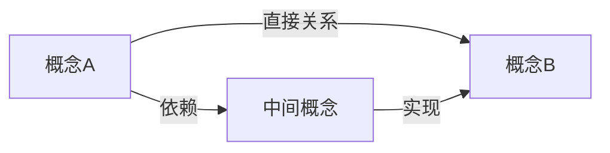

# Query 技能

## 核心目标

将用户的提问转化为对本地 Wiki 的深度检索。支持三种查询模式，根据问题类型自动选择或手动指定。通过索引系统精准定位相关页面，提取信息，综合出带有明确引用来源的双链回答。

## 触发条件

- 用户输入 `/query <问题>` — 精准查询模式
- 用户输入 `/query --explore <主题>` — 探索查询模式
- 用户输入 `/query --relate <概念A> <概念B>` — 关系查询模式
- 用户用自然语言询问：`"我的笔记里关于 X 是怎么说的"`、`"过去我对 Y 的决策是什么"`、`"查询 Z 相关的知识"`

## 降级策略

如果问题属于纯通用知识（如"太阳系有几颗行星"），且 wiki/index.md 中无相关内容：

> 本地知识库中未找到相关内容，以下为通用知识回答：[直接回答]

---

## 模式 1：精准查询（默认）

**适用场景**：具体问题，如"什么是 Transformer？"、"Claude Code 的核心功能是什么？"

### 步骤 1：索引导航

**永远的第一步**：读取 `wiki/index.md`

这是总索引，按 domain 和 type 双维度列出所有页面。根据问题关键词，定位到 5-10 个最相关的页面。

**判断逻辑**：
- 如果问题明确涉及某些实体或概念，直接定位到对应页面
- 如果问题较宽泛，选择多个可能相关的页面
- 如果索引中页面数量过多（> 100），先按 domain 或 type 筛选

**关键优化**：
- 只读取 wiki/index.md（通常 < 200 行）
- 精准定位到 5-10 个页面，不要全量扫描

### 步骤 2：深度阅读

**只读取定位到的 5-10 个页面**：
```bash
Read wiki/{type}/{page}.md
```

获取完整内容，提取与问题相关的信息。

**关键优化**：
- 只读取步骤 1 定位到的页面，不要额外读取
- 如果 5-10 个页面不足以回答问题，返回步骤 1 重新定位

### 步骤 3：综合与回答

综合信息，回答用户问题。

**双链引用规范**：
- 每当引用某个 Wiki 页面的信息，在文本中使用 `[[页面名称]]` 标注
- 整段引用同一页面：段落首尾各引用一次
- 引用特定原文：使用 Markdown 块引用 `> 引用内容`

**回答格式**：
```markdown
根据知识库中的信息：

[回答内容，使用 [[wikilink]] 标注引用]

## 参考页面
- [[type/页面1]] — 简短说明
- [[type/页面2]] — 简短说明
```

### 步骤 4：高价值内容固化

如果满足以下条件，主动询问用户是否保存为 synthesis：
- 回答超过 2 个段落
- 内容具有分析对比性或总结性
- 综合了多个页面的信息

询问话术：
> 这是一个有价值的总结，是否需要我将其保存到 wiki/syntheses/ 目录？

用户同意后，按照 CLAUDE.md 规范创建文件：
```markdown
---
title: "页面标题"
type: synthesis
domain: AI | 财务 | 健康 | 未分类
tags: [标签1, 标签2, 标签3]
sources: []
last_updated: YYYY-MM-DD
backlinks_count: 0
---

# 总结内容
[回答内容]

## 关联连接
- [[页面1]] — 引用来源
- [[页面2]] — 引用来源
```

并在 `wiki/index.md` 的对应 domain 和 Syntheses 分类下注册。

### 步骤 5：记录操作日志

无论是否生成 synthesis 页面，查询结束后必须在 `wiki/log.md` 末尾追加：

```markdown
## [YYYY-MM-DD] query | <操作简述>
- **模式**: 精准查询
- **输出**: <引用页面列表或"即时回答未保存">
- **引用页面**: N 个
```

---

## 模式 2：探索查询（`/query --explore <主题>`）

**适用场景**：广度优先探索，如"我对 AI 了解多少？"、"知识库中有哪些关于 LLM 的内容？"

### 步骤 1：广度扫描

**读取 wiki/index.md**，找到所有与主题相关的页面（不限数量）

**只读取每个页面的 frontmatter + 第一段**（摘要），不读取完整内容

### 步骤 2：生成知识地图

根据扫描结果，生成以下内容之一：

**选项 A：Mermaid 思维导图**
```mermaid
mindmap
  root((主题))
    Concepts
      [[概念1]]
      [[概念2]]
    Entities
      [[实体1]]
      [[实体2]]
    Sources
      [[来源1]]
      [[来源2]]
```

**选项 B：文本知识地图**
```markdown
# 知识库中关于「主题」的内容

## 概念层（Concepts）
- [[概念1]] — 一句话描述
- [[概念2]] — 一句话描述

## 实体层（Entities）
- [[实体1]] — 一句话描述
- [[实体2]] — 一句话描述

## 来源层（Sources）
- [[来源1]] — 一句话描述

## 知识缺口
- 缺少关于 X 的深度分析
- Y 和 Z 的关系尚未建立
```

### 步骤 3：深入引导

询问用户是否深入某个分支：
> 发现 N 个相关页面。是否需要深入了解某个具体概念？（如需要，请告诉我页面名称，我将切换到精准查询模式）

### 步骤 4：记录操作日志

```markdown
## [YYYY-MM-DD] query | 探索查询：<主题>
- **模式**: 探索查询
- **覆盖范围**: N 个页面（concepts: X, entities: Y, sources: Z）
- **输出**: 知识地图
```

---

## 模式 3：关系查询（`/query --relate <概念A> <概念B>`）

**适用场景**：探索两个概念的关系，如"Transformer 和 Attention 的关系？"

### 步骤 1：定位节点

从 `wiki/index.md` 找到概念 A 和概念 B 的页面

如果找不到，报告：
> 知识库中未找到 [[概念A]] 或 [[概念B]] 的页面。

### 步骤 2：图遍历

**读取两个页面的完整内容**，特别关注：
- `## 关联连接` 区域
- 正文中提到的其他 [[wikilink]]

**递归查找**：
- 直接关系：A 的关联连接中是否有 B？
- 间接关系：A 和 B 是否有共同的中间节点？
- 最短路径：A → 中间节点 → B

### 步骤 3：关系可视化

生成 Mermaid 关系图：



或文本描述：
```markdown
# [[概念A]] 和 [[概念B]] 的关系

## 直接关系
- [[概念A]] 在其定义中提到了 [[概念B]]
- [[概念B]] 是 [[概念A]] 的核心组成部分

## 间接关系
- 两者都与 [[中间概念]] 相关
- 最短路径：[[概念A]] → [[中间概念]] → [[概念B]]

## 共同依赖
- 都依赖于 [[基础概念]]
- 都被 [[高层概念]] 引用
```

### 步骤 4：记录操作日志

```markdown
## [YYYY-MM-DD] query | 关系查询：<概念A> vs <概念B>
- **模式**: 关系查询
- **关系类型**: 直接关系 | 间接关系 | 无关系
- **中间节点**: N 个
```

---

## 强制约束

- **禁止凭记忆回答** — 必须先检索知识库
- **禁止过度引用** — 同一页面的信息在段落首尾引用一次即可
- **禁止静默回答** — 知识库无相关内容时必须声明
- **精准定位** — 通过索引定位，避免全量扫描
- **探索模式节省 token** — 只读 frontmatter + 第一段，不读完整内容

## 关联连接

- [[wiki/index.md]] — 总索引入口
- [[wiki/log.md]] — 操作日志
- [[CLAUDE.md]] — Wiki 架构总规范
