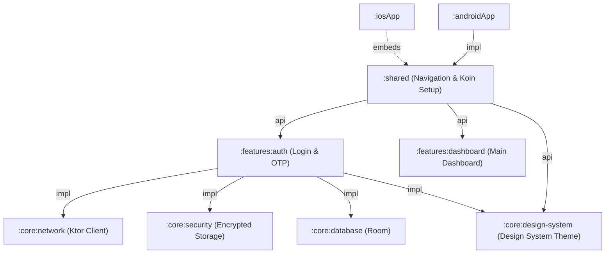

# Skill: KMP Modular Architecture

This skill details the implementation of a multi-module physical architecture in Gradle for **Kotlin Multiplatform (KMP)** and **Compose Multiplatform (CMP)** projects, structured under **Clean Architecture** patterns (Features + Layers) and centralized dependency injection with **Koin**.

## When to Use

- When designing a scalable, enterprise-grade KMP project.
- To achieve physical decoupling of components (preventing UI modules from depending directly on databases or APIs without a domain contract).
- To structure Gradle dependencies so they do not leak unnecessary implementation details to other layers or native applications.

---

## 1. Gradle Multi-Module Structure

The project is physically split into three logical layers composed of independent Gradle submodules:



### Root Configuration (`settings.gradle.kts`):

```kotlin
// settings.gradle.kts
rootProject.name = "YourMultiplatformApp"

// Umbrella Module and Applications
include(":shared")
include(":androidApp")

// Core Modules
include(":core:network")
include(":core:database")
include(":core:security")
include(":core:design-system")

// Feature Modules
include(":features:auth")
include(":features:dashboard")
```

---

## 2. Umbrella Module Configuration (`:shared`)

The `:shared` module acts as the aggregator of the project. It hosts the global navigation engine and exposes everything to Android and iOS. To allow shared classes to be consumed in Swift (Xcode), we must physically export them as frameworks.

```kotlin
// shared/build.gradle.kts

plugins {
    alias(libs.plugins.kotlinMultiplatform)
    alias(libs.plugins.androidMultiplatformLibrary)
    alias(libs.plugins.composeMultiplatform)
    alias(libs.plugins.composeCompiler)
}

kotlin {
    androidLibrary {
        namespace = "your.package.name"
        compileSdk = libs.versions.android.compileSdk.get().toInt()
        minSdk = libs.versions.android.minSdk.get().toInt()
        androidResources {
            enable = true
        }
    }

    iosArm64()
    iosSimulatorArm64()

    sourceSets {
        commonMain.dependencies {
            // "api" exposes classes and screens to the iOS framework (Umbrella)
            api(project(":core:design-system"))
            api(project(":core:network"))
            api(project(":features:auth"))
            api(project(":features:dashboard"))

            // Compose Core
            api(libs.compose.runtime)
            api(libs.compose.ui)
            api(libs.compose.material3)

            // DI
            implementation(libs.koin.core)
        }
    }

    targets.withType<org.jetbrains.kotlin.gradle.plugin.mpp.KotlinNativeTarget>()
        .matching { it.konanTarget.family.isAppleFamily }
        .configureEach {
            binaries {
                framework {
                    baseName = "Shared"
                    isStatic = true
                    
                    // Physically export these modules in Shared.framework for iOS/Swift
                    export(project(":core:design-system"))
                    export(project(":core:network"))
                    export(project(":features:auth"))
                    export(project(":features:dashboard"))
                }
            }
        }
}
```

> [!NOTE]
> **Export only what Swift consumes.** `export(...)` makes a module's public API visible in the generated `Shared.framework` headers. Export a module **only if Swift code references its types directly**. In a Compose-UI app the iOS side enters through `MainViewController` and touches almost no Kotlin types, so most `:core:*` modules (network, database, security) do **not** need exporting — blanket-exporting every module bloats the framework and slows the build. Default to the minimum and add an `export` only when a Swift compile error tells you a type is actually missing.

---

## 3. Standardized Dependency Injection (Koin Setup)

To consolidate shared dependency injection in multiplatform environments, modular initialization is structured in the aggregator `:shared` module:

### A. Common Initializer (`shared/src/commonMain/.../di/HelperKoin.kt`)

```kotlin
package your.package.name.di

import your.package.name.core.network.di.networkModule
import org.koin.core.context.startKoin
import org.koin.core.module.Module
import org.koin.dsl.KoinAppDeclaration
import org.koin.dsl.module

/**
 * Common DI aggregator module.
 * Groups all core components and transversal infrastructures.
 */
val appModule = module {
    includes(networkModule)
}

/**
 * Common Koin initializer for mobile platforms.
 */
fun initKoin(appDeclaration: KoinAppDeclaration = {}) =
    startKoin {
        appDeclaration()
        modules(platformModule(), appModule)
    }

/**
 * Overload for Swift/iOS startup initialization.
 */
fun initKoin() = initKoin {}

/**
 * Expect contract to define platform-specific native dependencies.
 */
expect fun platformModule(): Module
```

### B. Platform Initializers (`shared/src/*Main/.../di/PlatformModule.*.kt`)

*   **Android (`PlatformModule.android.kt`):**
    ```kotlin
    package your.package.name.di

    import org.koin.core.module.Module
    import org.koin.dsl.module

    actual fun platformModule(): Module = module {
        // Native Android dependencies (e.g., Android Context, Room databases)
    }
    ```

*   **iOS (`PlatformModule.ios.kt`):**
    ```kotlin
    package your.package.name.di

    import org.koin.core.module.Module
    import org.koin.dsl.module

    actual fun platformModule(): Module = module {
        // Native iOS dependencies (e.g., Keychain-backed storage builders)
    }
    ```

### C. Platform Entry Points (start Koin)

Aggregating modules is not enough — **Koin must be started from each platform's entry point**, or the DI graph never initializes and the first dependency resolution crashes at runtime (`KoinApplication has not been started`). This is the step most often forgotten after wiring the modules.

*   **Android** (`androidApp` — an `Application` subclass registered in the manifest):
    ```kotlin
    class MainApplication : Application() {
        override fun onCreate() {
            super.onCreate()
            // androidContext requires libs.koin.android on the androidApp module
            initKoin {
                androidContext(this@MainApplication)
            }
        }
    }
    ```
    ```xml
    <!-- androidApp/src/main/AndroidManifest.xml -->
    <application android:name=".MainApplication" ... />
    ```

*   **iOS** (`iosApp/iOSApp.swift` — Kotlin/Native prefixes `init*` functions with `do`, so `initKoin()` becomes `doInitKoin()`):
    ```swift
    import SwiftUI
    import Shared

    @main
    struct iOSApp: App {
        init() {
            HelperKoinKt.doInitKoin()
        }

        var body: some Scene {
            WindowGroup {
                ContentView()
            }
        }
    }
    ```

For the full DI standard (layered modules, `singleOf` / `factoryOf` / `viewModelOf`, binding interfaces), see the **`kmp-expert-koin`** skill.

---

## 4. Internal Structure of a Feature Module (`:features:auth`)

Each feature module implements **Clean Architecture** by dividing its `commonMain` code into three decoupled layers, allowing clean and independent testing of its logical infrastructure:

```text
features/auth/
  ├── build.gradle.kts
  └── src/
      └── commonMain/
          └── kotlin/
              └── your/package/name/features/auth/
                  ├── domain/                          # Pure business rules (Pure Kotlin, no UI or frameworks)
                  │   ├── model/                       # Business data classes (User, Session)
                  │   ├── repository/                  # Repository contracts (Interfaces)
                  │   └── usecase/                     # Specific use cases (LoginUseCase)
                  │
                  ├── data/                            # Persistence infrastructure and API interactions
                  │   ├── repository/                  # Domain repository interface implementations
                  │   ├── datasource/                  # Remote and local data sources
                  │   └── mapper/                      # DTO <-> Domain Entity mappers
                  │
                  └── presentation/                    # Presentation and View layer (CMP)
                      └── login/                       # Login view (Screen, ViewModel, UI State)
```

### Feature Module Gradle Configuration (`features/auth/build.gradle.kts`):

```kotlin
plugins {
    alias(libs.plugins.kotlinMultiplatform)
    alias(libs.plugins.composeCompiler)
    alias(libs.plugins.composeMultiplatform)
    alias(libs.plugins.androidMultiplatformLibrary)
}

kotlin {
    androidLibrary {
        namespace = "your.package.name.features.auth"
        compileSdk = libs.versions.android.compileSdk.get().toInt()
        minSdk = libs.versions.android.minSdk.get().toInt()
        compilerOptions { jvmTarget = org.jetbrains.kotlin.gradle.dsl.JvmTarget.JVM_17 }
    }

    iosArm64()
    iosSimulatorArm64()

    sourceSets {
        commonMain.dependencies {
            // Core submodule dependencies
            implementation(project(":core:design-system"))
            implementation(project(":core:network"))
            implementation(project(":core:security"))
            implementation(project(":core:database"))

            // Compose Multiplatform
            implementation(libs.compose.runtime)
            implementation(libs.compose.ui)
            implementation(libs.compose.foundation)
            implementation(libs.compose.material3)
            
            // DI
            implementation(libs.koin.core)
        }
    }
}
```

---

## 5. Core Design System Module Configuration (`:core:design-system`)

The `:core:design-system` module centralizes all visual tokens, colors, custom shapes, icons, typography styles, and raw assets (fonts, drawables, strings) to prevent UI duplication and guarantee brand consistency across features.

### A. Design System Gradle Configuration (`core/design-system/build.gradle.kts`):

Apply the KMP/Compose plugins and configure resources transitively so features inheriting `:core:design-system` do not need to redeclare Compose Multiplatform libraries.

> [!IMPORTANT]
> - `androidResources { enable = true }` is required to compile XML Vector Drawables and merge native Android resource outputs.
> - `publicResClass = true` tells Compose Multiplatform to make the generated `Res` class public. This is critical so that features or the aggregator `:shared` module can access fonts, strings, and images defined in this core module.

```kotlin
import org.jetbrains.kotlin.gradle.dsl.JvmTarget

plugins {
    alias(libs.plugins.kotlinMultiplatform)
    alias(libs.plugins.composeCompiler)
    alias(libs.plugins.composeMultiplatform)
    alias(libs.plugins.androidMultiplatformLibrary)
}

kotlin {
    androidLibrary {
        namespace = "your.package.name.core.design"
        compileSdk = libs.versions.android.compileSdk.get().toInt()
        minSdk = libs.versions.android.minSdk.get().toInt()
        androidResources {
            enable = true
        }
        compilerOptions { jvmTarget = JvmTarget.JVM_17 }
    }

    iosArm64()
    iosSimulatorArm64()

    sourceSets {
        commonMain.dependencies {
            // Expose Compose dependencies transitively using api()
            api(libs.compose.runtime)
            api(libs.compose.ui)
            api(libs.compose.foundation)
            api(libs.compose.resources)
            api(libs.compose.material3)
        }
    }
}

compose.resources {
    publicResClass = true
    generateResClass = auto
}
```

### B. Resources Directory Layout (`src/commonMain/composeResources/`)

Store localized values, assets, and custom typography in a single shared directory using Compose Multiplatform standards:

```text
core/design-system/src/commonMain/
├── composeResources/
│   ├── drawable/               # Vector XMLs, PNGs, and app illustrations
│   ├── font/                   # TTF or OTF fonts (e.g. Montserrat-Bold.ttf)
│   └── values/
│       └── strings.xml         # String keys (e.g. <string name="app_name">My App</string>)
└── kotlin/
    └── your/package/name/core/design/
        ├── Color.kt            # Color definitions and palette objects
        ├── Shape.kt            # Custom shape definitions (e.g., RoundedCornerShape)
        ├── Theme.kt            # AppTheme composable wrapping MaterialTheme
        └── Type.kt             # Font configurations mapping to Montserrat font resources
```
---

## 6. Best Practices

1. **`api` vs `implementation`:** In the aggregator `:shared` module, use `api` so that feature and UI dependencies are exposed and compiled into the Swift framework header (`Shared.framework`). In feature modules, use `implementation` to prevent leaking transitive dependencies.
2. **Domain Purity:** The `domain/` package inside feature modules **must not import UI libraries** or have dependencies on external frameworks like Ktor Client or SQLite databases. Everything should be defined via interfaces (`repositories`) and interact using abstractions.
3. **Design System Visibility:** When moving themes and colors (e.g., `Theme.kt`) into `:core:design-system`, ensure that `AppTheme` and any associated `CompositionLocal` variables are **public** (not `internal`) so they are visible to features and the aggregator modules.
4. **Submodule Namespaces:** Each submodule using the `com.android.kotlin.multiplatform.library` plugin must declare a unique `namespace` inside its `android {}` Gradle block to avoid namespace conflicts during the resource merge phase.

---

## 7. iOS Interop & Migration Gotchas

When renaming or reorganizing the aggregator (umbrella) module (e.g., from `:sharedUI` to `:shared`):

1. **Xcode Run Script Build Phase:** Ensure the script phase that embeds the framework in the Xcode project (`project.pbxproj`) is updated to target the new aggregator module:
   ```bash
   cd "$SRCROOT/.."
   ./gradlew :shared:embedAndSignAppleFrameworkForXcode
   ```
2. **Swift Imports:** Update any `import` declarations in Swift source files (`.swift`) to point to the new framework namespace:
   ```swift
   import Shared // Replaces 'import SharedUI'
   ```

