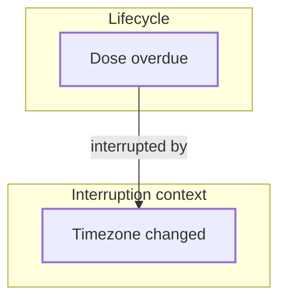

# Condition Graph

Render a view of the map. The JSON or confirmed tables remain the source of truth.

## Procedure

1. Read `state-map.json`, then `STATEFUL.md`, then user-supplied tables in that order.
2. If no map exists, stop and recommend discovery; do not invent one while graphing.
3. Choose the smallest useful cut:
   - up to about 25 conditions: one diagram;
   - larger maps: in-scope only, one lens, or separate diagrams by lens.
4. Create a Mermaid `flowchart TB`:
   - quote every label;
   - group categories as Lifecycle, Failure, Interruption context, and Surface;
   - style confirmed scope: solid `in`, dashed `out-with-implication`, dimmed `out`;
   - draw only recorded relationships;
   - label non-transition edges `interrupted by`, `re-enters as`, or `projects to`.
5. State the cut and that the result is a condition-map view, not an executable statechart.
6. Validate Mermaid syntax.
7. Ask whether to return inline, write `state-graph.md`, or embed under `## Graph` in `STATEFUL.md`.

## Output

````text


Legend: solid = in · dashed = out-with-implication · dimmed = out
Cut: <description>
This is a condition-map view, not an executable statechart.
````

## Failure modes

- Inventing arrows.
- Flattening typed relationships into unlabeled transitions.
- Treating surfaces or interruptions as lifecycle nodes.
- One unreadable graph for the entire map.
- Allowing the graph to become the source of truth.
