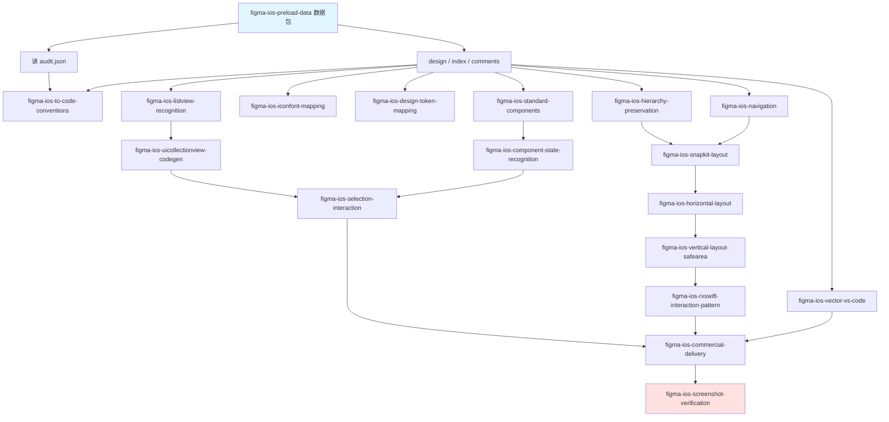

# Figma → iOS 代码生成（入口）

## 📌 本 playbook 的产物定位（重要）

本 playbook 产出的是 **阶段 2 基础 UI 代码**（不是最终商用代码）：

- ✅ UI 视觉 / 布局 / 样式 / 交互骨架 100% 还原
- ✅ 数据走 mock（URL 用 `manifest.json.mock.default_image_url`，模型用临时 struct + 从 Figma 文字提取的数据）
- ✅ 业务逻辑留 `// TODO(阶段3): ...` 锚点
- ❌ **不**负责：接口对接、ViewModel / Service、路由、埋点、错误处理、权限、持久化

这些由 **阶段 3**（结合 PRD + 接口文档二次加工，人工或另一个 AI 会话完成）接手。阶段 2 的目标是「UI 能跑能看，阶段 3 接手时只动数据层不动视图层」。

## 🏷  类名前缀（强制）

所有新建顶层类型（`class` / `struct` / `enum` / `protocol` / `actor`）必须以业务类前缀 **`<P>`** 开头，见 `host.json` / [`PROJECT_BINDING` §0](../figma-ios-PROJECT_BINDING.md#0-类名前缀class_prefix)。

**可选外部 driver** 若注入 `CLASS_PREFIX = <P>` 则优先于 `host.json`（本开源仓不附带 driver）。**本文档示例中的 `XxxVC` / `XxxView` / `XxxCell` 占位应理解为 `<P>XxxVC` 等**（真实生成时展开，如 `AppFillOrderVC`）。

---

## ⛔ 强制流程：先输出「节点 → view 映射表」再写一行代码

阶段 2 开始**第一件事**就是产出一份对账表（直接放生成代码文件顶部的注释里），覆盖 **`design.json` 中所有非跳过节点**。在没有这份表前，**禁止**直接写 `class <P>XxxVC: ...` / `private lazy var ... = ...`。

### 表格模板（必须按此格式输出）

```text
// ============== 节点 → View 映射表（共 N 个节点，跳过 K 个）==============
// node_id              type           name                       impl
// 341:265              GROUP          填写派单要求_增加外露品类       根 view（self.view）
// 341:266              GROUP          bg                         backgroundImageView（整组导出，无语义子节点 → 切图）
// 341:273              GROUP          编组 3                     stepStripContainer（含 6 个语义子节点 → 拆解）
//   ↳ 341:274          RECTANGLE      矩形                       stepStripBgView（蓝色圆角底）
//   ↳ 341:275          FRAME          编组 4                     step1Container
//     ↳ 341:276        TEXT           填写要求                   step1TitleLabel
//     ↳ 341:277        TEXT           STEP.1                    step1IndexLabel
//   ↳ 341:284          RECTANGLE      位图                       stepArrow1ImageView (img_af078_asset)
//   ...
// 341:311              INSTANCE       系统控件/home indicator   <skip> (figma-ios-to-code-conventions)
// ...
// === 跳过节点统计 ===
// - Home Indicator: 341:311 (系统控件)
// - Status Bar: <none>（设计稿无该节点）
//
// === 切图节点统计（assets/ios/manifest.json）===
// 341:266 → img_51be1_bg            (背景图，纯位图)
// 341:284 → img_af078_asset         (步骤箭头 1)
// ...
//
// === 列表节点 ===
// 341:332 (Property 1=水平): scroll=horizontal, cell=341:333, count=5
// ...
```

### 硬约束

1. 表中每一行必须能在 `design.json` 找到对应 node_id；不许漏，不许编。
2. 任何 `<skip>` 必须给出依据 skill 名（`figma-ios-to-code-conventions` / 系统控件 / 设计标注）。
3. 任何 `→ 切图` 必须先过 [`figma-ios-vector-vs-code`「红线规则」](../figma-ios-vector-vs-code/SKILL.md)：含 TEXT/INSTANCE/iconfont 的容器禁止整组用切图。
4. 表中标 `→ 拆解` 的容器，其每个直接子节点必须**也**在表中出现。
5. 写完代码后，自检每个表中非 `<skip>` 节点是否都有对应 `private lazy var` 或 `addSubview`，缺失即视为不合规。
6. **禁止**用 hardcode 文字数组（如 `["排位赛","娱乐赛"]`）替代真实 `design.json[node].text` 读取——文字数组中的每一项都必须能在表中找到对应 TEXT node_id。

### 为什么必须强制

历史多次出现：模型只读了 `screenshot.png` 就开始凭印象写代码，导致：
- 整组用切图替代（步骤条 / 品类滚动条整组贴一张图）
- 列表用 hardcode 字符串数组替代（连文字都猜）
- 节点数 175，代码里只有 30 个 view，覆盖率 ~17%
- 截图比对"看起来很像"但功能完全缺失

写映射表是**唯一**能在交付前就发现这类问题的手段，截图比对查不出"少画了什么"。

---

## ⛔ 全量还原是默认值（最高优先级）

把数据包中所有应实现节点**全部生成对应代码**是默认承诺，**不允许**渐进交付/礼貌降级/可选增量话术。详见：

- 原则定义：[`figma-ios-codegen-workflow` §「全量还原原则」](../../rules/figma-ios-codegen-workflow.mdc)
- 强制对账：[`figma-ios-commercial-delivery` §0「节点覆盖率对账」](../figma-ios-commercial-delivery/SKILL.md)
- 禁用话术：[`figma-ios-commercial-delivery` §「回复纪律」](../figma-ios-commercial-delivery/SKILL.md)

阶段 4 视觉比对**必须**在节点对账通过后才能进行。

## ⛔ 技术栈限定（强制，不可覆盖）

| 技术 | 状态 | 说明 |
|------|------|------|
| **Swift + UIKit** | ✅ 唯一目标 | 所有生成代码必须是 Swift + UIKit |
| **SwiftUI** | ❌ 禁止 | 暂不支持，**不得生成任何 SwiftUI 代码** |
| **Objective-C** | ⚠️ 不推荐 | 仅在宿主工程明确要求 OC 时使用；默认生成 Swift |

> 以上规则优先级高于所有其他 Skill。发现冲突时，以本条为准。

## ⛔ ViewController 强制要求（读 host.json）

1. 基类 = `bindings/host.json` → `bases.view_controller`（等）
2. 若 `vc_required_overrides` **非空**：每个生成的 VC 必须按模板实现（见 `host.json` / `examples/mk`）；`{has_custom_nav}` 按本页是否自定义导航替换
3. 若列表为空（vanilla）：**不**强制宿主钩子方法

详见 [figma-ios-navigation](../figma-ios-navigation/SKILL.md) §一、[PROJECT_BINDING](../figma-ios-PROJECT_BINDING.md)。

---

## 本 Skill 的职责（仅此）

- 规定 **推荐执行顺序** 与 **Skill 索引**
- 规定 **新增 Skill 时如何避免重叠、冲突**
- **不**在此重复编写具体规则；细节只在下方链接的专题 Skill 中维护（**单一事实来源**）

若某条规则需要修改：**只改对应专题 Skill**，并检查本入口的索引表是否仍准确。

---

## 何时先看本入口

- 从 Figma **生成或改 UIKit/Swift** 代码
- 不确定「颜色 / 字体 / 系统版本 / 节点跳过」分别由哪个 Skill 管
- **准备新增一个 Skill** 时，先对照下文「新增 Skill 前检查」

---

## 数据流总览（1 → 2 → 4；阶段 3 仓外）

```
┌─────────────────────────────────────────────────────┐
│  阶段 1：.cursor/figma-ios-preload-data（脚本，无 LLM）│
│  Figma URL  ──►  统一数据包（design.json / audit…）  │
└─────────────────────────────────────────────────────┘
                       ↓
┌─────────────────────────────────────────────────────┐
│  阶段 2：基础 UI（本 Skill + bindings + 专题 skill） │
│  数据包  ──►  Swift / UIKit 基础 UI                   │
│  ⚠️ 禁止再调 Figma API；宿主 API 只查 .cursor/bindings│
└─────────────────────────────────────────────────────┘
                       ↓
┌─────────────────────────────────────────────────────┐
│  阶段 4：覆盖率对账 + 截图视觉验收（强制）             │
└─────────────────────────────────────────────────────┘

阶段 3（仓外）：基础 UI + PRD + 接口 → 商用代码（grep TODO(阶段3)）
```

---

## 推荐流程（顺序）

### 阶段 1：拉取数据包（强制第一步）⭐️

```bash
cd .cursor/figma-ios-preload-data
python3 -m src.cli "<figma_url>" --platforms ios
```

**输出**：CLI 末尾打印 `data_dir` 路径，记住它。

**目录结构**：

```
{data_dir}/
├── manifest.json                    # 入口元信息（summary、warnings）
├── design.json                      # 节点完整数据
├── index.json                       # by_id / by_type / by_role / tree / depth
├── comments.json                    # 评论 + 已匹配的 node_id + confidence
├── audit.json                       # 高风险字段清单（阶段 2 必读）
├── variables.json                   # Figma Variables
├── screenshot.png                   # 设计稿截图
└── assets/ios/
    ├── manifest.json                # node_id → asset_name
    └── img_xxxxx_*.imageset/
        ├── Contents.json
        ├── *@2x.png
        └── *@3x.png
```

**文件组织规范**：阶段 2 生成的临时文件统一放 `_/tmp/`，禁止散落根目录。

### 阶段 2：代码生成

#### 2.0 必读 audit.json（高风险字段清单）⭐️⭐️⭐️

**第一件事**：读 `{data_dir}/audit.json`，理解全部高风险字段后再写一行代码。

历史上每次「还原度差」都是这些字段漏读：

| 字段 | 漏读后果 |
|---|---|
| `non_default_opacity` | 文字/控件「太亮太重」（事故：STEP.1） |
| `non_solid_fills` | 渐变退化成纯色（事故：编组 3 背景渐变） |
| `non_solid_strokes` | 渐变边框消失（事故：编组 3 边框渐变） |
| `with_effects` | 阴影漏画 |
| `non_standard_fonts` | 自定义字体退化（事故：HYYaKuHei） |
| `letter_spacing` | 字距漏读（事故：STEP.x .kern=-0.57） |
| `non_normal_blend_modes` | 混合模式不对 |
| `list_containers` ⭐ | UICollectionView 失效（事故：水平 5 品类 → UIScrollView，垂直 3 卡 → 被 bg 切图吃掉） |
| `export_asset_with_semantic_children` ⭐ | 整组切图吃掉语义子节点（事故：bg 整组切图覆盖了 list_container 子树） |

`audit.json` 每条 entry 都带 `must_apply` / `must_use` / `forbidden`，**逐条对照写代码**，不要"觉得复杂就跳过"。上表保留事故备注，便于理解「为什么必读」；完整对账步骤见 [`figma-ios-codegen-workflow` §2.0](../../rules/figma-ios-codegen-workflow.mdc) + [`figma-ios-commercial-delivery`](../figma-ios-commercial-delivery/SKILL.md)（用 `rg` 对账；本仓不附带 coverage CLI）。

#### 2.1 数据读取（强制）

**唯一数据来源**：

| 信息 | 文件 |
|---|---|
| **高风险字段清单**（必读） | `{data_dir}/audit.json` |
| 节点完整数据 | `{data_dir}/design.json` |
| 节点索引（by_id / by_type / by_role / tree） | `{data_dir}/index.json` |
| 评论及匹配 | `{data_dir}/comments.json` |
| 切图清单 | `{data_dir}/assets/ios/manifest.json` |
| Variables 多 Mode 警告 | `{data_dir}/manifest.json` 的 `summary.warnings` |
| 设计稿截图 | `{data_dir}/screenshot.png` |
| **宿主定制（必读）** | `.cursor/bindings/host.json` + `color_map.json` / `font_map.json` / `iconfont_map.json` |

**强制规则**：
- ✅ **第一步必须校验 `schema_version == "1.0.0"`**（见 [`figma-ios-codegen-workflow` §2.2](../../rules/figma-ios-codegen-workflow.mdc)）。版本不匹配 → 立即停止生成
- ✅ 所有节点信息查 `design.json`，禁止再调 MCP / REST API
- ✅ 宿主 API 只查 `.cursor/bindings/`，禁止臆造未登记 token
- ✅ 字段已规范化（snake_case + `rgba(...)` 字符串 + 双坐标）
- ✅ 评论已挂到节点：`design.json[node_id].comments = [comment_id, ...]`
- ✅ 命中 iconfont 的节点已有 `iconfont` 字段（symbol + size + color）

**节点字段速查**（入口常用字段；**完整契约**以 [data-package-schema](../../../docs/data-package-schema.md) 为准，冲突时以 schema 为准）：

| 字段 | 含义 |
|---|---|
| `id` / `name` / `type` / `parent_id` / `children` | 树结构 |
| `frame.absolute` | 相对画板坐标 |
| `frame.relative` | 相对父节点坐标（**布局优先用这个**）|
| `fills` / `strokes` / `effects` / `corner_radius` | 视觉样式 |
| `text` / `font` | TEXT：`text` 为**字符串**文案；颜色在 `fills[].color`（无 `text.color`）；`font` 为字阶 |
| `auto_layout` | Figma Auto Layout（mode / spacing / padding / sizing）；布局 skill 可参考，坐标仍优先 `frame.relative` + `_layout_hint` |
| `iconfont` | iconfont 节点：`{symbol, size_hint, color, rotation, source, color_from_descendant?}`；`source=comment` 表示评论修正过 |
| `iconfont_library`（顶层 bool）+ `_role.is_iconfont_library` | iconfont 集合容器（如 `iconfont_24`）；**自身不渲染**，以 `_role` 为准跳过 |
| `export.is_export_asset` | 切图节点（同时 `assets/ios/manifest.json` 有 `items[node_id]`）|
| `_role` | `is_iconfont` / `is_iconfont_library` / `is_export_asset` / `is_layout_container` / `is_transparent_wrapper` / `is_single_child_wrapper` / `is_list_container` / `is_sticky_top` / `is_sticky_bottom` |
| `_layout_hint` | 脚本预算：横向模式、`list.{scroll_axis,cell_template_node_id,cell_count}`、`screen_kind`，**优先查表** |
| `vector_geometry` | VECTOR 路径：`fill_paths` / `stroke_paths`（`.data` 为 SVG）；旧名 `vector_paths` 已废弃 |
| `overrides` | INSTANCE 覆盖字段列表（阶段 1 原样保留；当前 codegen 可不消费） |

完整 schema：[`docs/data-package-schema.md`](../../../docs/data-package-schema.md)。

#### 2.2 评论应用（已匹配，直接读）

`comments.json` 已包含匹配结果：

```json
{
  "1693773932": {
    "message": "这个是iconfont：icon_next_12",
    "parsed": { "tags": ["iconfont","icon_correction"], "iconfont_name": "icon_next_12" },
    "match": { "best_node_id": "I1:343;1:342;30:8689", "confidence": "high" }
  }
}
```

应用规则：
- `confidence=high` → 直接应用
- `confidence=medium` → 应用，并在生成代码注释中标注「评论建议」
- `confidence=low` / `unmatched` → 不应用，在 README 列出供人工确认

详见 [figma-ios-comments-integration](../figma-ios-comments-integration/SKILL.md)。

#### 2.3 警告处理

读 `manifest.json` 的 `summary.warnings`，转译为生成 Swift 文件顶部的注释：

| 警告类型 | 处置 |
|---|---|
| `Variables 包含多个 Mode` | 顶部加 `// WARNING: Dark mode 需手动处理` 注释 |
| 其他 | `// WARNING: ...` 注释 |

详见 [figma-ios-variables-detection](../figma-ios-variables-detection/SKILL.md)。

#### 2.4 识别横向布局模式（强制检查）

> 详见 [figma-ios-horizontal-layout](../figma-ios-horizontal-layout/SKILL.md)

对任何包含 ≥3 个横向排列子节点的容器，必须判断：
- 对称布局（`|left - right| ≤ 2`）→ 边距固定 + 中间间距均分
- 接近全宽（`right ≤ 20 且 left ≤ 80`）→ 容器动态宽度
- 其他 → 容器固定宽度

子元素根据 `_role` 决定：
- `is_layout_container` 含横向滚动 → UICollectionView
- 普通横向排列 → SnapKit 比例缩放

#### 2.5 识别设计稿机型（顶部/底部安全区）

> 权威细则：[figma-ios-vertical-layout-safearea](../figma-ios-vertical-layout-safearea/SKILL.md)

**优先读数据包**（不要猜机型）：
1. 根节点 `_layout_hint.screen_kind`（`iphone_x` / `iphone_8` 等）
2. `manifest.json.summary.screen_size`
3. 吸顶/吸底：`_role.is_sticky_top` / `is_sticky_bottom` + `audit.json.sticky_keyword_hits`

仅当上述字段缺失时，才可用 Status Bar 高度 / 画板高度作兜底（详见 vertical-layout-safearea）。导航高度优先用 `host.json` 的 utils（如 `status_bar_nav_height`），勿写死 88/44。

#### 2.6 节点识别与代码生成

按以下顺序套用专题 skill：

1. **节点跳过规则** → [figma-ios-to-code-conventions](../figma-ios-to-code-conventions/SKILL.md)（Home Indicator、Status Bar 等不实现）
2. **层级保持** → [figma-ios-hierarchy-preservation](../figma-ios-hierarchy-preservation/SKILL.md)（不拍平 Frame/Group；遇到 `_role.is_transparent_wrapper` 可考虑透传）
3. **iconfont** → [figma-ios-iconfont-mapping](../figma-ios-iconfont-mapping/SKILL.md)（`symbol` 查 `iconfont_map.json`）
4. **导航栏 + VC 基类** → [figma-ios-navigation](../figma-ios-navigation/SKILL.md)
5. **矢量绘制 vs 切图** → [figma-ios-vector-vs-code](../figma-ios-vector-vs-code/SKILL.md)（切图节点已下载，路径在 `assets/ios/manifest.json`）
6. **图片引用** → [figma-ios-image-assets-download](../figma-ios-image-assets-download/SKILL.md)（仅作引用规范说明；下载已在阶段 1 完成）
7. **ListView 决策** → [figma-ios-listview-recognition](../figma-ios-listview-recognition/SKILL.md)（统一 UICollectionView）  
   → **命中列表后必须加载** [figma-ios-uicollectionview-codegen](../figma-ios-uicollectionview-codegen/SKILL.md)（CV/Cell/DataSource；勿只识别不写骨架）
8. **标准组件** → [figma-ios-standard-components](../figma-ios-standard-components/SKILL.md)（Selector / Stepper / Toggle / Tag Group）
9. **状态切换** → [figma-ios-component-state-recognition](../figma-ios-component-state-recognition/SKILL.md)
10. **选择交互** → [figma-ios-selection-interaction](../figma-ios-selection-interaction/SKILL.md)（`didSelectItemAt`；禁 UITableView）
11. **SnapKit 布局** → [figma-ios-snapkit-layout](../figma-ios-snapkit-layout/SKILL.md)（用 `frame.relative`）
12. **颜色与字体** → [figma-ios-design-token-mapping](../figma-ios-design-token-mapping/SKILL.md)（查 `.cursor/bindings/color_map.json` / `font_map.json`；未命中 UIKit fallback）
13. **交互事件** → [figma-ios-rxswift-interaction-pattern](../figma-ios-rxswift-interaction-pattern/SKILL.md)
14. **系统能力边界** → [figma-ios-minimum-deployment-12](../figma-ios-minimum-deployment-12/SKILL.md)
15. **商用一次交付** → [figma-ios-commercial-delivery](../figma-ios-commercial-delivery/SKILL.md)

#### 2.7 ListView 决策摘要（细节在 listview-recognition）

> **权威规则与红线**：[figma-ios-listview-recognition](../figma-ios-listview-recognition/SKILL.md)（`audit.json` / `_role.is_list_container` / chip_group）。  
> **命中后必写骨架**：[figma-ios-uicollectionview-codegen](../figma-ios-uicollectionview-codegen/SKILL.md)。  
> 下表只作入口速记，**不要**用它替代 audit 清单。

```python
def decide_list_component(node):
    """所有 ListView 统一用 UICollectionView（不用 UITableView）"""
    # 1) 先查 _role.is_list_container / audit.list_containers / chip_group_hits / list_keyword_hits
    # 2) 名称含 可滚动/列表/标签组 → UICollectionView（或 LeftAlignedFlow，scrollEnabled 按 scroll_intent）
    # 3) ≥4 同构子节点 → UICollectionView
    # 细节与 must_use/forbidden → listview-recognition
    ...
```

统一规则（保留）：
- ✅ 所有 ListView 用 UICollectionView（**不用 UITableView**）
- ✅ 必须使用数据模型（不用字符串数组）
- ✅ 标签集合用 `LeftAlignedFlowLayout`
- ✅ 异构内容用枚举数据模型，同构内容用单一数据模型
- ✅ 识别命中后**必须**加载 `figma-ios-uicollectionview-codegen`

#### 2.8 图片引用规范

切图已在阶段 1 下载到 `{data_dir}/assets/ios/`。代码生成时：

1. 读 `assets/ios/manifest.json` 找到 `node_id → asset_name` 映射
2. 把 `*.imageset` 拷贝到主工程的 `Assets.xcassets`
3. 代码引用：`UIImage(named: "img_xxxxx_<semantic>")`

> **不再**调用 `download_figma_images.py`、`get_figma_image_url.py`。

服务器下发图片场景（节点无 `export.settings` 但表现为图片）：
- 数据包不下载
- 代码生成 mock：`imageView.sd_setImage(with: URL(string: mockURL))`
- 在 README 标注「TODO(阶段3): 接入接口文档后替换为业务真实 URL」

### 阶段 4：视觉还原验收（强制）

> 详见 [figma-ios-screenshot-verification](../figma-ios-screenshot-verification/SKILL.md)

代码生成完成后：

0. **先做节点覆盖率对账**（强制前置，详见 [`figma-ios-commercial-delivery` §0](../figma-ios-commercial-delivery/SKILL.md)）。覆盖率 < 100% 且无显式豁免理由 → **不进入视觉比对**，回到阶段 2 补齐。**截图比对验不出"少画了什么"，节点对账才能。**
1. 直接读 `{data_dir}/screenshot.png`（**禁止再调 MCP get_screenshot**）
2. AI 视觉逐区比对，按下表核查：

| 比对维度 | 检查要点 | 常见问题 |
|---------|---------|---------|
| 整体布局 | 各区块位置、间距、对齐 | 层级拍平、坐标偏移 |
| 导航栏 | 标题/按钮/高度/背景色 | 高度 44 vs 88 弄错 |
| 颜色 | 背景色、文字色、边框色 | 绕过 color_map / 未用 fallback |
| 字体/字重 | 字号、粗细 | Regular/Medium 混淆 |
| 图片 | 位图位置/比例 | imageset 未拷或路径错误 |
| iconfont | 图标类型、尺寸、颜色 | 用了错误的 icon 属性名 |
| 底部安全区 | 吸底按钮是否贴 safeArea | 被 Home Indicator 遮挡 |

3. 输出 `视觉还原比对报告`，明确：
   - ✅ 一致项
   - ⚠️ 差异项 + 处置方式
   - ❌ 无法还原项 + 告知用户

豁免条件：用户明确写「无需比对」「快速验证」时可跳过，但回复中须注明「已豁免视觉验收」。

---

## Skill 索引（按类型分类，维护时保持分类）

### 数据消费类（Data Consumption）

> 阶段 2 只读数据包，**不再调用 API**。下列 skill 描述如何"读 + 用"。

| Skill | 负责内容 |
|-------|---------|
| [figma-ios-comments-integration](../figma-ios-comments-integration/SKILL.md) | 如何应用已匹配的评论（high/medium/low confidence 处置）|
| [figma-ios-image-assets-download](../figma-ios-image-assets-download/SKILL.md) | `UIImage(named:)` 引用规范、imageset 拷贝到主工程 |
| [figma-ios-variables-detection](../figma-ios-variables-detection/SKILL.md) | dark mode 警告如何写入代码注释 |

### 规则转换类（Rule Transformation）

| Skill | 负责内容 |
|-------|---------|
| [figma-ios-to-code-conventions](../figma-ios-to-code-conventions/SKILL.md) | 哪些图层不实现 |
| [figma-ios-hierarchy-preservation](../figma-ios-hierarchy-preservation/SKILL.md) | 保持层级不拍平、相对布局优先 |
| [figma-ios-listview-recognition](../figma-ios-listview-recognition/SKILL.md) | 所有 ListView 用 UICollectionView |
| [figma-ios-uicollectionview-codegen](../figma-ios-uicollectionview-codegen/SKILL.md) | UICollectionView / Cell 完整生成 |
| [figma-ios-standard-components](../figma-ios-standard-components/SKILL.md) | Selector / Stepper / Toggle / Tag Group 类型识别 |
| [figma-ios-component-state-recognition](../figma-ios-component-state-recognition/SKILL.md) | 视觉状态提取 + updateAppearance() |
| [figma-ios-selection-interaction](../figma-ios-selection-interaction/SKILL.md) | 单选/多选/Toggle 交互生成 |
| [figma-ios-vector-vs-code](../figma-ios-vector-vs-code/SKILL.md) | 矢量是绘制还是切图 |
| [figma-ios-iconfont-mapping](../figma-ios-iconfont-mapping/SKILL.md) | `node.iconfont.symbol` → `iconfont_map.json` |
| [figma-ios-navigation](../figma-ios-navigation/SKILL.md) | 导航栏 + VC 基类 |
| [figma-ios-screenshot-verification](../figma-ios-screenshot-verification/SKILL.md) | 视觉验收 |
| [figma-ios-vertical-layout-safearea](../figma-ios-vertical-layout-safearea/SKILL.md) | 设计稿机型识别 + 安全区策略 |

### 代码生成类（Code Generation）

| Skill | 负责内容 |
|-------|---------|
| [figma-ios-snapkit-layout](../figma-ios-snapkit-layout/SKILL.md) | SnapKit 相对约束、底部安全区域 |
| [figma-ios-horizontal-layout](../figma-ios-horizontal-layout/SKILL.md) | 横向适配（对称 / 流式）|
| [figma-ios-design-token-mapping](../figma-ios-design-token-mapping/SKILL.md) | rgba/font → bindings map，未命中 UIKit |
| [figma-ios-rxswift-interaction-pattern](../figma-ios-rxswift-interaction-pattern/SKILL.md) | 按钮/手势（仅当 `host.interaction=rxswift`） |

### 验收类（Acceptance & Verification）

| Skill | 负责内容 |
|-------|---------|
| [figma-ios-screenshot-verification](../figma-ios-screenshot-verification/SKILL.md) | Phase 4 视觉还原比对 |
| [figma-ios-commercial-delivery](../figma-ios-commercial-delivery/SKILL.md) | 默认可合并标准 |

### 约束规范类（Constraints & Standards）

| Skill | 负责内容 |
|-------|---------|
| [figma-ios-minimum-deployment-12](../figma-ios-minimum-deployment-12/SKILL.md) | 最低 iOS 12 |

### 总入口

| Skill | 负责内容 |
|-------|---------|
| **figma-ios-playbook**（当前） | 顺序、索引、分类、防冲突规则 |

---

## Skill 依赖关系（阶段 2 内）



阶段 2 **不再有**「先 MCP 拉数 → 再 REST 补数」的链路，所有数据消费起点都是数据包。`listview-recognition` 命中后必须走到 `uicollectionview-codegen`。

---

## 新增 Skill 前：如何避免重叠与冲突

1. **先搜再建**：在 `.cursor/skills/` 下搜关键词，确认没有同主题 Skill
2. **单一事实来源**：同一类规则只在一个 Skill 里写完整；其它 Skill 仅用一句话 + 链接指过去
3. **划清边界**：新 Skill 的 `description` 里写清「负责什么、不负责什么」
4. **命名**：使用可检索前缀，如 `figma-to-code-*`、`lux-*`、`ios-*`
5. **冲突时**：以更"下游"、更具体的 Skill 为准；若两 Skill 真冲突，**改掉旧 Skill 或合并**，并在本入口表里更新
6. **弃用**：旧 Skill 勿删文件；在 frontmatter `description` 首行加 `DEPRECATED: 见 xxx`，正文顶部说明迁移到哪
7. **新增的"数据采集"类 skill**：直接加到 `figma-ios-preload-data` 项目，**不要**放到 `.cursor/skills/`

---

## 新增 Skill 后必做

- 在本文件的 **「Skill 索引」表** 中增加一行
- 若引入新流程步骤，更新上文 **「推荐流程」**
- **不要**在多个 Skill 复制同一段长规则
