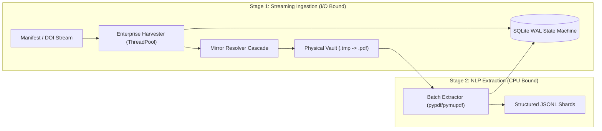

# Resilient Crawler & Academic Document Pipeline Skill

This skill enforces enterprise-grade engineering standards for large-scale web harvesting, academic paper ingestion, and downstream text extraction. It prevents data corruption, process hangs, rate-limit bans, and concurrency deadlocks.

---

## 1. Core Architecture: The Two-Stage Decoupled Pattern

Never combine network fetching (I/O bound) and PDF/text extraction (CPU bound) within the same worker thread. Always decouple into two asynchronous stages:



---

## 2. State Engine: SQLite Write-Ahead Logging (WAL)

### Why Flat JSON Ledgers Are Banned
- Flat JSON files must be fully re-serialized on every single write ($O(N)$ disk writes).
- Sudden power loss, kernel panic, or forced process termination during a write corrupts the entire ledger.
- Multiple worker threads cannot safely append without heavyweight global locking.

### Mandatory SQLite WAL Configuration
Every crawler database must initialize with:

```python
import sqlite3

def get_crawler_db(db_path: str) -> sqlite3.Connection:
    conn = sqlite3.connect(db_path, timeout=15.0)
    conn.row_factory = sqlite3.Row
    # Enable WAL for concurrent read/write throughput
    conn.execute("PRAGMA journal_mode = WAL;")
    # Ensure immediate durability on power loss
    conn.execute("PRAGMA synchronous = FULL;")
    # Prevent database locked errors under high thread concurrency
    conn.execute("PRAGMA busy_timeout = 10000;")
    return conn
```

---

## 3. Concurrency & Deadlock Prevention

### Mandatory Use of `threading.RLock()`
Standard `threading.Lock()` will trigger an instant, silent deadlock if a thread acquires the lock in an outer scope (e.g. database batch save) and then calls an inner helper that also requests the lock.
- **Rule**: Always use `threading.RLock()` for all shared state locks, network pause locks, and cache synchronizations.

```python
import threading

# CORRECT:
network_lock = threading.RLock()

# FORBIDDEN in multi-tier scrapers:
# network_lock = threading.Lock()
```

---

## 4. Network Watchdog & Timeout Tiers

To guarantee that a crawler never freezes indefinitely:

```python
CONNECT_TIMEOUT = 4.0      # Maximum seconds to establish TCP handshake
READ_TIMEOUT = 10.0        # Maximum seconds between streamed chunks
WALL_CLOCK_TIMEOUT = 25.0  # Absolute hard deadline for single document download
```

### Sub-50ms Header Rejection
Inspect HTTP response headers immediately upon handshake. If the `Content-Type` is HTML, reject before reading the body:

```python
content_type = resp.headers.get("Content-Type", "").lower()
if "text/html" in content_type or "text/plain" in content_type:
    return False, "html_landing_page"
```

### Active Connectivity Watchdog
If consecutive sockets fail, test multi-provider public DNS roots (`1.1.1.1:53`, `8.8.8.8:53`). When disconnected, pause all worker threads gracefully until internet recovers.

---

## 5. Multi-Mirror Cascading Resolver

When primary publisher DOIs hit paywalls, 403 blocks, or Cloudflare verification:
1. **Unpaywall REST API**: Query `https://api.unpaywall.org/v2/{doi}?email={polite_email}` to discover author-accepted Green Open Access institutional repository mirrors.
2. **Zenodo API**: Query `https://zenodo.org/api/records/{id}` for direct open data bitstreams.
3. **Semantic Scholar API**: Query `https://api.semanticscholar.org/graph/v1/paper/{id}?fields=openAccessPdf`.
4. **Institutional OJS Bitstream Heuristics**: Transform landing URLs (`/article/view/{id}`) into direct download streams (`/article/download/{id}/{file_id}`).

---

## 6. Atomic File Commit & Magic Byte Verification

Never write directly to target filenames. Always write to a `.tmp` file and verify binary integrity:

```python
# 1. Download to temporary file
tmp_path = target_pdf_path + ".tmp"

# 2. Check first chunk for PDF magic bytes
if not first_chunk.startswith(b"%PDF-"):
    os.remove(tmp_path)
    return False, "invalid_magic_bytes"

# 3. Minimum byte size threshold (drop 1-page error stubs)
if os.path.getsize(tmp_path) < 2000:
    os.remove(tmp_path)
    return False, "file_too_small"

# 4. Atomic filesystem commit
os.replace(tmp_path, target_pdf_path)
```
