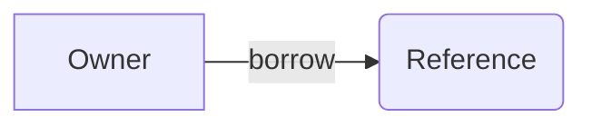

## Goal

Create a Slidev project in `D:/newkub/slides/{project-name}` and open the browser to view the slides immediately

## Scope

Write `slides.md` yourself with standard headmatter and per-slide frontmatter. No need to create `package.json` — dependencies already live in the root `D:/newkub/slides/package.json`

## Execute

### 1. Create Project Directory

> Goal: Create the directory structure for the Slidev project

1. Take the project name as a parameter (e.g. `rust`)
2. Create the directory `D:/newkub/slides/{project-name}` if it does not exist
3. Create the subdirectories: `components/`, `layouts/`, `public/`, `styles/`

### 2. Verify Root Dependencies

> Goal: Confirm the root dependencies are ready to use

1. Check that `D:/newkub/slides/package.json` already exists
2. If it does not, run `/follow-create-slide-slidev` to create the root setup
3. Do not create a project-level `package.json` — dependencies live at the root

### 3. Create Slides File

> Goal: Create `slides.md` with standard headmatter and per-slide frontmatter

1. Write the headmatter (first `---` block) for global config
2. Write per-slide frontmatter for each slide
3. Separate slides with the `---` separator

#### Headmatter Fields

```yaml
---
theme: seriph
title: Presentation Title
info: |
  Short presentation description
class: text-center
transition: slide-left
mdc: true
drawings:
  persist: false
---
```

#### Per-slide Frontmatter Fields

```yaml
---
layout: two-cols
class: my-class
background: /image.png
transition: fade-out
---
```

### 4. Use Built-in Layouts

> Goal: Pick the layout to fit the content

- `cover` — first title slide
- `center` — centered content
- `default` — general content
- `two-cols` — two columns using the `::right::` slot
- `fact` — highlight a fact or data
- `full` — full screen
- `end` — last slide
- `section` — section divider
- `quote` — show a quote

### 5. Add Code Blocks

> Goal: Use Shiki syntax highlighting with features

- Use `{2|4-6|all}` for line highlighting
- Use `[filename.rs]` for a filename label
- Use `{monaco}` for an editable Monaco editor
- Use `{monaco-run}` for executable code
- Use `twoslash` for TypeScript type info
- Use `<<< @/path/to/file.ts` to import an external snippet
- Use magic-move (4 backticks) to animate code transitions

### 6. Add Diagrams And Animations

> Goal: Add diagrams and animations as needed

1. Use Mermaid for diagrams:



2. Use `v-click` for step-by-step reveals
3. Use the `<v-clicks>` component for lists
4. Use `v-motion` for motion effects
5. Use `v-mark` for annotations

### 7. Run Dev Server

> Goal: The dev server runs and displays the slides

1. Run `/run-dev` to start the dev server with `bunx slidev`
2. Wait for the dev server to come up

### 8. Ship

> Goal: Deliver the work

1. Run `/ship`
2. If `ship` fails → report the status

## Rules

### 1. Project Setup

- Create the project only in `D:/newkub/slides/{project-name}`
- Do not create a project-level `package.json` — use only the root `package.json`
- Use Bun as the package manager per the global rules
- Create only the necessary subdirectories: `components/`, `layouts/`, `public/`, `styles/`

### 2. Headmatter Standards

- Set `theme: seriph` as the default
- Set `transition: slide-left` as the default
- Enable `mdc: true` for MDC syntax
- Set `drawings.persist: false` if you do not want drawings persisted

### 3. Layout Selection

- First slide uses the `cover` layout
- Last slide uses the `end` layout
- General content uses the `default` layout
- Comparisons use the `two-cols` layout
- Emphasized data uses the `fact` layout

### 4. Code Blocks

- Use line highlighting `{2|4-6|all}` for step-by-step
- Use the filename label `[main.rs]` to identify the file
- Use magic-move to animate code changes
- No more than 15 lines per code block

### 5. Animations

- Use `v-click` to reveal one point at a time
- Use `<v-clicks>` for whole lists
- Use `v-motion` for motion effects
- Do not overuse animations

### 6. Dev Server

- Run `bunx slidev {project-name}/slides.md` at the root directory
- Use `http://localhost:3030` as the default URL
- If the dev server does not start, fix that first

## Expected Outcome

- Slidev project created in `D:/newkub/slides/{project-name}`
- No project-level `package.json` — only the root `package.json` is used
- `slides.md` has complete headmatter and per-slide frontmatter
- Dev server running on port 3030
- Slides are editable in real time

