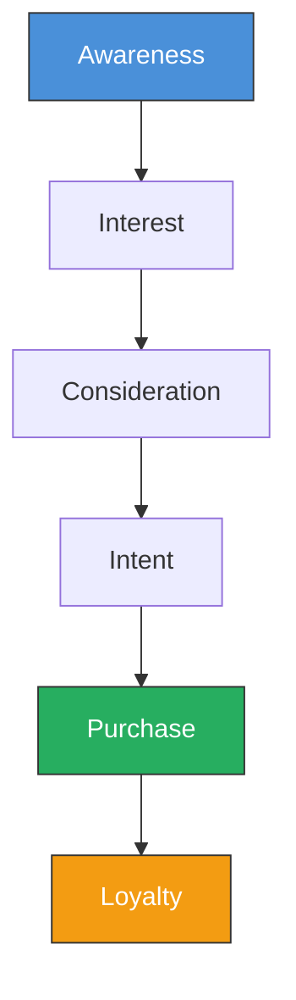

# 10X Visualizer — TLDraw SDK (Local)

## Overview

The 10X Visualizer skill generates professional visual deliverables for marketing strategy by creating TLDraw documents (`.tldr` files) programmatically. Every visual — strategy boards, funnel diagrams, flowcharts, journey maps, dashboards — is a TLDraw canvas that agents build by writing `.tldr` JSON files directly.

**There is no MCP server.** TLDraw SDK (`@tldraw/tldraw`) and TLDraw CLI (`@kitschpatrol/tldraw-cli`) are installed locally in the project via `npm install`. Agents create `.tldr` files by writing JSON, then export to SVG/PNG using tldraw-cli.

**Each department agent creates its own visuals.** There is no separate "visualizer agent." The Strategy Planner creates strategy boards. The Funnel CRO Specialist creates funnel diagrams. The Content Strategist creates content calendars. Every agent owns the visuals for their domain.

Mermaid diagram syntax is available as a **secondary fallback only** — for quick inline markdown previews when a full canvas is not needed.

---

## Architecture

```
Agent writes .tldr JSON  -->  output/visuals/{category}/{name}.tldr
                          -->  npx tldraw-cli export {file}.tldr --format svg
                          -->  output/visuals/{category}/{name}.svg
                          -->  output/visuals/{category}/{name}.png
```

All visual creation follows this flow:
1. The responsible agent constructs a `.tldr` JSON document in memory.
2. The JSON is written to `output/visuals/{category}/`.
3. tldraw-cli exports the `.tldr` to SVG and/or PNG.
4. The exported files are saved alongside the `.tldr` source.

---

## Setup Requirements

TLDraw packages are installed **locally** in the project (not globally). The `/setup` command handles this automatically. To install manually:

```bash
cd "C:/Users/Anit/Downloads/Swarms of Agent"
npm install
```

This installs from `package.json`:
- `tldraw` (^3.0.0) — Core TLDraw SDK
- `@tldraw/tldraw` (^3.0.0) — TLDraw React components and shape utilities
- `@kitschpatrol/tldraw-cli` (^5.0.0) — CLI tool for exporting `.tldr` files to SVG/PNG

**No MCP configuration is needed.** No `.claude/mcp_settings.json` entry for tldraw. Everything runs locally.

### Verify Installation

```bash
npx tldraw-cli --version
```

If this returns a version number, tldraw-cli is ready for exports.

---

## The .tldr File Format

TLDraw documents are JSON files with the `.tldr` extension. Agents create visuals by writing these JSON files directly. Understanding this format is essential.

### Minimal .tldr Structure

```json
{
  "tldrawFileFormatVersion": 1,
  "schema": {
    "schemaVersion": 2,
    "sequences": {
      "com.tldraw.store": 4,
      "com.tldraw.asset": 1,
      "com.tldraw.camera": 1,
      "com.tldraw.document": 2,
      "com.tldraw.instance": 25,
      "com.tldraw.instance_page_state": 5,
      "com.tldraw.page": 1,
      "com.tldraw.shape": 4,
      "com.tldraw.binding": 1
    }
  },
  "records": []
}
```

The `records` array contains every object on the canvas: pages, shapes, bindings (arrows connecting shapes), and document metadata.

### Required Base Records

Every `.tldr` file needs at minimum a document record and a page record:

```json
{
  "tldrawFileFormatVersion": 1,
  "schema": {
    "schemaVersion": 2,
    "sequences": {
      "com.tldraw.store": 4,
      "com.tldraw.asset": 1,
      "com.tldraw.camera": 1,
      "com.tldraw.document": 2,
      "com.tldraw.instance": 25,
      "com.tldraw.instance_page_state": 5,
      "com.tldraw.page": 1,
      "com.tldraw.shape": 4,
      "com.tldraw.binding": 1
    }
  },
  "records": [
    {
      "gridSize": 10,
      "name": "",
      "meta": {},
      "id": "document:document",
      "typeName": "document"
    },
    {
      "meta": {},
      "id": "page:page-1",
      "name": "Page 1",
      "index": "a1",
      "typeName": "page"
    }
  ]
}
```

---

## Shape Reference

All shapes live in the `records` array. Every shape has this base structure:

```json
{
  "x": 100,
  "y": 200,
  "rotation": 0,
  "isLocked": false,
  "opacity": 1,
  "meta": {},
  "id": "shape:unique-id-here",
  "type": "geo",
  "parentId": "page:page-1",
  "index": "a1",
  "typeName": "shape",
  "props": { }
}
```

**Key fields:**
- `id` — Must be unique, format: `"shape:{unique-string}"`. Use descriptive IDs like `"shape:header-box"`, `"shape:step-1"`, `"shape:arrow-1-to-2"`.
- `type` — The shape type: `"geo"`, `"arrow"`, `"text"`, `"frame"`, `"note"`, `"line"`, `"draw"`, `"image"`.
- `parentId` — Usually `"page:page-1"`. Set to a frame's ID to nest shapes inside frames.
- `index` — Sort order string. Use `"a1"`, `"a2"`, `"a3"`, etc. for ordering.
- `x`, `y` — Position on canvas in pixels.

### Geo Shapes (Rectangles, Ellipses, Diamonds, etc.)

The `"geo"` type is the most versatile. The `props.geo` field controls the geometric shape.

```json
{
  "x": 100,
  "y": 100,
  "rotation": 0,
  "isLocked": false,
  "opacity": 1,
  "meta": {},
  "id": "shape:box-1",
  "type": "geo",
  "parentId": "page:page-1",
  "index": "a1",
  "typeName": "shape",
  "props": {
    "geo": "rectangle",
    "w": 200,
    "h": 100,
    "dash": "draw",
    "size": "m",
    "color": "blue",
    "fill": "solid",
    "text": "Step 1: Awareness",
    "font": "sans",
    "align": "middle",
    "verticalAlign": "middle",
    "growY": 0,
    "labelColor": "black",
    "url": ""
  }
}
```

**`props.geo` options:**
- `"rectangle"` — Standard box. Use for steps, stages, containers.
- `"ellipse"` — Circle/oval. Use for start/end nodes, highlights.
- `"diamond"` — Decision diamond. Use for flowchart decisions.
- `"triangle"` — Triangle shape.
- `"pentagon"` — Pentagon.
- `"hexagon"` — Hexagon. Good for process nodes.
- `"octagon"` — Octagon (stop sign shape).
- `"star"` — Star. Use for highlights, achievements.
- `"cloud"` — Cloud shape. Good for ideas, external systems.
- `"arrow-right"` — Arrow-shaped box pointing right.
- `"arrow-left"` — Arrow-shaped box pointing left.
- `"arrow-up"` — Arrow-shaped box pointing up.
- `"arrow-down"` — Arrow-shaped box pointing down.
- `"x-box"` — Box with an X. Use for rejected/failed items.
- `"check-box"` — Box with a checkmark. Use for completed items.
- `"oval"` — Oval/stadium shape.
- `"trapezoid"` — Trapezoid.
- `"rhombus"` — Alias for diamond.
- `"rhombus-2"` — Rotated rhombus.
- `"heart"` — Heart shape. Use for brand love, sentiment.

**`props.color` options:** `"black"`, `"grey"`, `"light-violet"`, `"violet"`, `"blue"`, `"light-blue"`, `"yellow"`, `"orange"`, `"green"`, `"light-green"`, `"light-red"`, `"red"`, `"white"`.

**`props.fill` options:** `"none"` (outline only), `"semi"` (semi-transparent), `"solid"` (fully filled), `"pattern"` (hatched pattern).

**`props.dash` options:** `"draw"` (hand-drawn style), `"solid"` (clean lines), `"dashed"`, `"dotted"`.

**`props.size` options:** `"s"` (small), `"m"` (medium), `"l"` (large), `"xl"` (extra large).

**`props.font` options:** `"draw"` (handwritten), `"sans"` (clean sans-serif), `"serif"`, `"mono"`.

### Text Shapes

Standalone text labels, titles, and annotations.

```json
{
  "x": 100,
  "y": 50,
  "rotation": 0,
  "isLocked": false,
  "opacity": 1,
  "meta": {},
  "id": "shape:title-text",
  "type": "text",
  "parentId": "page:page-1",
  "index": "a0",
  "typeName": "shape",
  "props": {
    "color": "black",
    "size": "xl",
    "w": 500,
    "text": "Campaign Strategy Board",
    "font": "sans",
    "textAlign": "start",
    "autoSize": true,
    "scale": 1
  }
}
```

### Arrow Shapes (Connectors)

Arrows connect shapes visually. For arrows that snap to shapes, use **bindings** (see below).

**Freestanding arrow (no binding):**

```json
{
  "x": 300,
  "y": 150,
  "rotation": 0,
  "isLocked": false,
  "opacity": 1,
  "meta": {},
  "id": "shape:arrow-1",
  "type": "arrow",
  "parentId": "page:page-1",
  "index": "a5",
  "typeName": "shape",
  "props": {
    "dash": "draw",
    "size": "m",
    "fill": "none",
    "color": "black",
    "labelColor": "black",
    "bend": 0,
    "start": { "x": 0, "y": 0 },
    "end": { "x": 200, "y": 100 },
    "arrowheadStart": "none",
    "arrowheadEnd": "arrow",
    "text": "",
    "labelPosition": 0.5,
    "font": "sans",
    "scale": 1
  }
}
```

**`arrowheadStart` / `arrowheadEnd` options:** `"none"`, `"arrow"`, `"triangle"`, `"square"`, `"dot"`, `"diamond"`, `"inverted"`, `"bar"`, `"pipe"`.

**`bend`:** `0` for straight. Positive values curve right, negative curve left. Use `50` to `100` for gentle curves.

### Arrow Bindings (Connecting Shapes)

To make arrows snap/connect to shapes, create **binding records** alongside the arrow:

```json
{
  "meta": {},
  "id": "binding:arrow-1-start",
  "type": "arrow",
  "fromId": "shape:arrow-1",
  "toId": "shape:box-1",
  "typeName": "binding",
  "props": {
    "terminal": "start",
    "normalizedAnchor": { "x": 0.5, "y": 0.5 },
    "isExact": false,
    "isPrecise": false
  }
},
{
  "meta": {},
  "id": "binding:arrow-1-end",
  "type": "arrow",
  "fromId": "shape:arrow-1",
  "toId": "shape:box-2",
  "typeName": "binding",
  "props": {
    "terminal": "end",
    "normalizedAnchor": { "x": 0.5, "y": 0.5 },
    "isExact": false,
    "isPrecise": false
  }
}
```

**Binding fields:**
- `fromId` — Always the arrow shape's ID.
- `toId` — The target shape the arrow connects to.
- `props.terminal` — `"start"` or `"end"` (which end of the arrow).
- `props.normalizedAnchor` — Where on the target shape the arrow attaches. `{ "x": 0.5, "y": 0.5 }` is center. `{ "x": 0.5, "y": 1 }` is bottom center. `{ "x": 1, "y": 0.5 }` is right center.

### Frame Shapes (Grouping)

Frames group related shapes visually. Set child shapes' `parentId` to the frame's ID to nest them.

```json
{
  "x": 50,
  "y": 50,
  "rotation": 0,
  "isLocked": false,
  "opacity": 1,
  "meta": {},
  "id": "shape:frame-awareness",
  "type": "frame",
  "parentId": "page:page-1",
  "index": "a0",
  "typeName": "shape",
  "props": {
    "w": 500,
    "h": 400,
    "name": "Awareness Phase"
  }
}
```

Then child shapes reference the frame:

```json
{
  "id": "shape:awareness-task-1",
  "type": "geo",
  "parentId": "shape:frame-awareness",
  ...
}
```

### Note Shapes (Sticky Notes)

```json
{
  "x": 100,
  "y": 100,
  "rotation": 0,
  "isLocked": false,
  "opacity": 1,
  "meta": {},
  "id": "shape:note-1",
  "type": "note",
  "parentId": "page:page-1",
  "index": "a1",
  "typeName": "shape",
  "props": {
    "color": "yellow",
    "size": "m",
    "text": "Key insight: Users drop off at step 3",
    "font": "sans",
    "align": "middle",
    "verticalAlign": "middle",
    "growY": 0,
    "fontSizeAdjustment": 0,
    "url": "",
    "scale": 1
  }
}
```

**Note colors:** `"black"`, `"grey"`, `"light-violet"`, `"violet"`, `"blue"`, `"light-blue"`, `"yellow"`, `"orange"`, `"green"`, `"light-green"`, `"light-red"`, `"red"`, `"white"`.

---

## Exporting Visuals

Use `@kitschpatrol/tldraw-cli` to export `.tldr` files to SVG or PNG:

```bash
# Export to SVG
npx tldraw-cli export output/visuals/strategy-maps/brand-positioning.tldr --format svg --output output/visuals/strategy-maps/

# Export to PNG
npx tldraw-cli export output/visuals/funnel-diagrams/conversion-funnel.tldr --format png --output output/visuals/funnel-diagrams/

# Export with custom dimensions
npx tldraw-cli export output/visuals/dashboards/kpi-dashboard.tldr --format png --output output/visuals/dashboards/ --width 1920 --height 1080
```

The `npm run export-visual` script is also available:

```bash
npm run export-visual -- output/visuals/strategy-maps/brand-positioning.tldr --format svg
```

---

## Supported Visual Types

### 1. Strategy Planning Boards

Whiteboard-style canvases where strategic elements are laid out spatially. Use frames to group related concepts, sticky notes for insights, and arrows for relationships.

**Created by:** Strategy Planner agent
**Use cases:** Brand positioning maps, market landscape maps, channel strategy overviews, SWOT diagrams, competitive positioning grids, OKR boards.

**Layout pattern:**
- Title text at top (size `"xl"`, font `"sans"`)
- Frames for each strategic category
- Geo shapes (rectangles) for strategy elements within frames
- Arrows connecting related elements across frames
- Sticky notes for key insights and callouts
- Color-coding: blue for current state, green for targets, red for risks, yellow for opportunities

### 2. Campaign Flowcharts and Workflows

Step-by-step process diagrams showing campaign execution flows.

**Created by:** Strategy Planner, Email Marketer, Content Strategist agents
**Use cases:** Campaign execution workflows, email automation flows, content distribution flows, approval processes, multi-channel orchestration maps.

**Layout pattern:**
- Start node: ellipse shape, green fill
- Process steps: rectangle shapes, blue fill, arranged left-to-right or top-to-bottom
- Decision points: diamond shapes, yellow fill
- End nodes: ellipse shape, red fill
- Arrows with bindings connecting all steps
- Labels on arrows for decision outcomes ("Yes"/"No")
- Frames grouping phases (Planning, Execution, Measurement)

### 3. Funnel Diagrams with Metrics

Visual funnels showing conversion stages with metrics at each level.

**Created by:** Funnel CRO Specialist agent
**Use cases:** Conversion funnels, lead lifecycle funnels, revenue attribution funnels, signup funnels.

**Layout pattern:**
- Trapezoid or progressively narrower rectangle shapes stacked vertically
- Each stage: rectangle with decreasing width (widest at top, narrowest at bottom)
- Stage labels inside shapes with metric values
- Side annotations (text shapes) showing conversion rates between stages
- Arrows between stages
- Color gradient: light-blue at top through blue to green at bottom (or use red for drop-off stages)

**Example — 5-stage funnel (records excerpt):**

```json
[
  {
    "id": "shape:funnel-title", "type": "text", "parentId": "page:page-1",
    "x": 150, "y": 20, "index": "a0", "typeName": "shape",
    "rotation": 0, "isLocked": false, "opacity": 1, "meta": {},
    "props": { "color": "black", "size": "xl", "w": 400, "text": "Conversion Funnel — Q1 2026", "font": "sans", "textAlign": "middle", "autoSize": true, "scale": 1 }
  },
  {
    "id": "shape:stage-1", "type": "geo", "parentId": "page:page-1",
    "x": 100, "y": 100, "index": "a1", "typeName": "shape",
    "rotation": 0, "isLocked": false, "opacity": 1, "meta": {},
    "props": { "geo": "rectangle", "w": 400, "h": 70, "dash": "solid", "size": "m", "color": "light-blue", "fill": "solid", "text": "Visitors: 50,000", "font": "sans", "align": "middle", "verticalAlign": "middle", "growY": 0, "labelColor": "black", "url": "" }
  },
  {
    "id": "shape:stage-2", "type": "geo", "parentId": "page:page-1",
    "x": 140, "y": 190, "index": "a2", "typeName": "shape",
    "rotation": 0, "isLocked": false, "opacity": 1, "meta": {},
    "props": { "geo": "rectangle", "w": 320, "h": 70, "dash": "solid", "size": "m", "color": "blue", "fill": "solid", "text": "Leads: 5,000 (10%)", "font": "sans", "align": "middle", "verticalAlign": "middle", "growY": 0, "labelColor": "black", "url": "" }
  },
  {
    "id": "shape:stage-3", "type": "geo", "parentId": "page:page-1",
    "x": 180, "y": 280, "index": "a3", "typeName": "shape",
    "rotation": 0, "isLocked": false, "opacity": 1, "meta": {},
    "props": { "geo": "rectangle", "w": 240, "h": 70, "dash": "solid", "size": "m", "color": "violet", "fill": "solid", "text": "MQLs: 1,500 (30%)", "font": "sans", "align": "middle", "verticalAlign": "middle", "growY": 0, "labelColor": "black", "url": "" }
  },
  {
    "id": "shape:stage-4", "type": "geo", "parentId": "page:page-1",
    "x": 210, "y": 370, "index": "a4", "typeName": "shape",
    "rotation": 0, "isLocked": false, "opacity": 1, "meta": {},
    "props": { "geo": "rectangle", "w": 180, "h": 70, "dash": "solid", "size": "m", "color": "orange", "fill": "solid", "text": "SQLs: 500 (33%)", "font": "sans", "align": "middle", "verticalAlign": "middle", "growY": 0, "labelColor": "black", "url": "" }
  },
  {
    "id": "shape:stage-5", "type": "geo", "parentId": "page:page-1",
    "x": 240, "y": 460, "index": "a5", "typeName": "shape",
    "rotation": 0, "isLocked": false, "opacity": 1, "meta": {},
    "props": { "geo": "rectangle", "w": 120, "h": 70, "dash": "solid", "size": "m", "color": "green", "fill": "solid", "text": "Customers: 100 (20%)", "font": "sans", "align": "middle", "verticalAlign": "middle", "growY": 0, "labelColor": "black", "url": "" }
  }
]
```

### 4. Org Charts / Agent Responsibility Maps

Hierarchical or network diagrams showing team structure and agent responsibilities.

**Created by:** Strategy Planner agent (for agent maps), any agent for team-specific hierarchies
**Use cases:** Marketing team structure, agent responsibility maps, RACI charts, stakeholder maps.

**Layout pattern:**
- Top-level node: large rectangle, dark fill, bold title
- Department/role nodes: medium rectangles arranged in rows below
- Arrows pointing from parent to child nodes (with bindings)
- Frames grouping departments
- Color-coding by department or responsibility level

### 5. Customer Journey Maps

End-to-end visualizations of customer experience across touchpoints.

**Created by:** Funnel CRO Specialist, Content Strategist agents
**Use cases:** Awareness-to-advocacy journeys, touchpoint maps, experience maps with pain points and opportunities, omnichannel journey flows.

**Layout pattern:**
- Horizontal timeline layout (left to right)
- Phase frames: Awareness, Consideration, Decision, Onboarding, Retention, Advocacy
- Touchpoint shapes inside each phase frame
- Emotion curve: shapes positioned vertically to indicate sentiment (higher = positive)
- Pain point callouts: red sticky notes
- Opportunity callouts: green sticky notes
- Channel indicators below each touchpoint

### 6. Activity Tracking Dashboards

Visual dashboards showing campaign activities, their status, and results.

**Created by:** Strategy Planner, any department agent tracking their activities
**Use cases:** Sprint boards, campaign status trackers, implementation progress, what-works/what-doesn't boards.

**Layout pattern:**
- Three-column frame layout: "To Do" | "In Progress" | "Done"
- Task cards: rectangles with task descriptions inside each column
- Color-coding: grey for to-do, blue for in-progress, green for done, red for blocked
- Metrics section: separate frame with KPI values
- Status indicators: check-box geo for done, x-box geo for failed

### 7. Performance Comparison Visuals

Side-by-side or before/after comparison layouts.

**Created by:** Research Analyst, Funnel CRO Specialist agents
**Use cases:** A/B test comparisons, channel performance comparisons, before/after optimization visuals, competitor benchmarking.

**Layout pattern:**
- Two frames side by side: "Before" / "After" or "Option A" / "Option B"
- Matching elements in each frame for comparison
- Metric callouts with arrows showing improvement direction
- Green for improvements, red for declines
- Summary bar at bottom with key deltas

### 8. Content Calendar Visualizations

Calendar-style layouts showing planned content across channels and dates.

**Created by:** Content Strategist, Social Media Manager agents
**Use cases:** Monthly content calendars, editorial calendars, social media posting schedules, campaign timelines.

**Layout pattern:**
- Grid of frames: columns for days/weeks, rows for channels
- Content cards (rectangles) placed in the grid cells
- Color-coding by content type (blog = blue, social = green, email = orange, video = violet)
- Status indicators on each card

### 9. Competitive Positioning Maps

2x2 matrix diagrams showing competitive positioning across two dimensions.

**Created by:** Research Analyst, Brand Creative Director agents
**Use cases:** Market positioning maps, perceptual maps, feature comparison matrices, price-value maps.

**Layout pattern:**
- Large frame with title
- Two axis lines (arrows): horizontal and vertical, crossing at center
- Axis labels at each end (text shapes)
- Quadrant labels (text shapes, light color)
- Competitor/brand dots: ellipse shapes positioned on the grid
- Labels near each dot

### 10. Implementation Activity Tracking (What Works / What Doesn't)

Retrospective-style boards tracking experiments and outcomes.

**Created by:** Strategy Planner, any agent reviewing results
**Use cases:** Experiment tracking boards, retrospective boards, lessons-learned canvases, hypothesis validation maps.

**Layout pattern:**
- Three frames: "What Worked" (green border) | "What Didn't" (red border) | "Next Experiments" (blue border)
- Sticky notes inside each frame with individual items
- Impact indicators: star shapes for high-impact items
- Arrows from "What Didn't" items to related "Next Experiments" items

---

## Integration with Department Agents

Every agent creates visuals for their domain. The canvas is the primary visual medium.

| Agent | Visual Responsibilities | Typical Outputs |
|-------|------------------------|-----------------|
| **Strategy Planner** | Strategy boards, OKR canvases, campaign flowcharts, agent responsibility maps, activity tracking dashboards, experiment tracking | `strategy-maps/`, `campaign-flows/`, `dashboards/` |
| **Research Analyst** | Competitive positioning maps, market landscape visuals, performance comparisons, benchmarking charts | `strategy-maps/`, `reports/` |
| **Funnel CRO Specialist** | Funnel diagrams with metrics, A/B test flow charts, customer journey maps, conversion analysis visuals | `funnel-diagrams/`, `journey-maps/` |
| **Content Strategist** | Content calendar visualizations, topic cluster maps, content distribution flows, editorial pipeline boards | `content-calendars/`, `campaign-flows/` |
| **Email Marketer** | Email automation flow diagrams, drip campaign flowcharts, segmentation maps | `campaign-flows/` |
| **Social Media Manager** | Multi-platform content distribution flows, posting schedule calendars, engagement flow maps | `campaign-flows/`, `content-calendars/` |
| **SEO Specialist** | Site architecture diagrams, keyword cluster maps, internal linking maps, technical audit visuals | `strategy-maps/`, `reports/` |
| **Brand Creative Director** | Brand positioning maps, brand architecture visuals, visual identity system maps, mood boards | `strategy-maps/` |

### How an Agent Creates a Visual

1. **Construct the records array.** Build all shapes, arrows, bindings, frames, and text needed for the visual.
2. **Wrap in the .tldr structure.** Add the standard `tldrawFileFormatVersion`, `schema`, and base records (document + page).
3. **Write the .tldr file.** Save to the appropriate `output/visuals/{category}/` directory.
4. **Export.** Run `npx tldraw-cli export {file}.tldr --format svg --output {directory}/` to generate an SVG and/or PNG.
5. **Reference in reports.** Include the exported image path in any markdown deliverables.

---

## Complete .tldr Template

Use this as the starting template when creating any visual. Add shape, arrow, and binding records to the `records` array.

```json
{
  "tldrawFileFormatVersion": 1,
  "schema": {
    "schemaVersion": 2,
    "sequences": {
      "com.tldraw.store": 4,
      "com.tldraw.asset": 1,
      "com.tldraw.camera": 1,
      "com.tldraw.document": 2,
      "com.tldraw.instance": 25,
      "com.tldraw.instance_page_state": 5,
      "com.tldraw.page": 1,
      "com.tldraw.shape": 4,
      "com.tldraw.binding": 1
    }
  },
  "records": [
    {
      "gridSize": 10,
      "name": "",
      "meta": {},
      "id": "document:document",
      "typeName": "document"
    },
    {
      "meta": {},
      "id": "page:page-1",
      "name": "Page 1",
      "index": "a1",
      "typeName": "page"
    }
  ]
}
```

**Add shapes after the page record.** Each shape, arrow, and binding is an additional entry in the `records` array.

---

## Output Location

All visual outputs are saved to:

```
output/
  visuals/
    strategy-maps/           # Positioning, landscape, channel maps, OKR boards
    funnel-diagrams/         # Conversion and journey funnels
    campaign-flows/          # Campaign execution flowcharts, automation flows
    org-charts/              # Team and responsibility charts, agent maps
    journey-maps/            # Customer journey visualizations
    dashboards/              # Activity tracking, KPI dashboards, sprint boards
    reports/                 # Performance comparisons, benchmark visuals
    content-calendars/       # Editorial calendars, posting schedules
    competitive/             # Positioning maps, market landscapes
    experiments/             # What-works/what-doesn't boards, retrospectives
```

**Naming Convention:** `{type}-{campaign-or-context}-{date}.{format}`

Each visual produces up to three files:
- `.tldr` — Source file (editable, version-controllable)
- `.svg` — Scalable vector export (for web, docs, presentations)
- `.png` — Raster export (for sharing, embedding)

Examples:
- `funnel-saas-launch-2026-02-06.tldr` (source)
- `funnel-saas-launch-2026-02-06.svg` (export)
- `strategy-map-competitor-analysis-2026-02-06.png` (export)

---

## Mermaid Fallback (Secondary)

Mermaid diagrams are used **only** as a quick fallback for inline markdown previews — for example, in chat responses or markdown reports where embedding an image is not practical.

Mermaid is **not** the primary visual medium. Always prefer `.tldr` canvas files for any deliverable-quality visual.

**Supported Mermaid types (for fallback use):**
- `flowchart` — Quick process sketches
- `sequenceDiagram` — Multi-step interaction previews
- `gantt` — Timeline overviews
- `pie` — Distribution breakdowns
- `journey` — Customer journey quick previews

**Example:**



---

## Layout Best Practices

### Spacing
- Leave at least **20px** gap between shapes.
- Standard shape sizes: width 160-300px, height 60-100px.
- Frame padding: at least **40px** from frame edge to child shapes.

### Hierarchy
- Title text at `y: 20-50`, size `"xl"`.
- Subtitle/description at `y: 80-100`, size `"m"`, color `"grey"`.
- Main content starts at `y: 150+`.

### Color Conventions
- **Blue** (`"blue"`, `"light-blue"`) — Primary elements, current state, informational.
- **Green** (`"green"`, `"light-green"`) — Positive outcomes, completed items, targets, growth.
- **Red** (`"red"`, `"light-red"`) — Negative outcomes, risks, blockers, failures, drop-off.
- **Yellow** (`"yellow"`) — Warnings, decisions, pending items, insights.
- **Orange** (`"orange"`) — In-progress items, email/CRM channel.
- **Violet** (`"violet"`, `"light-violet"`) — Creative/brand elements, mid-funnel stages.
- **Grey** (`"grey"`) — Inactive, to-do, background elements.

### ID Naming
Use descriptive, hierarchical IDs:
- `"shape:frame-awareness"` — Frame for awareness phase
- `"shape:awareness-step-1"` — Step 1 inside awareness frame
- `"shape:arrow-step1-to-step2"` — Arrow connecting step 1 to step 2
- `"binding:arrow-step1-to-step2-start"` — Start binding for that arrow
- `"binding:arrow-step1-to-step2-end"` — End binding for that arrow

---

## Usage

```
/report                          # Generate a visual report of recent outputs
/report funnel                   # Generate a funnel diagram
/report strategy-map             # Generate a strategy map
/report campaign-flow            # Generate a campaign flowchart
/report journey-map              # Generate a customer journey map
/report dashboard                # Generate an activity tracking dashboard
/report competitive              # Generate a competitive positioning map
/report calendar                 # Generate a content calendar visual
/report experiments              # Generate a what-works/what-doesn't board
```

---

*Developed by 10x.in*
