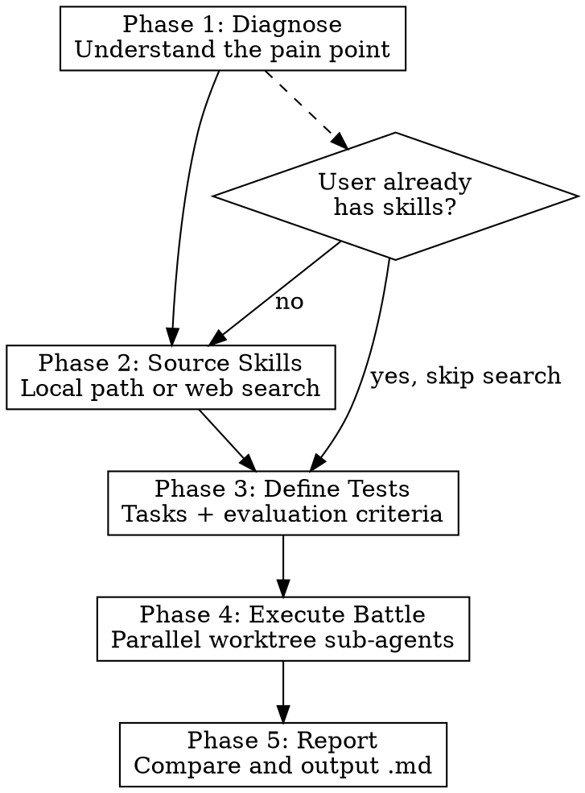

# Skill Picker

Compare skills head-to-head to find which one actually improves CC's performance for your specific problem.

## Overview

Run controlled A/B tests: same model (CC), same tasks, different skills. Each candidate runs in an isolated worktree sub-agent. Output: a markdown comparison report with scores and a winner.

## When to Use

- User wants to compare 2+ skills
- User has a CC pain point and wants to find the best skill for it
- User says "skill picker", "compare skills", "which skill is better"
- User is choosing between skill alternatives before installing

## When NOT to Use

- User just wants to install a known skill (no comparison needed)
- User wants to evaluate CC model performance (not skill-related)

## Workflow



---

## Phase 1: Diagnose

**Goal:** Understand what problem the user is trying to solve with a skill.

1. Ask: **"What problem are you running into with CC?"**
   - Probe for specifics: "Can you show me an example where CC didn't perform well?"
   - "What would a good result look like?"
2. Identify the **skill category**:
   - Deep research / literature review
   - Fact-checking / accuracy
   - Code review / security
   - Debugging / error diagnosis
   - Writing / grammar
   - Architecture / design
   - Testing / TDD
   - Other (let user describe)
3. Confirm: "So the core issue is **[X]**, and we're looking for a **[category]** skill. Correct?"
4. Ask: **"Do you already have skill files to compare? If so, give me the path(s)."**
   - If yes → read skills, skip to Phase 3
   - If no → proceed to Phase 2

**If user triggers skill-picker without context** (just says "skill picker"), start with question 1.

**If user provides skills upfront** (e.g., "compare these two skill folders"), skip diagnosis — extract the category from the skill content and go to Phase 2 Step 2a or Phase 3.

---

## Phase 2: Source Skills

**Goal:** Collect 2+ candidate skills for comparison.

### Step 2a: Read local skills (if user provided path)

1. Read each path. Expect either:
   - A directory with subdirectories each containing `SKILL.md`
   - A directory with one `SKILL.md`
   - A single `.md` file
2. Extract `name` and `description` from frontmatter
3. List: "Found **N** skills: [name1], [name2], ..."
4. Ask: "Want to search for more skills online, or proceed with these?"

### Step 2b: Search online (if no local skills or user wants more)

1. Construct search queries based on the diagnosed category:
   - `"[category] skill" site:github.com SKILL.md`
   - `"awesome claude skills" [category]`
   - `"[category]" CLAUDE.md agent skill github`
   - `"[category]" awesome-agent-skills`
2. Use WebSearch to find candidate repositories
3. For each candidate, gather: **repo name, URL, stars, one-line description**
4. Present ranked list (by stars):
   ```
   Found 5 candidate skills for [category]:

   1. user/repo (4.2K stars) — description
   2. user/repo (2.1K stars) — description
   3. ...
   ```
5. Ask: **"Which ones should I download?"** (e.g., "1, 3" or "all")
6. **Pre-download check**: For each candidate, quickly preview the skill's description/README to confirm it actually addresses the user's problem (not a related-but-different problem). Drop candidates that don't match.
7. Download selected:
   - Clone or fetch the skill files
   - Save to `.skill-picker/candidates/<skill-name>/`
   - Verify each has valid SKILL.md with frontmatter
   - **Check for dependency files**: If SKILL.md references external files (e.g., `reference/`, `templates/`, `scripts/`), download those too. A skill missing its dependencies will not execute properly.
8. **Install skills and generate agents for testing:**
   - Copy each candidate skill to project-level `.claude/skills/picker-<name>/SKILL.md` (prefix `picker-` avoids name conflicts with user's existing skills)
   - If skill has dependency files (reference/, templates/), copy those too
   - Generate a corresponding `.claude/agents/picker-<name>.md` for each:
     ```yaml
     ---
     name: picker-<name>
     description: Skill picker test agent with <name>
     skills:
       - picker-<name>
     ---
     Complete the assigned task using the loaded skill's methodology. Do your best work.
     ```
   - Generate `.claude/agents/picker-baseline.md` (no `skills:` field) for the control group
   - This ensures each sub-agent gets the **full skill content injected by the system** at startup, not via prompt (which may truncate/simplify content)
9. **Ask user to restart session:**
   "Skills and agents are set up. Please type `/exit` to restart CC, then come back and say **'继续'** to proceed from Phase 3."
   (Agents and skills are loaded at session startup — a restart is required for new ones to be recognized.)
10. Confirm: "Downloaded and installed **N** skills. Waiting for restart."

---

## Phase 3: Define Tests & Ground Truth

**Goal:** Agree on test tasks, establish ground truth with the user, and define evaluation criteria.

### Step 3a: Reconfirm understanding

Before designing tasks, restate the problem to the user: **"Just to confirm — the problem we're solving is [X]. The skills should help with [Y]. Correct?"** This prevents wasted effort if CC misunderstood the problem (e.g., searching for "citation verification" skills when the problem is "inaccurate numbers").

### Step 3b: Design test tasks

1. If in a project repo, explore for context:
   - Read README, key source files, recent git log
   - Look for existing issues related to the diagnosed problem
2. Propose **2-5 test tasks**:
   - Based on user's specific problem from Phase 1
   - Real scenarios from the repo if available
   - General scenarios for the category if no repo context
3. Each task must be:
   - **Specific** — clear input and expected behavior
   - **Reproducible** — identical for every sub-agent
   - **Evaluable** — results can be compared against ground truth
4. Present tasks and ask user to confirm, modify, or add.

### Step 3c: Establish ground truth (CRITICAL)

**CC's own answers carry LLM bias. Ground truth MUST be verified with the user.**

For each task:
1. CC researches the correct/reference answer using WebSearch and authoritative sources
2. Present the proposed ground truth to the user:
   ```
   Task 1: [title]
   Ground truth (draft):
   - Key fact A: [value] (source: [URL])
   - Key fact B: [value] (source: [URL])
   - ...
   ```
3. **Ask the user to review and confirm:** "Is this ground truth accurate? Anything to correct or add?"
4. User may:
   - Confirm as-is
   - Correct specific facts
   - Add facts CC missed
   - Provide their own ground truth entirely
5. Only proceed after user explicitly confirms the ground truth for each task.
6. **Save ground truth to file:** `.skill-picker/ground-truth-YYYY-MM-DD.md` — include all tasks, standard answers, sources, and evaluation criteria. This file is referenced during Phase 5 scoring.

**Why this matters:** Without user-verified ground truth, CC is both writing the exam and grading it — its own biases would propagate into the scoring. The user is the ultimate authority on what counts as correct.

### Step 3d: Define evaluation criteria

For each task, define with user:

**Hard criteria** (against ground truth):
- Do key facts match ground truth? Numbers within acceptable range?
- Are required sources cited? Are citations real and accessible?
- CC checks these programmatically by comparing sub-agent output vs ground truth.

**Soft criteria** (CC judges, informed by ground truth):
- Completeness: did the response cover all ground truth points?
- Clarity: is the information well-organized?
- Uncertainty: does it properly flag what it's unsure about?
- CC scores 1-5 for each, with brief justification.

**Weights** (optional): Ask user if any criteria matter more. Default: equal weight.

Confirm: **"Ground truth set, criteria defined. Ready to run?"**

---

## Phase 4: Execute Comparison

**Goal:** Run each skill + baseline against the same tasks in parallel sub-agents.

### How skill loading works

Skills are loaded via **predefined agent definitions** (`.claude/agents/picker-<name>.md`) with the `skills:` frontmatter field. This ensures the **system injects the full skill content** into each sub-agent at startup — no truncation, no simplification. This is more reliable than prompt injection, where the main CC may simplify long skill content.

**Prerequisites (done in Phase 2):**
- `.claude/skills/picker-<name>/SKILL.md` exists for each candidate
- `.claude/agents/picker-<name>.md` exists with `skills: [picker-<name>]`
- `.claude/agents/picker-baseline.md` exists (no skills)
- User has restarted the CC session so agents are loaded

### Worktree isolation (optional, for code tasks)

If the current directory is a git repo, add `isolation: worktree` to sub-agent calls for file-level isolation. This is important for code tasks where sub-agents write/modify files. For pure Q&A tasks, worktree is optional but still recommended.

**Note to user:** If not in a git repo, run `git init && git add -A && git commit -m "init"` then **restart your CC session** (CC caches git status at startup).

### Execution

For each candidate skill AND the baseline, spawn a sub-agent using the predefined agent type:

```
Agent(subagent_type: "picker-database-lookup", isolation: worktree, prompt: "...")
Agent(subagent_type: "picker-paper-lookup", isolation: worktree, prompt: "...")
Agent(subagent_type: "picker-fact-checking", isolation: worktree, prompt: "...")
Agent(subagent_type: "picker-baseline", isolation: worktree, prompt: "...")
```

### Sub-agent prompt template

Since skills are already loaded via the agent definition, the prompt only needs the task:

```
You are participating in a skill comparison test. Do your best work.
Follow the methodology from your loaded skills.

## Your Task

<task description from Phase 3>

## Output Requirements

When you finish, end your response with this exact format:

## Picker Result

**Skill:** <skill-name or "baseline">
**Task:** <task title>

### Output
<your full work product>

### Self-Check
- [criterion]: PASS/FAIL — brief reason
  (repeat for each hard criterion from Phase 3)
```

### Parallel execution

- Spawn ALL sub-agents in a **single message** (Agent tool supports parallel calls)
- If more than 5 sub-agents, batch in groups of 5
- Results are collected from each sub-agent's **return message**

### Failure handling

- If a sub-agent times out: record as FAIL, note "timed out"
- If a sub-agent errors: record as FAIL, note the error
- Continue with remaining sub-agents — don't abort the whole run

### Cleanup after battle

After the report is generated, offer to clean up test artifacts:
- Remove `.claude/skills/picker-*` directories
- Remove `.claude/agents/picker-*` files
- Keep `.skill-picker/` (candidates, ground truth, reports)

---

## Phase 5: Generate Report

**Goal:** Compare all results and output a markdown report.

### Step 5a: Evaluate against ground truth

For each task x skill combination:
1. **Hard criteria** (vs ground truth): Do key facts match? Numbers correct? Sources cited? Score: pass=1, fail=0
2. **Soft criteria** (informed by ground truth): Completeness, clarity, uncertainty handling. Score 1-5 with justification referencing ground truth.
3. **Aggregate**: Per-skill weighted average across all tasks, normalized to **0-100**

### Step 5b: Write report

Save to: **`.skill-picker/report-YYYY-MM-DD.md`**

```markdown
# Skill Picker Report

**Date:** YYYY-MM-DD
**Problem:** <diagnosed problem>
**Skills tested:** <list with sources>
**Tasks:** <count>

## Summary

| Rank | Skill | Score | Strengths | Weaknesses |
|------|-------|-------|-----------|------------|
| 1 | skill-name | 85/100 | ... | ... |
| 2 | skill-name | 72/100 | ... | ... |
| - | baseline | 60/100 | ... | ... |

## Winner: [skill-name]

<2-3 sentences: why it won, how much better than baseline>

## Detailed Results

### Task 1: [title]

| Skill | Hard | Soft | Total | Notes |
|-------|------|------|-------|-------|
| ... | .../N | .../5 | ... | ... |

<comparison of outputs>

(repeat for each task)

## Execution Stats

| Skill | Tool Calls | Duration | Search Behavior |
|-------|-----------|----------|-----------------|
| ... | N | Ns | searched / no search |

## Recommendation

<which skill to install, any caveats, setup tips>
```

### Step 5c: Present to user

1. Show the summary table in chat
2. Confirm report file location
3. Ask: **"Want me to install the winning skill?"**

---

## Edge Cases

- **Only 1 candidate skill:** Still run — compare vs baseline to measure if the skill helps at all
- **Web search finds nothing:** Tell user, suggest broadening category or providing skills manually
- **Sub-agent fails:** Mark as FAIL in report, don't discard — a skill that causes failures is useful data
- **User wants to re-run:** Support re-running with different tasks or additional skills
- **Skills are very large (1000+ lines):** Warn user that injecting into sub-agent prompt may hit context limits. Suggest testing the most important sections.
- **User provides skills in non-SKILL.md format** (e.g., plain .md, .cursorrules): Treat any markdown file as a skill — inject its content the same way
