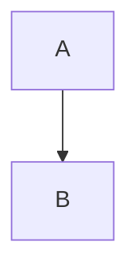

# remark-mermaid-tldraw

Pre-render `​```mermaid` fences into [tldraw](https://tldraw.dev)'s hand-drawn
SVGs at build time. It's two cooperating parts that agree on a filename and never
talk to each other:

1. a **remark plugin** that rewrites each fence into light/dark `` tags, and
2. a **headless renderer** (CLI / programmatic / Astro integration) that drives a
   real tldraw editor in Playwright-Chromium and writes the SVGs.

The reader downloads an `` — no mermaid, no tldraw, no hydration. Package:
[`remark-mermaid-tldraw`](https://www.npmjs.com/package/remark-mermaid-tldraw) ·
[GitHub](https://github.com/seangeng/remark-mermaid-tldraw).

## Install

```bash
npm i -D remark-mermaid-tldraw tldraw @tldraw/mermaid playwright react react-dom
npx playwright install chromium
```

`tldraw`, `@tldraw/mermaid`, `playwright`, `react`, `react-dom` are **peer deps**
(the renderer needs a browser + the React/tldraw stack). `vite`,
`@vitejs/plugin-react`, `unist-util-visit`, `mdast-util-from-markdown`, and
`tinyglobby` come along as regular deps. The remark plugin itself is lightweight
— it does NOT pull in tldraw/playwright, so importing it in a config is cheap.

## Wire it up — four steps

### 1. Add the remark plugin

It rewrites each `​```mermaid` fence into `<figure class="mermaid-diagram
not-prose">` with a light and a dark `` pointing at `/diagrams/<hash>.svg`.

```ts
import { remarkMermaidTldraw } from "remark-mermaid-tldraw";
// in your markdown/MDX remarkPlugins:
remarkPlugins: [remarkMermaidTldraw];
// or with options: [remarkMermaidTldraw, { theme: "dark" }]
```

### 2. Add the render step (produces the SVGs)

A prebuild CLI for most setups:

```jsonc
// package.json
"scripts": {
  "mermaid": "remark-mermaid-tldraw --content \"src/**/*.{md,mdx}\" --out public/diagrams"
}
```

Run `npm run mermaid` whenever a diagram changes, and commit `public/diagrams/`.
(Or wire it into a prebuild step if your CI has a browser.) On Astro, prefer the
integration — it auto-renders on `config:setup` and hot-reloads in dev:

```ts
import { mermaidTldraw } from "remark-mermaid-tldraw/astro";
export default defineConfig({
  integrations: [mermaidTldraw()],
  markdown: { remarkPlugins: [remarkMermaidTldraw] },
});
```

### 3. Add the light/dark CSS

Both variants are emitted with transparent backgrounds; you pick one per scheme:

```css
.mermaid-dark { display: none; }
@media (prefers-color-scheme: dark) {
  .mermaid-light { display: none; }
  .mermaid-dark { display: inline; }
}
/* class-based theme: html.dark .mermaid-light{display:none} html.dark .mermaid-dark{display:inline} */
.mermaid-diagram { margin: 2rem auto; display: flex; justify-content: center; }
.mermaid-diagram img { width: 100%; height: auto; }
```

On a **single-theme site**, pass `{ theme: "dark" }` (or `"light"`) to the plugin
so the browser never fetches the variant it can't show.

### 4. Write a fence

````md

````

`width=` (bare number → px, or any CSS length) caps a tall flowchart's width.

## ⚠️ The MDX gotcha (read this — it silently breaks the build)

The plugin emits a raw HTML `<figure>` node. Plain markdown (Astro `.md`,
remark-rehype) handles that fine. **MDX does not** — `@mdx-js` throws
`Cannot handle unknown node "raw"`. Fix: add `rehype-raw` as the FIRST rehype
plugin, with `passThrough` for MDX's own node types, or it will destroy any JSX
components in your `.mdx` files:

```ts
import rehypeRaw from "rehype-raw";

rehypePlugins: [
  [rehypeRaw, {
    passThrough: [
      "mdxFlowExpression", "mdxJsxFlowElement", "mdxJsxTextElement",
      "mdxTextExpression", "mdxjsEsm",
    ],
  }],
  // ...your other rehype plugins after this
]
```

(`npm i -D rehype-raw`.) This step is MDX-only; skip it for plain-markdown
pipelines.

## Per-framework cheat sheet

- **Astro** — remark plugin in `markdown.remarkPlugins` + the `/astro`
  integration. No rehype-raw needed (Astro markdown handles raw HTML).
- **Vite + @mdx-js/rollup** (incl. React Router 7) — plugin in `remarkPlugins`,
  add `rehype-raw` (passThrough) as the first `rehypePlugins` entry, run the CLI
  as a prebuild.
- **Next.js** (`@next/mdx`) — plugin in `remarkPlugins`, `rehype-raw`
  (passThrough) in `rehypePlugins`, CLI prebuild over `content/`/`app/`.
- **Eleventy / plain remark** — plugin + CLI; no rehype-raw.

## How caching works (so you don't fight it)

- Filenames are `sha256(source).slice(0,16)` — the URL depends ONLY on the
  diagram source, so it never changes when render logic does.
- A render-version marker comment lives *inside* each SVG. Bump `RENDER_VERSION`
  (or visual changes from a tldraw upgrade) → diagrams re-render in place, URLs
  stay stable.
- The headless browser launches ONLY when something is stale. Cached build = no
  browser.

## Troubleshooting

- **Labels clipped / spilling out of boxes** — a font race; the harness already
  preloads tldraw's fonts before rendering, so this is handled. If you see it,
  you're on an old version — update.
- **Build error `Cannot handle unknown node "raw"`** — you're on MDX without
  `rehype-raw`. See the gotcha above.
- **Diagram didn't update after an edit** — re-run the render step; a source edit
  changes the hash → a new file. To GC old files run the CLI with `--clean`.
- **Diagram looks like plain mermaid, not hand-drawn** — that type (pie, gantt,
  class, ER) isn't modeled natively by tldraw, so it falls back to mermaid's own
  SVG. Flowcharts and sequence diagrams get the tldraw look.
- **CI** — add `npx playwright install chromium` to the workflow before the
  render/build step.

## Caveats

Build-time only: you need a browser where you build (and in CI). The payoff is
zero runtime cost — the visitor gets a cached SVG, never mermaid or tldraw.

---

Built by [Sean Geng](https://seangeng.com); generalizes
[Sunil Pai](https://github.com/threepointone)'s Astro plugin and stands on
[`@tldraw/mermaid`](https://www.npmjs.com/package/@tldraw/mermaid). Full writeup:
[Rendering mermaid diagrams as hand-drawn tldraw](https://seangeng.com/writing/rendering-mermaid-with-tldraw).
