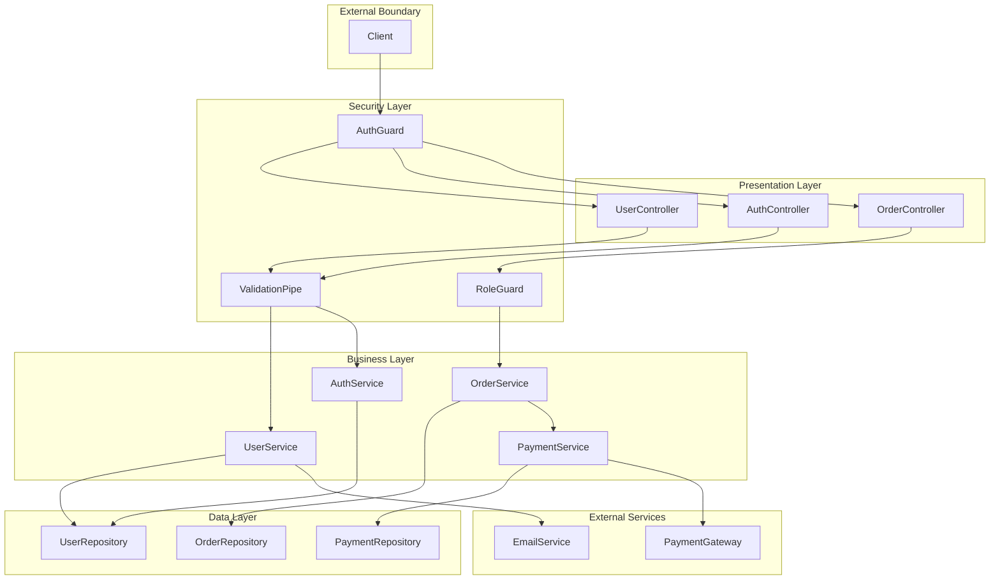

# Abstraction Security Analysis for Threat Modeling

Enumerate software abstractions, map their relationships and responsibilities, and establish security profiles for component-level threat modeling.

## Analysis Workflow

```
1. Abstraction discovery      → Identify classes, modules, services, components
2. Purpose analysis           → Determine responsibilities and domain context
3. Relationship mapping       → Dependencies, inheritance, composition, APIs
4. Asset identification       → Data and resources each abstraction handles
5. Trust profile analysis     → Access requirements, exposure, privilege level
6. Security boundary mapping  → Where trust transitions occur
7. Output generation          → Component diagrams and security profiles
```

## Step 1: Abstraction Discovery

### Identify Project Structure

```bash
# Top-level architecture
find . -type d -not -path '*/\.*' -not -path '*/node_modules/*' -not -path '*/vendor/*' -not -path '*/__pycache__/*' -not -path '*/dist/*' -not -path '*/build/*' | head -50

# Common abstraction directories
find . -type d \( -name "services" -o -name "controllers" -o -name "models" -o -name "entities" -o -name "repositories" -o -name "handlers" -o -name "middleware" -o -name "utils" -o -name "helpers" -o -name "lib" -o -name "core" -o -name "domain" -o -name "modules" -o -name "components" -o -name "providers" \) -not -path "*/node_modules/*" 2>/dev/null
```

### Class/Module Discovery by Language

#### TypeScript/JavaScript

```bash
# Classes
grep -rn "^class\s\|^export class\|^export default class" --include="*.ts" --include="*.js" 2>/dev/null | head -50

# Interfaces (contracts)
grep -rn "^interface\s\|^export interface" --include="*.ts" 2>/dev/null | head -50

# React components
grep -rn "^export.*function\|^export.*const.*=.*=>\|^export default function\|React\.FC\|React\.Component" --include="*.tsx" --include="*.jsx" 2>/dev/null | head -50

# NestJS/Angular modules and services
grep -rn "@Module\|@Injectable\|@Controller\|@Service\|@Component\|@Guard\|@Interceptor" --include="*.ts" 2>/dev/null | head -50

# Express routers/handlers
grep -rn "Router\(\)\|express\.Router\|app\.use\|app\.get\|app\.post" --include="*.js" --include="*.ts" 2>/dev/null | head -30
```

#### Python

```bash
# Classes
grep -rn "^class\s\+\w\+" --include="*.py" 2>/dev/null | head -50

# Django views, models, serializers
grep -rn "class.*View\)\|class.*Model\)\|class.*Serializer\)\|class.*Form\)" --include="*.py" 2>/dev/null | head -30

# FastAPI/Flask routes
grep -rn "@app\.\|@router\.\|@blueprint\." --include="*.py" 2>/dev/null | head -30

# Abstract base classes
grep -rn "ABC\|abstractmethod\|@abstract" --include="*.py" 2>/dev/null
```

#### Java

```bash
# Classes and interfaces
grep -rn "^public class\|^public interface\|^public abstract class\|^public enum" --include="*.java" 2>/dev/null | head -50

# Spring components
grep -rn "@Service\|@Repository\|@Controller\|@RestController\|@Component\|@Configuration\|@Bean" --include="*.java" 2>/dev/null | head -50

# Spring Security
grep -rn "@PreAuthorize\|@Secured\|@RolesAllowed\|WebSecurityConfigurerAdapter\|SecurityFilterChain" --include="*.java" 2>/dev/null
```

#### Go

```bash
# Struct definitions (Go's classes)
grep -rn "^type\s\+\w\+\s\+struct" --include="*.go" 2>/dev/null | head -50

# Interfaces
grep -rn "^type\s\+\w\+\s\+interface" --include="*.go" 2>/dev/null | head -30

# Handler functions
grep -rn "func.*http\.ResponseWriter\|func.*gin\.Context\|func.*echo\.Context\|func.*fiber\.Ctx" --include="*.go" 2>/dev/null | head -30
```

#### C#/.NET

```bash
# Classes and interfaces
grep -rn "public class\|public interface\|public abstract class\|public sealed class" --include="*.cs" 2>/dev/null | head -50

# ASP.NET controllers and services
grep -rn "\[ApiController\]\|\[Controller\]\|\[Authorize\]\|IHostedService\|BackgroundService" --include="*.cs" 2>/dev/null | head -30
```

### Categorize Abstractions by Type

```bash
echo "=== CONTROLLERS/HANDLERS (Entry Points) ==="
find . -type f \( -name "*controller*" -o -name "*handler*" -o -name "*endpoint*" -o -name "*route*" \) -not -path "*/node_modules/*" 2>/dev/null

echo "=== SERVICES (Business Logic) ==="
find . -type f \( -name "*service*" -o -name "*manager*" -o -name "*provider*" -o -name "*facade*" \) -not -path "*/node_modules/*" 2>/dev/null

echo "=== REPOSITORIES/DAOs (Data Access) ==="
find . -type f \( -name "*repository*" -o -name "*repo*" -o -name "*dao*" -o -name "*store*" \) -not -path "*/node_modules/*" 2>/dev/null

echo "=== MODELS/ENTITIES (Domain Objects) ==="
find . -type f \( -name "*model*" -o -name "*entity*" -o -name "*domain*" -o -name "*dto*" \) -not -path "*/node_modules/*" 2>/dev/null

echo "=== MIDDLEWARE/INTERCEPTORS (Cross-cutting) ==="
find . -type f \( -name "*middleware*" -o -name "*interceptor*" -o -name "*filter*" -o -name "*guard*" \) -not -path "*/node_modules/*" 2>/dev/null

echo "=== UTILITIES/HELPERS ==="
find . -type f \( -name "*util*" -o -name "*helper*" -o -name "*common*" -o -name "*shared*" \) -not -path "*/node_modules/*" 2>/dev/null
```

## Step 2: Purpose Analysis

### Extract Class/Module Responsibilities

```bash
# Classes with their methods (understanding scope)
# TypeScript/JavaScript
grep -rn -A20 "^class\s\|^export class" --include="*.ts" --include="*.js" 2>/dev/null | grep -E "class\s|^\s+(async\s+)?\w+\s*\(" | head -100

# Python - class methods
grep -rn -A30 "^class\s" --include="*.py" 2>/dev/null | grep -E "^class\s|^\s+def\s" | head -100

# Java - class methods  
grep -rn -A30 "^public class" --include="*.java" 2>/dev/null | grep -E "public class|public.*\w+\s*\(" | head -100
```

### Identify Domain Concepts

```bash
# Domain-specific naming patterns
grep -rn "class\s\+\(User\|Account\|Order\|Payment\|Product\|Customer\|Invoice\|Transaction\|Session\|Token\|Permission\|Role\|Policy\)" --include="*.py" --include="*.ts" --include="*.js" --include="*.java" --include="*.go" --include="*.cs" 2>/dev/null

# Service naming (reveals business capabilities)
grep -rn "class\s\+\w*Service\|class\s\+\w*Manager\|class\s\+\w*Handler" --include="*.py" --include="*.ts" --include="*.js" --include="*.java" --include="*.go" --include="*.cs" 2>/dev/null
```

### Identify Security-Relevant Abstractions

```bash
# Authentication-related
grep -rln "Auth\|Login\|Logout\|Session\|Token\|Credential\|Password\|OAuth\|JWT\|Identity" --include="*.py" --include="*.ts" --include="*.js" --include="*.java" --include="*.go" --include="*.cs" 2>/dev/null | grep -v node_modules | grep -v test

# Authorization-related
grep -rln "Permission\|Role\|Policy\|Access\|Authorize\|Guard\|ACL\|RBAC\|ABAC" --include="*.py" --include="*.ts" --include="*.js" --include="*.java" --include="*.go" --include="*.cs" 2>/dev/null | grep -v node_modules | grep -v test

# Cryptography-related
grep -rln "Crypto\|Encrypt\|Decrypt\|Hash\|Sign\|Verify\|Key\|Cipher\|Secret" --include="*.py" --include="*.ts" --include="*.js" --include="*.java" --include="*.go" --include="*.cs" 2>/dev/null | grep -v node_modules | grep -v test

# Validation-related
grep -rln "Validat\|Sanitiz\|Escape\|Filter\|Schema\|Constraint" --include="*.py" --include="*.ts" --include="*.js" --include="*.java" --include="*.go" --include="*.cs" 2>/dev/null | grep -v node_modules | grep -v test
```

## Step 3: Relationship Mapping

### Dependency Analysis

```bash
# Import statements (direct dependencies)
# TypeScript/JavaScript
grep -rn "^import\s\|^const.*require\|^from\s" --include="*.ts" --include="*.js" 2>/dev/null | grep -v node_modules | head -100

# Python
grep -rn "^import\s\|^from\s.*import" --include="*.py" 2>/dev/null | grep -v __pycache__ | head -100

# Java
grep -rn "^import\s" --include="*.java" 2>/dev/null | head -100

# Go
grep -rn "^import\s\|^\s*\"" --include="*.go" 2>/dev/null | head -100
```

### Inheritance Hierarchies

```bash
# TypeScript/JavaScript extends
grep -rn "class.*extends\|implements" --include="*.ts" --include="*.js" 2>/dev/null | head -50

# Python inheritance
grep -rn "class\s\+\w\+\s*(" --include="*.py" 2>/dev/null | grep -v "class\s\+\w\+\s*():\|class\s\+\w\+:" | head -50

# Java extends/implements
grep -rn "class.*extends\|class.*implements\|interface.*extends" --include="*.java" 2>/dev/null | head -50

# Go embedded structs
grep -rn -A10 "type\s\+\w\+\s\+struct" --include="*.go" 2>/dev/null | grep -E "^\s+\w+$\s*$" | head -30
```

### Composition and Injection

```bash
# Constructor injection (dependencies)
# TypeScript/JavaScript
grep -rn "constructor\s*(" --include="*.ts" --include="*.js" 2>/dev/null | head -50

# Python __init__ with dependencies
grep -rn "def __init__\s*\(self" --include="*.py" 2>/dev/null | head -50

# Java constructor injection / @Autowired
grep -rn "@Autowired\|@Inject\|public\s\+\w\+\s*(" --include="*.java" 2>/dev/null | head -50

# Go struct fields (composition)
grep -rn -A15 "type\s\+\w\+\s\+struct" --include="*.go" 2>/dev/null | grep -E "^\s+\w+\s+\*?\w+" | head -50
```

### Inter-Service Communication

```bash
# HTTP clients (service-to-service)
grep -rn "axios\|fetch\|http\.Client\|HttpClient\|RestTemplate\|requests\.\|urllib\|httpx" --include="*.py" --include="*.ts" --include="*.js" --include="*.go" --include="*.java" 2>/dev/null | head -30

# gRPC
grep -rn "grpc\|\.proto\|protobuf\|pb\." --include="*.py" --include="*.ts" --include="*.js" --include="*.go" --include="*.java" 2>/dev/null | head -20

# Message queues
grep -rn "publish\|subscribe\|emit\|on\(\s*['\"].*['\"]\|queue\|topic\|channel" --include="*.py" --include="*.ts" --include="*.js" --include="*.go" --include="*.java" 2>/dev/null | head -30
```

### Generate Dependency Graph Data

```bash
# Create adjacency list of class dependencies
# This finds which classes reference which other classes
for file in $(find . -name "*.ts" -o -name "*.js" -o -name "*.py" | grep -v node_modules | head -50); do
    echo "=== $file ===" 
    # Classes defined in this file
    grep -E "^class\s|^export class" "$file" 2>/dev/null | head -5
    # Classes imported/referenced
    grep -E "^import|^from.*import" "$file" 2>/dev/null | head -10
done
```

## Step 4: Asset Identification

### Data Assets per Abstraction

```bash
# Find what data each class/module handles
# Look for property/field definitions

# TypeScript class properties
grep -rn -A30 "^class\s\|^export class" --include="*.ts" 2>/dev/null | grep -E "^\s+(private|public|protected|readonly)?\s*\w+\s*[:\?]" | head -50

# Python class attributes
grep -rn -A30 "^class\s" --include="*.py" 2>/dev/null | grep -E "^\s+self\.\w+\s*=" | head -50

# Java fields
grep -rn "private\s\+\w\+\s\+\w\+\s*;" --include="*.java" 2>/dev/null | head -50
```

### Sensitive Data Handling

```bash
# Classes handling authentication data
grep -rln "password\|credential\|token\|secret\|apiKey\|api_key" --include="*.py" --include="*.ts" --include="*.js" --include="*.java" --include="*.go" 2>/dev/null | grep -v node_modules | grep -v test

# Classes handling PII
grep -rln "email\|phone\|address\|ssn\|socialSecurity\|dateOfBirth\|dob" --include="*.py" --include="*.ts" --include="*.js" --include="*.java" --include="*.go" 2>/dev/null | grep -v node_modules | grep -v test

# Classes handling financial data
grep -rln "creditCard\|cardNumber\|accountNumber\|balance\|payment\|transaction" --include="*.py" --include="*.ts" --include="*.js" --include="*.java" --include="*.go" 2>/dev/null | grep -v node_modules | grep -v test
```

### Resource Access

```bash
# Database access
grep -rln "repository\|\.query\|\.find\|\.save\|\.delete\|\.update\|\.execute\|\.create" --include="*.py" --include="*.ts" --include="*.js" --include="*.java" --include="*.go" 2>/dev/null | grep -v node_modules | head -30

# File system access
grep -rln "readFile\|writeFile\|readdir\|mkdir\|unlink\|fs\.\|os\.path\|io\.\|File\(" --include="*.py" --include="*.ts" --include="*.js" --include="*.java" --include="*.go" 2>/dev/null | grep -v node_modules | head -30

# External API access
grep -rln "axios\|fetch\|http\.get\|http\.post\|requests\.\|HttpClient" --include="*.py" --include="*.ts" --include="*.js" --include="*.java" --include="*.go" 2>/dev/null | grep -v node_modules | head -30
```

## Step 5: Trust Profile Analysis

### Exposure Level Detection

```bash
# Public entry points (highest exposure)
grep -rn "@Get\|@Post\|@Put\|@Delete\|@Patch\|@RequestMapping\|app\.get\|app\.post\|router\.get\|router\.post\|@app\.route\|HandleFunc" --include="*.py" --include="*.ts" --include="*.js" --include="*.java" --include="*.go" 2>/dev/null | head -50

# Internal-only (package/module private)
grep -rn "internal\|private\|protected\|_\w\+\s*=" --include="*.py" --include="*.ts" --include="*.js" --include="*.java" --include="*.go" 2>/dev/null | head -30

# Background/async workers
grep -rn "worker\|job\|queue\|cron\|scheduler\|background\|async\s\+def\|@celery\|@task" --include="*.py" --include="*.ts" --include="*.js" --include="*.java" --include="*.go" 2>/dev/null | head -30
```

### Authentication Requirements

```bash
# Protected endpoints
grep -rn "@Authenticated\|@RequireAuth\|@login_required\|@jwt_required\|@Authorize\|@PreAuthorize\|@Secured\|UseGuards\|middleware.*auth" --include="*.py" --include="*.ts" --include="*.js" --include="*.java" --include="*.go" 2>/dev/null | head -50

# Public/anonymous endpoints
grep -rn "@Public\|@AllowAnonymous\|@PermitAll\|skipAuth\|public\s*=\s*true\|authenticated\s*=\s*false" --include="*.py" --include="*.ts" --include="*.js" --include="*.java" --include="*.go" 2>/dev/null | head -30
```

### Privilege Level Analysis

```bash
# Admin/elevated privilege indicators
grep -rn "admin\|superuser\|root\|elevated\|privileged\|sudo\|@Admin\|Role\.ADMIN\|isAdmin" --include="*.py" --include="*.ts" --include="*.js" --include="*.java" --include="*.go" 2>/dev/null | head -30

# Role checks
grep -rn "hasRole\|checkRole\|requireRole\|@Roles\|role.*=\|userRole" --include="*.py" --include="*.ts" --include="*.js" --include="*.java" --include="*.go" 2>/dev/null | head -30

# Permission checks
grep -rn "hasPermission\|checkPermission\|can\(\|ability\|@Permission\|permission.*=" --include="*.py" --include="*.ts" --include="*.js" --include="*.java" --include="*.go" 2>/dev/null | head -30
```

### Input Handling

```bash
# Direct user input handling
grep -rn "req\.body\|req\.params\|req\.query\|request\.json\|request\.form\|@Body\|@Param\|@Query\|@RequestBody\|@PathVariable" --include="*.py" --include="*.ts" --include="*.js" --include="*.java" --include="*.go" 2>/dev/null | head -50

# Validation decorators/functions
grep -rn "@Valid\|@Validate\|Joi\.\|yup\.\|zod\.\|class-validator\|pydantic\|Schema\(" --include="*.py" --include="*.ts" --include="*.js" --include="*.java" 2>/dev/null | head -30
```

## Step 6: Security Boundary Mapping

### Trust Transition Points

```bash
# Authentication boundaries (where identity is established)
grep -rln "authenticate\|login\|signin\|verifyToken\|validateToken\|checkCredentials" --include="*.py" --include="*.ts" --include="*.js" --include="*.java" --include="*.go" 2>/dev/null | grep -v node_modules

# Authorization boundaries (where access is granted)
grep -rln "authorize\|checkAccess\|hasAccess\|canAccess\|isAllowed\|permit" --include="*.py" --include="*.ts" --include="*.js" --include="*.java" --include="*.go" 2>/dev/null | grep -v node_modules

# Data validation boundaries
grep -rln "validate\|sanitize\|parse\|transform\|normalize" --include="*.py" --include="*.ts" --include="*.js" --include="*.java" --include="*.go" 2>/dev/null | grep -v node_modules | head -30

# External integration boundaries
grep -rln "external\|thirdParty\|third_party\|integration\|gateway\|adapter\|client" --include="*.py" --include="*.ts" --include="*.js" --include="*.java" --include="*.go" 2>/dev/null | grep -v node_modules | head -30
```

### Cross-Cutting Concerns

```bash
# Middleware/interceptors (security enforcement)
grep -rn "@Middleware\|@Interceptor\|@Guard\|@Filter\|app\.use\|middleware\s*=" --include="*.py" --include="*.ts" --include="*.js" --include="*.java" --include="*.go" 2>/dev/null | head -30

# Aspect-oriented security
grep -rn "@Before\|@After\|@Around\|@Aspect\|decorator\|@wraps" --include="*.py" --include="*.ts" --include="*.js" --include="*.java" 2>/dev/null | head -30
```

## Step 7: Output Generation

### Abstraction Inventory Template

```markdown
# Abstraction Analysis: [Repository Name]

## Architecture Overview
- **Pattern**: [Layered | Hexagonal | Microservices | MVC | etc.]
- **Primary Language**: 
- **Framework(s)**: 

## Abstraction Categories

### Entry Points (Controllers/Handlers)
| Abstraction | File | Purpose | Exposure | Auth Required |
|-------------|------|---------|----------|---------------|
| UserController | src/controllers/user.ts | User CRUD operations | Public | Mixed |

### Business Logic (Services)
| Abstraction | File | Purpose | Dependencies | Assets Handled |
|-------------|------|---------|--------------|----------------|
| AuthService | src/services/auth.ts | Authentication logic | UserRepo, TokenService | Credentials, Tokens |

### Data Access (Repositories)
| Abstraction | File | Purpose | Data Store | Sensitive Data |
|-------------|------|---------|------------|----------------|
| UserRepository | src/repos/user.ts | User persistence | PostgreSQL | PII, Credentials |

### Domain Entities
| Entity | File | Purpose | Sensitive Fields |
|--------|------|---------|------------------|
| User | src/models/user.ts | User domain object | password, ssn, email |

### Cross-Cutting (Middleware/Guards)
| Abstraction | File | Purpose | Trust Boundary |
|-------------|------|---------|----------------|
| AuthGuard | src/guards/auth.ts | Enforce authentication | Unauth → Auth |

### Utilities
| Abstraction | File | Purpose | Security Relevance |
|-------------|------|---------|-------------------|
| CryptoUtil | src/utils/crypto.ts | Encryption helpers | Handles secrets |
```

### Security Profile Template

```markdown
## Abstraction Security Profiles

### [AbstractionName]

**Location**: `path/to/file.ts`
**Type**: [Controller | Service | Repository | Entity | Middleware | Utility]
**Purpose**: [Brief description of responsibility]

#### Trust Profile
| Attribute | Value | Notes |
|-----------|-------|-------|
| Exposure Level | [External | Internal | Background] | |
| Authentication | [Required | Optional | None] | |
| Authorization | [Role-based | Permission-based | None] | |
| Privilege Level | [Admin | User | Public | System] | |

#### Assets Handled
| Asset | Classification | Operations |
|-------|---------------|------------|
| User credentials | Critical | Read, Validate |
| User PII | High | Read, Write |

#### Dependencies
| Dependency | Type | Trust Implication |
|------------|------|-------------------|
| UserRepository | Data Access | DB credentials |
| CryptoService | Utility | Encryption keys |

#### Inbound Trust
| Caller | Trust Level | Validation |
|--------|-------------|------------|
| UserController | External input | Validated |
| AdminController | Admin input | Validated |

#### Outbound Trust
| Callee | Data Passed | Sensitivity |
|--------|-------------|-------------|
| UserRepository | User entity | Contains PII |
| EmailService | Email address | PII |

#### Security Controls
- [ ] Input validation implemented
- [ ] Output encoding applied
- [ ] Error handling secure
- [ ] Logging appropriate
- [ ] Rate limiting applied

#### Threat Considerations
- [Specific threats based on abstraction type and assets]
```

### Component Diagram Template (Mermaid)

```markdown
## Component Relationship Diagram


```

### Attack Surface by Abstraction

```markdown
## Attack Surface Analysis

### High Exposure Abstractions
| Abstraction | Attack Vectors | Mitigations Present |
|-------------|---------------|---------------------|
| UserController | Injection, AuthN bypass, IDOR | Validation, AuthGuard |
| AuthController | Brute force, Credential stuffing | Rate limiting |
| FileController | Path traversal, Upload attacks | Type validation |

### Critical Data Abstractions
| Abstraction | Data at Risk | Protection |
|-------------|--------------|------------|
| UserRepository | Credentials, PII | Encryption, Hashing |
| PaymentService | Card data | Tokenization |
| SessionService | Session tokens | Secure storage |

### Privilege Escalation Paths
| From | To | Via | Risk |
|------|-----|-----|------|
| UserController | AdminService | Role manipulation | High |
| OrderService | PaymentService | Price tampering | High |
```

## Quick Reference Commands

### One-liner Abstraction Scan

```bash
# Comprehensive abstraction count
echo "=== CONTROLLERS ===" && find . -name "*controller*" -o -name "*handler*" | grep -v node_modules | wc -l && \
echo "=== SERVICES ===" && find . -name "*service*" -o -name "*manager*" | grep -v node_modules | wc -l && \
echo "=== REPOSITORIES ===" && find . -name "*repository*" -o -name "*repo.*" | grep -v node_modules | wc -l && \
echo "=== MODELS ===" && find . -name "*model*" -o -name "*entity*" | grep -v node_modules | wc -l && \
echo "=== MIDDLEWARE ===" && find . -name "*middleware*" -o -name "*guard*" | grep -v node_modules | wc -l && \
echo "=== AUTH-RELATED ===" && grep -rln "auth\|login\|session\|token" --include="*.ts" --include="*.py" --include="*.java" | grep -v node_modules | wc -l
```

## Additional References

For deeper analysis, consult these reference files:

- **[references/abstraction-patterns.md](references/abstraction-patterns.md)**: Common architectural patterns and their security implications across frameworks.

- **[references/dependency-analysis.md](references/dependency-analysis.md)**: Techniques for deep dependency analysis and identifying transitive trust relationships.

- **[references/abstraction-stride.md](references/abstraction-stride.md)**: Maps abstraction types to STRIDE threats and provides attack trees per component type.