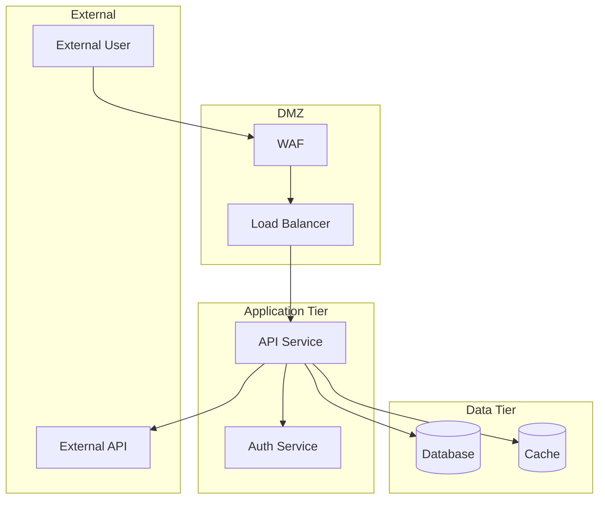

# Repository Architecture Analysis for Threat Modeling

Analyze git repositories to extract architectural patterns that inform security threat modeling. This skill produces structured output suitable for STRIDE, PASTA, or other threat modeling frameworks.

## Analysis Workflow

```
1. Repository reconnaissance     → Understand structure and tech stack
2. Component identification      → Map services, modules, boundaries
3. Data flow analysis           → Trace data movement and transformations
4. Entry point enumeration      → Identify attack surface
5. Security pattern extraction  → Find auth, crypto, validation patterns
6. Output generation            → Produce threat model inputs
```

## Step 1: Repository Reconnaissance

### Initial Structure Analysis

```bash
# Get directory structure (depth 3 for overview)
find . -type d -not -path '*/\.*' -not -path '*/node_modules/*' -not -path '*/vendor/*' -not -path '*/__pycache__/*' | head -100

# Identify primary languages
find . -type f \( -name "*.py" -o -name "*.js" -o -name "*.ts" -o -name "*.go" -o -name "*.java" -o -name "*.cs" -o -name "*.rb" \) | sed 's/.*\.//' | sort | uniq -c | sort -rn

# Find configuration files (architecture indicators)
find . -type f \( -name "docker-compose*.yml" -o -name "Dockerfile*" -o -name "kubernetes*.yml" -o -name "*.tf" -o -name "serverless.yml" -o -name "package.json" -o -name "requirements.txt" -o -name "go.mod" -o -name "pom.xml" -o -name "build.gradle" \) 2>/dev/null
```

### Tech Stack Identification

Examine dependency files to identify frameworks and libraries:

| File | Indicates |
|------|-----------|
| `package.json` | Node.js, check for Express, Fastify, NestJS, React, Vue |
| `requirements.txt` / `pyproject.toml` | Python, check for Django, Flask, FastAPI |
| `go.mod` | Go, check for Gin, Echo, gRPC |
| `pom.xml` / `build.gradle` | Java, check for Spring, Micronaut |
| `Gemfile` | Ruby, check for Rails, Sinatra |
| `docker-compose.yml` | Multi-service architecture |
| `*.tf` | Terraform/IaC, cloud infrastructure |

## Step 2: Component Identification

### Microservices / Service Boundaries

```bash
# Docker-based services
grep -r "container_name\|service:" docker-compose*.yml 2>/dev/null

# Kubernetes services
find . -name "*.yml" -o -name "*.yaml" | xargs grep -l "kind: Service\|kind: Deployment" 2>/dev/null

# API route files (entry points)
find . -type f \( -name "routes.*" -o -name "*router*" -o -name "*controller*" -o -name "*handler*" -o -name "*endpoint*" \) 2>/dev/null
```

### Trust Boundary Indicators

Look for these patterns that indicate trust boundaries:

| Pattern | Trust Boundary Type |
|---------|-------------------|
| API gateways, reverse proxies | External → Internal |
| Authentication middleware | Unauthenticated → Authenticated |
| Authorization checks | User → Admin/Privileged |
| Database connection configs | Application → Data tier |
| External API clients | Internal → External services |
| Message queue configs | Async processing boundary |

```bash
# Find auth/middleware patterns
grep -rn "middleware\|authenticate\|authorize\|isAdmin\|requireAuth\|@login_required\|@authenticated" --include="*.py" --include="*.js" --include="*.ts" --include="*.go" --include="*.java" 2>/dev/null | head -50
```

## Step 3: Data Flow Analysis

### Database and Storage Identification

```bash
# Database connection strings / configs
grep -rn "mongodb\|mysql\|postgres\|redis\|sqlite\|dynamodb\|DATABASE_URL\|REDIS_URL\|connectionString" --include="*.py" --include="*.js" --include="*.ts" --include="*.go" --include="*.java" --include="*.yml" --include="*.yaml" --include="*.json" --include="*.env*" 2>/dev/null

# ORM/Database models (data entities)
find . -type f \( -name "*model*" -o -name "*schema*" -o -name "*entity*" \) -not -path "*/node_modules/*" 2>/dev/null
```

### Data Input Points

```bash
# HTTP request handling (data ingress)
grep -rn "req\.body\|req\.params\|req\.query\|request\.json\|request\.form\|request\.args\|@RequestBody\|@PathVariable\|@RequestParam\|c\.Bind\|r\.ParseForm" --include="*.py" --include="*.js" --include="*.ts" --include="*.go" --include="*.java" 2>/dev/null | head -50

# File upload handling
grep -rn "multipart\|upload\|FormFile\|MultipartFile\|FileField\|req\.files" --include="*.py" --include="*.js" --include="*.ts" --include="*.go" --include="*.java" 2>/dev/null
```

### External Communications

```bash
# HTTP clients (outbound calls)
grep -rn "axios\|fetch\|requests\.\|http\.Client\|HttpClient\|RestTemplate\|WebClient\|urllib\|httpx" --include="*.py" --include="*.js" --include="*.ts" --include="*.go" --include="*.java" 2>/dev/null | head -30

# Message queues
grep -rn "kafka\|rabbitmq\|amqp\|sqs\|pubsub\|nats\|redis.*publish\|redis.*subscribe" --include="*.py" --include="*.js" --include="*.ts" --include="*.go" --include="*.java" --include="*.yml" 2>/dev/null
```

## Step 4: Entry Point Enumeration

### API Endpoints (Attack Surface)

```bash
# REST route definitions
grep -rn "@app\.route\|@router\.\|@Get\|@Post\|@Put\|@Delete\|@Patch\|app\.get\|app\.post\|router\.get\|router\.post\|@RequestMapping\|@GetMapping\|@PostMapping\|HandleFunc\|r\.GET\|r\.POST" --include="*.py" --include="*.js" --include="*.ts" --include="*.go" --include="*.java" 2>/dev/null

# GraphQL endpoints
grep -rn "GraphQL\|gql\|Query\|Mutation\|Resolver\|@Query\|@Mutation" --include="*.py" --include="*.js" --include="*.ts" --include="*.go" --include="*.java" 2>/dev/null

# WebSocket endpoints
grep -rn "WebSocket\|socket\.io\|ws://\|wss://\|@OnMessage\|@OnConnect" --include="*.py" --include="*.js" --include="*.ts" --include="*.go" --include="*.java" 2>/dev/null
```

### Administrative / Privileged Endpoints

```bash
# Admin routes (high-value targets)
grep -rn "admin\|dashboard\|management\|internal\|debug\|actuator\|metrics\|health" --include="*route*" --include="*router*" --include="*controller*" --include="*handler*" 2>/dev/null
```

## Step 5: Security Pattern Extraction

### Authentication Mechanisms

```bash
# Auth libraries and patterns
grep -rn "passport\|jwt\|jsonwebtoken\|bcrypt\|argon2\|OAuth\|OIDC\|SAML\|Keycloak\|Auth0\|Cognito\|firebase.*auth\|session\|cookie" --include="*.py" --include="*.js" --include="*.ts" --include="*.go" --include="*.java" --include="*.yml" 2>/dev/null | head -40

# Token/session handling
grep -rn "Bearer\|Authorization\|accessToken\|refreshToken\|id_token\|session_id\|CSRF\|csrf" --include="*.py" --include="*.js" --include="*.ts" --include="*.go" --include="*.java" 2>/dev/null | head -30
```

### Cryptography Usage

```bash
# Crypto operations
grep -rn "crypto\|encrypt\|decrypt\|hash\|hmac\|sha256\|sha512\|md5\|aes\|rsa\|ecdsa\|sign\|verify\|SecretKey\|PrivateKey" --include="*.py" --include="*.js" --include="*.ts" --include="*.go" --include="*.java" 2>/dev/null | head -30
```

### Input Validation

```bash
# Validation patterns
grep -rn "validate\|sanitize\|escape\|Validator\|@Valid\|Joi\|yup\|zod\|class-validator\|pydantic\|marshmallow" --include="*.py" --include="*.js" --include="*.ts" --include="*.go" --include="*.java" 2>/dev/null | head -30
```

### Secrets and Configuration

```bash
# Environment variables and secrets
grep -rn "process\.env\|os\.environ\|os\.getenv\|viper\.\|@Value\|SECRET\|API_KEY\|PASSWORD\|PRIVATE_KEY\|AWS_\|AZURE_\|GCP_" --include="*.py" --include="*.js" --include="*.ts" --include="*.go" --include="*.java" 2>/dev/null | head -30

# Secrets management
grep -rn "vault\|secretsmanager\|keyvault\|KMS\|ssm\.get" --include="*.py" --include="*.js" --include="*.ts" --include="*.go" --include="*.java" --include="*.yml" 2>/dev/null
```

## Step 6: Output Generation

### Architecture Summary Template

Generate a structured summary for threat modeling:

```markdown
# Architecture Analysis: [Repository Name]

## System Overview
- **Primary Language(s)**: 
- **Framework(s)**: 
- **Architecture Style**: [Monolith | Microservices | Serverless | Hybrid]
- **Deployment Model**: [Containers | VMs | Serverless | PaaS]

## Components
| Component | Type | Description | Trust Level |
|-----------|------|-------------|-------------|
| [name] | [service/database/cache/queue] | [purpose] | [external/internal/privileged] |

## Trust Boundaries
1. **[Boundary Name]**: [Description of what crosses this boundary]

## Data Flows
| Source | Destination | Data Type | Protocol | Auth Required |
|--------|-------------|-----------|----------|---------------|
| [from] | [to] | [PII/credentials/etc] | [HTTP/gRPC/etc] | [yes/no] |

## Entry Points (Attack Surface)
| Endpoint | Method | Auth | Input Types | Risk Notes |
|----------|--------|------|-------------|------------|
| [path] | [GET/POST/etc] | [required/optional/none] | [body/query/file] | [notes] |

## Security Controls Identified
- **Authentication**: [mechanisms found]
- **Authorization**: [patterns found]
- **Input Validation**: [libraries/patterns]
- **Cryptography**: [usage patterns]
- **Secrets Management**: [approach]

## Assets (for STRIDE)
| Asset | Confidentiality | Integrity | Availability |
|-------|-----------------|-----------|--------------|
| [data/service] | [H/M/L] | [H/M/L] | [H/M/L] |

## Initial Threat Considerations
- [List potential threats based on architecture]
```

### Data Flow Diagram (DFD) Generation

For Mermaid-based DFD output:

```markdown
## Data Flow Diagram


```

## Quick Reference Commands

### One-liner Repository Scan

```bash
# Comprehensive quick scan (run from repo root)
echo "=== LANGUAGES ===" && find . -type f \( -name "*.py" -o -name "*.js" -o -name "*.ts" -o -name "*.go" -o -name "*.java" \) -not -path "*/node_modules/*" | sed 's/.*\.//' | sort | uniq -c | sort -rn && \
echo "=== ENTRY POINTS ===" && grep -rn "@app\.\|@router\.\|app\.get\|app\.post\|HandleFunc\|@GetMapping\|@PostMapping" --include="*.py" --include="*.js" --include="*.ts" --include="*.go" --include="*.java" 2>/dev/null | wc -l && \
echo "=== DATABASES ===" && grep -rln "mongodb\|mysql\|postgres\|redis\|sqlite" --include="*.py" --include="*.js" --include="*.ts" --include="*.yml" 2>/dev/null && \
echo "=== AUTH PATTERNS ===" && grep -rln "jwt\|passport\|OAuth\|session" --include="*.py" --include="*.js" --include="*.ts" 2>/dev/null
```

## Analysis Priorities for Threat Modeling

Prioritize analysis based on threat model scope:

| Priority | Focus Area | Key Questions |
|----------|------------|---------------|
| **P0** | Entry points | What can external actors reach? |
| **P0** | Authentication | How are users verified? |
| **P0** | Data stores | Where does sensitive data live? |
| **P1** | Authorization | How are permissions enforced? |
| **P1** | External integrations | What third parties are trusted? |
| **P1** | Secrets management | How are credentials protected? |
| **P2** | Logging/monitoring | What visibility exists? |
| **P2** | Error handling | What information leaks on failure? |
| **P2** | Dependencies | What supply chain risks exist? |

## Common Architecture Patterns to Document

When analyzing, specifically look for these patterns:

1. **API Gateway Pattern** → Central entry point, auth/rate limiting
2. **BFF (Backend for Frontend)** → Multiple entry points per client type
3. **Service Mesh** → Internal mTLS, observability
4. **Event-Driven** → Message queues, async processing
5. **CQRS** → Separate read/write paths
6. **Saga Pattern** → Distributed transactions

Each pattern has distinct threat implications—document which patterns are present.

## Additional References

For deeper analysis, consult these reference files:

- **[references/stride-mapping.md](references/stride-mapping.md)**: Maps architectural findings to STRIDE threat categories. Use when translating code analysis results into formal threat statements.

- **[references/code-patterns.md](references/code-patterns.md)**: Detailed grep patterns for identifying security-relevant code across languages. Use for comprehensive security pattern extraction beyond the quick commands above.