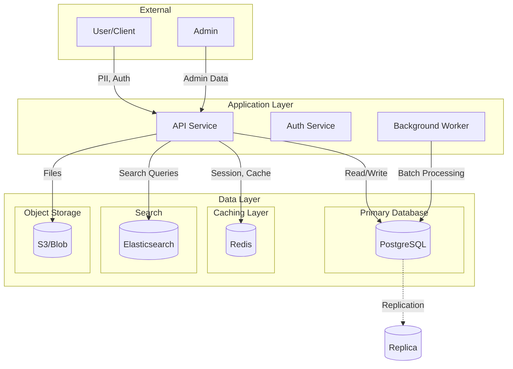

# Database Security Analysis for Threat Modeling

Analyze git repositories to extract database architecture, data models, access patterns, and security configurations for threat modeling.

## Analysis Workflow

```
1. Database discovery       → Identify database technologies and connections
2. Schema analysis          → Extract data models and relationships
3. Sensitive data mapping   → Classify PII, secrets, financial data
4. Access pattern analysis  → Query construction, ORM usage, raw SQL
5. Connection security      → Credentials, encryption, pooling
6. Data lifecycle           → Backup, replication, retention
7. Output generation        → Produce data flow diagrams and threat inputs
```

## Step 1: Database Discovery

### Identify Database Technologies

```bash
# Find database dependencies in package files
echo "=== NPM (Node.js) ===" && grep -rn "mysql\|pg\|postgres\|mongodb\|mongoose\|sequelize\|typeorm\|prisma\|knex\|sqlite\|redis\|ioredis\|cassandra\|dynamodb\|neo4j\|elasticsearch" package.json 2>/dev/null

echo "=== Python ===" && grep -rn "psycopg\|mysql-connector\|pymongo\|sqlalchemy\|django\|peewee\|tortoise\|redis\|cassandra-driver\|boto3.*dynamodb\|elasticsearch" requirements.txt pyproject.toml setup.py 2>/dev/null

echo "=== Java/Gradle ===" && grep -rn "mysql-connector\|postgresql\|mongodb\|hibernate\|spring-data\|jdbc\|r2dbc\|jedis\|lettuce\|cassandra\|elasticsearch" build.gradle pom.xml 2>/dev/null

echo "=== Go ===" && grep -rn "database/sql\|gorm\|sqlx\|pgx\|mongo-driver\|go-redis\|elastic" go.mod 2>/dev/null

echo "=== Ruby ===" && grep -rn "pg\|mysql2\|mongo\|activerecord\|sequel\|redis\|elasticsearch" Gemfile 2>/dev/null
```

### Database Technology Matrix

| Technology | Type | Common Ports | Key Files |
|------------|------|--------------|-----------|
| PostgreSQL | Relational | 5432 | `*.sql`, migrations |
| MySQL/MariaDB | Relational | 3306 | `*.sql`, migrations |
| MongoDB | Document | 27017 | `*.js` schemas |
| Redis | Key-Value | 6379 | — |
| Elasticsearch | Search | 9200, 9300 | mappings |
| DynamoDB | Key-Value | 443 (AWS) | — |
| Cassandra | Wide-Column | 9042 | `*.cql` |
| Neo4j | Graph | 7474, 7687 | `*.cypher` |
| SQLite | Embedded | — | `*.db`, `*.sqlite` |

### Find Connection Configurations

```bash
# Connection strings in code
grep -rn "postgres://\|postgresql://\|mysql://\|mongodb://\|mongodb+srv://\|redis://\|rediss://\|amqp://\|elasticsearch://" --include="*.py" --include="*.js" --include="*.ts" --include="*.go" --include="*.java" --include="*.rb" --include="*.yml" --include="*.yaml" --include="*.json" --include="*.env*" --include="*.properties" 2>/dev/null

# Environment variable references for DB
grep -rn "DATABASE_URL\|DB_HOST\|DB_PORT\|DB_NAME\|DB_USER\|DB_PASSWORD\|REDIS_URL\|MONGO_URI\|ELASTICSEARCH_URL\|PG_\|MYSQL_\|POSTGRES_" --include="*.py" --include="*.js" --include="*.ts" --include="*.go" --include="*.java" --include="*.yml" --include="*.env*" 2>/dev/null

# Configuration files
find . -type f \( -name "database.yml" -o -name "database.json" -o -name "db.config.*" -o -name "ormconfig.*" -o -name "knexfile.*" -o -name "sequelize.config.*" -o -name "prisma.schema" -o -name "schema.prisma" \) 2>/dev/null
```

### Find Database Client Initialization

```bash
# Node.js/TypeScript
grep -rn "new Pool\|createPool\|createConnection\|MongoClient\|mongoose\.connect\|Sequelize\|DataSource\|PrismaClient\|createClient.*redis" --include="*.js" --include="*.ts" 2>/dev/null

# Python
grep -rn "create_engine\|connect\(\|MongoClient\|psycopg2\|mysql\.connector\|redis\.Redis\|Redis\(\|aioredis" --include="*.py" 2>/dev/null

# Java
grep -rn "DriverManager\.getConnection\|DataSource\|JdbcTemplate\|EntityManagerFactory\|MongoClient\|Jedis\|RedisTemplate" --include="*.java" 2>/dev/null

# Go
grep -rn "sql\.Open\|gorm\.Open\|pgx\.Connect\|mongo\.Connect\|redis\.NewClient" --include="*.go" 2>/dev/null
```

## Step 2: Schema Analysis

### Find Schema Definitions

```bash
# SQL migration files
find . -type f \( -name "*.sql" -o -path "*/migrations/*" -o -path "*/migrate/*" \) -not -path "*/node_modules/*" 2>/dev/null

# ORM model files
find . -type f \( -name "*model*" -o -name "*entity*" -o -name "*schema*" \) -not -path "*/node_modules/*" -not -path "*/__pycache__/*" 2>/dev/null | head -50

# Prisma schemas
find . -name "*.prisma" -o -name "schema.prisma" 2>/dev/null

# TypeORM entities
grep -rln "@Entity\|@Column\|@PrimaryGeneratedColumn" --include="*.ts" 2>/dev/null

# Sequelize models
grep -rln "sequelize\.define\|Model\.init\|DataTypes\." --include="*.js" --include="*.ts" 2>/dev/null

# SQLAlchemy models
grep -rln "Base.*declarative\|Column\(\|relationship\(" --include="*.py" 2>/dev/null

# Django models
grep -rln "models\.Model\|models\.CharField\|models\.ForeignKey" --include="*.py" 2>/dev/null

# Mongoose schemas
grep -rln "new Schema\|mongoose\.Schema\|mongoose\.model" --include="*.js" --include="*.ts" 2>/dev/null
```

### Extract Table/Collection Names

```bash
# SQL CREATE TABLE statements
grep -rn "CREATE TABLE\|CREATE INDEX\|ALTER TABLE" --include="*.sql" 2>/dev/null

# Table names from ORM
grep -rn "tableName\|table_name\|__tablename__\|@Table\|@Entity.*name" --include="*.py" --include="*.js" --include="*.ts" --include="*.java" 2>/dev/null

# MongoDB collection names
grep -rn "collection\(\|getCollection\|db\.\|mongoose\.model" --include="*.py" --include="*.js" --include="*.ts" 2>/dev/null
```

### Identify Relationships

```bash
# Foreign keys in SQL
grep -rn "FOREIGN KEY\|REFERENCES\|ON DELETE\|ON UPDATE" --include="*.sql" 2>/dev/null

# ORM relationships
grep -rn "ForeignKey\|OneToMany\|ManyToOne\|ManyToMany\|OneToOne\|hasMany\|belongsTo\|hasOne\|relationship\|@JoinColumn\|@JoinTable" --include="*.py" --include="*.js" --include="*.ts" --include="*.java" 2>/dev/null

# Mongoose refs
grep -rn "ref:\s*['\"]" --include="*.js" --include="*.ts" 2>/dev/null
```

## Step 3: Sensitive Data Mapping

### PII Field Detection

```bash
# Common PII field names
grep -rn -i "first_name\|last_name\|full_name\|email\|phone\|address\|street\|city\|zip\|postal\|ssn\|social_security\|tax_id\|national_id\|passport\|driver_license\|date_of_birth\|dob\|birth_date\|gender\|ethnicity\|religion\|ip_address\|user_agent\|device_id\|location\|latitude\|longitude\|geolocation" --include="*.sql" --include="*.py" --include="*.js" --include="*.ts" --include="*.java" --include="*.prisma" 2>/dev/null | head -100
```

### Financial Data Detection

```bash
# Financial field names
grep -rn -i "credit_card\|card_number\|cvv\|ccv\|expiry\|expiration\|account_number\|routing_number\|iban\|swift\|bank_account\|payment\|billing\|invoice\|salary\|income\|balance\|transaction\|price\|amount\|currency" --include="*.sql" --include="*.py" --include="*.js" --include="*.ts" --include="*.java" --include="*.prisma" 2>/dev/null | head -50
```

### Authentication Data Detection

```bash
# Auth-related fields
grep -rn -i "password\|passwd\|pwd\|secret\|token\|api_key\|apikey\|auth_token\|access_token\|refresh_token\|session\|salt\|hash\|otp\|mfa\|two_factor\|recovery_code\|private_key\|public_key" --include="*.sql" --include="*.py" --include="*.js" --include="*.ts" --include="*.java" --include="*.prisma" 2>/dev/null | head -50
```

### Health Data Detection (HIPAA)

```bash
# PHI field names
grep -rn -i "diagnosis\|medical\|health\|patient\|prescription\|medication\|treatment\|doctor\|physician\|insurance\|claim\|procedure\|symptom\|allergy\|blood_type\|condition\|disability" --include="*.sql" --include="*.py" --include="*.js" --include="*.ts" --include="*.java" --include="*.prisma" 2>/dev/null | head -50
```

### Data Classification Summary

```bash
# Quick classification scan
echo "=== PII FIELDS ===" && grep -rn -i -c "email\|phone\|address\|ssn\|passport\|name" --include="*.sql" --include="*model*" --include="*entity*" --include="*schema*" 2>/dev/null | grep -v ":0$"

echo "=== FINANCIAL FIELDS ===" && grep -rn -i -c "card\|account\|payment\|billing\|transaction\|balance" --include="*.sql" --include="*model*" --include="*entity*" --include="*schema*" 2>/dev/null | grep -v ":0$"

echo "=== AUTH FIELDS ===" && grep -rn -i -c "password\|token\|secret\|key\|session\|hash" --include="*.sql" --include="*model*" --include="*entity*" --include="*schema*" 2>/dev/null | grep -v ":0$"
```

## Step 4: Access Pattern Analysis

### Raw SQL Query Detection

```bash
# String concatenation in queries (SQL injection risk)
grep -rn "execute.*+\|query.*+\|exec.*+\|\"SELECT.*+\|\"INSERT.*+\|\"UPDATE.*+\|\"DELETE.*+\|f\"SELECT\|f\"INSERT\|f\"UPDATE\|f\"DELETE\|`SELECT.*\$\|`INSERT.*\$" --include="*.py" --include="*.js" --include="*.ts" --include="*.go" --include="*.java" --include="*.rb" 2>/dev/null

# Format string queries
grep -rn "\.format\(.*SELECT\|\.format\(.*INSERT\|\.format\(.*UPDATE\|\.format\(.*DELETE\|%s.*SELECT\|%s.*INSERT" --include="*.py" --include="*.js" --include="*.ts" 2>/dev/null

# DANGEROUS: Direct variable interpolation
grep -rn '\$\{.*\}.*SELECT\|\$\{.*\}.*INSERT\|\$\{.*\}.*UPDATE\|\$\{.*\}.*DELETE' --include="*.js" --include="*.ts" 2>/dev/null
```

### Parameterized Query Detection (Good Practice)

```bash
# Parameterized queries
grep -rn "\$1\|\$2\|%s\|:param\|@param\|\?.*\?" --include="*.py" --include="*.js" --include="*.ts" --include="*.go" --include="*.java" 2>/dev/null | grep -i "select\|insert\|update\|delete" | head -30

# Prepared statements
grep -rn "prepare\|PreparedStatement\|parameterized\|placeholder" --include="*.py" --include="*.js" --include="*.ts" --include="*.go" --include="*.java" 2>/dev/null
```

### ORM Query Patterns

```bash
# ORM query methods
grep -rn "\.find\(\|\.findOne\|\.findAll\|\.findById\|\.findByPk\|\.where\(\|\.filter\(\|\.get\(\|\.all\(\|\.first\(\|\.select\(\|\.query\(" --include="*.py" --include="*.js" --include="*.ts" --include="*.java" 2>/dev/null | head -50

# Raw queries through ORM (potential bypass)
grep -rn "\.raw\(\|\.rawQuery\|raw_query\|RawSQL\|textual\|Sequelize\.literal\|knex\.raw\|prisma\.\$queryRaw\|prisma\.\$executeRaw" --include="*.py" --include="*.js" --include="*.ts" --include="*.java" 2>/dev/null
```

### NoSQL Query Patterns

```bash
# MongoDB queries
grep -rn "\.find\(\|\.findOne\|\.aggregate\|\.updateOne\|\.updateMany\|\.deleteOne\|\.deleteMany\|\.insertOne\|\.insertMany" --include="*.js" --include="*.ts" --include="*.py" 2>/dev/null | head -50

# DANGEROUS: NoSQL injection patterns ($where, $regex from user input)
grep -rn '\$where\|\$regex\|\$ne\|\$gt\|\$lt\|\$or\|\$and' --include="*.js" --include="*.ts" --include="*.py" 2>/dev/null

# Elasticsearch queries
grep -rn "\.search\(\|query.*bool\|query.*match\|query.*term" --include="*.js" --include="*.ts" --include="*.py" --include="*.java" 2>/dev/null
```

### Data Retrieval Patterns

```bash
# Bulk data access (potential data exfiltration)
grep -rn "\.findAll\|\.find\(\{\}\)\|SELECT \*\|LIMIT.*1000\|LIMIT.*10000\|no.*limit\|unlimited" --include="*.py" --include="*.js" --include="*.ts" --include="*.java" --include="*.sql" 2>/dev/null

# Pagination patterns
grep -rn "offset\|skip\|limit\|page\|pageSize\|per_page\|cursor\|after\|before" --include="*.py" --include="*.js" --include="*.ts" --include="*.java" 2>/dev/null | head -30

# Export/dump functionality
grep -rn "export\|dump\|backup\|download.*data\|csv\|xlsx\|bulk" --include="*.py" --include="*.js" --include="*.ts" --include="*.java" 2>/dev/null
```

## Step 5: Connection Security

### Credential Handling

```bash
# Hardcoded credentials (CRITICAL)
grep -rn "password.*=.*['\"].\+['\"]\|passwd.*=.*['\"].\+['\"]\|pwd.*=.*['\"].\+['\"]" --include="*.py" --include="*.js" --include="*.ts" --include="*.go" --include="*.java" --include="*.yml" --include="*.json" 2>/dev/null | grep -v "password.*=.*\"\"\|password.*=.*''\|password.*env\|password.*process\|password.*getenv\|password.*config"

# Connection strings with credentials
grep -rn "://.*:.*@" --include="*.py" --include="*.js" --include="*.ts" --include="*.go" --include="*.java" --include="*.yml" --include="*.json" --include="*.env*" 2>/dev/null

# Credentials from environment (good practice)
grep -rn "process\.env\.\|os\.environ\|os\.getenv\|System\.getenv\|viper\.Get" --include="*.py" --include="*.js" --include="*.ts" --include="*.go" --include="*.java" 2>/dev/null | grep -i "password\|secret\|key\|credential"
```

### TLS/SSL Configuration

```bash
# SSL/TLS settings
grep -rn "ssl\|tls\|sslmode\|ssl_mode\|sslca\|sslcert\|sslkey\|rejectUnauthorized\|verify_ssl\|ssl_verify\|tlsAllowInvalidCertificates\|tlsCAFile" --include="*.py" --include="*.js" --include="*.ts" --include="*.go" --include="*.java" --include="*.yml" --include="*.json" 2>/dev/null

# DANGEROUS: SSL disabled
grep -rn "ssl.*false\|ssl.*disable\|sslmode.*disable\|rejectUnauthorized.*false\|verify.*false\|tlsAllowInvalid.*true" --include="*.py" --include="*.js" --include="*.ts" --include="*.go" --include="*.java" --include="*.yml" 2>/dev/null
```

### Connection Pooling

```bash
# Connection pool configuration
grep -rn "pool\|poolSize\|pool_size\|maxConnections\|max_connections\|minConnections\|connectionLimit\|max_pool\|min_pool\|idleTimeout\|connectionTimeout" --include="*.py" --include="*.js" --include="*.ts" --include="*.go" --include="*.java" --include="*.yml" 2>/dev/null

# Pool implementations
grep -rn "createPool\|Pool\(\|ConnectionPool\|HikariConfig\|GenericObjectPool" --include="*.py" --include="*.js" --include="*.ts" --include="*.go" --include="*.java" 2>/dev/null
```

### Database User Permissions

```bash
# Database user/role creation in migrations
grep -rn "CREATE USER\|CREATE ROLE\|GRANT\|REVOKE\|ALTER USER\|ALTER ROLE" --include="*.sql" 2>/dev/null

# Application user references
grep -rn "db_user\|DB_USER\|database_user\|username.*=\|user.*=.*['\"]" --include="*.py" --include="*.js" --include="*.ts" --include="*.yml" --include="*.env*" 2>/dev/null | head -30
```

## Step 6: Data Lifecycle Analysis

### Backup Configuration

```bash
# Backup references
grep -rn "backup\|dump\|pg_dump\|mysqldump\|mongodump\|snapshot\|restore\|recovery" --include="*.py" --include="*.js" --include="*.ts" --include="*.sh" --include="*.yml" --include="*.yaml" 2>/dev/null

# Backup scripts
find . -type f \( -name "*backup*" -o -name "*dump*" -o -name "*restore*" \) 2>/dev/null
```

### Replication and High Availability

```bash
# Replication configuration
grep -rn "replica\|replication\|slave\|master\|primary\|secondary\|readPreference\|read_replica\|standby\|failover\|cluster" --include="*.py" --include="*.js" --include="*.ts" --include="*.yml" --include="*.yaml" --include="*.json" 2>/dev/null

# Connection strings with replicas
grep -rn "replicaSet\|replica_set\|readPreference" --include="*.py" --include="*.js" --include="*.ts" --include="*.yml" 2>/dev/null
```

### Data Retention and Deletion

```bash
# Soft delete patterns
grep -rn "deleted_at\|deletedAt\|is_deleted\|isDeleted\|soft_delete\|paranoid\|@DeletedDate" --include="*.py" --include="*.js" --include="*.ts" --include="*.java" --include="*.sql" 2>/dev/null

# Hard delete operations
grep -rn "\.destroy\|\.delete\|DELETE FROM\|TRUNCATE\|DROP TABLE" --include="*.py" --include="*.js" --include="*.ts" --include="*.java" --include="*.sql" 2>/dev/null | head -30

# Data retention policies
grep -rn "retention\|expire\|ttl\|time_to_live\|purge\|archive\|cleanup" --include="*.py" --include="*.js" --include="*.ts" --include="*.yml" --include="*.sql" 2>/dev/null
```

### Audit Logging

```bash
# Audit trail implementations
grep -rn "audit\|changelog\|history\|revision\|versioning\|created_at\|updated_at\|created_by\|updated_by\|modified_by" --include="*.py" --include="*.js" --include="*.ts" --include="*.java" --include="*.sql" 2>/dev/null | head -50

# ORM hooks for auditing
grep -rn "@BeforeInsert\|@BeforeUpdate\|@AfterInsert\|@AfterUpdate\|beforeCreate\|beforeUpdate\|pre_save\|post_save\|@PrePersist\|@PostPersist" --include="*.py" --include="*.js" --include="*.ts" --include="*.java" 2>/dev/null
```

### Encryption at Rest

```bash
# Field-level encryption
grep -rn "encrypt\|decrypt\|cipher\|@Encrypted\|EncryptedField\|encrypted_type\|pgcrypto\|aes_encrypt\|aes_decrypt" --include="*.py" --include="*.js" --include="*.ts" --include="*.java" --include="*.sql" 2>/dev/null

# Column encryption
grep -rn "ENCRYPTED\|encryption_key\|data_key\|column.*encrypt" --include="*.sql" --include="*.py" --include="*.js" --include="*.ts" 2>/dev/null
```

## Step 7: Output Generation

### Database Architecture Summary Template

```markdown
# Database Analysis: [Repository Name]

## Database Technologies
| Technology | Type | Purpose | Files |
|------------|------|---------|-------|
| [PostgreSQL] | [Relational] | [Primary data store] | [db/*, models/*] |

## Data Classification
| Category | Tables/Collections | Fields | Sensitivity |
|----------|-------------------|--------|-------------|
| PII | users, profiles | email, phone, ssn | High |
| Financial | transactions, accounts | card_number, balance | Critical |
| Authentication | users, sessions | password_hash, tokens | Critical |
| Business | orders, products | — | Medium |

## Schema Summary
| Table/Collection | Key Fields | Relationships | Sensitive Data |
|-----------------|------------|---------------|----------------|
| [users] | [id, email, password_hash] | [→ orders, → sessions] | [Yes - PII, Auth] |

## Data Access Patterns
| Pattern | Location | Risk Level | Notes |
|---------|----------|------------|-------|
| Raw SQL | [file:line] | [High] | [String concatenation] |
| ORM | [file:line] | [Low] | [Parameterized] |

## Connection Security
- **TLS/SSL**: [Enabled/Disabled]
- **Credential Storage**: [Environment vars / Secrets manager / Hardcoded]
- **Connection Pooling**: [Yes/No, max connections]
- **Database User**: [Dedicated / Shared / Root]

## Data Lifecycle
- **Backups**: [Configured/Not found]
- **Retention Policy**: [Defined/Not found]
- **Audit Logging**: [Implemented/Not found]
- **Encryption at Rest**: [Yes/No]
- **Soft Delete**: [Yes/No]

## Security Findings
| Finding | Severity | Location | Recommendation |
|---------|----------|----------|----------------|
| | | | |
```

### Data Flow Diagram Template

```markdown
## Data Flow Diagram


```

## Quick Reference Commands

### One-liner Database Scan

```bash
# Comprehensive quick scan
echo "=== DB TECHNOLOGIES ===" && grep -rh "postgres\|mysql\|mongodb\|redis\|elasticsearch\|dynamodb" package.json requirements.txt go.mod pom.xml 2>/dev/null | head -10 && \
echo "=== CONNECTION STRINGS ===" && grep -rn "://.*@\|DATABASE_URL\|MONGO_URI" --include="*.env*" --include="*.yml" 2>/dev/null | wc -l && \
echo "=== MODELS/SCHEMAS ===" && find . -type f \( -name "*model*" -o -name "*schema*" -o -name "*entity*" \) -not -path "*/node_modules/*" 2>/dev/null | wc -l && \
echo "=== RAW SQL ===" && grep -rn "execute\|\.query\|\.raw\(" --include="*.py" --include="*.js" --include="*.ts" 2>/dev/null | wc -l && \
echo "=== SENSITIVE FIELDS ===" && grep -rn -i "password\|ssn\|credit_card\|secret" --include="*.sql" --include="*model*" --include="*schema*" 2>/dev/null | wc -l
```

## Additional References

For deeper analysis, consult these reference files:

- **[references/orm-patterns.md](references/orm-patterns.md)**: Detailed patterns for analyzing ORM usage across frameworks (Sequelize, TypeORM, Prisma, SQLAlchemy, Django ORM, GORM).

- **[references/nosql-patterns.md](references/nosql-patterns.md)**: MongoDB, Redis, Elasticsearch, and DynamoDB specific security patterns and injection risks.

- **[references/database-stride-mapping.md](references/database-stride-mapping.md)**: Maps database findings to STRIDE threat categories with data-specific attack vectors.