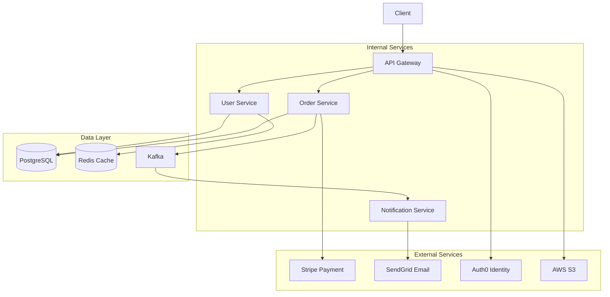

# Service Dependency Analysis for Threat Modeling

Enumerate and profile all service dependencies (external APIs, internal services, cloud services, infrastructure) to understand trust relationships and data flows for threat modeling.

## Analysis Workflow

```
1. Dependency discovery       → Find all service integrations
2. External API profiling     → Third-party APIs and webhooks
3. Internal service mapping   → Microservice communication
4. Cloud service enumeration  → AWS/GCP/Azure service usage
5. Infrastructure deps        → Databases, caches, queues
6. Authentication flows       → Identity providers, SSO
7. Data flow analysis         → What data crosses boundaries
8. Trust profiling            → Security posture per dependency
9. Output generation          → Dependency map and risk profile
```

## Step 1: Dependency Discovery

### HTTP Client Detection

```bash
echo "=== HTTP CLIENT LIBRARIES ==="

# Node.js/TypeScript
grep -rn "axios\|node-fetch\|got\|superagent\|request\|undici\|ky\|@apollo/client\|graphql-request" package.json 2>/dev/null
grep -rn "import.*axios\|require.*axios\|import.*fetch\|from 'got'\|from 'superagent'" --include="*.ts" --include="*.js" 2>/dev/null | head -20

# Python
grep -rn "requests\|httpx\|aiohttp\|urllib3\|http\.client\|httplib2" requirements.txt pyproject.toml 2>/dev/null
grep -rn "import requests\|from requests\|import httpx\|import aiohttp" --include="*.py" 2>/dev/null | head -20

# Java
grep -rn "HttpClient\|RestTemplate\|WebClient\|OkHttp\|Retrofit\|Feign" --include="*.java" 2>/dev/null | head -20
grep -rn "apache.*http\|okhttp\|retrofit\|feign" pom.xml build.gradle 2>/dev/null

# Go
grep -rn "net/http\|resty\|go-resty\|gentleman" --include="*.go" 2>/dev/null | head -20

# Ruby
grep -rn "Net::HTTP\|HTTParty\|Faraday\|RestClient\|Typhoeus" --include="*.rb" 2>/dev/null | head -20
```

### SDK Detection

```bash
echo "=== SERVICE SDKS ==="

# Cloud Provider SDKs
grep -rn "aws-sdk\|@aws-sdk\|boto3\|google-cloud\|@google-cloud\|azure\|@azure" package.json requirements.txt go.mod pom.xml Gemfile 2>/dev/null

# Payment Services
grep -rn "stripe\|braintree\|paypal\|square\|adyen\|mollie" package.json requirements.txt go.mod pom.xml Gemfile 2>/dev/null

# Communication Services
grep -rn "twilio\|sendgrid\|mailgun\|postmark\|ses\|mailchimp\|messagebird" package.json requirements.txt go.mod pom.xml Gemfile 2>/dev/null

# Auth Providers
grep -rn "auth0\|okta\|firebase-admin\|cognito\|keycloak\|passport" package.json requirements.txt go.mod pom.xml Gemfile 2>/dev/null

# Monitoring/Observability
grep -rn "datadog\|newrelic\|sentry\|bugsnag\|rollbar\|elastic-apm\|opentelemetry" package.json requirements.txt go.mod pom.xml Gemfile 2>/dev/null

# Analytics
grep -rn "segment\|amplitude\|mixpanel\|analytics\|google-analytics\|heap" package.json requirements.txt go.mod pom.xml Gemfile 2>/dev/null
```

### URL/Endpoint Discovery

```bash
echo "=== EXTERNAL URLs ==="

# Hardcoded URLs
grep -rn "https://\|http://" --include="*.ts" --include="*.js" --include="*.py" --include="*.java" --include="*.go" --include="*.rb" 2>/dev/null | \
  grep -v "localhost\|127\.0\.0\.1\|example\.com\|schema\.org\|w3\.org" | \
  grep -v node_modules | grep -v "test\|spec" | head -50

# API base URLs in config
grep -rn "API_URL\|BASE_URL\|SERVICE_URL\|ENDPOINT\|_HOST\|_URI" --include="*.env*" --include="*.yml" --include="*.yaml" --include="*.json" --include="*.ts" --include="*.js" --include="*.py" 2>/dev/null | head -30

# Webhook endpoints
grep -rn "webhook\|callback\|hook" --include="*.ts" --include="*.js" --include="*.py" --include="*.java" --include="*.go" --include="*.yml" 2>/dev/null | head -20
```

## Step 2: External API Profiling

### Payment Service Integrations

```bash
echo "=== PAYMENT SERVICES ==="

# Stripe
grep -rn "stripe\|sk_live\|sk_test\|pk_live\|pk_test" --include="*.ts" --include="*.js" --include="*.py" --include="*.java" --include="*.go" --include="*.env*" 2>/dev/null | head -20

# PayPal
grep -rn "paypal\|PAYPAL\|braintree" --include="*.ts" --include="*.js" --include="*.py" --include="*.java" --include="*.go" --include="*.env*" 2>/dev/null | head -20

# Other payment processors
grep -rn "square\|adyen\|mollie\|klarna\|afterpay" --include="*.ts" --include="*.js" --include="*.py" --include="*.env*" 2>/dev/null | head -10
```

### Communication Services

```bash
echo "=== COMMUNICATION SERVICES ==="

# Email
grep -rn "sendgrid\|mailgun\|postmark\|ses\.\|smtp\|nodemailer\|mailchimp" --include="*.ts" --include="*.js" --include="*.py" --include="*.java" --include="*.go" --include="*.yml" 2>/dev/null | head -20

# SMS/Voice
grep -rn "twilio\|nexmo\|vonage\|plivo\|messagebird\|bandwidth" --include="*.ts" --include="*.js" --include="*.py" --include="*.java" --include="*.go" --include="*.yml" 2>/dev/null | head -15

# Push notifications
grep -rn "firebase.*messaging\|fcm\|apns\|onesignal\|pusher\|expo-notifications" --include="*.ts" --include="*.js" --include="*.py" --include="*.java" --include="*.yml" 2>/dev/null | head -15
```

### Storage & CDN Services

```bash
echo "=== STORAGE & CDN ==="

# Object storage
grep -rn "s3\.\|S3Client\|@aws-sdk/client-s3\|google.*storage\|azure.*blob\|cloudinary\|imgix\|uploadcare" --include="*.ts" --include="*.js" --include="*.py" --include="*.java" --include="*.go" 2>/dev/null | head -20

# CDN
grep -rn "cloudfront\|fastly\|cloudflare\|akamai\|cdn\." --include="*.ts" --include="*.js" --include="*.py" --include="*.yml" --include="*.env*" 2>/dev/null | head -15

# File upload services
grep -rn "uploadthing\|filepond\|uppy\|fine-uploader\|dropzone" package.json 2>/dev/null
```

### Third-Party Data Services

```bash
echo "=== DATA SERVICES ==="

# Search
grep -rn "algolia\|elasticsearch\|typesense\|meilisearch\|elastic\.co" --include="*.ts" --include="*.js" --include="*.py" --include="*.java" --include="*.yml" 2>/dev/null | head -15

# Maps/Geolocation
grep -rn "mapbox\|google.*maps\|here\.\|opencage\|ipstack\|maxmind\|geoip" --include="*.ts" --include="*.js" --include="*.py" --include="*.java" --include="*.yml" 2>/dev/null | head -15

# AI/ML APIs
grep -rn "openai\|anthropic\|cohere\|huggingface\|replicate\|stability\.\|palm\|vertex" --include="*.ts" --include="*.js" --include="*.py" --include="*.java" --include="*.yml" --include="*.env*" 2>/dev/null | head -15
```

### Social & OAuth Providers

```bash
echo "=== SOCIAL & OAUTH ==="

# Social login
grep -rn "google.*oauth\|facebook.*oauth\|github.*oauth\|twitter.*oauth\|linkedin.*oauth\|apple.*sign" --include="*.ts" --include="*.js" --include="*.py" --include="*.java" --include="*.yml" 2>/dev/null | head -15

# OAuth client IDs
grep -rn "CLIENT_ID\|client_id\|OAUTH\|oauth" --include="*.env*" --include="*.yml" --include="*.yaml" 2>/dev/null | head -15

# Social APIs
grep -rn "twitter.*api\|facebook.*graph\|instagram\|linkedin.*api\|slack.*api\|discord.*api" --include="*.ts" --include="*.js" --include="*.py" --include="*.java" 2>/dev/null | head -15
```

## Step 3: Internal Service Mapping

### Service Client Detection

```bash
echo "=== INTERNAL SERVICE CLIENTS ==="

# Feign/REST clients
grep -rn "@FeignClient\|@LoadBalanced\|RestTemplate\|WebClient\.create" --include="*.java" 2>/dev/null | head -20

# gRPC clients
grep -rn "grpc\.\|proto\.\|ManagedChannel\|stub\." --include="*.java" --include="*.go" --include="*.py" --include="*.ts" 2>/dev/null | head -20

# Service discovery
grep -rn "eureka\|consul\|etcd\|zookeeper\|nacos" --include="*.java" --include="*.go" --include="*.py" --include="*.yml" --include="*.yaml" 2>/dev/null | head -15
```

### Internal URL Patterns

```bash
echo "=== INTERNAL SERVICE URLs ==="

# Service name patterns in URLs
grep -rn "http://\w\+-service\|http://\w\+-api\|http://\w\+-svc\|http://api-\|http://svc-" --include="*.ts" --include="*.js" --include="*.py" --include="*.java" --include="*.go" --include="*.yml" 2>/dev/null | head -20

# Kubernetes service DNS
grep -rn "\.svc\.cluster\.local\|\.svc\.\|\.default\." --include="*.ts" --include="*.js" --include="*.py" --include="*.java" --include="*.go" --include="*.yml" 2>/dev/null | head -15

# Environment-based service URLs
grep -rn "_SERVICE_HOST\|_SERVICE_URL\|_API_URL\|_ENDPOINT" --include="*.ts" --include="*.js" --include="*.py" --include="*.java" --include="*.env*" --include="*.yml" 2>/dev/null | head -20
```

### Message Queue Consumers/Producers

```bash
echo "=== MESSAGE QUEUES ==="

# RabbitMQ
grep -rn "amqp\|rabbitmq\|@RabbitListener\|@RabbitHandler\|pika\." --include="*.ts" --include="*.js" --include="*.py" --include="*.java" --include="*.go" --include="*.yml" 2>/dev/null | head -20

# Kafka
grep -rn "kafka\|@KafkaListener\|KafkaProducer\|KafkaConsumer\|confluent" --include="*.ts" --include="*.js" --include="*.py" --include="*.java" --include="*.go" --include="*.yml" 2>/dev/null | head -20

# AWS SQS/SNS
grep -rn "sqs\.\|sns\.\|@aws-sdk/client-sqs\|@aws-sdk/client-sns" --include="*.ts" --include="*.js" --include="*.py" --include="*.java" --include="*.go" --include="*.yml" 2>/dev/null | head -15

# Redis pub/sub
grep -rn "redis.*publish\|redis.*subscribe\|pubsub\|bull\|bullmq" --include="*.ts" --include="*.js" --include="*.py" --include="*.java" --include="*.go" 2>/dev/null | head -15

# NATS
grep -rn "nats\.\|nats://" --include="*.ts" --include="*.js" --include="*.py" --include="*.java" --include="*.go" --include="*.yml" 2>/dev/null | head -10
```

### Event-Driven Patterns

```bash
echo "=== EVENT PATTERNS ==="

# Event emitters/handlers
grep -rn "EventEmitter\|@EventPattern\|@MessagePattern\|on\s*\(\s*['\"]" --include="*.ts" --include="*.js" --include="*.py" --include="*.java" 2>/dev/null | head -20

# Domain events
grep -rn "DomainEvent\|event.*publish\|event.*emit\|dispatch.*event" --include="*.ts" --include="*.js" --include="*.py" --include="*.java" 2>/dev/null | head -15

# Webhook handlers
grep -rn "webhook\|/hook\|/callback\|handleWebhook" --include="*.ts" --include="*.js" --include="*.py" --include="*.java" --include="*.go" 2>/dev/null | head -15
```

## Step 4: Cloud Service Enumeration

### AWS Services

```bash
echo "=== AWS SERVICES ==="

# Find all AWS SDK imports/usage
grep -rn "@aws-sdk/client-\|boto3\.\|aws\." --include="*.ts" --include="*.js" --include="*.py" --include="*.java" --include="*.go" 2>/dev/null | \
  sed 's/.*@aws-sdk\/client-//; s/.*boto3\.client(['\''"]//; s/['\''"].*$//' | \
  sort | uniq -c | sort -rn | head -20

# Common AWS services
for svc in s3 dynamodb lambda sqs sns ses cognito secretsmanager ssm kms rds elasticache cloudwatch ecs eks ec2 iam sts; do
    count=$(grep -rn "$svc" --include="*.ts" --include="*.js" --include="*.py" --include="*.java" --include="*.go" --include="*.yml" 2>/dev/null | grep -v node_modules | wc -l)
    [ "$count" -gt 0 ] && echo "  $svc: $count references"
done
```

### GCP Services

```bash
echo "=== GCP SERVICES ==="

# Find GCP SDK usage
grep -rn "@google-cloud/\|google\.cloud\.\|googleapis" --include="*.ts" --include="*.js" --include="*.py" --include="*.java" --include="*.go" 2>/dev/null | head -20

# Common GCP services
for svc in storage bigquery pubsub firestore compute functions run secretmanager kms; do
    count=$(grep -rn "google.*$svc\|@google-cloud/$svc" --include="*.ts" --include="*.js" --include="*.py" --include="*.java" --include="*.go" --include="*.yml" 2>/dev/null | wc -l)
    [ "$count" -gt 0 ] && echo "  $svc: $count references"
done
```

### Azure Services

```bash
echo "=== AZURE SERVICES ==="

# Find Azure SDK usage
grep -rn "@azure/\|azure\.\|Microsoft\.Azure" --include="*.ts" --include="*.js" --include="*.py" --include="*.java" --include="*.cs" --include="*.go" 2>/dev/null | head -20

# Common Azure services
for svc in storage keyvault cosmos servicebus eventgrid functions; do
    count=$(grep -rn "azure.*$svc\|@azure/$svc" --include="*.ts" --include="*.js" --include="*.py" --include="*.cs" --include="*.go" --include="*.yml" 2>/dev/null | wc -l)
    [ "$count" -gt 0 ] && echo "  $svc: $count references"
done
```

### Serverless Functions

```bash
echo "=== SERVERLESS FUNCTIONS ==="

# AWS Lambda
grep -rn "lambda\.\|@aws-sdk/client-lambda\|serverless.*functions\|sam.*function" --include="*.ts" --include="*.js" --include="*.py" --include="*.yml" --include="*.yaml" 2>/dev/null | head -15

# Azure Functions
grep -rn "azure.*functions\|func\.\|bindings\.\|triggers\." --include="*.ts" --include="*.js" --include="*.py" --include="*.cs" --include="*.json" 2>/dev/null | head -15

# GCP Functions
grep -rn "google.*functions\|cloud\.functions\|@google-cloud/functions" --include="*.ts" --include="*.js" --include="*.py" --include="*.go" 2>/dev/null | head -10
```

## Step 5: Infrastructure Dependencies

### Database Connections

```bash
echo "=== DATABASE DEPENDENCIES ==="

# Connection string patterns
grep -rn "DATABASE_URL\|MONGO_URI\|REDIS_URL\|POSTGRES_\|MYSQL_\|DB_HOST" --include="*.env*" --include="*.yml" --include="*.yaml" 2>/dev/null | head -20

# Database clients in code
grep -rn "createConnection\|createPool\|MongoClient\|PrismaClient\|TypeORM\|Sequelize\|mongoose\.connect" --include="*.ts" --include="*.js" --include="*.py" --include="*.java" --include="*.go" 2>/dev/null | head -20

# Cloud database services
grep -rn "rds\.\|aurora\|documentdb\|dynamodb\|cosmosdb\|cloud.*sql\|alloydb\|planetscale\|neon\|supabase" --include="*.ts" --include="*.js" --include="*.py" --include="*.java" --include="*.yml" 2>/dev/null | head -15
```

### Cache Dependencies

```bash
echo "=== CACHE DEPENDENCIES ==="

# Redis
grep -rn "redis://\|ioredis\|redis\.createClient\|Redis\(\|elasticache\|memorystore" --include="*.ts" --include="*.js" --include="*.py" --include="*.java" --include="*.go" --include="*.yml" 2>/dev/null | head -15

# Memcached
grep -rn "memcached\|memcache" --include="*.ts" --include="*.js" --include="*.py" --include="*.java" --include="*.go" --include="*.yml" 2>/dev/null | head -10

# Application caches
grep -rn "node-cache\|lru-cache\|cacheable\|@Cacheable" --include="*.ts" --include="*.js" --include="*.py" --include="*.java" 2>/dev/null | head -10
```

### Search Dependencies

```bash
echo "=== SEARCH DEPENDENCIES ==="

# Elasticsearch
grep -rn "elasticsearch\|@elastic/elasticsearch\|elastic\.co\|opensearch" --include="*.ts" --include="*.js" --include="*.py" --include="*.java" --include="*.go" --include="*.yml" 2>/dev/null | head -15

# Managed search services
grep -rn "algolia\|typesense\|meilisearch\|cloud.*search\|cloudsearch" --include="*.ts" --include="*.js" --include="*.py" --include="*.java" --include="*.yml" 2>/dev/null | head -10
```

## Step 6: Authentication Flows

### Identity Providers

```bash
echo "=== IDENTITY PROVIDERS ==="

# Auth0
grep -rn "auth0\|AUTH0_\|\.auth0\.com" --include="*.ts" --include="*.js" --include="*.py" --include="*.java" --include="*.env*" --include="*.yml" 2>/dev/null | head -15

# Okta
grep -rn "okta\|OKTA_\|\.okta\.com" --include="*.ts" --include="*.js" --include="*.py" --include="*.java" --include="*.env*" --include="*.yml" 2>/dev/null | head -15

# AWS Cognito
grep -rn "cognito\|COGNITO_\|CognitoIdentity" --include="*.ts" --include="*.js" --include="*.py" --include="*.java" --include="*.env*" --include="*.yml" 2>/dev/null | head -15

# Firebase Auth
grep -rn "firebase.*auth\|firebaseAuth\|FIREBASE_" --include="*.ts" --include="*.js" --include="*.py" --include="*.java" --include="*.env*" --include="*.yml" 2>/dev/null | head -15

# Keycloak
grep -rn "keycloak\|KEYCLOAK_" --include="*.ts" --include="*.js" --include="*.py" --include="*.java" --include="*.env*" --include="*.yml" 2>/dev/null | head -15

# Azure AD
grep -rn "azure.*ad\|msal\|AZURE_AD\|aad\." --include="*.ts" --include="*.js" --include="*.py" --include="*.cs" --include="*.env*" --include="*.yml" 2>/dev/null | head -15
```

### OAuth/OIDC Configuration

```bash
echo "=== OAUTH/OIDC CONFIG ==="

# OAuth configuration
grep -rn "OAUTH\|oauth\|CLIENT_ID\|CLIENT_SECRET\|REDIRECT_URI\|issuer\|jwks" --include="*.env*" --include="*.yml" --include="*.yaml" --include="*.json" 2>/dev/null | head -20

# OIDC discovery
grep -rn "\.well-known\|openid-configuration\|issuer\|jwks_uri" --include="*.ts" --include="*.js" --include="*.py" --include="*.java" --include="*.yml" 2>/dev/null | head -15
```

### SSO/SAML

```bash
echo "=== SSO/SAML ==="

# SAML configuration
grep -rn "saml\|SAML\|sso\|SSO\|SingleSignOn" --include="*.ts" --include="*.js" --include="*.py" --include="*.java" --include="*.xml" --include="*.yml" 2>/dev/null | head -15

# Federation
grep -rn "federation\|federated\|identity.*provider" --include="*.ts" --include="*.js" --include="*.py" --include="*.java" --include="*.yml" 2>/dev/null | head -10
```

## Step 7: Data Flow Analysis

### Outbound Data Patterns

```bash
echo "=== OUTBOUND DATA ==="

# POST/PUT request bodies
grep -rn "\.post\(\|\.put\(\|\.patch\(" --include="*.ts" --include="*.js" --include="*.py" 2>/dev/null | head -30

# Data serialization for external calls
grep -rn "JSON\.stringify\|json\.dumps\|toJson\|serialize" --include="*.ts" --include="*.js" --include="*.py" --include="*.java" 2>/dev/null | head -20

# Form data/multipart
grep -rn "FormData\|multipart\|form-data" --include="*.ts" --include="*.js" --include="*.py" --include="*.java" 2>/dev/null | head -15
```

### Inbound Data Patterns

```bash
echo "=== INBOUND DATA ==="

# Webhook handlers
grep -rn "webhook\|handleWebhook\|/hook\|/callback" --include="*.ts" --include="*.js" --include="*.py" --include="*.java" --include="*.go" 2>/dev/null | head -20

# External data parsing
grep -rn "JSON\.parse\|json\.loads\|fromJson\|deserialize" --include="*.ts" --include="*.js" --include="*.py" --include="*.java" 2>/dev/null | head -20

# File downloads
grep -rn "download\|fetch.*blob\|getObject\|downloadFile" --include="*.ts" --include="*.js" --include="*.py" --include="*.java" 2>/dev/null | head -15
```

### Sensitive Data in Transit

```bash
echo "=== SENSITIVE DATA FLOWS ==="

# PII being sent
grep -rn "email\|phone\|address\|ssn\|name" --include="*.ts" --include="*.js" --include="*.py" --include="*.java" 2>/dev/null | \
  grep -E "post\(|put\(|send\(|emit\(" | head -20

# Credentials in requests
grep -rn "password\|credential\|token\|secret\|apiKey" --include="*.ts" --include="*.js" --include="*.py" --include="*.java" 2>/dev/null | \
  grep -E "post\(|put\(|send\(|header" | head -20

# Payment data
grep -rn "card\|payment\|amount\|currency\|billing" --include="*.ts" --include="*.js" --include="*.py" --include="*.java" 2>/dev/null | \
  grep -E "post\(|put\(|send\(|stripe\|paypal" | head -15
```

## Step 8: Trust Profiling

### Authentication with Dependencies

```bash
echo "=== DEPENDENCY AUTHENTICATION ==="

# API key authentication
grep -rn "API_KEY\|api[_-]key\|apiKey\|x-api-key\|Authorization.*Bearer" --include="*.ts" --include="*.js" --include="*.py" --include="*.java" --include="*.env*" 2>/dev/null | head -20

# Client credentials
grep -rn "client_secret\|CLIENT_SECRET\|client_credentials" --include="*.ts" --include="*.js" --include="*.py" --include="*.java" --include="*.env*" 2>/dev/null | head -15

# Service accounts
grep -rn "service[_-]account\|SERVICE_ACCOUNT\|credentials\.json\|keyfile" --include="*.ts" --include="*.js" --include="*.py" --include="*.java" --include="*.env*" --include="*.yml" 2>/dev/null | head -15
```

### TLS/Certificate Configuration

```bash
echo "=== TLS CONFIGURATION ==="

# TLS settings
grep -rn "tls\|ssl\|certificate\|ca_cert\|rejectUnauthorized\|verify_ssl" --include="*.ts" --include="*.js" --include="*.py" --include="*.java" --include="*.go" --include="*.yml" 2>/dev/null | head -20

# DANGEROUS: TLS disabled
grep -rn "rejectUnauthorized.*false\|verify.*false\|InsecureSkipVerify.*true\|ssl.*false" --include="*.ts" --include="*.js" --include="*.py" --include="*.java" --include="*.go" --include="*.yml" 2>/dev/null | head -10
```

### Timeout and Retry Configuration

```bash
echo "=== RESILIENCE CONFIG ==="

# Timeouts
grep -rn "timeout\|TIMEOUT\|connectTimeout\|readTimeout" --include="*.ts" --include="*.js" --include="*.py" --include="*.java" --include="*.go" --include="*.yml" 2>/dev/null | head -15

# Retry logic
grep -rn "retry\|RETRY\|backoff\|circuit.*breaker\|resilience4j" --include="*.ts" --include="*.js" --include="*.py" --include="*.java" --include="*.go" --include="*.yml" 2>/dev/null | head -15

# Fallback patterns
grep -rn "fallback\|failover\|default.*value\|onError" --include="*.ts" --include="*.js" --include="*.py" --include="*.java" --include="*.go" 2>/dev/null | head -15
```

## Step 9: Output Generation

### Service Dependency Inventory Template

```markdown
# Service Dependency Analysis: [Repository Name]

## Executive Summary
| Metric | Count |
|--------|-------|
| External APIs | [X] |
| Internal Services | [X] |
| Cloud Services | [X] |
| Databases | [X] |
| Message Queues | [X] |
| Identity Providers | [X] |

## External Service Dependencies

### Payment Services
| Service | Purpose | Data Exchanged | Auth Method |
|---------|---------|----------------|-------------|
| Stripe | Payment processing | Card tokens, amounts | API Key |

### Communication Services
| Service | Purpose | Data Exchanged | Auth Method |
|---------|---------|----------------|-------------|
| SendGrid | Email delivery | Email addresses, content | API Key |
| Twilio | SMS notifications | Phone numbers, messages | API Key + Secret |

### Third-Party APIs
| Service | Purpose | Data Exchanged | Auth Method |
|---------|---------|----------------|-------------|
| [Service] | [Purpose] | [Data types] | [Auth type] |

## Internal Service Dependencies

### Microservices
| Service | Protocol | Purpose | Data Exchanged |
|---------|----------|---------|----------------|
| user-service | gRPC | User management | User objects |
| order-service | REST | Order processing | Order data |

### Message-Based Communication
| Queue/Topic | Type | Publishers | Consumers | Message Content |
|-------------|------|------------|-----------|-----------------|
| orders | Kafka | api-gateway | order-processor | Order events |

## Cloud Service Dependencies

### Compute
| Service | Provider | Purpose |
|---------|----------|---------|
| Lambda | AWS | Async processing |
| ECS | AWS | Container hosting |

### Storage
| Service | Provider | Data Stored | Encryption |
|---------|----------|-------------|------------|
| S3 | AWS | User uploads | AES-256 |
| RDS | AWS | Application data | TDE |

### Security Services
| Service | Provider | Purpose |
|---------|----------|---------|
| Secrets Manager | AWS | Credential storage |
| KMS | AWS | Key management |

## Authentication Dependencies

### Identity Providers
| Provider | Protocol | Users Affected | Integration Type |
|----------|----------|----------------|------------------|
| Auth0 | OIDC | All users | SDK |
| Google | OAuth 2.0 | Social login | OAuth |

## Data Flow Summary

### Outbound Sensitive Data
| Destination | Data Type | Protection |
|-------------|-----------|------------|
| Stripe | Payment tokens | TLS, tokenized |
| SendGrid | Email addresses | TLS |

### Inbound External Data
| Source | Data Type | Validation |
|--------|-----------|------------|
| Stripe webhooks | Payment events | Signature verification |
```

### Dependency Risk Profile Template

```markdown
## Dependency Risk Profiles

### [Service Name]

**Category**: [External API | Internal Service | Cloud Service | Infrastructure]
**Criticality**: [Critical | High | Medium | Low]

#### Connection Profile
| Attribute | Value |
|-----------|-------|
| Protocol | HTTPS / gRPC / AMQP |
| Authentication | API Key / OAuth / mTLS |
| TLS Version | 1.2 / 1.3 |
| IP Allowlisting | Yes / No |

#### Data Profile
| Direction | Data Types | Sensitivity | Volume |
|-----------|------------|-------------|--------|
| Outbound | PII, Payment | High | Medium |
| Inbound | Confirmations | Low | Low |

#### Availability Profile
| Attribute | Value |
|-----------|-------|
| SLA | 99.9% |
| Timeout Config | 30s |
| Retry Policy | 3x exponential |
| Circuit Breaker | Yes |
| Fallback | Graceful degradation |

#### Security Assessment
| Control | Status |
|---------|--------|
| TLS enforced | ✓ |
| Credentials secure | ✓ |
| Webhook verified | ✓ |
| Audit logging | ✓ |
| Rate limiting | ⚠ (provider-side only) |

#### Trust Level
**Rating**: [Trusted | Partially Trusted | Untrusted]
**Justification**: [Reason for trust level]

#### Threat Considerations
- [Specific threats based on dependency type]
```

### Dependency Diagram Template (Mermaid)

```markdown
## Service Dependency Diagram


```

## Quick Reference Command

### One-liner Dependency Scan

```bash
# Comprehensive dependency discovery
echo "=== EXTERNAL APIs ===" && grep -roh "https://[^\"' ]*" --include="*.ts" --include="*.js" --include="*.py" --include="*.java" 2>/dev/null | grep -v localhost | sort | uniq -c | sort -rn | head -20 && \
echo "=== SDK PACKAGES ===" && grep -E "stripe|twilio|sendgrid|aws-sdk|@aws-sdk|google-cloud|@azure|auth0|okta|firebase" package.json requirements.txt go.mod pom.xml 2>/dev/null | head -20 && \
echo "=== MESSAGE QUEUES ===" && grep -rn "kafka\|rabbitmq\|sqs\|redis.*pub" --include="*.ts" --include="*.js" --include="*.py" --include="*.yml" 2>/dev/null | wc -l && \
echo "=== DATABASES ===" && grep -rn "postgres\|mysql\|mongo\|redis\|dynamodb" --include="*.env*" --include="*.yml" 2>/dev/null | wc -l
```

## Additional References

For deeper analysis, consult these reference files:

- **[references/service-catalog.md](references/service-catalog.md)**: Comprehensive catalog of common services with security profiles and integration patterns.

- **[references/dependency-threats.md](references/dependency-threats.md)**: STRIDE threat mapping for service dependencies and supply chain risks.