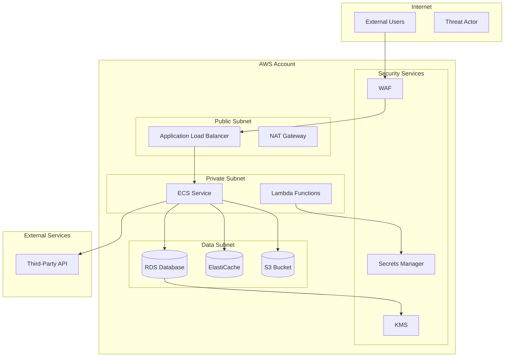

# IaC Security Analysis for Threat Modeling

Analyze Infrastructure-as-Code to extract cloud architecture patterns, security configurations, and potential misconfigurations for threat modeling.

## Analysis Workflow

```
1. IaC discovery           → Identify IaC tools and file locations
2. Resource enumeration    → Catalog cloud resources defined
3. Network topology        → Map VPCs, subnets, security groups
4. Identity & access       → Extract IAM roles, policies, permissions
5. Data storage analysis   → Identify databases, storage, encryption
6. Secrets management      → Find secrets handling patterns
7. Output generation       → Produce threat model inputs
```

## Step 1: IaC Discovery

### Identify IaC Tools in Repository

```bash
# Find all IaC files
find . -type f \( \
  -name "*.tf" -o -name "*.tfvars" -o \
  -name "*.yaml" -o -name "*.yml" -o \
  -name "*.json" -o \
  -name "Pulumi.*" -o \
  -name "serverless.yml" -o \
  -name "*.bicep" -o \
  -name "*.cdk.*" \
\) -not -path "*/node_modules/*" -not -path "*/.terraform/*" 2>/dev/null | head -100

# Categorize by tool
echo "=== TERRAFORM ===" && find . -name "*.tf" -not -path "*/.terraform/*" 2>/dev/null | wc -l
echo "=== CLOUDFORMATION ===" && find . -name "*.yaml" -o -name "*.yml" | xargs grep -l "AWSTemplateFormatVersion\|Resources:\|AWS::" 2>/dev/null | wc -l
echo "=== KUBERNETES ===" && find . -name "*.yaml" -o -name "*.yml" | xargs grep -l "apiVersion:\|kind:" 2>/dev/null | wc -l
echo "=== ANSIBLE ===" && find . -name "*.yaml" -o -name "*.yml" | xargs grep -l "hosts:\|tasks:\|ansible" 2>/dev/null | wc -l
echo "=== PULUMI ===" && find . -name "Pulumi.*" -o -name "__main__.py" -o -name "index.ts" | xargs grep -l "pulumi\|@pulumi" 2>/dev/null | wc -l
echo "=== HELM ===" && find . -name "Chart.yaml" -o -name "values.yaml" 2>/dev/null | wc -l
```

### IaC Tool Identification Matrix

| Files/Patterns | Tool | Cloud Provider |
|----------------|------|----------------|
| `*.tf`, `*.tfvars`, `.terraform/` | Terraform | Multi-cloud |
| `AWSTemplateFormatVersion`, `AWS::` | CloudFormation | AWS |
| `apiVersion:`, `kind: Deployment` | Kubernetes | Multi-cloud |
| `hosts:`, `tasks:`, `playbook` | Ansible | Multi-cloud |
| `Pulumi.yaml`, `@pulumi/` | Pulumi | Multi-cloud |
| `serverless.yml` | Serverless Framework | Multi-cloud |
| `*.bicep`, `Microsoft.` | Bicep/ARM | Azure |
| `google_`, `gcp` | Terraform GCP | GCP |

## Step 2: Resource Enumeration

### Terraform Resources

```bash
# List all resource types
grep -rh "^resource\s" --include="*.tf" | sed 's/resource "\([^"]*\)".*/\1/' | sort | uniq -c | sort -rn

# List all data sources
grep -rh "^data\s" --include="*.tf" | sed 's/data "\([^"]*\)".*/\1/' | sort | uniq -c | sort -rn

# List all modules
grep -rh "^module\s" --include="*.tf" | sed 's/module "\([^"]*\)".*/\1/' | sort | uniq

# Find provider configurations
grep -rn "^provider\s" --include="*.tf"
```

### CloudFormation Resources

```bash
# List all resource types
grep -rh "Type:\s*AWS::" --include="*.yaml" --include="*.yml" --include="*.json" | sed 's/.*Type:\s*//' | sort | uniq -c | sort -rn

# Find nested stacks
grep -rn "AWS::CloudFormation::Stack" --include="*.yaml" --include="*.yml"
```

### Kubernetes Resources

```bash
# List all resource kinds
grep -rh "^kind:" --include="*.yaml" --include="*.yml" | sed 's/kind:\s*//' | sort | uniq -c | sort -rn

# Find namespaces
grep -rh "namespace:" --include="*.yaml" --include="*.yml" | sort | uniq

# List container images
grep -rh "image:" --include="*.yaml" --include="*.yml" | sort | uniq
```

### Resource Category Summary

Generate counts by security-relevant categories:

```bash
echo "=== COMPUTE ===" 
grep -rh "aws_instance\|aws_lambda\|aws_ecs\|aws_eks\|google_compute\|azurerm_virtual_machine\|kind: Deployment\|kind: Pod" --include="*.tf" --include="*.yaml" --include="*.yml" 2>/dev/null | wc -l

echo "=== STORAGE ===" 
grep -rh "aws_s3\|aws_dynamodb\|aws_rds\|google_storage\|azurerm_storage\|kind: PersistentVolume" --include="*.tf" --include="*.yaml" --include="*.yml" 2>/dev/null | wc -l

echo "=== NETWORKING ===" 
grep -rh "aws_vpc\|aws_subnet\|aws_security_group\|aws_lb\|google_compute_network\|azurerm_virtual_network\|kind: Service\|kind: Ingress" --include="*.tf" --include="*.yaml" --include="*.yml" 2>/dev/null | wc -l

echo "=== IAM/IDENTITY ===" 
grep -rh "aws_iam\|google_iam\|azurerm_role\|kind: ServiceAccount\|kind: Role\|kind: ClusterRole" --include="*.tf" --include="*.yaml" --include="*.yml" 2>/dev/null | wc -l
```

## Step 3: Network Topology Analysis

### VPC and Network Structure (Terraform/AWS)

```bash
# VPCs
grep -rn "resource.*aws_vpc\|aws_vpc\." --include="*.tf"

# Subnets (public vs private indicators)
grep -rn "resource.*aws_subnet" --include="*.tf"
grep -rn "map_public_ip_on_launch\s*=\s*true" --include="*.tf"

# Internet/NAT Gateways
grep -rn "aws_internet_gateway\|aws_nat_gateway\|aws_eip" --include="*.tf"

# Route tables
grep -rn "aws_route_table\|aws_route\s" --include="*.tf"
```

### Security Groups and Firewall Rules

```bash
# Security group definitions
grep -rn "resource.*aws_security_group\s" --include="*.tf"

# Ingress rules - look for 0.0.0.0/0
grep -rn -A10 "ingress\s*{" --include="*.tf" | grep -E "cidr_blocks|from_port|to_port|protocol"

# Egress rules
grep -rn -A10 "egress\s*{" --include="*.tf" | grep -E "cidr_blocks|from_port|to_port|protocol"

# DANGEROUS: Open to world
grep -rn "0\.0\.0\.0/0\|::/0" --include="*.tf" --include="*.yaml" --include="*.yml"

# GCP firewall rules
grep -rn "google_compute_firewall" --include="*.tf"

# Azure NSG
grep -rn "azurerm_network_security" --include="*.tf"
```

### Kubernetes Network Policies

```bash
# Network policies
grep -rn "kind: NetworkPolicy" --include="*.yaml" --include="*.yml"

# Ingress definitions
grep -rn "kind: Ingress" --include="*.yaml" --include="*.yml"

# Services (especially LoadBalancer/NodePort)
grep -rn -A5 "type: LoadBalancer\|type: NodePort" --include="*.yaml" --include="*.yml"
```

### Load Balancers and Entry Points

```bash
# AWS Load Balancers
grep -rn "aws_lb\|aws_alb\|aws_elb" --include="*.tf"

# Listener configurations (ports exposed)
grep -rn -A10 "aws_lb_listener\|aws_alb_listener" --include="*.tf" | grep -E "port|protocol|ssl_policy"

# API Gateway
grep -rn "aws_api_gateway\|aws_apigatewayv2" --include="*.tf"

# CloudFront
grep -rn "aws_cloudfront" --include="*.tf"
```

## Step 4: Identity & Access Analysis

### IAM Roles and Policies (AWS)

```bash
# IAM roles
grep -rn "resource.*aws_iam_role\s" --include="*.tf"

# IAM policies
grep -rn "resource.*aws_iam_policy\s\|aws_iam_role_policy\|aws_iam_policy_document" --include="*.tf"

# Policy attachments
grep -rn "aws_iam_role_policy_attachment\|aws_iam_user_policy_attachment" --include="*.tf"

# Inline policies - extract actions
grep -rn -A20 "aws_iam_policy_document" --include="*.tf" | grep -E "actions|resources|effect"

# DANGEROUS: Overly permissive
grep -rn '"*"' --include="*.tf" | grep -i "action\|resource"
grep -rn "iam:*\|s3:*\|ec2:*\|*:*" --include="*.tf"
```

### Service Accounts (Kubernetes)

```bash
# Service accounts
grep -rn "kind: ServiceAccount" --include="*.yaml" --include="*.yml"

# RBAC roles
grep -rn "kind: Role\|kind: ClusterRole" --include="*.yaml" --include="*.yml"

# Role bindings
grep -rn "kind: RoleBinding\|kind: ClusterRoleBinding" --include="*.yaml" --include="*.yml"

# DANGEROUS: Cluster-admin bindings
grep -rn -B5 -A5 "cluster-admin" --include="*.yaml" --include="*.yml"
```

### Cross-Account/Trust Relationships

```bash
# Assume role policies (trust relationships)
grep -rn -A15 "assume_role_policy" --include="*.tf" | grep -E "Principal|AWS|Service|Federated"

# Cross-account access
grep -rn "arn:aws:iam::" --include="*.tf" | grep -v "data\."

# OIDC providers (for K8s service account integration)
grep -rn "aws_iam_openid_connect_provider\|oidc" --include="*.tf"
```

## Step 5: Data Storage Analysis

### Databases

```bash
# RDS instances
grep -rn "aws_db_instance\|aws_rds" --include="*.tf"
grep -rn -A20 "aws_db_instance" --include="*.tf" | grep -E "publicly_accessible|storage_encrypted|engine|multi_az"

# DynamoDB
grep -rn "aws_dynamodb_table" --include="*.tf"
grep -rn -A10 "aws_dynamodb_table" --include="*.tf" | grep -E "server_side_encryption|point_in_time_recovery"

# ElastiCache/Redis
grep -rn "aws_elasticache" --include="*.tf"
grep -rn -A10 "aws_elasticache" --include="*.tf" | grep -E "at_rest_encryption|transit_encryption"

# DocumentDB/MongoDB
grep -rn "aws_docdb\|mongodb" --include="*.tf"
```

### Object Storage

```bash
# S3 buckets
grep -rn "resource.*aws_s3_bucket\s" --include="*.tf"

# Bucket ACLs and policies
grep -rn "aws_s3_bucket_acl\|aws_s3_bucket_policy\|aws_s3_bucket_public_access_block" --include="*.tf"

# DANGEROUS: Public access
grep -rn "public-read\|public-read-write\|authenticated-read" --include="*.tf"
grep -rn "block_public\|restrict_public\|ignore_public" --include="*.tf"

# Encryption
grep -rn "aws_s3_bucket_server_side_encryption" --include="*.tf"

# GCS buckets
grep -rn "google_storage_bucket" --include="*.tf"

# Azure storage
grep -rn "azurerm_storage" --include="*.tf"
```

### Encryption Configuration

```bash
# KMS keys
grep -rn "aws_kms_key\|aws_kms_alias" --include="*.tf"

# Encryption at rest
grep -rn "encrypted\s*=\s*true\|storage_encrypted\|server_side_encryption\|kms_key_id" --include="*.tf"

# DANGEROUS: Encryption disabled
grep -rn "encrypted\s*=\s*false\|storage_encrypted\s*=\s*false" --include="*.tf"
```

## Step 6: Secrets Management Analysis

### Secrets Storage

```bash
# AWS Secrets Manager
grep -rn "aws_secretsmanager\|secretsmanager" --include="*.tf"

# AWS SSM Parameter Store
grep -rn "aws_ssm_parameter" --include="*.tf"
grep -rn -A5 "aws_ssm_parameter" --include="*.tf" | grep "type\|SecureString"

# HashiCorp Vault
grep -rn "vault_\|provider.*vault" --include="*.tf"

# Kubernetes secrets
grep -rn "kind: Secret" --include="*.yaml" --include="*.yml"

# External Secrets Operator
grep -rn "kind: ExternalSecret\|kind: SecretStore" --include="*.yaml" --include="*.yml"
```

### Hardcoded Secrets Detection

```bash
# DANGEROUS: Hardcoded values in tfvars
grep -rn "password\|secret\|api_key\|token\|private_key" --include="*.tfvars" --include="*.auto.tfvars"

# Potential secrets in default values
grep -rn -A2 "default\s*=" --include="*.tf" | grep -i "password\|secret\|key\|token"

# Base64 encoded secrets in K8s
grep -rn -A5 "kind: Secret" --include="*.yaml" --include="*.yml" | grep "data:"

# DANGEROUS: Secrets not from secure sources
grep -rn "password\s*=\s*\"[^$]" --include="*.tf"
```

### Environment Variables

```bash
# Lambda environment variables
grep -rn -A10 "environment\s*{" --include="*.tf" | grep -E "variables|sensitive"

# ECS task definitions
grep -rn -A20 "container_definitions" --include="*.tf" | grep -E "environment|secrets|valueFrom"

# K8s env vars
grep -rn -A10 "env:" --include="*.yaml" --include="*.yml" | grep -E "name:|value:|valueFrom:|secretKeyRef"
```

## Step 7: Security Misconfiguration Detection

### Common Misconfigurations Checklist

```bash
echo "=== CHECKING COMMON MISCONFIGURATIONS ==="

# Public S3 buckets
echo "Public S3:" && grep -rn "acl.*public\|block_public.*false" --include="*.tf" | wc -l

# Open security groups  
echo "Open SGs (0.0.0.0/0):" && grep -rn "0\.0\.0\.0/0" --include="*.tf" | wc -l

# Unencrypted storage
echo "Unencrypted:" && grep -rn "encrypted.*false\|storage_encrypted.*false" --include="*.tf" | wc -l

# Public RDS
echo "Public RDS:" && grep -rn "publicly_accessible.*true" --include="*.tf" | wc -l

# Privileged containers
echo "Privileged K8s:" && grep -rn "privileged.*true\|runAsRoot\|allowPrivilegeEscalation.*true" --include="*.yaml" --include="*.yml" | wc -l

# Missing logging
echo "CloudTrail/Logging:" && grep -rn "aws_cloudtrail\|logging\|access_logs" --include="*.tf" | wc -l

# Wildcard IAM
echo "Wildcard IAM:" && grep -rn '"*"\|iam:\*\|s3:\*' --include="*.tf" | wc -l
```

### Kubernetes Security Context

```bash
# Security contexts
grep -rn -A10 "securityContext:" --include="*.yaml" --include="*.yml"

# DANGEROUS patterns
grep -rn "privileged:\s*true" --include="*.yaml" --include="*.yml"
grep -rn "runAsUser:\s*0\|runAsRoot" --include="*.yaml" --include="*.yml"
grep -rn "allowPrivilegeEscalation:\s*true" --include="*.yaml" --include="*.yml"
grep -rn "hostNetwork:\s*true\|hostPID:\s*true\|hostIPC:\s*true" --include="*.yaml" --include="*.yml"

# Capabilities
grep -rn -A5 "capabilities:" --include="*.yaml" --include="*.yml" | grep -E "add:|drop:|SYS_ADMIN|NET_ADMIN|ALL"
```

### Logging and Monitoring

```bash
# CloudTrail
grep -rn "aws_cloudtrail" --include="*.tf"

# CloudWatch
grep -rn "aws_cloudwatch\|log_group\|log_stream" --include="*.tf"

# VPC Flow Logs
grep -rn "aws_flow_log" --include="*.tf"

# GuardDuty/Security Hub
grep -rn "aws_guardduty\|aws_securityhub" --include="*.tf"

# K8s audit logging
grep -rn "audit\|logging" --include="*.yaml" --include="*.yml" | grep -v "^#"
```

## Output Generation

### Infrastructure Inventory Template

```markdown
# Infrastructure Analysis: [Repository Name]

## IaC Overview
- **Primary Tool**: [Terraform | CloudFormation | Kubernetes | etc.]
- **Cloud Provider(s)**: [AWS | GCP | Azure | Multi-cloud]
- **Environments Detected**: [dev | staging | prod]

## Resource Summary
| Category | Count | Key Resources |
|----------|-------|---------------|
| Compute | | |
| Storage | | |
| Networking | | |
| IAM/Identity | | |
| Databases | | |

## Network Topology
| VPC/Network | Subnets | Internet-Facing | Notes |
|-------------|---------|-----------------|-------|
| | | | |

## Trust Boundaries
1. **Internet → Public Subnet**: [Load balancers, API gateways]
2. **Public → Private Subnet**: [Application layer]
3. **Application → Data Tier**: [Databases, caches]
4. **Internal → External Services**: [Third-party APIs]

## Entry Points (Attack Surface)
| Entry Point | Type | Port(s) | Auth | Notes |
|-------------|------|---------|------|-------|
| ALB | Load Balancer | 443 | | |
| API GW | API Gateway | 443 | Cognito | |

## IAM Summary
| Role/Identity | Trust | Key Permissions | Risk Level |
|---------------|-------|-----------------|------------|
| | | | |

## Data Stores
| Resource | Type | Encryption | Public | Backup |
|----------|------|------------|--------|--------|
| | | | | |

## Security Controls Present
- [ ] VPC with private subnets
- [ ] Security groups with least privilege
- [ ] Encryption at rest
- [ ] Encryption in transit
- [ ] IAM with least privilege
- [ ] Secrets management
- [ ] Logging enabled
- [ ] Backup/DR configured

## Misconfigurations Found
| Finding | Resource | Severity | Details |
|---------|----------|----------|---------|
| | | | |
```

### Network Diagram (Mermaid)

```markdown
## Infrastructure Diagram


```

## Quick Reference Commands

### One-liner IaC Scan

```bash
# Comprehensive quick scan (run from repo root)
echo "=== IAC FILES ===" && find . -name "*.tf" -o -name "*.yaml" -o -name "*.yml" | grep -v node_modules | wc -l && \
echo "=== RESOURCES ===" && grep -rh "^resource\|Type: AWS::\|^kind:" --include="*.tf" --include="*.yaml" --include="*.yml" 2>/dev/null | wc -l && \
echo "=== OPEN TO INTERNET ===" && grep -rn "0\.0\.0\.0/0" --include="*.tf" --include="*.yaml" 2>/dev/null | wc -l && \
echo "=== IAM WILDCARDS ===" && grep -rn '"\*"' --include="*.tf" 2>/dev/null | wc -l && \
echo "=== UNENCRYPTED ===" && grep -rn "encrypted.*false" --include="*.tf" 2>/dev/null | wc -l
```

## Additional References

For deeper analysis, consult these reference files:

- **[references/terraform-patterns.md](references/terraform-patterns.md)**: Detailed patterns for Terraform security analysis across AWS, GCP, and Azure resources.

- **[references/kubernetes-patterns.md](references/kubernetes-patterns.md)**: Kubernetes-specific security patterns, RBAC analysis, and pod security standards.

- **[references/iac-stride-mapping.md](references/iac-stride-mapping.md)**: Maps infrastructure findings to STRIDE threat categories for cloud environments.