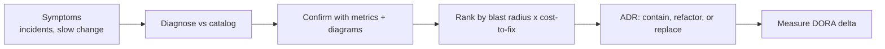

# Architecture Anti-Patterns

Anti-patterns are recurring "solutions" that look reasonable locally and fail systemically. Naming them precisely shortens debate, justifies refactors, and sharpens reviews.

## Stack Baseline (2026)
| Concern | Recommended |
| --- | --- |
| Catalog reference | Richards & Ford, *Fundamentals of Software Architecture* 2e (anti-patterns chapter) |
| Distributed pitfalls | Richards & Ford, *The Hard Parts* |
| Detection signals | DORA metrics regression, change-failure rate, MTTR, lead time |
| Visualization | C4 component + dependency graph (Structurizr) |
| Decision capture | ADR with "trigger to revisit" |
| Radar context | ThoughtWorks Tech Radar Hold ring |

## When to Use
- System audit or due diligence.
- Architecture review where the team is defending a fragile design.
- Post-incident analysis showing systemic (not local) cause.
- Framing a refactor or re-platform business case.

## Prerequisites
- Read access to code, deployment topology, and runtime metrics.
- A list of recent incidents and change-failure data (last 90 days).
- A C4 container diagram (or willingness to draw one).

## Instructions



1. **Collect symptoms**: incident timeline, lead-time trend, deploy coupling, on-call load.
2. **Match against the catalog** below; require at least two independent signals per match.
3. **Rank** anti-patterns by blast radius (users x revenue x compliance) divided by cost-to-fix.
4. **Decide** per item: contain (guardrails), refactor (strangler fig), or replace.
5. **Track** DORA + reliability deltas after each remediation.

```markdown
# Anti-Pattern Quick Reference

| Anti-pattern | Telltale signal | First move |
|---|---|---|
| Big Ball of Mud | No module boundaries, cyclic deps | Modularization sprint, ArchUnit fitness functions |
| Distributed Monolith | Services deploy together, shared DB | Re-establish contracts; split data |
| Golden Hammer | Same tech for every problem | Force option analysis in ADRs |
| Vendor Lock-in | Business logic in vendor SDK | Hexagonal port; abstraction + exit plan |
| Premature Microservices | More services than teams | Recompose into modular monolith |
| Lava Flow | Dead code, unused features | Delete with confidence via tests + telemetry |
| God Service | One service owns most domains | Bounded-context split (DDD) |
| Shared Database | Cross-service writes to same tables | Database-per-service + outbox pattern |
| Reporting on OLTP | Analytics queries kill prod | CDC to warehouse / lakehouse |
| Synchronous chains | One slow hop tanks everything | Async + bulkheads + timeouts |
```

## Common Pitfalls
| Pitfall | Why it hurts | Fix |
| --- | --- | --- |
| Naming without evidence | Becomes blame, not analysis | Require two metric signals per label |
| Big-bang rewrites | New system inherits old anti-patterns | Strangler fig with measurable milestones |
| Treating symptoms locally | Same anti-pattern reappears | Address root cause + add fitness function |
| Ignoring socio-technical cause | Conway's Law re-creates the mess | Adjust team boundaries with topology change |
| No revisit trigger | Containment becomes permanent | ADR includes metric threshold to revisit |

## Output Format
- An audit report listing detected anti-patterns with evidence and blast-radius scores.
- A prioritized remediation backlog (contain / refactor / replace).
- ADRs for each accepted remediation with trigger metrics.
- A fitness-function suite (ArchUnit, dependency rules) to prevent regression.

## Authoritative References
- Mark Richards & Neal Ford, *Fundamentals of Software Architecture*, 2e (O'Reilly, 2024).
- Mark Richards & Neal Ford, *Software Architecture: The Hard Parts* (O'Reilly).
- Brian Foote & Joseph Yoder, *Big Ball of Mud* (laputan.org/mud).
- Eberhard Wolff, writings on modular monolith vs microservices — ewolff.com.
- ThoughtWorks Technology Radar — Hold ring entries.
- GitHub ADR templates — github.com/joelparkerhenderson/architecture-decision-record.
