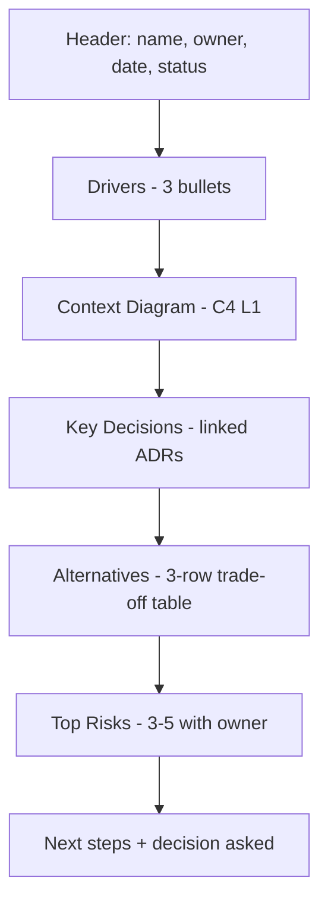

# Architecture Brief

The brief is a single page that lets a busy reader grasp the system, the bets, and the risks in five minutes - and decide whether to dig deeper. It sits above ADRs and RFCs and links to them. Think IETF abstract crossed with arc42 sections 1, 4, 9, and 11.

## Stack Baseline (2026)
| Concern | Recommended |
|---|---|
| Length | One printed page (~400-500 words + 1 diagram) |
| Format | Markdown in repo (`docs/architecture/brief.md`) |
| Diagram | C4 Level 1 (System Context) - embedded |
| Decisions | Linked, never inlined (ADR/RFC IDs) |
| Risks | Top 3-5 only, with owner |
| Alternatives | Trade-off table, max 3 options |
| Refresh | Reviewed every release; expires after 6 months |

## When to Use
- New project kickoff or funding request.
- Vendor or tooling evaluation summary.
- Onboarding a new exec, VP, or partner team.
- Pre-read for an architecture review board.

Do **not** use this skill for engineering deep-dives (use `rfc-template`) or for slide presentations (use `stakeholder-presentation`).

## Prerequisites
- C4 Level 1 context diagram exists.
- At least one ADR covering the headline decision.
- Quality attributes (top 3 NFRs) agreed with the product owner.
- Named owner of the brief (single throat to choke).

## Instructions

### 1. Structure on the page


### 2. Template
```markdown
# Architecture Brief - <System Name>
**Owner:** @handle  **Status:** Draft | Active | Superseded
**Version:** 2026.04  **Next review:** 2026-07-31

## Drivers
- Business: <one line, with metric>
- User: <one line, with metric>
- Constraint: <regulatory, budget, deadline>

## Context
<embedded C4 L1 diagram>

## Key decisions
| ID | Decision | Link |
|----|----------|------|
| ADR-014 | Postgres over DynamoDB for orders | /docs/adr/014.md |
| ADR-017 | Temporal for sagas | /docs/adr/017.md |
| RFC-0021 | Front door on Cloudflare | /rfcs/0021.md |

## Quality attributes (top 3)
| Attribute | Target | How measured |
|---|---|---|
| Availability | 99.95% monthly | SLO burn rate |
| p95 checkout latency | < 400 ms | RUM + synthetic |
| Recovery (RPO/RTO) | 5 min / 30 min | Quarterly DR test |

## Alternatives considered
| Option | Pros | Cons | Verdict |
|---|---|---|---|
| Monolith | Simple ops | Coupling, scaling | Rejected |
| Microservices (chosen) | Team autonomy | Ops cost | Selected |
| Serverless | Lowest ops | Cold starts, lock-in | Deferred |

## Top risks
| ID | Risk | Mitigation | Owner |
|----|------|------------|-------|
| R-01 | Aurora cutover during peak | Freeze window, dry runs | @data |
| R-02 | IdP vendor delay | Parallel POC | @platform |
| R-03 | OTel agent regression | Pinned version + canary | @sre |

## Decision asked
<one sentence: what do you need from the reader?>
```

### 3. Authoring rules
- Hard limit one page when printed at 100% (validate by exporting PDF).
- Diagram is **always** C4 L1 - no L2/L3 in the brief.
- Decisions link out; never paste ADR contents.
- Every risk has a named human owner.
- Status and next-review date at the top - briefs expire.

### 4. Lifecycle
- Created at project kickoff.
- Reviewed at every release or quarterly, whichever sooner.
- Marked `Superseded` and replaced - never silently edited beyond minor fixes.

## Common Pitfalls
| Pitfall | Symptom | Fix |
|---|---|---|
| Two pages | Reader skims, misses ask | Cut to one - move detail to ADR/RFC |
| ADRs pasted in | Brief becomes a design doc | Link only |
| No ask | Reader unsure why they read it | "Decision asked" line at the end |
| Stale | Status says Active, content from 2024 | Expiry date enforced |
| Diagram-free | Wall of text | Always embed C4 L1 |

## Output Format
- `docs/architecture/brief.md` in the system repo.
- PDF export for distribution (regenerated, never hand-edited).
- Linked from team README and the architecture index.
- Superseded versions kept in `docs/architecture/archive/YYYY-MM/`.

## Authoritative References
- Simon Brown, C4 Model - https://c4model.com
- arc42 8.x (sections 1, 4, 9, 11) - https://docs.arc42.org
- MADR 4.0 - https://adr.github.io/madr/
- ISO/IEC/IEEE 42010:2022 - Architecture description.
- Barbara Minto, *The Pyramid Principle* (for ordering content top-down).
- IETF RFC 7322 (abstracts as a model for one-page summaries).
