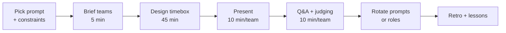

# Architecture Kata

The kata gives architects deliberate practice on unfamiliar problems under time pressure, then exposes their reasoning to peer critique. It is the gym for trade-off thinking.

## Stack Baseline (2026)
| Concern | Recommended |
| --- | --- |
| Format origin | Ted Neward, neward.net/architecturalkatas |
| Group size | 3-5 per team; 2-4 teams per session |
| Timebox | 45 min design + 10 min present + 10 min Q&A per team |
| Modeling | C4 Context + Container; whiteboard or Excalidraw/Structurizr |
| Scoring | Rubric across functional fit, NFRs, risks, communication |
| Reference text | Richards & Ford, *Fundamentals of Software Architecture* 2e |

## When to Use
- Quarterly guild or chapter practice session.
- Onboarding a cohort of new senior engineers / architects.
- Hiring loop calibration so interviewers share a bar.
- Pre-launch dry run for a real upcoming design.

## Prerequisites
- Facilitator + scribe + at least one experienced "judge".
- A pool of katas (3-5 prompts) with documented constraints and NFRs.
- Whiteboards / shared canvases per team; a visible timer.
- Published scoring rubric circulated beforehand.

## Instructions



1. **Pick the prompt** with explicit constraints (users, geography, regulatory, budget, timeline) and 3-5 NFR targets.
2. **Brief** all teams identically; clarify what is in-scope and what is fixed.
3. **Design timebox** (45 min): teams produce C4 Context + Container, key ADRs (3-5), and a risk list.
4. **Present** in 10 min: problem framing, design, top trade-offs, top risks.
5. **Judge** with the rubric; ask the "what would change your mind?" question every time.
6. **Retro** across teams: surface common misses (NFR neglect, pattern overreach, missing data design).

```markdown
# Kata Prompt Template

## Problem
<one paragraph>

## Users & Scale
- Daily active users: ...
- Peak QPS: ...
- Geography: ...

## Constraints
- Regulatory: ...
- Budget / team size: ...
- Timeline: ...

## Quality Attribute Targets
- Availability: ...
- Latency p99: ...
- Durability: ...
- Security: ...

## Out of Scope
- ...

## Deliverables (45 min)
1. C4 Context + Container diagram
2. 3-5 ADRs (one-liners ok)
3. Top 5 risks with mitigations
```

```markdown
# Scoring Rubric (1-5 per row)

| Dimension | Notes |
|---|---|
| Requirements understood | Clarifying questions, scope discipline |
| NFR coverage | Each target addressed with evidence |
| Pattern fit | Justified against drivers, not fashion |
| Data design | Access patterns, consistency, evolution |
| Failure modes | Bulkheads, timeouts, blast radius |
| Trade-off articulation | What rejected, why, revisit trigger |
| Communication | Diagram clarity, time management |
```

## Common Pitfalls
| Pitfall | Why it hurts | Fix |
| --- | --- | --- |
| Vague prompt | Teams diverge on scope, can't compare | Fix constraints + NFR numbers up front |
| No timebox enforcement | Reviews drag, lessons lost | Visible timer; cut hard at the bell |
| Solo dominators | Group doesn't actually practice | Rotate scribe + presenter every kata |
| Beauty-contest judging | Style over substance | Use the rubric; require evidence per score |
| No retro | Same misses next quarter | 20-min cross-team retro with named lessons |
| One-pattern teams | Reinforces Golden Hammer | Mix experience levels and tech backgrounds |

## Output Format
- A kata prompt pack (markdown) with constraints and NFRs.
- Per-team artifacts: C4 diagrams, mini-ADRs, risk list.
- Scored rubric sheets per team and per round.
- A retro doc capturing top 3 lessons and follow-up reading.

## Authoritative References
- Ted Neward, Architecture Kata format — neward.net/architecturalkatas.
- Mark Richards & Neal Ford, *Fundamentals of Software Architecture*, 2e (O'Reilly, 2024).
- Mark Richards & Neal Ford, *Software Architecture: The Hard Parts* (O'Reilly).
- Simon Brown, c4model.com and Structurizr DSL.
- O'Reilly Software Architecture Conference / GOTO katas archives.
- ThoughtWorks Technology Radar — thoughtworks.com/radar.
