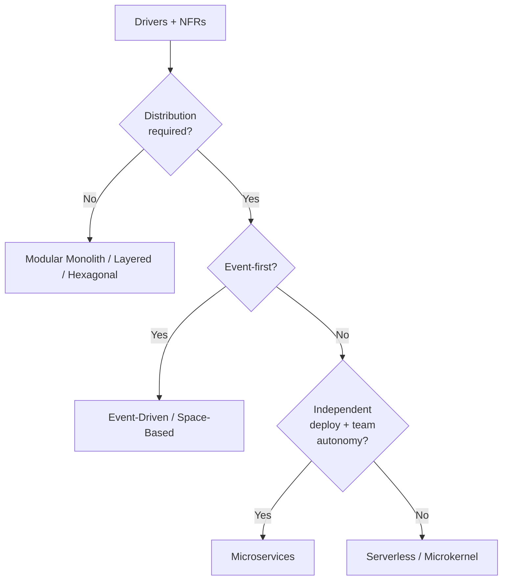

# Architecture Patterns Catalog

Patterns are not goals; they are pre-evaluated trade-off bundles. Use this catalog to shortlist candidates against your quality-attribute drivers, then validate with a spike or ATAM-lite before committing.

## Stack Baseline (2026)
| Concern | Recommended |
| --- | --- |
| Pattern source-of-truth | Richards & Ford, *Fundamentals of Software Architecture* 2e |
| Distributed trade-offs | Richards & Ford, *Software Architecture: The Hard Parts* |
| Modeling | C4 (c4model.com) + Structurizr DSL |
| Documentation | arc42 template, ADRs in repo |
| Radar input | ThoughtWorks Technology Radar, latest volume |
| Default for new systems | Modular monolith first, extract services on evidence |

## When to Use
- Greenfield system or major rewrite where the macro-style is open.
- Re-platforming when current style fails NFRs (e.g., scale, deploy independence).
- Producing options for an ADR or steering-committee decision.

## Prerequisites
- Documented drivers: top 3-5 quality attributes with measurable targets.
- Team Topologies snapshot (stream-aligned, platform, enabling, complicated-subsystem).
- Honest baselines: data volume, request rates, change frequency, regulatory scope.

## Instructions



1. **Frame drivers** in one page (workload, scale, change rate, regulatory, team count).
2. **Score candidates** from the catalog below against drivers using a 1-5 rubric.
3. **Spike** the top two for 1-2 weeks on the riskiest quality attribute.
4. **Decide via ADR** referencing scores, spike results, and reversibility cost.

```markdown
# Catalog (selection criteria)

| Pattern | Strengths | Weaknesses | Pick when |
|---|---|---|---|
| Layered | Simple, ubiquitous | Couples around DB, weak modularity | Small CRUD apps |
| Hexagonal (Ports & Adapters) | Testable, swappable I/O | Boilerplate | Domain-rich apps, many integrations |
| Microkernel (Plug-in) | Extensibility | Plug-in contracts brittle | Product platforms with 3rd-party features |
| Modular Monolith | Fast, cohesive, refactor-friendly | Single deploy unit | Default for most new systems in 2026 |
| Event-Driven | Decoupling, async scale | Eventual consistency, debugging | Reactive flows, integration backbones |
| Microservices | Independent deploy/scale | Distributed complexity, ops cost | Many autonomous teams, proven domains |
| Space-Based | Extreme elasticity | Data grid complexity | Bursty, high-throughput workloads |
| Serverless | Pay-per-use, low ops | Cold starts, vendor lock-in | Event glue, spiky workloads |
```

## Common Pitfalls
| Pitfall | Why it hurts | Fix |
| --- | --- | --- |
| Microservices by default | Distributed monolith, ops drag | Start modular monolith; extract on pain |
| Pattern picked from a blog | Ignores local drivers | Score against measurable NFRs |
| One pattern for the whole org | Misfit per bounded context | Allow per-context style; document boundaries |
| Skipping the spike | Trade-offs found in production | 1-2 week spike on the riskiest NFR |
| No ADR | Decision lost, re-litigated | Record options, scores, and trigger to revisit |

## Output Format
- A driver/NFR one-pager.
- A scored options table (markdown) with at least three candidates.
- Spike reports for top two patterns.
- An accepted ADR linking to all of the above.

## Authoritative References
- Mark Richards & Neal Ford, *Fundamentals of Software Architecture*, 2e (O'Reilly, 2024).
- Mark Richards & Neal Ford, *Software Architecture: The Hard Parts* (O'Reilly).
- Eberhard Wolff, *Software Architecture Foundations* — modular monolith guidance.
- Simon Brown, c4model.com and Structurizr DSL.
- arc42 template — arc42.org.
- ThoughtWorks Technology Radar — thoughtworks.com/radar.
