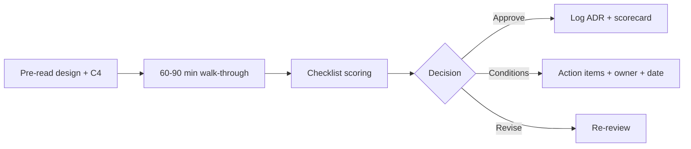

# Architecture Review Checklist

A focused, repeatable review that fits in 60-90 minutes. It complements (not replaces) ATAM for high-stakes systems and prevents review theater by tying each question to evidence and a decision (approve, approve-with-conditions, revise, reject).

## Stack Baseline (2026)
| Concern | Recommended |
| --- | --- |
| Inputs | Design doc / RFC, C4 model, ADR(s), threat model |
| Quality model | ISO/IEC 25010:2023 |
| Security | OWASP ASVS 5.0, STRIDE, SAMM 2 |
| Reliability | Google SRE workbook, error budgets |
| Cost | FinOps Framework 2025, unit-cost model |
| Tooling | Backstage scorecards, Structurizr, Miro/Excalidraw |
| Reference | SEI Architecture Tradeoff Analysis Method (ATAM) |

## When to Use
- New service, major refactor, or cross-team integration.
- Pre-production / launch readiness.
- ADR with material cost, risk, or reversibility concerns.
- Periodic health check on tier-1 systems.

## Prerequisites
- C4 (Context + Container minimum) and data flow diagram.
- Current ADRs and known constraints.
- Quality attribute scenarios with thresholds.
- Reviewer panel: architecture, security, SRE, product.

## Instructions



1. **Pre-read** (24h ahead). Reviewers comment async on the doc; live session resolves only open issues.
2. **Walk** the checklist categories below; capture evidence link, not opinion.
3. **Score** each category Red/Amber/Green with a one-line justification.
4. **Decide** explicitly; record action items with owner and due date in the ADR.
5. **Publish** to Backstage scorecard so trend is visible across the portfolio.

```yaml
# review-template.yaml
system: payments-orchestrator
adr: ADR-0042
categories:
  context_and_drivers:    { score: G, evidence: "doc s.1; OKR link" }
  quality_attributes:     { score: A, evidence: "p95 budget defined; availability TBD" }
  security:               { score: A, evidence: "STRIDE done; ASVS L2 gaps in auth" }
  data:                   { score: G, evidence: "PII map; retention 30d" }
  reliability_ops:        { score: G, evidence: "SLO 99.9; runbook linked" }
  cost_finops:            { score: A, evidence: "unit cost $0.004/tx; no budget alert" }
  evolvability:           { score: G, evidence: "fitness functions in CI" }
  compliance:             { score: G, evidence: "SOC2 CC mapping" }
decision: approve-with-conditions
actions:
  - { owner: sec-team, due: 2026-05-30, item: "Close ASVS L2 auth gaps" }
```

**Checklist categories**
- Context & drivers: business goal, constraints, principles cited.
- Quality attributes: measurable scenarios, fitness functions exist.
- Security: threat model, ASVS level, secrets, supply chain (SLSA).
- Data: classification, residency, retention, lineage, contracts.
- Reliability & ops: SLO/error budget, runbook, observability, DR.
- Cost / FinOps: unit cost, budget alerts, scaling profile.
- Evolvability: coupling, modularity, deprecation strategy.
- Compliance: ISO 27001, GDPR, sector-specific (HIPAA, EU AI Act).

## Common Pitfalls
| Pitfall | Mitigation |
| --- | --- |
| Review without pre-read | Cancel session; reschedule |
| Opinions instead of evidence | Require link/artifact per item |
| No decision recorded | Template forces explicit decision + actions |
| Same checklist for all tiers | Tier 1/2/3 variants; tier 3 self-service |
| Action items vanish | Tracked as JIRA + Backstage scorecard |

## Output Format
- Completed `review-template.yaml` attached to ADR.
- Backstage scorecard updated.
- Action items tracked in issue system with due dates.

## Authoritative References
- SEI, *Evaluating a Software Architecture (ATAM)*.
- ISO/IEC 25010:2023 product quality model.
- OWASP ASVS 5.0; OWASP SAMM 2.
- Google, *Site Reliability Workbook*.
- FinOps Foundation, *FinOps Framework* 2025.
