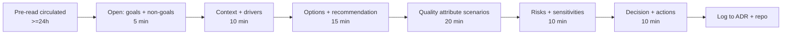

# Architecture Review Facilitation

A good architecture review converts a proposal into a binding decision plus a small set of owned actions. The facilitator's job is structure, time, and psychological safety - not to be the smartest person in the room.

## Stack Baseline (2026)
| Concern | Recommended |
| --- | --- |
| Method | ATAM-lite (SEI) tailored to a 60-90 min slot |
| Inputs | RFC/ADR draft, C4 diagrams, NFR targets, alternatives considered |
| Decision capture | ADR (accepted/rejected/superseded) committed to repo |
| Quality lens | ISO/IEC 25010:2023 quality attributes |
| Tooling | Structurizr or PlantUML for C4; markdown ADRs in GitHub |
| Cadence | Weekly review slot; pre-read 24h prior |

## When to Use
- Significant new system, integration, or pattern change.
- Cross-team dependency or platform impact.
- Reversibility cost is high (data shape, security boundary, vendor).
- Disagreement that won't resolve in async comments.

## Prerequisites
- An RFC/ADR draft circulated >=24h beforehand with: context, options, NFRs, recommendation.
- Right people in the room: proposer, reviewers, security/SRE/data as needed, decision owner.
- Explicit decision rights (RACI) - who can say yes.
- A scribe (not the facilitator).

## Instructions



1. **Open** with the decision being asked, the decision owner, and non-goals.
2. **Frame context** and drivers; confirm NFR targets are measurable.
3. **Walk options**, including the rejected ones; require the proposer to steelman alternatives.
4. **Run quality-attribute scenarios** ATAM-lite style: pick top 3 NFRs, walk one scenario each.
5. **Surface risks, sensitivities, trade-off points**; the scribe captures verbatim.
6. **Decide**: accept / accept-with-conditions / reject / defer with explicit revisit trigger.
7. **Log** to ADR within 24h; assign owners and dates to every action.

```markdown
# Review Minutes Template

Date / Facilitator / Scribe / Decision owner

## Decision asked
<one sentence>

## Outcome
[ ] Accepted  [ ] Accepted with conditions  [ ] Rejected  [ ] Deferred

## Conditions / Revisit trigger
- ...

## Risks captured
| Risk | Sensitivity | Owner |

## Actions
| # | Action | Owner | Due |

## ADR link
PR #...
```

## Common Pitfalls
| Pitfall | Why it hurts | Fix |
| --- | --- | --- |
| No pre-read | Meeting becomes a reading session | Cancel if pre-read not circulated 24h prior |
| Unclear decision rights | Discussion without resolution | Name the decision owner in the invite |
| Loudest voice wins | Bad decisions, low trust | Time-boxed rounds; written input first |
| No NFR scenarios | Trade-offs stay implicit | Force ATAM-lite scenarios for top 3 attributes |
| Decision lost | Re-litigated next quarter | ADR merged within 24h; linked from minutes |
| Action items without owners | Nothing happens | Every action has a name and a date |

## Output Format
- Pre-read RFC/ADR draft (markdown) with options and NFRs.
- Meeting minutes from the template above (in the repo, not a chat thread).
- Merged ADR with status, decision, consequences, and revisit trigger.
- Tracked action items with owners and due dates.

## Authoritative References
- ATAM and quality-attribute workshops — SEI, sei.cmu.edu.
- Mark Richards & Neal Ford, *Fundamentals of Software Architecture*, 2e (O'Reilly, 2024).
- Gregor Hohpe, *The Software Architect Elevator* — chapters on decisions and influence.
- Michael Nygard, "Documenting Architecture Decisions" — cognitect.com/blog.
- GitHub ADR community — github.com/joelparkerhenderson/architecture-decision-record.
- arc42 communication views — arc42.org.
