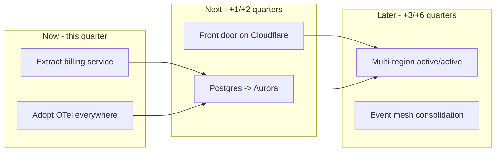
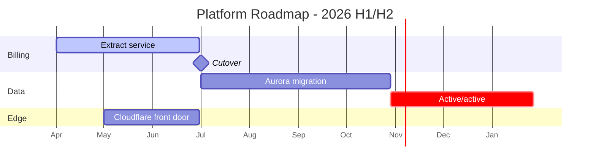

# Architecture Roadmap

A roadmap turns a target architecture into a sequenced, dependency-aware investment plan. This skill combines Now/Next/Later swimlanes, a Gantt-style milestone view, Wardley evolution, and explicit risk markers - so leadership sees value flow and engineers see the critical path.

## Stack Baseline (2026)
| Concern | Recommended |
|---|---|
| Horizon | 4-6 quarters; never beyond 18 months |
| Buckets | Now / Next / Later (Janna Bastow) plus a Parked column |
| Dependencies | Explicit cross-stream arrows, no hidden coupling |
| Risk | RAID markers (R/A/I/D) on each milestone |
| Evolution | Wardley Map for capability movement (Genesis -> Custom -> Product -> Commodity) |
| Team alignment | Team Topologies stream-aligned/platform/enabling tags |
| Tooling | Mermaid Gantt + ProductPlan/Aha! or markdown table |

## When to Use
- Annual or quarterly platform planning.
- Migration programmes (cloud, datastore, framework upgrades).
- Communicating sequencing trade-offs to a steering committee.
- Aligning multiple squads around a shared platform direction.

## Prerequisites
- Agreed target architecture (C4 L2 of the future state).
- Capacity model per squad for the next 2 quarters.
- Known regulatory or contractual hard dates.
- ADRs covering the major bets the roadmap depends on.

## Instructions

### 1. Now / Next / Later view

### 2. Gantt with milestones

### 3. Wardley evolution overlay
| Capability | Today | Target | Move |
|---|---|---|---|
| Auth | Custom-built | Product (IdP) | Buy |
| Billing | Product | Custom (extracted) | Build |
| Observability | Custom | Commodity (OTel SaaS) | Adopt |
| CI/CD | Product | Commodity | Consolidate |

### 4. Risk markers (RAID)
| ID | Type | Item | Mitigation | Owner |
|---|---|---|---|---|
| R-01 | Risk | Aurora cutover during peak | Freeze + dry runs | @data-lead |
| A-02 | Assumption | Cloudflare contract by Q3 | Procurement track | @cto-office |
| I-03 | Issue | OTel agent CPU regression | Vendor ticket open | @sre |
| D-04 | Dependency | IdP migration before billing cutover | Sequenced in Gantt | @platform |

### 5. Governance cadence
- Monthly: roadmap review with squad leads (30 min).
- Quarterly: re-baseline with leadership; archive prior version with date.
- Every change to a milestone updates the linked ADR/RFC.

## Common Pitfalls
| Pitfall | Symptom | Fix |
|---|---|---|
| Wishlist | 40 items, no sequencing | Force Now/Next/Later limits (max 5 in Now) |
| Hidden dependencies | Slip in one stream surprises another | Explicit arrows + RAID `D` entries |
| Date theatre | Precise dates 12 months out | Quarters beyond Now; dates only in Now |
| No evolution view | Build vs buy debates repeat | Include Wardley overlay |
| Disconnected from teams | Plan ignores capacity | Tag each item with owning team (Team Topologies) |

## Output Format
- `docs/roadmap/2026-Hx.md` with Mermaid Gantt + tables.
- One-page export for steering committee (PDF).
- Living link in the team handbook; previous version archived by date.
- Each milestone links to its RFC/ADR.

## Authoritative References
- Janna Bastow - Now/Next/Later roadmaps - https://www.prodpad.com/blog/the-now-next-later-roadmap/
- Simon Wardley, Wardley Maps - https://learnwardleymapping.com
- Matthew Skelton & Manuel Pais, *Team Topologies* (2nd ed., IT Revolution).
- arc42 8.x section 4 (Solution Strategy) - https://docs.arc42.org
- Mermaid Gantt - https://mermaid.js.org/syntax/gantt.html
- ISO/IEC/IEEE 42010:2022.
